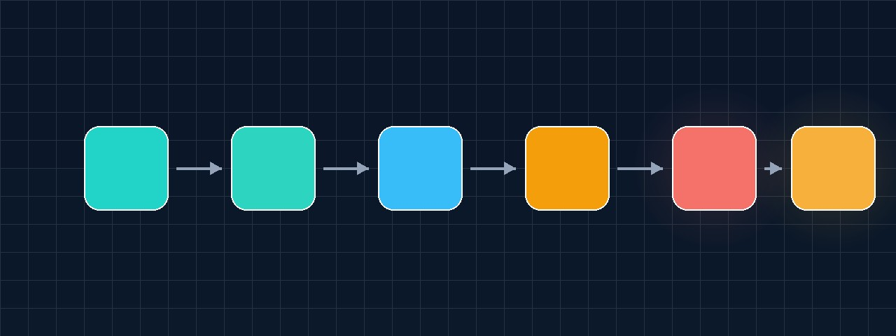
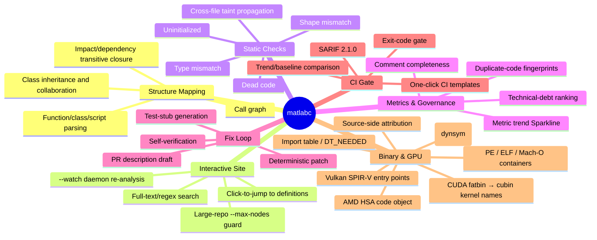
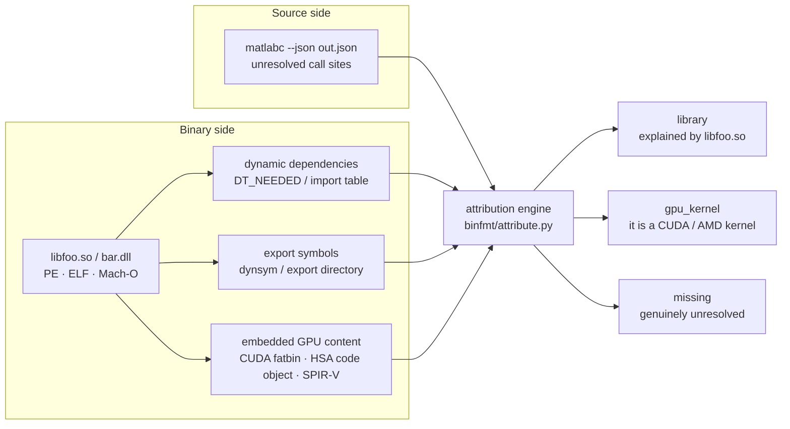
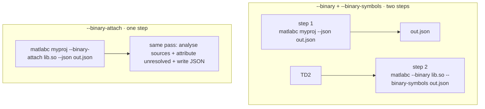
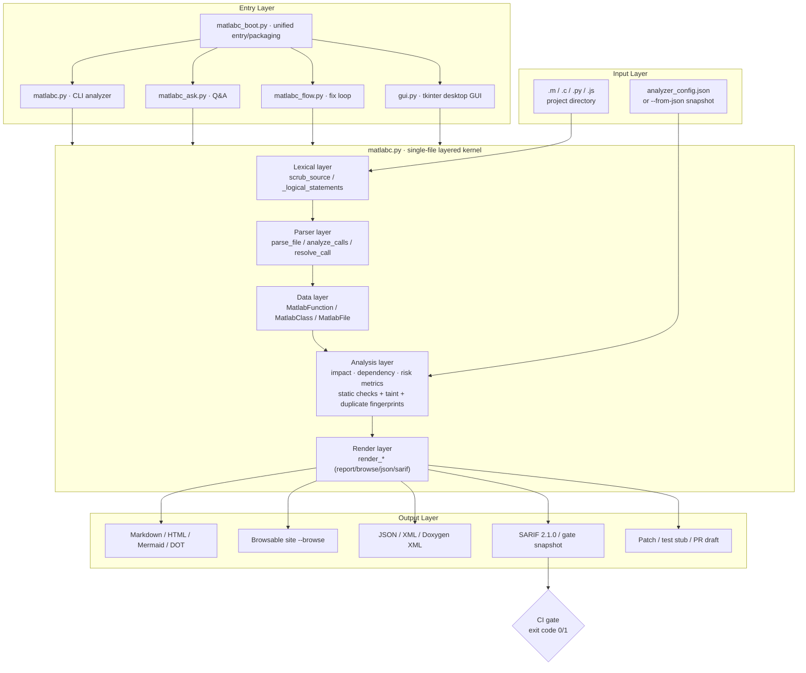
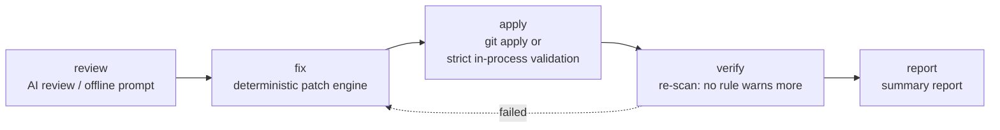
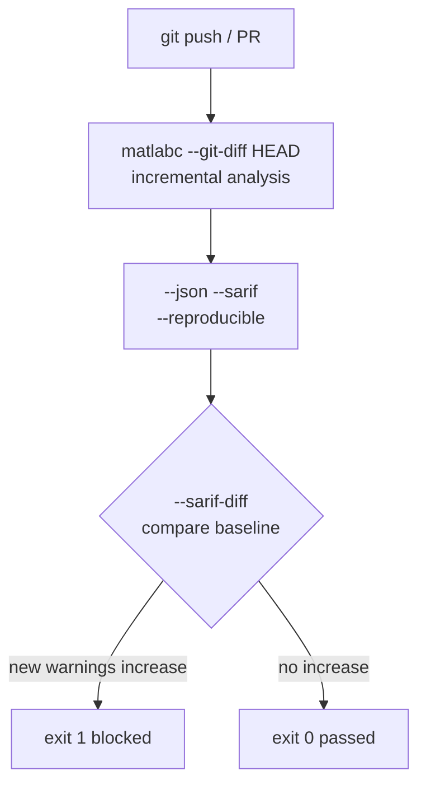
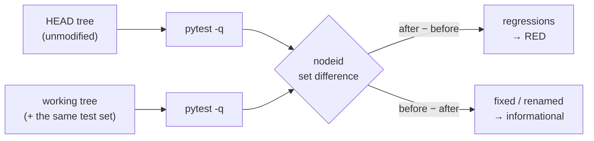

<div align="center">



# malabc

**Static analysis and deterministic auto-fix engine — MATLAB / Simulink, C·C++ (subset), Python and JavaScript, plus PE / ELF / Mach-O binaries and the CUDA · ROCm · Vulkan GPU content embedded in them**

Turn "reading code" into a "workbench": it does not just map call relationships, it
tells you **where the risks are, how severe they are, how to fix them, and whether a
fix patch / test stub / PR draft can be generated in one shot** — and wires every
conclusion into a **CI quality gate**.

<br>


-brightgreen)


[Quick Start](#quick-start) · [Core Capabilities](#core-capabilities) · [Architecture](#architecture)
· [Binary & GPU](#binary--gpu-analysis---binary) · [Command Cheatsheet](#command-cheatsheet)
· [CI Gate](#ci-quality-gate) · [Quality Gates](#quality-gates-self-verifying) · [中文文档](README_CN.md)
· [License](#license)

**Author & copyright holder: 冯磊 (Feng Lei)** — © 2026 冯磊 (Feng Lei).
**侵权必究**: the **code** is MIT — the **name and branding** are not. See [LICENSE](LICENSE) §6.

</div>

---

## What Problem It Solves

| Scenario | The old way | With `matlabc` |
| --- | --- | --- |
| Taking over an unfamiliar MATLAB project | Global search + manual jumping, three days to map entry points | `--browse` builds a clickable site; see the whole picture in 10 minutes |
| "Who is affected if I change this function?" | Guess by experience; miss something and find out after the change | Impact / dependency transitive closure + operator impact analysis |
| "Any hidden risks in this code?" | Run MATLAB to find out | Uninitialized / type mismatch / dead code / shape mismatch / taint, all statically |
| "How do I change it safely?" | Edit by hand and risk new bugs | `--gen-apply-patch` generates a deterministic, self-verified patch |
| "How do we stop the rot?" | Rely on reviewers' diligence | SARIF + exit code + trend baseline, enforced in CI |
| "This call resolves to nothing — is it our bug or a library's?" | Guess, or grep the disk | `--binary` + `--binary-symbols`, or the single-command `--binary-attach`: every unresolved name is attributed to a library, a GPU kernel, or `missing` |

> **Zero dependencies, no MATLAB needed, offline by default**: only the Python standard
> library is used; MATLAB / Octave is not required, and no network requests are made
> (offline-first, no CDN references in artifacts) — fully usable on an intranet.

---

## Core Capabilities



### Multi-Language Support

| Language | Flag | Key capabilities |
| --- | --- | --- |
| **MATLAB** (default) | — | Functions / classes / scripts / nested functions / `arguments` blocks / struct fields / global state, fully parsed |
| **C / C++** | `--lang c`（alias `--lang cpp`） | `.c/.h/.cc/.cpp/.cxx/.hpp/.hh/.hxx`; function calls / `#include` cross-file dependency edges / heuristics for uninitialized pointers, out-of-bounds, use-after-free, double-free, buffer overflow. **Preprocessor-aware for literal `#if 0`**: dead blocks are not analysed (line numbers preserved) while `#else` branches stay live — `#ifdef` / `#if defined` are deliberately left alone rather than guessed. Function definitions are found by a **lexical + brace-balancing** scanner (R49): a `name(args) {` whose signature **spans lines** (Allman brace, return type on its own line, multi-line parameter list) is recognised too — measured on glibc-2.37 (13,527 `.c/.h` files) the miss rate drops from **99.05%** to **0.04%** and `unresolved` false positives go to zero. C++ is parsed as a **C subset** (templates / classes / namespaces are not guaranteed) — a disclosed degradation, never a silent drop. Independently re-validated end-to-end on a full **Linux 6.19.14** tree (62,704 C-family files / 36,155,901 lines, sha256 verified against the mirror's `sha256sums.asc`): **661 s / peak 10.8 GB / 743,518 functions / zero crashes** — and that run exposed **five real defects**, three of them fixed in R75 (see `docs/SUPERPOWER_REVIEW_R75.md`). In R76 the C `--browse` output became a **paginated** site — `index.html` + one page per source file + one page per check rule + `browse.css` — because the old single-page report was **30.6 MB** on the `fs` subtree alone (2,085 files) and extrapolates to ~**1 GB** on the whole kernel, which no browser will open; and the same run showed that site's `browse.css` link had **never actually been written**, so the report rendered unstyled. The site is zero-JS / zero-CDN (every chart is server-side SVG) and opens offline (see `renderers/csite.py`). | In R78 the C frontend gained a **parsing-layer pass for comments and inline assembly** (`_c_comments` / `_c_inline_asm`, **without touching `_c_lex`**), so both are visible in the CLI, the JSON and the site alike: on the full kernel there are **13,632** inline-`asm` sites, **1,964 (14.4%)** of them **inside macro bodies** (`include/` is **93.1%** macro-borne — `asm/barrier.h`'s `mb()/rmb()/wmb()` live in `#define`s), which is why the extractor runs on a **dedicated tokenizer that does not fold `#` lines**: reusing `_c_lex`'s token stream would hide them silently. Every asm statement is reported as template / outputs / inputs / clobbers / qualifiers / labels, with `+`⇒inout, `=`⇒out and the C expression bound to each operand; a new `--lang asm` frontend gives `.S/.s/.asm` a **shallow** model (symbols / labels / mnemonic histogram / comments) that is **isolated** from the 8 C rules. Proved that every pre-existing C key stays **bit-identical** on kernel subtrees (`security`: 258 files / 3,694 functions;  R79 then makes that new data both **affordable and truthful**: `--no-annotations` emits a **detail-free JSON** — per-file `comments` / `asm` (and the asm frontend's `symbols` / `labels` / `insn_hist` / `directives` / `comments`) are dropped while every top-level summary stays, with a top-level `annotations` boolean so any consumer can tell which mode it is in: on the whole kernel's `.S` corpus that is **17.1 MB → 0.22 MB (−98.8%)**, and on C subtrees **−19%…−49%** (`drivers/net`, 6,086 files / 5.2 MLOC: 320.7 MB → 258.5 MB; `lib`: 22.2 MB → 11.3 MB) — which honestly means the whole-tree C JSON extrapolates to **≈2.2 GB full / ≈1.7 GB lite**, and that on C the real driver is `functions` / `edges`, not the annotations (the switch alone does not make a whole-tree C JSON small; that is the next round's problem). In the same pass the `.S` mnemonic histogram became **segmented and continuation-folded**: R78's pollution (`1:` 1964, `lock;`, `|` 5709) is gone and the head of the histogram is real mnemonics (`mov.l` 4794, `mov` 4231, `add` 3559, `nop` 2250) instead of the cpp continuation fragments (`\` 8,240, `|` 5,660) that used to lead it — numeric local labels become `kind="numeric"` labels (kernel: 16,089 labels, 4,880 numeric), m68k's `|` line comments are recorded as comments (6,477 on the kernel) rather than mistaken for instructions, and everything excluded stays traceable in `excluded_hist` / `segment_lines`, so nothing disappears silently. All pre-existing C keys remain **bit-identical** on `security`. **R80 / C29-1** adds `--json-level full|lite|summary`. Measured on the kernel: `lib` (651 files) 19.31 MB -> 8.98 MB (`lite`, -53.5%) -> **105.4 KB** (`summary`, -99.5%); `security` (258 files) 6.63 MB -> 43.5 KB (-99.4%); `drivers/net` (6,086 files) 253.05 MB -> **931.8 KB** (-99.6%). `summary` keeps only **counts** plus a one-line signature per file and a top-level `summary` block, so how much detail was dropped stays countable. On assembly the tiers do **not** shrink monotonically (whole-tree `.S`: 17.37 MB -> `lite` 215.6 KB -> `summary` 449.6 KB) - `lite` has already dropped every detail array, so `summary` writes counts back instead. Top-level key order is unchanged (only `json_level` is inserted). |
| **Python** | `--lang py` | Functions / calls / static checks (`py_unused_import` / `py_dup_params` / `py_too_many_params` / `py_missing_doc` / `py_eval_usage` / `py_sql_injection`), including a **Python 3.6 syntax-compatibility gate** (`--check-py36`) |
| **JavaScript** | `--lang js` | Functions / calls / static checks (`js_unused_import` / `js_global_var` / `js_too_many_params` / `js_missing_doc` / `js_dangerous_call` / `js_unused_var` / `js_prototype_pollution`) |
| **Mixed (MEX bridge)** | `--mixed` | MATLAB ↔ C cross-language call edges |

**Language boundary (explicit, not silent).** `--lang` covers MATLAB / C·C++ / Python / JavaScript only. TypeScript, Rust, Go, Java, Kotlin, C#, Swift, Scala, Ruby and PHP have **no frontend**: when such files exist but the requested language finds none, the CLI prints a `[warn]` line to stderr naming the language and the files it skipped, instead of quietly reporting `0 files / 0 functions`. When such files sit alongside sources of the requested language they are **skipped silently** — so "this language found 0 files" does not mean "there was nothing there". A cross-language operator label is only listed in the operator catalog if some code path actually emits it; operators that are deliberately not implemented are registered in `_UNIMPLEMENTED_KINDS` with a stated reason, and `tools/check_operator_impl.py` fails the build if the two ever diverge.

**Cross-reference site, same shape in every language (R92).** `--browse` used to build a paginated cross-reference site for C only: the Python / JavaScript / assembly entry point (`_run_ext_only`) stated outright that it *does not generate an HTML site*, so one capability was split by language into "exists" and "does not exist". R92 generalises `renderers/csite.py` into a **language-agnostic** engine (`lang` / `display` / `dep_key` / `dep_edges` / `binaries` / `attribution`): `index` + `file/<one page per source file>` + `funcs` (bounded in-degree / out-degree / unresolved-name leaderboards) + `deps` (`#include` for C, `import` for Python and JS, resolved to the in-project file) + `dir/<one page per directory>` + `src/<one page per source file, per-line anchors>` + `rule/<one page per check rule>`, plus a `binaries.html` page (container / arch / bitness / dependencies / exported symbols / mitigations with the evidence behind each key, and a three-state *unresolved call → which library* table) whenever `--binary` or `--binary-attach` supplies binaries. The per-file function table carries four columns — **out-edges / in-edges / calls (what it calls) / callers (who calls it)** — and both directions are clickable, which is what "the call relation between every function and every other function or file" actually looks like. `dep_key` is `includes` for C and `imports` for the rest, so the C `#include` graph and the Python/JS `import` graph travel the **same rendering path** instead of growing a second, drifting implementation. Dependency edges resolve `import a.b` (Python: longest match over `a/b.py` → `a/b/__init__.py` → `a.py` → `a/__init__.py`) and relative JS imports only; bare module names are reported as *unresolved (system library or outside the project)* rather than guessed through `sys.path` / `node_modules` / bundler aliases. Two explicit, non-silent gates stop a kernel-sized corpus from producing a kernel-sized site: a per-file source cap and a total source budget, both disclosed as counts on the index page; and the legacy single-page `c_report.html` is skipped above 5,000 files, with the reason printed and the extrapolated size range recomputed from the archived measurements rather than hard-coded. **Clickable call graph, same shape in every language (R93).** Every file page now carries an inline SVG call graph whose nodes are real links: click a node and you land on that function's source line. The layout is a deterministic Fruchterman-Reingold implemented in pure Python, so no Graphviz or `dot` is required, and there is no JavaScript and no external reference anywhere on the page - open it offline by double-clicking. Doxygen needs `HAVE_DOT` plus a `dot` on PATH, caps graphs at `DOT_GRAPH_MAX_NODES` (50 by default), draws nothing for functions without doc comments, and embeds the result as ``, which silently kills every link inside it; this site does the opposite on all five counts. The graph and the function table read the same `calls` stream, so an edge in one is always a row in the other - Doxygen derives its graphs and its cross-reference tables separately, and they disagree. Unresolved calls (libc, kernel exports, external packages) are drawn as orange nodes rather than dropped, and because force-directed layout is O(n^2 * iterations) the node count is bounded (40 by default, measured at 105.14 us per node per iteration); when the bound bites, the page says how many nodes were left out. Measured cost on `kernel/sched`: 38 graphs, 1,315 nodes, and the whole site grew from 10.95 MB to 11.27 MB.

### Binary & GPU Analysis (`--binary`)

Source-side analysis can tell you *that* a call is unresolved. It cannot tell you *why*.
`--binary` closes that loop: point it at the libraries your code actually links against, and
every unresolved name gets an owner.



```bash
# What does this library depend on, and what does it export?
python matlabc.py --binary libfoo.so

# Ask the source side and the binary side the same question
python matlabc.py myproj/ --json out.json                    # 1) find unresolved calls
python matlabc.py --binary libcublas.so.12 --binary-symbols out.json   # 2) attribute them

# Machine-readable, for wiring into your own pipeline
python matlabc.py --binary a.dll,b.so --binary-json -
```

| Backend | Where it hides | How it is found | What comes out |
| --- | --- | --- | --- |
| **CUDA** | PE `.nv_fatb` · ELF `.nv_fatbin` · PE/ELF `.nvFatBi` / `.nvFatBin` | fatbin magic `0xba55ed50`; cubin located through the `.text._Z…` section-name table | kernel names + demangled forms, SM targets, code-object counts |
| **ROCm / HIP** | PE/ELF `.hip_fat` / `.hipFatBin` | HSA code object header (`e_ident[7]` = 64, `e_machine` = 224) | trusted code-object count (names are **not** guessed) |
| **Vulkan** | **no dedicated section** — SPIR-V sits in `.rdata` | raw magic scan for `0x03022307` (`OpEntryPoint` decoding) | entry-point names, module count |
| **PTX** | inside the same fatbin segment | `.entry <name>(` with the parenthesis required | *usually nothing* — see the honest limits below |

> **Field note — the 8-byte trap.** PE section names are hard-truncated to eight bytes. The very
> same CUDA section is `.nv_fatbin` in an ELF but `.nv_fatb` in a PE; `.nvFatBin` becomes
> `.nvFatBi`; AMD's `.hip_fatbin` becomes `.hip_fat`. A matcher that only knows the full spelling
> reports **zero** GPU content in every Windows binary — silently, and with no error. Both
> spellings are matched.

> **Field note — cubins are not standard ELF.** A cubin sets `e_type = 0x8000`,
> `e_machine = 0x100`, and parks a `0xCAFE…` sentinel in `e_shoff`. The only trustworthy
> discriminators are `e_ident[7]` (`ELFOSABI_CUDA` = 51) and `e_ident[8]`. Counting `\x7fELF`
> occurrences is a *cheap* signal and is reported under a different field name
> (`suspect_code_objects`) than the strict one (`confidence_code_objects`), so the two can never
> be confused.

**Honest limits (measured, not guessed).**

- **PTX barely yields kernel names.** Requiring `.entry <name>(` on a 692 MB real driver
  distribution leaves ~2 usable names; the rest of the `.entry ` hits are binary metadata. The
  CUDA kernel-name path that actually works is the `.text._Z…` **section-name table** inside each
  cubin — measured **171** distinct kernel names in one vendor BLAS library and **59** in another,
  100% demangle-able.
- **Mach-O is implemented but unvalidated.** No Mach-O sample exists on the development machine;
  the parser says so in the report's `notes` instead of pretending.
- **"Unparseable" is a first-class state.** A GPU blob with no extractable content is reported as
  `NOT-PARSEABLE` **with a written reason** — never as a silent `0 kernels`.
- **Truncation is always visible.** `--binfmt-scan-cap` (default 64 MiB) bounds the scan; when it
  bites, the report prints `[TRUNCATED]`.
- **Run-time binding is out of scope.** `dlopen` / `LoadLibrary` / `dlsym` / `LD_PRELOAD` are not
  traced. Build-script link intent is read **only as a literal**: `-lfoo` is a resolution **seed**
  for `--lib-resolve` (name → file on disk), with no variable expansion and no inference about
  run-time load order — a variable-expanded `-l$(X)` is reported as an explicit note, never
  guessed. To see who loads whom at run time, use an external tool: `ltrace`,
  `strace -e openat`, or glibc's `LD_DEBUG=bindings` - those are run-time instruments, and
  static analysis cannot give you that answer.

#### One command instead of two: `--binary-attach`

`--binary` **short-circuits** — it inspects the binary and exits. `--binary-attach` deliberately
does **not**: it runs the normal source analysis, and then attributes the unresolved calls it just
found — in a single invocation, with no intermediate JSON to shuttle around.



| | `--binary` | `--binary-attach` |
| --- | --- | --- |
| Source analysis in the same call | no — binary only | **yes** — then attributes |
| Where the names come from | a `--binary-symbols` file you built earlier | the source side, automatically |

```bash
# One command: analyse myproj, then attribute its unresolved calls against libblas.so
python matlabc.py myproj/ --binary-attach libblas.so --json out.json
```

Only the binaries you explicitly pass are consulted. A library you did **not** pass yields
`missing`, never a guess — a false positive would launder a real defect into "it came from some
library", which is worse than no attribution at all. In JSON the result lands in
`unresolved_attribution` (`{summary, rows}`), and that key is **absent** when the flag is not
given — no empty shell that downstream code could mistake for "attributed, but nothing matched".

When a name still lands in `missing`, it goes one step further: it reads the project's
`Makefile` / `CMakeLists.txt` and lists their **literal** link intents (`-lblas` → candidate
`libblas.so`, `find_package(BLAS)` → a hint too), so you can see *which library to pass next*.
Variable-expanded flags such as `-l$(X)` are reported as an explicit note, never guessed.

#### From a library *name* to a *file* on disk: `--lib-resolve`

`--binary-attach` still asks *you* to hand over the files. `--lib-resolve` removes that last
manual step: the names are already in your project — a `Makefile`'s `-lfoo`, a `CMakeLists.txt`'s
`target_link_libraries`, an ELF's `DT_NEEDED`, a PE's import table — so it resolves them against
the filesystem and keeps walking down the dependency chain.

```bash
# Analyse myproj, resolve every library name it mentions, follow 2 levels of dependencies
python matlabc.py myproj/ --lib-resolve 2 --lib-path /opt/sdk/lib --json out.json
```

Every reference lands in exactly one of three states, and **none of them is a guess**:

| State | Meaning | What the report carries |
| --- | --- | --- |
| `resolved` | exactly one file matched | the path, and which rule matched (`exact` / `exact_ci` / `family` / `path`) |
| `ambiguous` | the same name exists as several files | **all** candidates plus a `rejected` list — a 32/64-bit twin is only ever separated by the **candidate's own** bitness, and the excluded copy stays quotable |
| `not_found` | nothing matched | **the directories that were actually searched** — never a bare "not found" |

**Bounded, and honest about being bounded.** `--lib-resolve` walks at most N levels deep, and
`--lib-max-nodes` (default 64) files in one run; a node that hits the cap is `skipped`, kept
strictly apart from `not_found` — *"I did not look"* is not *"I could not find it"*. A dependency
cycle terminates, with every file parsed once. `--lib-path` **appends** directories ahead of the
platform defaults rather than replacing them, and a directory that could not be read says so.

**Two tiers of evidence, never merged.** ELF mitigation readouts (PIE / NX / canary / RELRO) are
`inferred` — they follow from the presence or absence of build artifacts. PE ones (ASLR / CFG /
NX / SEH / …) are `observed`, read straight out of the header. `None` means *the criterion's
artifact is missing* and `False` means *observed, and negative*; RELRO and exec-stack are always
`null` on PE because those concepts do not exist there, and a `LOAD_CONFIG` whose declared size
cannot reach `SecurityCookie` is **refused** rather than read out of bounds.

#### Who calls whom: `--callgraph`

The call edges are computed either way — the Linux kernel tree alone yields **7,060,966** of
them. But `--json-level summary` **structurally carries no `edges` array** (it has a count and
nothing more), and the full array at kernel scale is gigabytes. So there used to be no artifact
you could open and answer *"who calls whom"* with.

`--callgraph` is that artifact, and it is **bounded by construction**:

```bash
# Whole-graph shape: degree tops, recursion cycles, cross-file / cross-dir counts
python matlabc.py linux/ --lang c --callgraph cg.json

# Drill into one function, two levels out: at most 50 nodes and 200 edges
python matlabc.py linux/ --lang c --callgraph cg.dot \
       --callgraph-focus __schedule --callgraph-depth 2 \
       --callgraph-max-nodes 50 --callgraph-max-edges 200
```

| Part | Answers |
| --- | --- |
| `fan_in_top` / `fan_out_top` | the hubs — *what is called the most* (so what a change ripples through) |
| `cycles` | strongly-connected components (mutual recursion). Nodes are **definition sites** by default, so same-named `static` functions in different files no longer merge into a phantom cycle |
| `cross_file` / `cross_dir` | internal vs cross-file vs **same name, several definitions (not guessed)** vs no definition |
| `focus_subgraph` | the BFS neighbourhood of one function, level by level |
| `truncated` | every cap that fired, **numerator and denominator together**: `hit_node_cap` / `nodes_shown`, plus — when `--callgraph-max-edges N` was given — `hit_edge_cap` / `max_edges` / `edges_total`. **"I did not expand it" is not "there is no relation"** |

`.json` is the structured form; `.dot` and `.mmd` render the focus subgraph. An unknown
extension **fails** rather than quietly falling back to JSON.

**Four calibrations, stated rather than implied.** Node identity defaults to the
**local definition site** (`identity: "definition-site-local"`, R89; before that R88 shipped
`definition-site`): a node is `name @ defining-file`, so two
`static` functions with the same name in different files stay **separate** — on the kernel tree the
name-level reading reported a "call cycle" of **37,775** members that was entirely a merge artifact
(5,149,101 edges, **72.9%**, pointed at a same-name multi-definition); under definition sites it
collapses to **591**. The two older readings are still
selectable via `--callgraph-identity definition-site` and `--callgraph-identity callee-name`; under
the name-level one nodes *are* names, so `cycles` can
contain false positives. Switching identity **removes no edge** (`edges_total` is identical across
all three). Where a callee has several definitions and the call cannot be attributed, the node is a
**sink** that is **not guessed** — the honest cost is that cycles *through it* go unreported; the
`resolution` block then says how many edges landed in which bucket (`unique` / `same_file` /
`include` / `ambiguous` / `external`), and its five buckets always sum to `edges_total`, so
"how much was recovered" can never be inflated by moving the denominator. The new default adds the
two scope rules C already has — **same file** first, then **same translation unit** (only when the
include closure pinned through basenames agrees on exactly one candidate, and only for
translation-unit roots) — and it is enabled **for C only**: Python / JS module bindings can be
reassigned at run time, so "same name, same file" would be an approximation, and an approximation
posing as a conclusion is precisely what manufactures phantom cycles.
Unresolved calls are **not in the graph** (they have no callee node); they are counted alongside,
because *"not resolved"* is not *"no relation"*. And a cap is **always reported**: a focus BFS that
stops at the node limit sets `truncated.hit_node_cap`, and one bounded by
`--callgraph-max-edges N` keeps the **first** `N` edges it meets and sets `truncated.hit_edge_cap`
alongside `max_edges` and `edges_total` — the latter being the **same count** it would have shown
unbounded, so "how many were dropped" is never read off a second, differently-computed number.
Bounding edges **never touches nodes** (`nodes` / `nodes_shown` / `hit_node_cap` are unchanged).
With the switch absent, that `truncated` block carries exactly the four keys it had in R90 — the
three edge-cap keys are **conditional, not omitted**.

### Static Check Rules

| Rule | Description |
| --- | --- |
| `uninitialized` | Read-before-write local variables (distinguishes "uninitialized / maybe uninitialized"; blocks CI only on high confidence) |
| `type_mismatch` | Inconsistent types for the same variable (e.g. a matrix variable assigned a scalar) |
| `dead_code` | Unreachable code after `return` + always-false `if` branches |
| `shape_mismatch` | `A*B` / `A+B` / `A-B` dimension-constraint violations |
| `tainted_sink` | Cross-file taint: user input / file / network → dangerous sinks such as `system` / `eval` / `fprintf` |
| `py_eval_usage` | `--lang py`: bare `eval()` / `exec()` inside a function (code injection / sandbox escape) |
| `py_sql_injection` | `--lang py`: SQL built by concatenation / `%` / `.format()` and then handed to `execute()`; parameterised calls are not reported |
| `c_double_free` | `--lang c`: the same pointer freed twice with no reassignment in between |
| `c_buffer_overflow` | `--lang c`: unbounded `strcpy`/`strcat`/`sprintf`/`gets` (or `memcpy`/`strncpy` without `sizeof(buf)`) into a fixed-size buffer |
| `js_dangerous_call` | `--lang js`: `eval` / `new Function` / `document.write` / `innerHTML` assignment / `insertAdjacentHTML` / string-timer |
| `js_unused_var` | `--lang js`: a simple local declaration never referenced again in the function body |
| `js_prototype_pollution` | `--lang js`: `__proto__` writes, `prototype[<variable>] =`, `constructor.prototype`, or a for-in merge that writes `target[key]` |

**Four levels of warning suppression** (written as source comments, without changing business semantics):

```matlab
% analyzer:ignore uninitialized                 % (1) File level: ignore the whole file
% analyzer:ignore type_mismatch x -- legacy      % (2) Name level: only variable x, reason optional
% analyzer:ignore-next-line shape_mismatch        % (3) Line level: next line only
% analyzer:disable uninitialized                  % (4) Range level: ignore everything inside the block
y = a + b;
% analyzer:enable uninitialized                   %     ↑ end of range
```

---

## Architecture



**Directory structure**

```
malabc/
├─ matlabc.py          # Core analyzer + report rendering (CLI main, ~29k lines, zero deps)
├─ matlabc_boot.py     # Unified entry dispatcher: no args = GUI / ask / flow / else = analyzer
├─ matlabc_ask.py      # Q&A code understanding (BM25 retrieval + intent recognition + LLM)
├─ matlabc_flow.py     # AI fix-loop orchestrator review→fix→apply→verify→report
├─ matlabc_mcp.py      # MCP server (exposes matlabc as tools to AI agents)
├─ frontends/          # The ONE decision point for "which call could not be resolved"
│  ├─ ir.py            #   shared IR + resolve_calls(); the single place that decides
│  ├─ matlab.py        #   MATLAB's own unresolved producer (different shape, same contract)
│  └─ __init__.py      #   public surface + IR_LANG_OWNERS (which language is whose)
├─ binfmt/             # Binary & GPU container analysis (zero-dependency)
│  ├─ model.py         #   unified IR: Section / Symbol / Dependency / GpuBlob / BinaryReport
│  │                   #   + Segment (perms) and mitigation readouts — None ≠ False
│  ├─ pe.py  elf.py    #   PE32+ and ELF64/32 streaming parsers (incl. CUDA/AMDGPU classification)
│  ├─ macho.py         #   Mach-O (⚠ implemented, unvalidated — no sample on the dev machine)
│  ├─ gpu.py           #   CUDA fatbin/cubin · HSA code object · SPIR-V entry points
│  ├─ attribute.py     #   attribution: unresolved name → library / gpu_kernel / missing
│  ├─ resolve.py       #   library NAME → file on disk → dependency walk (R86-2)
│  ├─ buildsys.py      #   Makefile / CMakeLists.txt link-intent hints
│  └─ report.py        #   text report (never hides a negative state)
├─ tools/              # Self-verifying static gates (see "Quality Gates")
│  ├─ check_all.py     #   one-shot runner: runs every check_*.py + its own --selftest
│  └─ check_*.py       #   doc-flags · operator-impl · patch-ops · py36-clean ·
│                      #   help-contract · binfmt-fixtures · subprocess-hygiene ·
│                      #   readme-parity · baseline · ir-attribution
├─ ai_cli.py           # Multi-vendor LLM access (offline echo / online answer, graceful degradation)
├─ gui.py              # Zero-dependency tkinter desktop GUI
├─ renderers/          # Report and visualization renderers (report/callgraph/hotspot/sarif/snapshot...)
│  └─ assets/          # Inlined CSS assets (offline-first, no CDN)
├─ tests/              # Tests and samples (test_matlabc.py / eval_ai_fix / sample_m/*.m)
├─ docs/               # Full documentation (usage / features / JSON Schema / delivery report ...)
├─ ci-examples/        # GitHub / GitLab CI template examples
├─ LICENSE             # MIT License (English original, the sole legally binding text)
└─ LICENSE_CN          # MIT License Chinese translation (for reference only)
```

**One rule, one place.** `resolve_calls()` is the only code that decides a call could not be resolved;
everything downstream — the call graph, the "possibly missed" page, and the binary attribution —
reads that same verdict instead of re-deriving it.

```mermaid
flowchart LR
  C["C frontend"] --> RC
  P["Py frontend"] --> RC
  J["JS frontend"] --> RC
  M["MATLAB<br/>frontends/matlab.py"] --> U
  RC["frontends/ir.py<br/>resolve_calls()<br/><b>the ONE decision point</b>"] --> E["edges → call graph"]
  RC --> U["unresolved"]
  U --> RP["\"possibly missed\" page"]
  U --> AT["--binary-attach<br/>library: / gpu_kernel: / missing"]
```

---

## Quick Start

> **Installing / using it**: the full user guide is [`releases/docs/USER_GUIDE.md`](releases/docs/USER_GUIDE.md) (bilingual tabs: install, every feature, FAQ).

```bash
# (1) Console report (zero install, clone and run)
python matlabc.py my_matlab_project/

# (2) Generate an interactive browsable site (recommended: click-to-jump, full-text search)
python matlabc.py my_matlab_project/ -o report.html --browse

# (3) CI static analysis (SARIF + exit-code gate)
python matlabc.py my_matlab_project/ --checks all --sarif report.sarif \
    --max-warnings 0 --reproducible
```

Requirements: **Python 3.6+** (the tool itself is strictly 3.6.5-compatible; self-check with `--check-py36`).
Optionally install as a command: after `pip install -e .`, use `matlabc <args>` (no args = GUI).

> You can also package it into a single-file executable that needs no Python
> (`build_dist.py` + `build_release.bat/.sh`): double-click = GUI, with args = CLI.

---

## The Four Entry Points

### 1. Analyzer (CLI)

```bash
python matlabc.py myproj/ -o report.md --html report.html --browse \
    --offline --checks all --debt --sarif report.sarif
```

### 2. `ask` — Q&A Code Understanding

Normalizes static-analysis results into three retrievable object classes — "function docs +
call graph + warnings/priority" — then uses BM25 retrieval + intent recognition (who calls X /
what X calls / risk hotspots / explain X) to assemble a prompt for the LLM.

```bash
matlabc ask "who calls main" --dir ./myproj           # packaged unified entry
python matlabc_ask.py "where is the risk highest" --dir ./myproj   # source-mode equivalent
python matlabc_ask.py "what does helper do" --json report.json --provider deepseek
```

> **Offline-first**: without an API key, no model is called; it just echoes a paste-ready prompt
> containing the retrieved real context + the question. After configuring a provider, it answers directly.

### 3. `flow` — AI Fix Loop



```bash
matlabc flow ./myproj                    # by default only emits a patch + report, changes nothing
matlabc flow ./myproj --auto-apply       # applies the patch and self-verifies
matlabc flow ./myproj --steps review,fix,report --lang c --provider deepseek
```

### 4. GUI (Zero-Dependency Desktop UI)

```bash
python gui.py            # or double-click the packaged matlabc.exe
python gui.py --selftest # headless self-test
```

Pick a directory → tick the artifacts (browsable site / HTML / JSON / SARIF / MD) → choose the AI
timing → one-click analyze with streaming logs.

---

## Output Artifacts

| Artifact | Trigger | Purpose |
| --- | --- | --- |
| Console / Markdown report | `dir` (default) / `-o` | Quick viewing, archived review |
| HTML report | `--html` | Single file, directly shareable |
| Mermaid / Graphviz DOT | `--mermaid` / `--dot` | Embed in Wiki / docs |
| Interactive browsable site | `--browse` (+`--watch` daemon) | Click-to-jump to definitions, full-text search |
| JSON / XML / Doxygen XML | `--json` / `--xml` / `--export-doxygen-xml` | Secondary development, doxygen ecosystem |
| SARIF 2.1.0 | `--sarif` (+`--sarif-base` / `--sarif-diff`) | GitHub / GitLab code scanning |
| Technical debt / trend | `--debt` / `--trend` / `--gate` | Quality metrics and trend gates |
| Fix loop | `--gen-pr` / `--gen-apply-patch` / `--gen-tests-risk` | Fix landing, test-stub skeleton |
| Duplicate-code governance | `--dup-*` (baseline / patch / self-verify / gate) | Copy-paste code-smell governance |
| Binary / GPU report | `--binary` (+`--binary-symbols` / `--binary-json` / `--binfmt-scan-cap`) | Dynamic dependencies, exports, CUDA/ROCm/Vulkan content, and source-side attribution |
| Diff report | `--diff` / `--diff-html` | Full-dimension comparison of two snapshots |

---

## CI Quality Gate



`ci-examples/` provides ready-to-use GitHub Actions / GitLab CI templates; just copy them in.

**This repository runs its own gates on Windows** (`ci.yml`, `windows-latest`):
the 3.6 syntax gate, the regression suite, the 33 static gates, the LSP/MCP
judgements, the 60 end-to-end scenarios and the mutation sampling.

```bash
python tools/ci_local.py        # same pipeline, inside a clean clone at E:\\ci\\matlabc
```

The Linux jobs were paused on purpose: without a Linux machine to reproduce a
failure on, a red ubuntu run is a signal nobody can act on. Re-enabling takes one
line (`runs-on: ${{ matrix.os }}` + a two-entry matrix) — and the day that
happens, the failures will at least be reproducible.

## Command Cheatsheet

```bash
# Structure-map report (Markdown)
python matlabc.py myproj/ -o report.md

# Interactive browsable site (click-to-jump + full-text search)
python matlabc.py myproj/ --browse -o site.html

# C project analysis
python matlabc.py myproj/ --lang c --checks all

# Python 3.6 syntax compatibility gate
python matlabc.py myproj/ --lang py --check-py36

# CI gate: fail on any new warning, SARIF output
python matlabc.py myproj/ --checks all --sarif report.sarif \
    --sarif-base baseline.sarif --sarif-diff --max-warnings 0 --reproducible

# Cross-file taint scan
python matlabc.py myproj/ --checks tainted_sink

# Binary analysis: dependencies, exports, GPU content
python matlabc.py --binary libfoo.so

# Attribute unresolved calls: source side ↔ binary side
python matlabc.py myproj/ --json out.json
python matlabc.py --binary libcublas.so.12 --binary-symbols out.json

# ...or do both in one command (no intermediate JSON)
python matlabc.py myproj/ --binary-attach libcublas.so.12 --json out.json

# A TASK instead of a query: rename a symbol with acceptance criteria and rollback.
# It prints the criteria BEFORE touching anything, then validates after writing —
# and restores every touched file if any criterion fails or a write blows up.
python matlabc_task.py rename --dir myproj/ --old helper --new assist
python matlabc_task.py rename --dir myproj/ --old helper --new assist --apply

# Same task, but for a struct field: only `.old` is touched — a standalone
# variable named `old`, or the text inside 'a.old', stays exactly as it was.
python matlabc_task.py rename-field --dir myproj/ --old old --new new --apply

# Extract a block into its own function. The interface is written by you, not
# guessed: a wrong guess is worse than no extraction. Validated by
# "functions +1 / diagnostics unchanged / function-end still balanced".
python matlabc_task.py extract --dir myproj/ --file a.m --lines 12-18 \
    --name part --in x,y --out z --apply

# ...or let it infer the interface from the data flow. It is a heuristic and it
# says so: the dry-run prints `in=… | out=…` before anything is written.
python matlabc_task.py extract --dir myproj/ --file a.m --lines 12-18 \
    --name part --auto --apply

# ...or move it into its own file (`--to`). The new file is written first and
# removed again on rollback; an existing target is refused, never overwritten.
python matlabc_task.py extract --dir myproj/ --file a.m --lines 12-18 \
    --name part --in x,y --out z --to part.m --apply

# Undo the last task. A failed task rolls itself back; this is for the
# case where it SUCCEEDED and you changed your mind. It refuses if any
# touched file was edited afterwards — undoing would silently discard
# that edit. Records live in `.matlabc/tasks/`.
python matlabc_task.py undo --dir myproj/ --apply
python matlabc_task.py undo --dir myproj/ --list   # what has been done
python matlabc_task.py undo --dir myproj/ --diff   # show the change before doing it
python matlabc_task.py undo --dir myproj/ --id 20261020-001555-413 --apply
python matlabc_task.py undo --dir myproj/ --batch --apply   # whole batch at once
python matlabc_task.py prune --dir myproj/ --keep 50 --apply  # trim old records
python matlabc_task.py stats --dir myproj/   # per-task timing and rollback rate
python matlabc_task.py baseline --dir myproj/ --save  # remember what normal looks like
# ...afterwards `stats` also lists anything that got 2x slower than that baseline.

# Task records live in `.matlabc/tasks/` (one JSON per task, capped at 50:
# already-undone ones go first). Add `.matlabc/` to your .gitignore if you
# do not want them committed.

# Undo is per-task and record-ordered: undoing an older task while a newer
# one changed the same file is refused, not silently applied. After restoring
# it re-analyses and requires the structure to be back to the pre-task state
# (functions / call edges / diagnostics); if not, the undo itself is reverted.

# Move a whole function out of a file. The target must be `<name>.m`: any other
# name would turn it into a private subfunction and silently break every caller.
python matlabc_task.py move --dir myproj/ --file a.m --name helper --to helper.m --apply

# Several steps as ONE transaction. Each step is validated as usual; if any
# step fails, every earlier step is rolled back too — no half-refactored tree.
# Inside plan.json a step may reference an earlier step's parameters:
#   {"task": "rename", "old": "${prev.new}", "new": "solve"}
python matlabc_task.py batch --dir myproj/ --steps plan.json --apply

# Generate a deterministic self-verified fix patch
python matlabc flow myproj --auto-apply --gen-apply-patch

# Q&A code understanding (offline => echoes a paste-ready prompt)
python matlabc_ask.py "where is the risk highest" --dir myproj
```

---

## AI Agent Integration (MCP)

`malabc` can run as a **Model Context Protocol (MCP)** tool server, so any MCP-capable AI agent
(CodeBuddy / Cursor / Claude, etc.) can call it out of the box, wiring "code understanding +
static checks + deterministic patches" into the agent's autonomous workflow.

Launch (started automatically by the agent's MCP client; zero third-party dependencies):

```bash
python matlabc_mcp.py
```

The protocol is MCP over stdio (LSP framing, compatible with the official MCP SDK). Exposed tools:

| Tool | Purpose |
| --- | --- |
| `matlabc_analyze` | Static analysis + structure mapping; produces call relationships / risk hotspots / tech-debt report |
| `matlabc_check` | Gated static check (`uninitialized` / `type_mismatch` / `dead_code` / `shape_mismatch` / `tainted_sink`) |
| `matlabc_ask` | Natural-language Q&A code understanding (who calls X / risk hotspots / explain X) |
| `matlabc_gen_patch` | Runs the AI fix loop; generates / applies a deterministic fix patch |
| `matlabc_version` | Returns the engine version and capability list for agent capability negotiation |

> **Design note**: the server reuses the existing `matlabc` CLI via `subprocess` (process isolation,
> consistent behavior); the spawned child process tree is force-reclaimed on server exit / timeout
> (Windows `taskkill /T`, POSIX `killpg`) to avoid orphaned processes running away. Every tool
> returns an `isError` flag for easy agent error branching.

Agent call example (pseudocode):

```json
{"method":"tools/call","params":{"name":"matlabc_check",
 "arguments":{"target":"src/","check":"uninitialized","max_warnings":0}}}
```

---

## Editor Integration (LSP)

`matlabc_lsp.py` is a minimal Language Server (stdio, JSON-RPC). It speaks to
`matlabc.py`, never re-implements the analysis:

| capability | behaviour |
| --- | --- |
| `initialize` | `textDocumentSync = 1` (full) |
| `textDocument/didOpen` | publishes diagnostics — an **empty** list first, then the real one |
| **`textDocument/didSave`** | **invalidates the cache, recomputes, republishes** |
| `publishDiagnostics` | `source = "matlabc"`, one entry per item in `facts` |

**The hard judgement**: every diagnostic must be traceable to a `facts` entry,
and the diagnostics are a **superset** of the `--json` `heuristics` — **not an
exact match**. Since R161 `facts` also carries `c_uninit_read` and
`m_dead_code`, so the server can report four kinds where `heuristics` holds one.

**It does not read the CLI output.** Since R145 it calls
`analyzer.api.analyze` in process — no subprocess, no 62 KB serialisation.

**`didOpen` alone would freeze the diagnostics at open time** — that is what
`didSave` exists for. *Slow is a wait; stale is wrong.*

```powershell
python matlabc_lsp.py      # speak LSP over stdin/stdout
```

> **Measured latency**, 1,300 `.m` files:
>
> | role | time |
> | --- | --- |
> | CLI (`matlabc.py … --json`, full pipeline) | 5.92 s |
> | **LSP first analysis (in-process)** | **3.20 s** |
> | reuse path (measured, **not yet wired into the server**) | **1.40 s** |
>
> The gap is `os.walk`, JSON serialisation and process startup — none of which
> an editor needs. `run_pipeline(prev=..., changed=...)` then skips parsing
> entirely when nothing changed, **in process, without serialisation**
> (`--incremental` uses pickle and is 10× *slower* on 13 files — see
> `docs/analysis/ANALYSIS_2026-10-18_REUSE_INTERFACE.md`).
>
> A single-file entry point was measured and **ruled out**:
> `MyCls.m` (a `classdef`) reports 2 missing-description entries in full mode
> and **0** in single-file mode, because `doc_todos` depends on the cross-file
> `callers_of`. (The 1,093 s quoted elsewhere belongs to the **C** arm —
> 62,704 `.c` files with `--checks all` — and does not apply here.)
> See `docs/analysis/ANALYSIS_2026-10-17_LSP_PERF.md` and
> `docs/analysis/ANALYSIS_2026-10-17_SINGLE_FILE.md`.

---

## Programmatic API and Rust Runtime

Import the analyser instead of shelling out — no argparse, no `sys.exit`, and
**0 bytes leaked to stdout** (which matters when stdout is an LSP channel):

```python
from analyzer.api import analyze, counts
r = analyze("tests/sample_m")     # -> PipelineResult, not a report
counts(r)                         # {'files': 13, 'functions': 19, 'edges': 9, 'checks': 6}
```

`analyzer.index.Index` tracks **which files changed** (mtime+size as a fast
path, sha256 as the truth). It deliberately does **not** cache parse results —
"which files moved" is a different problem from "cache invalidation".

```python
from analyzer.index import Index
d = Index("proj").refresh()       # d.added / d.changed / d.removed / d.unchanged
```

`malabc-rt` is a **Rust runtime skeleton** (zero dependencies, `cargo test`
5 passed). It evaluates scalar doubles only:

```powershell
malabc-rt eval "1+2*3"     # 7
malabc-rt eval "1/0"       # Inf
malabc-rt eval "a+1"       # rc=1: unimplemented token 'a'
```

Statements, arrays and MATLAB built-ins are **not** there yet. It is a
skeleton, not a runtime, and it says so in its own README.

---

## Quality Gates (self-verifying)

The project's own claims are enforced by executable gates. One command runs them all:

```bash
python tools/check_all.py        # runs every tools/check_*.py AND its --selftest
```

| Gate | What it stops |
| --- | --- |
| `check_baseline.py` | `P1–P4/T1` — "Did this change make the suite worse?" — answered by comparing failure **nodeid sets**, not counts. This suite is *not* green, so counts prove nothing: 124 → 123 can be "fixed one" or "fixed two, broke one". `--full` runs both sides; the default mode checks preconditions and self-tests the verdict logic. A "repository" counts in **both** git forms: `.git` a directory, or `.git` a file whose first line is `gitdir:` pointing at an **existing** directory (`git worktree add`) — the old check accepted only the former, so a worktree could not run `check_all` at all (R54). **TD1 (R63)**: the tests **added or modified this round** are separated out — `--full` copies the *current* `tests/` into the export tree while that tree's `tools/` is still the **previous commit**, so a test asserting *this round's* product facts fails on the `before` side **by construction**. Registering such a nodeid would be wrong: after the commit the export tree carries the product too, so the registration would be **stale on the very next run** |
| `check_doc_flags.py` | `NO_HELP_SCRIPTS` — Documentation **or a help screen** advertising a CLI flag that does not exist (this really happened: the README said `--check tainted_sink`, which argparse rejects as an **ambiguous prefix**) |
| `check_operator_impl.py` | `_UNIMPLEMENTED_KINDS` — "Phantom operators" (a rule in the catalog that no code path emits), contradictions between the catalog and the not-implemented table, and **a "we don't do this" that never reaches `--help`** |
| `check_patch_ops.py` | `G0–G3` — Patch operators that overwrite a target line instead of inserting before it (which would silently delete source) |
| `check_binfmt_fixtures.py` | `C1–C15` — Binary / GPU parsers regressing — synthetic PE/ELF/Mach-O fixtures plus contract assertions C1–C15. **R68**: the three mechanisms by which a dynamic library says what it links against are now all read — ELF `DT_NEEDED`, PE import table, and Mach-O `LC_LOAD_DYLIB` (incl. weak/reexport/upward/lazy) + `LC_ID_DYLIB` + `LC_RPATH` + `LC_LOAD_DYLINKER` (C10); Mach-O `LC_SYMTAB` external symbols are read while internal/debug symbols are strictly kept out of the export table (C11); and library **name families** are normalised so that `libfoo.so.1`, `libfoo.so.1.2.3` and `libfoo.1.dylib` count as one library, while rpath/runpath are never mistaken for a library you still have to add (C12). **R68 also found a defect while measuring**: the `.framework` branch of that normaliser was **unreachable** — the basename was stripped *before* the `.framework/` test, so `@rpath/Foo.framework/Versions/A/Foo` came back as `foo` while the function's own docstring promised `foo.framework`; the order is now fixed and the three framework spellings are pinned by C12's fixtures. **R86-2**: the gap between 「a **name** the code mentions」 and 「a **file** on disk」 is closed by `binfmt/resolve.py` — references (build-script `-lfoo` literals, `DT_NEEDED`, PE imports, `LC_LOAD_DYLIB`) are resolved against the searched directories and then walked down the dependency chain. Three states, never a guess: `resolved` (exactly one file), `ambiguous` (same name, different files — all listed, and a 32/64-bit twin is only ever separated by the **candidate's own** bitness, with the excluded copy kept in `rejected`), `not_found` (**always** carrying the directories that were actually searched). Bounded and honest: depth/node caps produce `skipped`, kept strictly apart from `not_found`, and a dependency cycle terminates with each file parsed once. PE mitigation readouts are now `observed` (header fields) while ELF's stay `inferred` — **two tiers side by side** — with `None` (criterion artifact missing) strictly apart from `False` (observed and negative), RELRO / exec-stack always `null` because those concepts do not exist on PE, and a `LOAD_CONFIG` whose declared size cannot reach `SecurityCookie` **refused** instead of read out of bounds (C14/C15) — before this a fat binary only listed its slices, so "what does this universal dylib link against" was always empty. Dependencies, exported symbols and section tables are now read from **every** slice (the criterion uses a name that occurs in only *one* slice as its witness that both were read), same-named entries are de-duplicated while keeping the slice indices, per-slice offsets are rebased to absolute container offsets, a slice that cannot be parsed is **named** in the notes rather than silently dropped, and the `slice[i]:` section-name prefix no longer blinds the GPU section-name hint table (C13) |
| `check_py36_clean.py` | `--check-py36` — The repo breaking **its own** Python 3.6.5 promise (it already had: `list[str]` and `from __future__ import annotations` had shipped) |
| `check_subprocess_hygiene.py` | `S1–S5` — Any subprocess that captures output while inheriting stdin, or that can hang forever |
| `check_help_contract.py` | `B0–B5` — An exit code that exists in the code but not in `--help`, or in `--help` but never returned; help that lost its usage example, diagram, or exit-code section; **examples that do not actually run**; help that silently shrank or bloated (an absolute bound, a **±64 B** drift band against a ratified snapshot, **and** a byte-exact match on a version- and width-independent canonical form of `--help` — resolution **1 byte**); exit codes claimed by the `ci-examples/` templates; and **stale "N gates" numbers in prose**. **R70**: every guard's `rc=0` description in `GUARD_CONTRACT` must contain that guard's own `ROW_SIGNATURE` **verbatim** — the description had been write-only prose and had silently fallen two rounds behind (it said `C1–C6` while the fact was `C1–C12` **at the time**). **R72**: the same `ROW_SIGNATURE` must also equal the criterion prefixes the gate **actually emits** (five legs: no invisible criteria, no phantom declarations, a two-way exemption registry, ASCII-tree token reconciliation, and the tree having to list every registered guard). **R73**: each gate additionally declares the prefixes it emits **outside** its signature (its `ROW_EXTRA`), and every criterion prefix must have **exactly one owner** — a prefix claimed by two gates is ambiguous and must be registered in `PREFIX_OWNERSHIP_SHARED` with a reason (**14** such shared prefixes today — and each one now carries a **concrete rename destination** in `PREFIX_OWNERSHIP_RENAME`: which gate will move, and to a target family that must be **currently unused** and different from the homonym's own; the movers must be numerous enough that at most one owner remains; and a ratchet `PREFIX_OWNERSHIP_MAX` (`<= 17`, frozen at R73) forbids the count from ever growing). **R74** paid one family off **for real** rather than on paper: `check_help_contract.py`'s CI exit-code criteria moved `C0–C3` → `CI0–CI3` — which is what they always meant (`CI_PY_EXIT_CONTRACT` / `CI_SH_EXIT_CONTRACT`) — so `check_binfmt_fixtures.py` is now the **sole** owner of `C` and the registry went 17 → 14). |
| `check_incremental_parity.py` | `IP1–IP2` — incremental recompute must return **exactly** what a full run returns. Every file is used as the changed one in turn, because the defect this gate was written for only appeared when the *callee's* file was re-parsed. It shipped red for exactly that reason and is green since R264 |
| `check_ir_attribution.py` | `I0–I7` — A **second** place deciding "this call could not be resolved". Before R44 that rule was **copied five times** (inline in `build_c_model` and `_build_ext_model`, verbatim in three `build_edges`), so the call graph and the binary attribution could be discussing **different sets of names** while neither side reported anything. The gate pins the whole-repo **set** of write sites, the **write shape** per site, and the `func_index.get(x.lower())` lookup that no re-copy can avoid — any unregistered "look the function index up by lowercased name" predicate is red; and **C7'** pins the **C extension-name truth source** — `CFrontend.exts` must *reference* `matlabc.py::_C_SOURCE_EXTS` instead of copying it (R50 measured 2 extensions declared vs the 8 that `collect_c_files` really honours) |
| `check_import_graph.py` | `G1–G7` — A **new cycle at import time**. `renderers/*` used to borrow symbols from `matlabc.py` through a module-level `from matlabc import ...` at the *bottom* of each file, while `matlabc.py` re-exported `renderers.*` at its own bottom — a real import-time cycle that only worked because of an **implicit ordering contract** ("whatever gets borrowed must already be defined before the re-export point"). Nothing pinned that contract, and no test, `git status` or `git diff` could see it. R52 moved the borrows onto a lazy accessor (`renderers/_late.py`), so the import-time graph is acyclic; this gate keeps it that way, and requires every remaining lazy cycle and every dynamic import of a repo module to be **registered and counter-party checked** (unregistered → red; stale registration → red). **G7** extends the same discipline to the channel's *contents*: `renderers/_late.py::BORROWED` is the static single source of truth for the borrow list, so a `_mL.X` with no registration → red, and a registration with no use site (or naming something `matlabc.py` does not define at module level) → also red |
| `check_flow_diagrams.py` | `D1–D12` — Six sources kept mutually aligned — the images embedded in the READMEs, the files in `flow/diagrams/`, the claims in `candidate*.json`, the interactive artefacts, and the `flow/FLOW_INDEX.json` index (D1–D12, every pair checked in **both** directions). A broken image, an unreferenced leftover, an English-only addition, or an SVG that is not self-contained (size / fonts / dual theme / no external reference) → red |
| `check_flow_figures.py` | `FF1–FF7` — `flow/index.html`, `flow/figures/` and each `figures/*/candidate.json` kept mutually aligned (FF1–FF7, every pair in **both** directions): a dangling link in the index, an unreferenced artefact, an artefact no candidate claims, a duplicated figure id, or an index page carrying scripts or external links → red. Single-language interactive figures (F14–F24) live here; the bilingual + standalone-SVG set stays under `check_flow_diagrams.py` D1–D12 |
| `check_facts_replay.py` | `FT1–FT3` — `facts.py` splits the `--json` report into **position-level facts** and then requires those facts to **replay** the same counts (FT1: five counters equal item by item; FT2: every fact carries `loc.file`; FT3: `kind` is closed so a typo cannot silently drop a fact). Without it, "the same readings in another layout" is only a claim — add one, drop one, or misspell a kind and nothing would speak |
| `check_eol_convention.py` | `EO1–EO3` — End-of-line convention: hand-written files (`.py/.md/.mmd`, `candidate*.json`) must be CRLF, generated artefacts (`.html/.svg`) must be LF, and the scan surface must not shrink. Triggered by R110, where one `newline="\n"` turned 6 files into LF and inflated three real lines into a **68,456-line** diff; the byte gap of 34,228 was exactly the line count |
| `check_boundary_reverse.py` | `V1–V6` — Whether those **written promises are still true**. R51 only checks that each "honest boundary" sentence is *still there*; this gate attaches a criterion that can say **no** to every one of them (V1–V6): unclaimed, claimed *and* exempted (ambiguous), a too-short exemption reason, a claim whose head is gone, an assertion carrying only "must not appear" (vacuously green), or a ratchet edited without its constant. **R56**: V1's admission rule was widened from "contains one of 6 negation words" to **every** bullet — the old rule skipped `* Mach-O：` entirely (a status statement with no negation word at all), even though its behavioural counterparty had been living in `check_binfmt_fixtures.py` C8/C9 all along |
| `check_c_frontend_shapes.py` | `F1–F10` — The C frontend's **function-definition shapes** losing a case that was already fixed once. R49 replaced the line-anchored `_RE_C_FUNC` with a lexical brace-matching scanner and proved it on glibc (missed definitions 15,471 → 4, all inside `#if 0`), but that evidence lived **outside the repo** (`_r49/`) and the product's own `_scan_c_definitions_selftest()` has **zero call sites in the product** — so `check_all.py` could run every gate it had and still nothing could say "no" to a C-shape regression. This gate drives the **public CLI** on three synthetic fixtures and pins six **disjoint** criteria: the P1/P2/P3/P4 writing shapes (F1), a pointer return type glued to the function name (F2), the parameter / return value domain (F3), the body boundary when a **string literal** contains braces (F4), the declaration-start line (F5), and both "no false positives" and the disclosed "we do not recognise K&R definitions or function-pointer returns" boundary (F6, which carries a positive half so it cannot pass vacuously). Fixture completeness (`R2`) and five ratchets (`R1`) stop the criteria from silently shrinking. **R86-3** adds `F7` — the **bounded projection of call relations** (`--callgraph`): the same two artifacts must agree (`call_relations.edges_total` == the length of the `edges` array in the `--json` payload), recursion cycles must be reported on a cyclic fixture **and** stay empty on an acyclic one, the node cap must be honest (`truncated.hit_node_cap`, and `fan_in_shown` must equal what was actually emitted), the depth switch must actually change the node set, an unknown extension must exit non-zero **without** silently falling back to JSON, and the node-identity calibration (`callee-name`) plus the "same name in different files merges ⇒ cycles can contain false positives" limitation must be stated as literals. The kernel tree has 7,065,831 call edges and `--json-level summary` structurally carries **no** `edges` — so without a bounded projection there is no artifact at all in which "who calls whom" is visible. **R87** adds `F8` — GNU **attribute specifiers** are neither definitions nor calls: `typedef struct __attribute__((…)) {` must not yield a function named `__attribute__` (the kernel really does have 7 such sites, and they used to arrive in the delivered graph as a fake node carrying 14 fake edges), a function whose name merely **contains** `attribute` must still be recognised, the attribute **group's own arguments** (`aligned(4)`) must not be counted as calls either, the unresolved-call reading must carry exactly the one genuine external call, the string `__attribute__` must not appear **anywhere** in the `--callgraph` artifact, and the boundary must be declared in `docs/matlabc_FEATURES.md`. **R87g** adds the fix for a regression *this very fix introduced*: the `typedef` test must carry **parenthesis depth** — a macro-argument position holds no storage class, so `BTF_ID(typedef, S)` / `DEFINE_PROCESS_TYPE(typedef)` must not swallow the real functions that follow them (`process_subrange_type`, `__resolve_symbol`). **R87h** gives gate 19's `W5` an exit: the registry gains a **third** fenced block declaring every reading that changed against the R81 baseline (numbers recomputed, reason written by hand, **an empty reason still lands on disk ⇒ the gate goes red**), and `W5` becomes "**equal counts ⇔ no declared change**" with all three directions carrying a counterparty. **R89** adds `F10` — the **resolution ladder**: a callee with several definitions can still be pinned down by C's own scope rules when **exactly one** candidate is visible — in the caller's own file (rung 1), or in the caller's translation unit (rung 2, decided as a **sandwich**: `closure_under` ⊆ real TU ⊆ `closure_over`, and the file is used only when both agree on exactly one candidate; applied only to translation-unit roots, because a call site inside a header is compiled under whichever TU includes it). This is a **re-classification, not an expansion**: the three identities must agree on `edges_total` and on the `unique` / `external` buckets, and the new `resolution` block's five buckets must sum to `edges_total` — otherwise "how much was recovered" would have no denominator. The ladder is **enabled for C only**, because Python / JS module bindings can be re-assigned at run time, so "same name, same file" is only an *approximation* — and an approximation posing as a conclusion is precisely what manufactures phantom cycles. **Fifty-six** bad samples, several per half-criterion: switching identity must not eat an edge (F10a); the new identity must recover cycles on the same-name fixture, every member of each recovered cycle must live in **one file**, and the biggest cycle must not exceed the name-level one (F10b); where nothing is disambiguable the ladder must be a no-op **bit for bit** (F10c); only `same_file` / `include` may move (F10d); non-C corpora must report `applied=false` / `rungs=[]` (F10e); a definition living in an **included header** must put **every** edge into `include` (F10f, stated as an identity rather than a hand-copied number); a call site inside a **header** must leave `include` at 0, keep everything undecided in `ambiguous`, and the artifact must **self-report** `header_callers > 0` (F10g); when two included headers share a **basename**, the over-approximation must not pose as the real TU, that "cannot decide" must **not** come from closure truncation, and the control half (`include` positive on the `inc` fixture) must hold (F10h); and `same_file` versus `include` — **the two rungs must not impersonate each other** (F10i). `F10i` was not designed, it was **dug out by a mutant**: turning rung 1 off (`if len(same) == 1:` → `if False:`) leaves the `dup` fixture's **graph bit-identical** (node keys are still `K_DEF + site + name`) and changes only the `resolution` **label** from `same_file` to `include` — and at that moment no criterion looked at the label, so the gate stayed **rc=0 green**. In the same pass the known-red register recovered a permanently-red test that had been **living outside every gate** (see the `check_known_red.py` row). **R90** adds `F10l` / **F10j** / **F10k** — the second rung's **cost** (`closure_computed == 2 * rung2_files`; a cache that stops writing once full recomputes every closure for every file after the eighth, and on the kernel that step ran **61.4 minutes** without finishing while **every reading stayed identical** — the criterion sees the cost, nothing else can), the **uniqueness basis** of the `under` graph (judging uniqueness by the number of `#include` *lines* throws shared headers — the commonest shape in the kernel — straight out of it, so the sandwich failed *always* on the main corpus: an independent probe measured 2034 decidable edges while the engine reported 0), and the **basis of `rel`**: until R90 `matlabc._rel_of()` computed `rel` against the current working directory and fell back to the **basename** whenever the analysed root lay outside it, so two same-basename files in different directories were **merged** into one — and since `rel` is the layer every reading derives from (the ladder, the `cross_file` buckets, the include graph, the focus subgraph), one corpus yielded **two sets of numbers** depending on where the caller stood (`resolution.same_file` 381290 → 348353 on the kernel, while `edges_total` / `unique` stayed **bit-identical**). `F10l` is a **direct** criterion rather than a derived one: the `file` field the artifact self-reports in `fan_in_top` / `fan_out_top` must equal the **fixture's own** relative paths, guarded by "the bounded projection was not truncated" (`shown == total`); and `root` must carry **no default value** (AST-checked, not text-searched) — a default *is* a silent `cwd` fallback. Two mutants hold both decisions: reverting the old semantics (cwd basis **and** basename collapse) reds only `F10l`, and restoring a default reds only its AST half. And the honest measurement: three **pre-registered** probes (`_r89/measure_scope.py`, `measure_ladder.py`, `measure_sandwich.py`) *falsified the previous round's estimate* — the same-file rung recovers only **9.9%** of the ambiguous edges on a cross-region corpus, and adding the include rung takes it to **18.4%**; the residual **81.6%** is not "not fixed yet", it is **not decidable at this layer** (same-name macro shadowing — 89 edges on that corpus — function pointers, `#ifdef`, definitions outside the corpus slice), and that residual is written into the artifact's `limitations` |
| `check_py_js_frontend_shapes.py` | `G1–G7 (py/js)` — The **Python / JS** frontends losing a definition shape that is already handled once. A standalone probe (`_r66/probe_r66a_forms.py`) measured that of **8** real Python shapes **4 were missed** (`def one(): return 1`, `async def`, a `-> bool` return annotation, a parameter list spanning lines) and that of **10** JS shapes **8 were missed** (`async function`, `export function`, `export default function`, `function*`, the three arrow forms) — while the same probe measured the **C** frontend at **0 missed**. A second probe (`_r66/probe_r66b_domain.py`) found the parameter tuple was captured with `\(([^)]*)\)`, which **cannot contain `)`**, so a nested pair inside a default value (`x=(1, 2)` / `b = g(1, 2)`) truncated the parameters or hid the definition entirely. R66 fixed both (re-measured: Python 0/8, JS 1/10, value domain 0/8, false positives 0/7 — the one left is the **deliberately disclosed** object-method shorthand). This gate drives the **public CLI** on four synthetic fixtures and pins seven **disjoint** criteria: the four Python shapes (G1), the seven JS shapes (G2), the parameter value domain including annotation stripping and nested parentheses (G3), no false positives (G4), the disclosed "we do not recognise object-method shorthand or an anonymous default export" boundary **and its positive half** (G5), the declaration-start line (G6), and no **over**-recognition of a definition that only appears on its own line inside a triple-quoted string, a block comment or a template literal (G7). Fixture completeness (`R2`) and the ratchets (`R1`) stop the criteria from silently shrinking |
| `check_flag_coverage.py` | `FC1–FC3` — every flag in `tools/sweep_cli.py` must be read through `args.*` somewhere. Tonight the same mistake happened twice: `--probe` shipped in R180 and got judgements in R184, `--probe-cli` shipped in R186 and got them in R187. "Feature added, never verified" leaves no trace in code — the only way to see it is to count references. |
| `check_tool_discoverability.py` | `TD1–TD4` — every non-gate script in `tools/` must be named in **both** READMEs. Gates have two counterparties (the tree and this table); plain tools had none, which is how `sweep_cli.py` reached 118 checks without ever appearing in the README, and how `lsp_selftest.py` stayed red for six rounds. **TD4**: the user guide must be reachable from the extension page — the manual and its four figures shipped inside the package while `README.md` referenced neither, so the file existed and nobody could find it. |
| `check_tour.py` | `TR1–TR3` — the walkthrough page degrading **silently**: a frame naming a module the diagram no longer has (that step then highlights *nothing*, while the page still opens fine), an edge endpoint left inside its own box (the line runs over the title — it reads as "the arrow overshoots"), or a file keeping a template `%%` / CRLF. None of the three raises anything; a screenshot of a broken frame looks exactly like a working one |
| `check_figure_glyphs.py` | gate for the figures (FG1–FG4): every character drawn into them must exist in the font — a missing glyph becomes a hollow box, and a box looks like redaction. Non-ASCII on a mono-font line is refused too |
| `check_release_gates.py` | `RG1–RG4` — a gate that exists but never runs at release time is a note to yourself. Every `check_*.py` must be in `release.py`'s `GATES`, or be exempted **with a reason** (stale exemptions are red too) |
| `check_symbol_ranges.py` | `SR1–SR3` — every symbol's start/end line must be inside the file. An out-of-range Range makes the editor drop the **whole** symbol batch, and the outline then sits on "loading" forever |
| `check_translate_port.py` | `TP1–TP4` — the MATLAB→C porting chain: ABI contract (no naked pointers) / two-sided adapters (ADP-1..3) / operator catalog + C emission / golden fidelity + port ledger. "Unverified" is a first-class state, but every declared claim must be backed by a fixture |
| `check_architecture_docs.py` | `AD1–AD7` — architecture docs stay honest: `FLOW_INDEX.json` ⇄ `candidates/*.json` ⇄ `html/*.html` ⇄ `svg/*.svg` three-way, SHA-256 freshness, offline layout invariants (unique ids, known edge endpoints, sequence y/spacing, label bounds), CODEOWNERS coverage, local image paths, plus the two root READMEs must link the index and embed the overall SVG |
| `check_tool_selftests.py` | `TS1–TS2` — every tool that declares `SELFTEST = True` is actually run. A tool's self-test is like any other gate: it only exists if something executes it |
| `check_portability.py` | `PF1–PF3` — the runtime must not assume Windows is the only platform. A Windows absolute path is only allowed when that very line is registered **and** has a POSIX sibling; Windows-only APIs (`os.startfile` / `winreg` / `msvcrt` / `ctypes.windll`) have no exemption at all. Comments and docstrings are skipped — a measurement written down as `C:\Temp\yalmip` is evidence, not a platform assumption. PF3 catches the stale direction: a registration whose anchor text has disappeared |
| `check_version_scheme.py` | `VS1–VS2` — the version number drifting out of its own rule. Every digit must stay in `0–9` (`0.7.9 → 0.8.0`, `0.9.9 → 1.0.0`); before this gate nothing could tell `0.6.105` from `0.7.0`, so the patch digit simply kept growing to `0.6.104` — a number that reads like a date and says nothing about how much changed. **VS2** ties the manifest to the release table: bump the version and forget to regenerate the table, and the two disagree silently |
| `check_js_balance.py` | `JS1–JS4` — the two JS files under `vscode/` must have balanced brackets, closed strings and closed regex literals, and must not be empty; `package.json` must parse, its `main` must point at a file that exists, and it must declare `engines.vscode` plus the `matlab` language. **There is no JS engine on this machine** (`node` is absent and `Code.exe` is an Electron shell, not `node --check`), so a broken `extension.js` has nothing that would report it — and its failure mode is the worst one: the extension *silently fails to activate*, so the user sees "clicking does nothing" and the log has no `activate()` line at all. This is a heuristic, not a parser: it catches a missing `}` or quote, not `const x = ;`. Its own first version reported 300 false errors because it did not recognise regex literals (`/[&<>"]/g`), and that exact case is now in the selftest |
| `check_matlab_grammar.py` | `GR1–GR6` — the TextMate grammar must not treat a **transpose** as a string: `X'`, `(A*B)'`, `s.f'`, `3'` all stay plain, while `a = 'x'` and `{'a'}` still open strings. `%{` only starts a block comment when it stands alone on its line. Every regex must compile under `re`, `support.function` must not come back, and a real corpus must contain **no single-quoted string spanning a line break** (MATLAB strings cannot span lines, so a cross-line one is a misjudgement). Measured on YALMIP: the old rule had 5 such lines including `norm.m:128`, the new one has 0. |
| `check_lsp_doc_parity.py` | `LSP1–LSP5` — the capability table in `vscode/README.md` and the `textDocument/*` methods `matlabc_lsp.py` actually implements must agree in **both directions**: implemented-but-undocumented, and documented-but-unimplemented. `check_readme_parity` only compares the two READMEs to each other, so both could go stale at once. |
| `check_readme_parity.py` | `P1/P2/P4/P5` — The English and Chinese READMEs drifting apart structurally — section count, and per-section table-row / code-block / mermaid counts. It deliberately does **not** compare line counts, because Chinese is more compact. **P4 (R61)** points the criterion at *reality* instead of at the other file: the quality-gate table in **each** README must name exactly the scripts present in `tools/check_*.py` — a missing row, an extra row, a duplicated row, or a stray continuation line right after the table is red. Parity alone could never see that bug: both READMEs lost the **same** row, so the per-section counts still matched **P5 (R62)** points the criterion at **that gate itself**: every guard declares a `ROW_SIGNATURE` (its own criterion family, or a mechanism only it owns) and prints it in its own success line, and the matching row in **each** README must carry it verbatim — swapping two rows' descriptions leaves the row *set* unchanged, so P4 alone cannot see it. |
| `check_legal_parity.py` | `L1–L7` — The **dual-track licence** rotting silently. R69 turned the licence into “MIT for the code, reserved for the name and branding”, and that arrangement has three ways to go wrong that **no other gate could see**: (i) the MIT body getting “tidied up” — GitHub's licensee detects the licence from that **body**, so one reworded sentence silently turns the `license-MIT` badge into a lie, and no existing gate read LICENSE at all; (ii) only one of `LICENSE` / `LICENSE_CN` receiving the new copyright holder, leaving two files that describe the *same* grant contradicting each other while both still exist and rc stays 0; (iii) the README version badge going stale — **R69 measured exactly that**: both READMEs said `1.16.71` while `matlabc.py`'s `VERSION` was already `1.16.72`, and nothing had ever watched it. L1 keeps the MIT body verbatim (the precondition of a dual track: the **code** side must still be MIT); L2 makes the copyright holder a single source of truth across both licence files; L3 requires the “all rights reserved” notice to be visible in the licence texts **and** in every reader entry point (both READMEs, CONTRIBUTING); L4 requires the two READMEs' badge sets to match item for item while the `license` badge stays `MIT`; L5 pins the `version` badge to the `VERSION` constant; L6 keeps the numbered sections of `LICENSE` and `LICENSE_CN` equal; L7 requires the dual track to be visible **inside** the READMEs' licence sections. Why it matters: the project's own notices deliberately live in an *Appendix* **after** the MIT grant, precisely so the grant body stays untouched — that promise had no counterparty until this gate existed |
| `check_known_red.py` | `K1–K9` — "the suite is permanently red" turned from folklore into a **two-way register**. Six artifacts that were **never committed** (`fe_audit.py`, `fe_dom_check.js`, `.github/workflows/frontend-gate.yml`, `_fe_capability.json`, `setup.py`, `analyzer_config.example.json`) plus one intentional negative fixture; every test that references them is classified into red (**48**) / gracefully skipped (**8**) / green (**4**). An unregistered hole, a stale registration, a reason that does not name its own artifact, a fake skip, or a **new** reference to a missing artifact → red. **K7–K9 (R65)** add the *measured* half: `--measure` really runs the registered 60 nodeids (~6 s) and compares each observed outcome against its bucket — a registered red that now passes, a registered green that now fails, or a registered skip that no longer skips is red; with pytest unavailable it returns rc=2 rather than silently passing. **R89** adds finding ⑤ and, with it, a **disclosed blind spot**: all four original reference forms assume the test **names** the artifact in its own text. A test can also depend on a missing artifact *through the product* — `test_r88_generator_selfcheck` drives the product's `--browse` generator, and `matlabc._selfcheck_html_tree` does an `import fe_audit` whose failure is **swallowed** by design ("self-check must never take the generator down"), so the test was **permanently red while sitting outside every gate**: no `fe_audit.py` in its text meant `scan_refs` could not see it, `K1` never demanded a registration, and `K5` only recognises `os.path.join(<root>, "<name>")`. Fixed the honest way — the dependency is now **written into the test text** (naming it is a registration obligation, the cost R63 already disclosed) and registered as red, so `fe_audit.py` landing turns the registration stale and demands it be removed. The scan's own calibration still only covers "named in the text", and that boundary is now recorded in the gate |
| `check_unified_graph.py` | `U1–U8` — the **identities** of the unified graph (the shared base of T1–T5) plus the self-consistency of its **three registration tables**. R82 Phase 0 puts the model before the features: TD1 adds an **edge kind**, TD2 adds **hops**, TD3 adds **kernel alignment**, T4 adds **rule nodes** — four lines each growing their own edge representation would mean tearing it apart twice. Criteria: **U1** single-source-of-truth shape (`EDGE_KINDS == EDGE_PRODUCING_OUTCOMES == SITE_OUTCOMES − NON_EDGE_OUTCOMES` — hit for real while building this very gate: `binhop` entered EDGE_KINDS but not SITE_OUTCOMES, so A1 was structurally false for it and nothing said a word); **U2** TD1 premises (`async`/`callback` are first-class **edge kinds**, `unknown`/`join` are first-class **site outcomes**); **U2b** all **20** primitive→outcome mappings checked one by one against an **explicit expectation table** (a single wrong mapping used to be invisible — only `await` was pinned, so moving `pthread_join` into `async` would not have turned anything red; `await` must be `join`, never `async`, because recording a join as async flips every ordering conclusion) plus `async ∩ join == ∅`; **U3** "inject one edge and it breaks" — a real graph is built and the conservation checker really runs: injecting an edge must go red, restoring the matching site **and** the declared total must return to zero (a second, **independent** denominator — without it, "create the edge, then backfill the site" makes the identity a tautology), plus A2/A3/A4 sub-probes each of which may trip **only** its own dimension; **U4** a `binhop`'s `via_device` must be registered in `HOP_DEVICES` (otherwise that edge is **guessed**); **U5** the serialization round-trip is lossless node-by-node, edge-by-edge and for `declared_sites`; **U6** **sites first** — `add_edge` refuses an edge whose kind has no remaining site credit, so "create the edge, then backfill the site" cannot be written at all; **U7** the translate-rule **verification census** must partition (`verified + unverified == total`) and "supported" must be ⊆ "verified", so a rule with an empty `verified_by` can never be advertised as supported; **U8** the site **matching caliber** — the word-boundary caliber must really count *less* than the substring caliber on a deliberately built prefix/suffix corpus (`delta > 0`; if the two agree, the word-boundary rewrite did nothing), three known false positives (`__future__`, `signaling`, `callbacks`) must be excluded, CamelCase (`hThread`, `myThreadPool`) and phrase tokens (`new Promise`, `.then(`) must still be hit (the caliber must not be over-tightened), and the two stem families must not intersect. **This gate does no recognition**: it emits no edges, reads no source, parses no binaries — it only answers "is this graph conserved, and do its registration tables agree?" |
| `check_kernel_snapshot.py` | `W1–W7` — A whole-tree reading that gets **written down but never re-checked**, plus a **pipeline registry** of the devices that produce it. **W6 (R85)** closes the question *"where is the flow, and which device should I run?"*: the flow used to live only in eight scripts' docstrings, spread across two out-of-repo trees, so three generations of drivers could sit on disk at once — one of which **overwrites the comparison baseline** if re-run — with nothing watching (W6a station-table shape with closed `role`/`status` sets; W6b **exactly one** `analyze`+`current` driver; W6c a **product-chain topology** — every station's `in` must appear in some earlier station's `out`, because a station table can be listed arbitrarily but a chain cannot; W6d station-count denominator == detail; W6e **in-repo** landing points must exist, while out-of-repo paths are deliberately **counted but not adjudicated** — a fresh clone has no `_kernel/`, so judging those would build a gate that is green only on the dev box). `docs/KERNEL_RUN.md` registers what the analyzer actually did on the whole Linux corpus, and the awkward part is that a re-run takes **~13 minutes** — far too slow for a gate. So this gate **does not re-run**: it pins *whose* reading it is (`matlabc.py` sha256 + byte size), *on which corpus* (a **named** subtree), and **under which convention**. The registry already carries two readings that are **both correct** — `661 s / 10.8 GB` (R75) and `793.4 s / 13.1 GB` (R81) — differing only in the subprocess `cwd` (`cwd=REPO` degrades the recorded path to a basename, `cwd=CORPUS` keeps the real relative path), and **nothing was watching that** (W2 requires the convention to be stated). **W3** makes the two denominators stand **side by side** and forbids merging them (C-family extensions **62,704** vs all extensions **63,051**; writing one number is choosing the denominator that flatters the conclusion). **W4** pins the summary↔detail **identity** (`Σ` heuristic kinds `==` the total — a real count, not a tuned threshold). **W5** compares this round against the R81 baseline on every **clock-independent** key **bit for bit *and* class by class** (a `+1 / −1` swap keeps the total unchanged, so comparing totals alone is silent), requires both READMEs to point at the single source of truth, and keeps a cross-document denominator equal. **W7 (R95)** re-computes every run artifact's **byte count and sha256 from disk** at gate time: the table was only ever computed once, at generation, and nothing looked at it again — this repo ended up with a table **mixing two different builds**, and nothing said a word |
| `check_parity_registry.py` | `E1–E6` — The four languages' **capability parity** moved off prose and onto a scoreboard. The original ask was one sentence — “C and Python must reach MATLAB's level: what they share gets adapted, what is unique to each gets adapted on its own terms” — and over a dozen rounds it scattered into a dozen places, **none** of which could answer “which cells are empty today, why, and is that old sentence still true”. `docs/PARITY_MATLAB_C_PY.md` now carries a 17-capability × 4-language matrix (human) plus a `<!-- PARITY v1 -->` machine block. **E1** pins the shape (every capability carries all four language states in `{yes,no,na}` with a non-empty `evidence`); **E2** is the two-way reconciliation — a registered `yes` where the probe measures false is red (**claimed but not implemented**), a probe that measures true where the block does not say `yes` is red (**implemented but not registered**), and the point of the whole gate: **`na` may not be used to bury “not done yet”** — for every cell where the gate itself owns a probe, `na` is red, and a `yes`/`no` claim with no probe behind it is red too (“an unverifiable claim is not a claim”); **E3** runs the reasons both ways (a non-`yes` cell must explain itself in ≥ 8 characters and not with a placeholder, while a `yes` cell **may not** carry a reason — a stale reason is red); **E4** reconciles the gate's own denominator against the block's key set in both directions; **E5** compares the document with the machine block — the human table cell by cell, and every number **derived** from the cells (the totals line, the §3.3 gap heading and its table's sum, the scoreboard line in both READMEs) is recomputed and compared (R101: R99 changed one cell in the block and the totals line but left three derived numbers stale, and **nothing** was watching them); **E6** demands that anything not exercised be said out loud (a fixture that cannot be written, a CLI that will not run, a missing artifact, or an **empty** measurement — on the empty set “every cell matches” is vacuously true). The measurements come from running the **public CLI** on synthetic fixtures and are never back-derived from the table or from source strings. Today's scoreboard: **56 `yes` · 4 `no` · 8 `na`**, and those 4 gaps are themselves the work list for the slots that remain. This is a **new gate** — the count goes 19 → 20 — not another criterion family on an existing one: capability parity previously had **not one** criterion, which is exactly the case where R85's “adding a gate when the gap is zero is churn” does **not** apply |
| `check_browse_clean_manifest.py` | `M1–M3` — `--browse` clean-up manifest ⇄ the code's real emission points, reconciled both ways. R99's commit message claimed the top-level list was fixed both ways while `git log -L` showed that function had not changed once since its first commit: one ghost page, nine missing files, four missing subdirectories. M0 asserts non-empty input first (on the empty set every entry matches is vacuous), M1 covers every emission point, M2 forbids ghost entries, M3 reconciles subdirectories both ways. |

**"How many tests fail" proves nothing here — the baseline gate exists to say so.** Because the
suite carries a backlog of failures, a gate that compared counts would happily bless a change
that fixed one test and broke another. So it compares *sets*:



```bash
python tools/check_baseline.py          # preconditions + the gate's own two-way self-test
python tools/check_baseline.py --full    # the real baseline: both sides, minutes
```

Four disciplines make these gates trustworthy rather than decorative:

1. **Every gate proves itself in both directions.** `--selftest` builds *bad* samples that must go
   red **and** *good* samples that must stay green, then prints a machine-readable line
   (`SELFTEST COUNTS {"bad": N, "good": M}`) that the regression tests assert against — using
   **lower bounds**, so silently shrinking the sample set fails the build.
2. **A gate that hangs is worse than no gate.** `check_all.py` gives every child a wall-clock
   timeout and treats a timeout as **red**. This came from a real defect: a gate spawned
   `<script> --help` with its output captured while *inheriting stdin*; the last of the four
   scripts is a stdio MCP server that reads stdin, so it blocked until its own 180 s timeout
   fired — the gate took ~181 s and was killed by the surrounding `timeout 90`, looking like an
   inexplicable freeze. Cutting stdin took the same gate to **3.4 s**, and
   `check_subprocess_hygiene.py` now enforces that lesson repo-wide.
3. **A measurement tool's own bug fabricates bugs in the thing it measures.** Two-way self-test
   must therefore run green **before** you are allowed to announce "0 violations in the real
   repo". This is not a slogan: the exit-code gate's own evidence matcher used `\breturn\s+0\b`,
   which matches inside `return 0.0` (the boundary sits between `0` and `.`) — so a function that
   returns a *float* was accepted as proof of "exits with code 0", and a **stale registry entry
   was laundered as valid**. The gate caught its own bug only because its self-test ran first.
4. **A number in prose is a claim, and nothing fails when it goes stale.** `--help` said "7 gates" <!-- guard-count:historical R42 历史引用：举例引用旧值 -->
   while there were 9; both READMEs said "8 gates". No syntax error, no failing test, no compiler <!-- guard-count:historical R42 历史引用：举例引用旧值 -->
   warning — a stale number is only ever found by someone happening to read it. So
   `check_help_contract.py` now checks every `N 道…护栏` / `N gates` in the current-state docs
   against the real count, and requires the claim to *still exist* (deleting the sentence would
   silently drop the coverage while `rc` stayed 0). Historical documents — the per-round reviews
   and `docs/analysis/**` — are explicitly exempt: their numbers were true when written, and
   "correcting" them would be rewriting history.

Several of these gates map a claim to an executable counter-party rather than to a style rule:
`check_py36_clean.py` feeds this repository's own sources to this repository's own 3.6.5 gate;
`check_help_contract.py` cross-checks the documented exit codes against the codes the source can
actually return, *runs* every documented example command, and holds the `ci-examples/` CI
templates to their own exit codes; `check_baseline.py` compares the working tree against
`git archive HEAD`; `check_readme_parity.py` compares the two READMEs to each other. All are
**two-way**: a stale registry entry fails just as loudly as a missing one, because a registry
that only ever grows stops meaning anything.

---

## Function-level views (R198)

Four entries that answer questions the official IDE **structurally cannot**:

| flag | question it answers | why MATLAB's IDE cannot |
| --- | --- | --- |
| **`--impact <func>`** | who calls this, transitively (and which entries reach it) | F12 is forward only. Reverse lookup means searching the folder for a name — which cannot tell `@sdpvar/get.m` from `@sdpvar/subsasgn.m`, nor follow polymorphic dispatch |
| **`--tree <func>`** | what this calls, nested (Source Insight style) | no equivalent |
| **`--trace <func>`** | how this function gets reached, from an entry | needs the reverse graph |
| **`--ai-context <func>`** | everything about one function in **< 8 KB** | 27 MB of JSON does not fit an LLM context window; one function's context does (1000:1) |

```powershell
python matlabc.py <root> --impact b
python matlabc.py <root> --tree a --tree-depth 4
python matlabc.py <root> --trace b
python matlabc.py <root> --ai-context "modules/global/compileQuadratic.m:compileQuadratic"
```

`--impact b` on `tests/sample_m`:

```
影响面：a.m:b
  直接调用者（1 层）        1 个
  间接调用者（2 层及以上）  1 个
  可达入口（无调用者）      1 个
    第 1 层（1）：a.m:a
    第 2 层（1）：switch_case.m:switch_case
```

**All four consume `edges` only** — no new analysis, so they cost the same as `--json`.

**`--ai-context` may only transcribe, never invent**: judgement A4 requires every
function it names to exist in `edges`. Data given to an LLM must not contain
invented call relationships, or the model will repeat them as fact.

## Full-scenario sweep (hand-run, 118 checks)

The 39 gates above are static and fast. This one is not — it starts subprocesses and LSP
servers, so it stays out of `check_all` and is run by hand:

```powershell
python tools/sweep_cli.py              # 118 checks in 9 groups, ~85 s
python tools/sweep_cli.py --only 1,3   # pick groups
python tools/sweep_cli.py --json       # machine-readable, with per-group timings
python tools/sweep_cli.py --repeat 2   # run twice; a >50% spread warns
python tools/sweep_cli.py --meta       # 13 mutation checks: can the judgements go red?
python tools/sweep_cli.py --probe textDocument/hover --probe-file a.m --probe-line 2
python tools/sweep_cli.py --probe-cli tests/sample_m   # print the --json shape
python tools/check_help_contract.py --list-prefixes    # prefix -> owner, check before adding a gate
```

| group | covers |
| --- | --- |
| 1 | flags: json / xml / browse / mermaid / dot / sarif / compact / no-checks / reproducible, plus the empty-directory exit code of all four language branches |
| 2 | malformed input (empty / comment-only / syntax error / Chinese names / names with spaces), scale (5000 lines / 8 levels), encoding (BOM / CRLF / LF / mixed) |
| 3 | flag combinations, incremental cold vs warm, idempotency across three runs, `--mixed`, round-trip |
| 4 | rarely used entries: `--version`, `--json-level`, unknown flags must give rc=2 |
| 5 | LSP boundaries: no `rootUri`, non-`.m` file, missing file, unknown method returns `-32601` |
| 6 | cross-format consistency (XML stats vs JSON, mermaid nodes vs functions) and extreme arguments |
| 7 | concurrency: two `--json`, two `--browse`, three mixed |
| 8 | LSP state machine: consecutive `didSave` (1→0→1), `didClose` then reopen, empty and script files |
| 9 | `--probe` itself |

**`--meta` is the one that matters most.** It breaks each guard on purpose and requires the
corresponding judgement to turn red — a judgement that can never fail is decoration. It has
already caught two: a test that ran three times inside the same second (so `generated_at` never
differed and the stripping of it was never exercised), and one that only asserted "the last
writer's file exists" without asserting "the first writer's file does not".

**`--probe` exists because thirteen of the fourteen judgement errors in this project came from
guessing a return shape instead of printing it.** Use it before asserting on any new field.

**Adjacent helpers in `tools/`** — not gates, not swept, but used constantly while writing the
judgements above:

| tool | does |
| --- | --- |
| `build_vsix.py` | builds the offline `.vsix` straight into `releases/vsix/` — the version is read from the extension manifest, so the filename always matches what gets installed |
| `make_tour_gif.py` | redraws `releases/demo/matlabc-tour.gif` frame by frame (four scenarios: outline, go-to-definition, relations panel, hot spots) — not a screen recording, so the wording and colours can be changed by editing the script |
| `make_tour_html.py` | renders `releases/demo/matlabc-tour.html` — an 8-step playable walkthrough — from the archify-format `matlabc-tour.architecture.json`, so the module map and the narration stay in one place |
| `check_tour.py` | gate for that page: every frame must reference modules that exist, every edge endpoint must sit outside its box (otherwise arrows run over the labels), and the file must stay LF with no template leftovers |
| `make_release.py` | regenerates the version table in `releases/README.md` from three facts: version from the manifest, summary from the changelog, size/date from the `.vsix` files. Lists only versions that actually have a package unless `--all` is given |
| `bump_version.py` | moves the version on by the project's rule — **every digit runs 0–9, then carries** (`0.7.9 → 0.8.0`, `0.9.9 → 1.0.0`). `--apply` writes it into the manifest, `--check` reports whether the current number still conforms |
| `mutate_sample.py` | mutation sampling over **14 behaviours** (LSP and MCP): breaks one at a time in a throwaway copy and requires the matching judgement to **go red**. A judgement that cannot fail is indistinguishable from no judgement at all — it has already caught one vacuous criterion (a cycle guard tested on a fixture with no cycle) and one mutation aimed at the wrong function |
| `rsi_scenarios.py` | full-scenario probe (**60 cases**) that drives real processes over the public protocols only — LSP with `Content-Length` framing, MCP line-delimited. The set only grows: every failure a round finds becomes a new case, and the floor is pinned so deleting one turns red |
| `make_guide_figures.py` | draws the four figures used in the user guide (`releases/docs/figures/*.png`): relations panel, CodeLens, hot-function ranking, command palette. They are **stylised renderings of the real UI**, not screen captures — a screenshot drifts with theme, font size and machine, and usually carries the author's own project paths |
| `make_guide_pdf.py` | prints the user guide to **PDF** (Markdown → HTML → headless Edge): eight pages with the four figures embedded, so the images are visible the moment it opens and it can be forwarded to someone without an editor |
| `new_gate.py` | scaffolding for a new gate: writes the skeleton (ROW_SIGNATURE + exit-code block + selftest stub) **and** registers it in the five places a gate must appear — the six-step checklist used to be followed from memory |
| `gate_cache.py` | shared "is anything different?" helper for gates: sha256 over (path, mtime, size) of the files each gate reads, **plus the gate script itself**. Only passing results are cached — a gate that caches failures turns "fixed it" into a permanent red |
| `patch_text.py` | anchored text replacement that **verifies syntax afterwards** (py_compile / `node --check`) and rolls back on failure. Old/new text comes from files, so the shell never gets a chance to mangle quotes or backslashes |
| `release.py` | one command for a release: bump the version → build the `.vsix` → regenerate the version table → run the key gates, stopping at the first failure. The order used to be five manual steps, and a missed one (forgetting to install) shows up only at the very end |
| `ci_local.py` | runs the same pipeline as `ci.yml`, but inside a **clean clone** at `E:\ci\matlabc` — the one thing a workflow cannot tell you locally is whether the repository still works from zero. What it tests is *committed* code by definition, so commit before running it |
| `audit_coverage.py` | counts **real call sites** per MCP tool (`_MCP.t_x(` in the judgements, `_call(sess, "matlabc_x")` in the scenarios) instead of grepping for the name. The name-based audit reported 19/19 while `matlabc_definition` and `matlabc_references` had never been called at all |
| `json_diff.py` | compares two `--json` / `--xml` outputs after ignoring volatile keys — every "IDENTICAL" claim in this repo is made with it |
| `tree_diff.py` | compares two directory trees (file sets and contents, with regex line-ignores) |
| `analyze_structure.py` | prints a single-file structural outline; a re-runnable baseline, not a gate |
| `lsp_selftest.py` | the 19-judgement LSP suite — see `CONTRIBUTING` for when it must be run by hand |
| `demo_lsp.py` | one command that exercises all five LSP capabilities and prints each result **next to the source line it lands on** — so you can check the jump rather than read JSON |
| `update_kernel_prov.py` | first step of every probe close-out: writes the analyser (`matlabc`) sha / byte count back into `docs/KERNEL_RUN.md` (`--dry-run` prints without writing). Pass `--from-log <probe log>` (or `--head`) so the HEAD comes from the same run — otherwise the sha is rewritten while the old `git_head` stays, and one table ends up mixing two runs. `--from-log` also refuses a log whose `matlabc=<sha>` differs from the current file, because pairing that log's HEAD with today's sha is exactly how the mixing happens |

---

## Built-in help (illustrated, one story per entry point)

Each entry script's module docstring **is** its `--help` text, and all of them follow the same
skeleton: *what pain it removes → a flow diagram → copy-pasteable examples → exit codes →
honest limits*. `--help` returns immediately and has no side effects — it never opens a window,
never starts an analysis, never hangs.

```bash
python matlabc.py --help          # the analyzer: task-oriented command table + pipeline + limits
python matlabc_flow.py --help     # repair loop: five-station pipeline + five recipes
python matlabc_ask.py --help      # grounded Q&A: how facts become an answer
python matlabc_mcp.py --help      # MCP server: the five tools + why stdin must be cut
python gui.py --help              # GUI: which CLI flag each form field maps to
python tools/check_all.py --help  # gates: what each of the 39 gates stops
```

This is not a verbal promise — `check_help_contract.py` and `check_doc_flags.py` watch it, and
they check more than wording:

- every flag named in an example must really exist;
- every documented exit code must match the codes the source can actually return;
- every example command is **actually executed** (`rc == 0`) and must appear in the help text
  **verbatim**, so it is genuinely copy-pasteable;
- help has a **volume ratchet** with both a floor and a ceiling — a help screen that silently
  shrinks back to bare argparse usage fails just as loudly as one that bloats past what anyone
  would read.

---

## Flow Diagrams (archify)

All 21 diagram blocks in this repository were located, exported verbatim and re-drawn as
standalone interactive HTML with **archify**. The results live in [`flow/`](flow/), and every
diagram is described in [`flow/FLOW_REPORT.md`](flow/FLOW_REPORT.md).

Eight of the 21 blocks are EN/CN mirrors of the same picture, so they map to
**13 distinct diagrams**:

| Diagram | archify type | Source | What it answers |
| --- | --- | --- | --- |
| `F01` | architecture | `README.md` L55–97 | Which capabilities make up the tool? |
| `F02` | architecture | `README.md` L117–138 | Why is a name left unresolved — and which evidence backs each of the three states? |
| `F03` | workflow | `README.md` L195–206 | What does `--binary-attach` actually save? |
| `F04` | architecture | `README.md` L261–295 | Which layers live inside the single-file kernel, and what goes in and out? |
| `F05` | architecture | `README.md` L338–348 | Where exactly is "a call that could not be resolved" decided? |
| `F06` | workflow | `README.md` L400–407 | What are the five steps of the fix loop, and where does a failure return? |
| `F07` | workflow | `README.md` L447–454 | How is the CI exit code computed? |
| `F08` | workflow | `README.md` L560–568 | Why does the baseline gate compare sets instead of counts? |
| `F09` | lifecycle | `docs/SUPERPOWER_REVIEW_R30.md` L24–36 | How does one round of the method loop run? |
| `F10` | workflow | `docs/SUPERPOWER_REVIEW_R30.md` L176–189 | How are the guardrails registered into the tests and CI? |
| `F11` | workflow | `docs/SUPERPOWER_REVIEW_R44.md` L182–200 | After collapsing to one decision point, what keeps it from spreading again? |
| `F12` | architecture | `docs/analysis/ANALYSIS_2026-10-08_MALABC_DEEP_AUDIT.md` L72–107 | What is the repository's real layering, including the import cycle? |
| `F13` | lifecycle | `docs/analysis/ANALYSIS_2026-10-08_MALABC_DEEP_AUDIT.md` L189–208 | How does the loop guarantee it never leaves a half-applied tree? |

Regenerate any diagram from its editable source:

```bash
cd flow
node <archify>/bin/archify.mjs render <type> <dir>/candidate.json <dir>/<name>.html --quality showcase
```

Every diagram ships in two editions: an **English** one (`candidate.json`, `locale: en`) and a
**Chinese** one (`candidate.zh-CN.json`, `locale: zh-CN`, 450 translated strings). The Chinese
candidate is not hand-written — it is produced from the English candidate by string substitution
alone, and the generator asserts that blanking every string leaves the two files structurally
identical, so node ids, order, geometry and card counts cannot drift. The locale tag matters here:
archify's built-in catalogs are `en` and `zh-CN`, and a near-miss tag such as `zh` silently falls
back to the English viewer chrome. The Chinese HTML is likewise rendered twice and compared
byte-for-byte, so "re-running the renderer == the committed file" stays a checkable equation.

#### The thirteen diagrams

Every diagram is committed **twice over**: as a standalone **SVG** (so the picture is
visible here without opening anything) and as the **interactive HTML**. The editions
below are the English ones; [`README_CN.md`](README_CN.md) carries the Chinese ones.
`flow/diagrams/` and the `flow/FLOW_INDEX.json` index are kept in step with the
candidates by `tools/check_flow_diagrams.py`, so a picture that stops matching its
source — or drifts out of the index — turns the build red instead of rotting
silently. Click any picture to open its interactive edition.

### `F01` — Which capabilities make up the tool?

[](flow/archify/architecture-malabc-capabilities-20261009-2215/f01-capabilities.html)

### `F02` — Why is a name left unresolved — and which evidence backs each state?

[](flow/archify/architecture-binary-attribution-20261009-2340/f02-binary-attribution.html)

### `F03` — What does `--binary-attach` actually save?

[](flow/archify/workflow-binary-attach-20261009-2310/f03-binary-attach.html)

### `F04` — Which layers live inside the single-file kernel?

[](flow/archify/architecture-malabc-layers-20261009-2340/f04-layers.html)

### `F05` — Where exactly is an unresolvable call decided?

[](flow/archify/architecture-single-decision-point-20261009-2340/f05-decision-point.html)

### `F06` — What are the five steps of the fix loop, and where does a failure return?

[](flow/archify/workflow-fix-loop-20261009-2310/f06-fix-loop.html)

### `F07` — How is the CI exit code computed?

[](flow/archify/workflow-ci-gate-20261009-2310/f07-ci-gate.html)

### `F08` — Why does the baseline gate compare sets instead of counts?

[](flow/archify/workflow-baseline-nodeids-20261009-2310/f08-baseline-nodeids.html)

### `F09` — How does one round of the method loop run?

[](flow/archify/lifecycle-superpower-loop-20261009-2340/f09-superpower-loop.html)

### `F10` — How are the guardrails registered into the tests and CI?

[](flow/archify/workflow-guard-registry-20261009-2340/f10-guard-registry.html)

### `F11` — After collapsing to one decision point, what keeps it from spreading again?

[](flow/archify/workflow-ir-attribution-20261009-2340/f11-ir-attribution.html)

### `F12` — What is the repository's real layering, including the import cycle?

[](flow/archify/architecture-audit-layers-20261009-2340/f12-audit-layers.html)

### `F13` — How does the loop guarantee it never leaves a half-applied tree?

[](flow/archify/lifecycle-agent-loop-20261009-2340/f13-agent-loop.html)

The mapping, the measured numbers behind every drawing, and the recommended next
steps are in [`flow/FLOW_REPORT.md`](flow/FLOW_REPORT.md) and [`flow/INDEX.md`](flow/INDEX.md).

---

## Documents

- [docs/matlabc_USAGE.md](docs/matlabc_USAGE.md) — full command-line usage reference
- [docs/matlabc_FEATURES.md](docs/matlabc_FEATURES.md) — capability details and examples
- [docs/matlabc_JSON_SCHEMA.md](docs/matlabc_JSON_SCHEMA.md) — JSON output schema
- [docs/matlabc_DELIVERY_REPORT.md](docs/matlabc_DELIVERY_REPORT.md) — delivery / packaging notes
- [docs/matlabc_STRUCTURE.md](docs/matlabc_STRUCTURE.md) — code structure overview
- [docs/matlabc_AI_ROADMAP.md](docs/matlabc_AI_ROADMAP.md) — AI roadmap
- [docs/analysis/](docs/analysis/) — deep-analysis reports (six-hats reviews, design comparisons)
- [docs/architecture/](docs/architecture/) — architecture diagrams: overall framework + 11 modules + dataflow & sequence (14 diagrams, archify HTML/SVG). Regenerate the slim SVGs with `python tools/export_arch_svg.py --all`; English labels with `python tools/build_arch_svg_en.py`; base/head layout diff with `python tools/arch_compare.py --id 00-overall`
- [docs/SUPERPOWER_REVIEW_R31.md](docs/SUPERPOWER_REVIEW_R31.md) — round-by-round review: binary/GPU integration, subprocess hygiene, and the gate that hung
- [docs/SUPERPOWER_REVIEW_R33.md](docs/SUPERPOWER_REVIEW_R33.md) — round review: `--binary-attach`, the README parity gate, executable help examples, and the exit-code matcher that caught its own bug
- [docs/KERNEL_RUN.md](docs/KERNEL_RUN.md) — the **single source of truth** for whole-tree readings (Linux kernel corpus): provenance + **cwd convention**, three **parallel** denominators, and the latest run pinned against its frozen R81 baseline
- [docs/GITHUB_REPO_ABOUT.md](docs/GITHUB_REPO_ABOUT.md) — paste-ready repository About panel text (description / website / topics)


Interactive version: [docs/architecture/index.html](docs/architecture/index.html) — the overall framework plus 11 module diagrams, a dataflow view, and one LSP request sequence (14 diagrams; English SVG labels, Chinese interactive pages).

---

## License

**Dual-track: the code is MIT — the name and branding are not.**

* **Code — MIT, verbatim.** [LICENSE](LICENSE) is the English original and the **sole
  legally binding text**; [LICENSE_CN](LICENSE_CN) is a Chinese translation provided for
  convenience. The MIT body is kept **word for word** — GitHub's licensee detection reads
  that body, so not a character of it has been altered. This is also why this project's own
  notices live in the *Appendix* **after** the grant, which states explicitly that it does
  not modify the MIT terms.
* **Name and branding — ALL RIGHTS RESERVED.** `malabc` / `matlabc`, the logo and the
  banner were **never** licensed by MIT, and are not licensed here. Attribution is
  mandatory (MIT already required it); a fork may not pass itself off as this project, may
  not imply that the author endorses it, and the names may not be registered as anyone
  else's trademark. See **§6** of [LICENSE](LICENSE) / [LICENSE_CN](LICENSE_CN):
  **侵权必究** — infringement will be pursued.
* **What is still fully permitted.** Use, copy, modify, merge, publish, distribute,
  sublicense and **sell** the Software, including commercially. Selling a product that
  *uses* this Software is fine; presenting your product *as* this project is not.

Author and copyright holder: **冯磊 (Feng Lei)** — © 2026 冯磊 (Feng Lei).

---

> This document has a fully corresponding **Chinese version**: [README_CN.md](README_CN.md).
> The two are kept in sync section by section; do not mix languages within a single file.


> **Verifying this repo**: `python tools/check_all.py` runs every static gate (each carries its own two-way self-test); `python tools/lsp_selftest.py --all --list` covers the behavioural judgements over the LSP / MCP surface.
> `python tools/rsi_scenarios.py` drives both protocols end to end, `python tools/mutate_sample.py` proves the judgements can actually fail.

