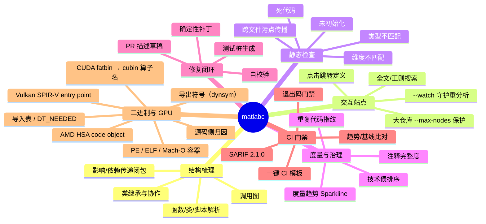
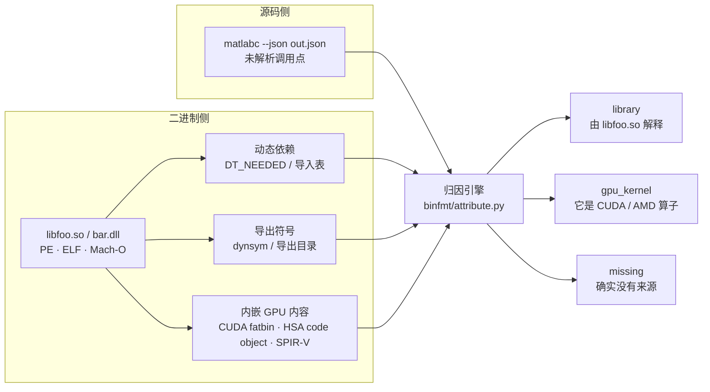
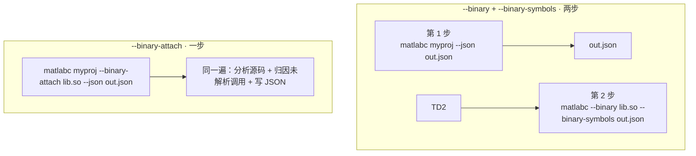
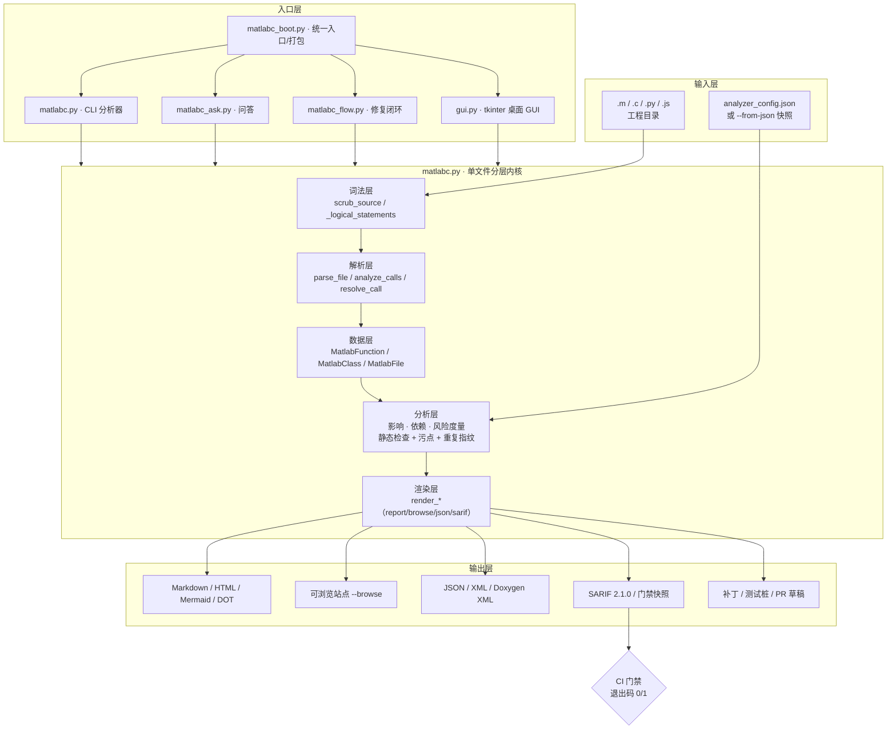
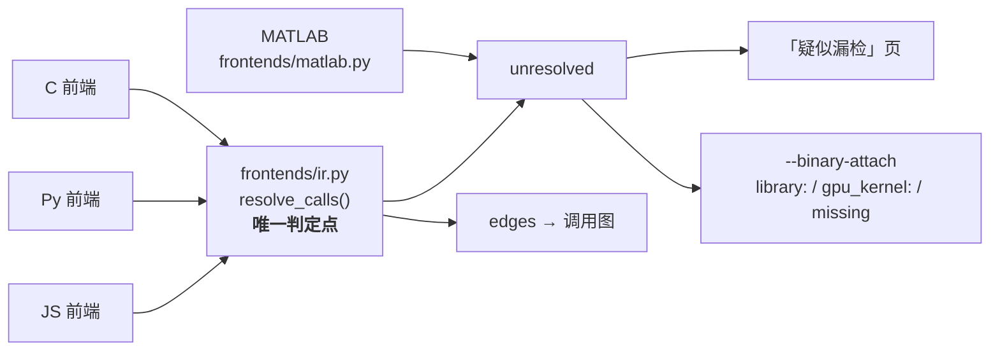
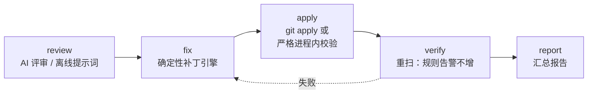
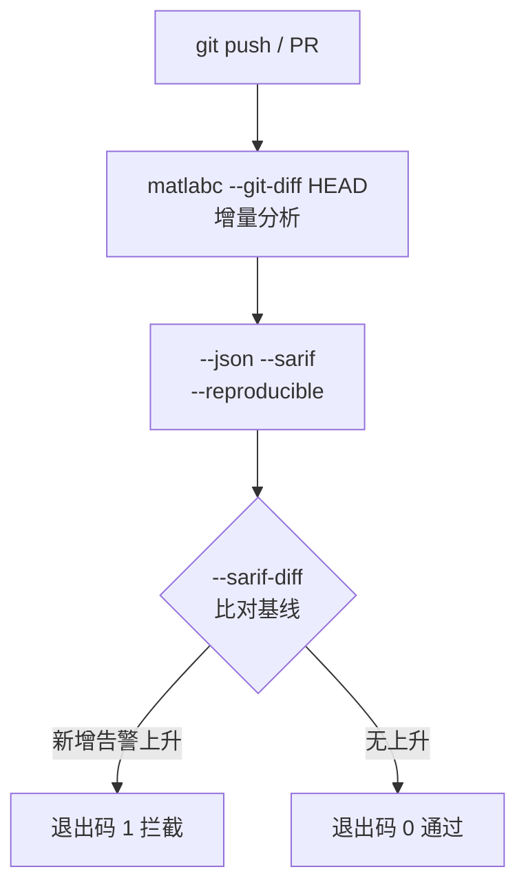
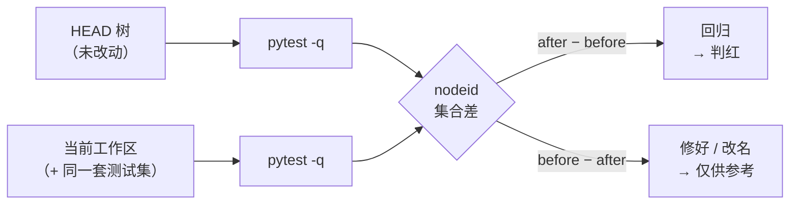

<div align="center">


# malabc

**静态分析与确定性自动修复引擎 —— MATLAB / Simulink、C·C++（子集）、Python、JavaScript，以及 PE / ELF / Mach-O 二进制与其中内嵌的 CUDA · ROCm · Vulkan GPU 内容**

把"读代码"变成"工作台"：它不只是梳理调用关系，更告诉你**风险在哪、有多严重、怎么改，
以及能否一键生成修复补丁 / 测试桩 / PR 草稿**，并把每一项结论都接进 **CI 质量门禁**。

<br>


-brightgreen)


[快速开始](#快速开始) · [核心能力](#核心能力) · [架构](#架构) · [二进制与 GPU](#二进制与-gpu-分析---binary) · [命令速查](#命令速查) · [CI 门禁](#ci-质量门禁) · [自验证质量门](#自验证质量门quality-gates) · [English](README.md) · [许可证](#许可证)

**作者与版权持有人：冯磊 (Feng Lei)** —— © 2026 冯磊 (Feng Lei)。
**侵权必究**：**代码**是 MIT，**名称与品牌**不是。详见 [LICENSE](LICENSE) §6。

</div>

---

## 解决什么问题

| 场景 | 旧做法 | 用 `matlabc` |
| --- | --- | --- |
| 接手陌生 MATLAB 工程 | 全局搜索 + 手动跳转，三天才摸清入口 | `--browse` 生成可点击站点，十分钟看全貌 |
| "改这个函数会影响谁？" | 凭经验猜，改完才发现漏了 | 影响 / 依赖传递闭包 + 算子影响分析 |
| "这代码里有没有隐藏风险？" | 跑 MATLAB 才能发现 | 未初始化 / 类型不匹配 / 死代码 / 维度不匹配 / 污点，全部静态可得 |
| "怎么改才安全？" | 手改，容易引入新 bug | `--gen-apply-patch` 生成确定性、自校验补丁 |
| "怎么阻止腐烂？" | 靠评审自觉 | SARIF + 退出码 + 趋势基线，CI 强制卡点 |
| "这个调用解析不出来 —— 是我们写错了，还是它本就是库函数？" | 靠猜，或手动翻磁盘 | `--binary` + `--binary-symbols`，或用一条命令搞定的 `--binary-attach`：每个未解析名字都被归到某个库、某个 GPU kernel，或标记 `missing` |

> **零依赖、无需 MATLAB、默认离线**：只用 Python 标准库；不依赖 MATLAB / Octave，不发起任何网络请求
> （离线优先，产物中不含 CDN 引用）——完全可在内网使用。

---

## 核心能力



### 多语言支持

| 语言 | 参数 | 关键能力 |
| --- | --- | --- |
| **MATLAB**（默认） | — | 函数 / 类 / 脚本 / 嵌套函数 / `arguments` 块 / 结构体字段 / 全局状态，完整解析 |
| **C / C++** | `--lang c`（别名 `--lang cpp`） | `.c/.h/.cc/.cpp/.cxx/.hpp/.hh/.hxx`；函数调用 / `#include` 跨文件依赖边 / 悬空指针、越界、释放后使用、重复释放、缓冲区溢出启发式。**对字面量 `#if 0` 具备预处理感知**：死分支不再被分析（**行号保持不变**），`#else` 分支照常分析 —— `#ifdef` / `#if defined` 刻意**不动**，不做猜测。函数定义识别走「**词法 + 括号配平**」扫描（R49）：`名字(参数) {` **跨行**（Allman 花括号、返回类型独占一行、参数表跨行）的定义同样可见 —— 实测 glibc-2.37（13,527 个 `.c/.h`）漏识率由 **99.05%** 降到 **0.04%**，`unresolved` 假阳性归零。C++ 按 **C 子集**解析（模板/类/命名空间不保证识别）—— 已披露的降级，不是静默丢弃。另在一棵完整的 **Linux 6.19.14** 源码树上做过端到端实测（62,704 个 C 系文件 / 36,155,901 行，sha256 已对镜像参考哈希校验一致）：**661 秒 / 峰值 10.8GB / 743,518 个函数 / 零崩溃** —— 并由此取证出 **五条真缺陷**，R75 修好其中三条（见 `docs/SUPERPOWER_REVIEW_R75.md`）。R76 把 C 前端 `--browse` 的产物改成**分页站点** —— `index.html` + 每源码文件一页 + 每检查规则一页 + `browse.css`：旧的单页报告在 `fs` 子树上（2,085 文件）已达 **30.6 MB**，整棵内核线性外推约 **1 GB**，浏览器打不开；同一次实测还发现站点 `<link href="browse.css">` 指向的文件**从未被写出**，页面实际是无样式的。站点零 JS / 零 CDN（图表全部服务端 SVG），可离线打开（见 `renderers/csite.py`）。 |R78 给 C 前端补上**注释与内联汇编的解析层 pass**（`_c_comments` / `_c_inline_asm`，**一行都不动 `_c_lex`**），CLI / JSON / 站点三处同时可见：全树实测 **13,632** 处内联汇编，其中 **1,964 处（14.4%）写在宏体里**（`include/` 高达 **93.1%** —— `asm/barrier.h` 的 `mb()/rmb()/wmb()` 全在 `#define` 里），所以抽取器走**独立的词法、不折叠 `#` 行**：复用 `_c_lex` 的 token 流会把它们**静默藏起来**。每条汇编按 模板 / 输出 / 输入 / clobber / 限定符 / 标签 报告，`+`⇒inout、`=`⇒out，并带出每个操作数绑定的 C 表达式；新增 `--lang asm` 前端给 `.S/.s/.asm` 一个**浅层**模型（符号 / 标签 / 指令助记符直方图 / 注释），与 C 的 8 类规则**隔离**。已验证旧有 C 键在内核子树上**逐位不变**（`security`：258 文件 / 3,694 函数；R79 让这批新数据既**付得起**又**不撒谎**：`--no-annotations` 输出**不带明细的 JSON** —— 逐文件的 `comments`/`asm`（以及汇编前端的 `symbols`/`labels`/`insn_hist`/`directives`/`comments`）被去掉，而**所有顶层汇总照留**，并用顶层 `annotations` 布尔让消费方能自证处于哪种模式：整棵内核 `.S` 语料 **17.1 MB → 0.22 MB（−98.8%）**，C 子树 **−19%…−49%**（`drivers/net` 6,086 文件 / 5.2 MLOC：320.7 MB → 258.5 MB；`lib`：22.2 MB → 11.3 MB）—— 诚实的读数是：整树 C 的 JSON 外推 **≈2.2 GB（full）/ ≈1.7 GB（lite）**，且 C 侧的真正大头是 `functions`/`edges` 而不是注释与汇编（所以单靠这个开关**不足以**让整树 C 的 JSON 变小，那是下一轮的题目）。同一次还把 `.S` 的助记符直方图改成**先分段、再折叠续行**统计：R78 的污染（`1:` 1964、`lock;`、`|` 5709）消失，直方图头部换成真助记符（`mov.l` 4794、`mov` 4231、`add` 3559、`nop` 2250），而不是原先霸榜的 cpp 续行残片（`\` 8,240、`|` 5,660）；数字局部标签变成 `kind="numeric"` 的标签（内核：16,089 个标签，其中 4,880 个是数字标签），m68k 的 `|` 行注释被如实记为注释（内核 6,477 条）而不再被误当指令，被排除的东西全部留在 `excluded_hist` / `segment_lines` 里可查 —— **没有静默消失**。既有的 C 键在 `security` 上仍**逐位不变**。**R80 / C29-1** 新增 `--json-level full|lite|summary`：内核实测 `lib`（651 文件）19.31 MB -> 8.98 MB（`lite`，-53.5%）-> **105.4 KB**（`summary`，-99.5%）；`security`（258 文件）6.63 MB -> 43.5 KB（-99.4%）；`drivers/net`（6,086 文件）253.05 MB -> **931.8 KB**（-99.6%）。`summary` 只留**计数** + 每文件一行签名 + 一个顶层 `summary` 块，于是「丢掉了多少明细」永远数得出来。汇编侧三档**不**单调变瘦（整树 `.S`：17.37 MB -> `lite` 215.6 KB -> `summary` 449.6 KB）—— `lite` 已把明细数组删光，`summary` 反而要写回计数。顶层键序不变（只插入了 `json_level`）。 |
| **Python** | `--lang py` | 函数 / 调用 / 静态检查（`py_unused_import` / `py_dup_params` / `py_too_many_params` / `py_missing_doc` / `py_eval_usage` / `py_sql_injection`），含 **Python 3.6 语法兼容门禁**（`--check-py36`） |
| **JavaScript** | `--lang js` | 函数 / 调用 / 静态检查（`js_unused_import` / `js_global_var` / `js_too_many_params` / `js_missing_doc` / `js_dangerous_call` / `js_unused_var` / `js_prototype_pollution`） |
| **混合（MEX 桥接）** | `--mixed` | MATLAB ↔ C 跨语言调用边 |

**语言支持边界（显式，不静默）**：`--lang` 只覆盖 MATLAB / C·C++ / Python / JavaScript。TypeScript、Rust、Go、Java、Kotlin、C#、Swift、Scala、Ruby、PHP **没有前端**：当目录里存在这些文件、而本次请求的语言一个源文件都没找到时，CLI 会向 stderr 打印 `[warn]` 行，点名语言与被跳过的文件，而不是悄悄给出「0 文件 / 0 函数」。与本次语言的源文件**混放**时，这些文件会被**安静跳过** —— 别把「本次语言 0 文件」当成「目录里什么都没有」。跨语言算子只有在**确有代码路径会产出**时才会出现在算子目录里；刻意不实现的算子登记在 `_UNIMPLEMENTED_KINDS` 并写明原因，`tools/check_operator_impl.py` 会在两者不一致时让构建失败。

**跨语言同形的交叉引用站点（R92）。** `--browse` 此前只对 C 产出分页站点：Python / JavaScript / 汇编的入口 `_run_ext_only` 明写「不生成 HTML 站点」，于是同一条能力按语言分裂成「有」和「没有」。R92 把 `renderers/csite.py` 泛化为**语言无关**的引擎（`lang` / `display` / `dep_key` / `dep_edges` / `binaries` / `attribution`）：`index` + `file/<每源文件一页>` + `funcs`（扇入 / 扇出 / 未解析名三张有界榜）+ `deps`（C 是 `#include`，Python 与 JS 是 `import`，都解析到项目内文件）+ `dir/<每目录一页>` + `src/<每源文件一页，逐行锚点>` + `rule/<每条检查规则一页>`；给了 `--binary` 或 `--binary-attach` 时另加 `binaries.html`（容器 / 架构 / 位数 / 依赖项 / 导出符号 / 缓解措施（每个键都给出依据）+「未解析调用 → 归到了哪个库」三态表）。每个文件页的函数表是**四列** —— `出边 / 入边 / 调用（它调用了谁）/ 被调用（谁调用了它）`，两个方向都可点，这就是「每一个函数和其他文件或者函数之间的调用关系」实际长成的样子。`dep_key` 对 C 是 `includes`、对其余是 `imports`，于是 C 的 `#include` 图与 Python/JS 的 `import` 图走**同一条渲染路径**，而不是长出第二份会各自漂移的实现。依赖边的口径：`import a.b` 按 Python 取最长命中（`a/b.py` → `a/b/__init__.py` → `a.py` → `a/__init__.py`），JS 只解析相对路径导入；裸模块名一律报成**未解析（系统库或项目外）**，不去猜 `sys.path` / `node_modules` / 打包器别名。两道**不静默**的闸挡住「内核级语料产出内核级站点」：源码页的单文件上限与总输出预算，两者都以计数写在索引页上；旧单页 `c_report.html` 在文件数超过 5,000 时跳过，理由打印出来，体积区间由归档的实测基数**现算**而不是写死。 **可点击的调用关系图，四语言同形（R93）。** 每个文件页现在都带一张**内联 SVG** 调用关系图，节点是真链接：点节点直接落到那个函数的源码行。布局是纯 Python 实现的确定性 Fruchterman-Reingold，**不需要 Graphviz 也不需要 `dot`**，页面上零 JavaScript、零外链 —— 断网双击即可打开。对照 doxygen：它要 `HAVE_DOT` + PATH 里有 `dot`，默认`DOT_GRAPH_MAX_NODES=50`，没有文档注释的函数**根本不画**，而且它把图用`` 嵌进 HTML —— **SVG 里的链接会全部失效**。这五条本项目逐条相反。更关键的是**图与表同源**：两者读的是同一份 `calls` 流，所以「图里有的边，表里必有同一行」；doxygen 的图与它的交叉引用表是两套独立推导，两者会对不上。未解析的调用（libc、内核导出符号、外部包）画成橙色节点而不是丢掉 —— 丢掉的话图会比真实干净。由于力导向是 O(n²·迭代)，节点数**有界**（默认 40，实测 105.14 微秒/节点/迭代）；一旦截断，页面写明「另有 N 个节点未画」。`kernel/sched` 实测：38 张图 / 1,315 个节点，站点从 10.95 MB 涨到 11.27 MB。

### 二进制与 GPU 分析（`--binary`）

源码侧分析能告诉你**有个调用没解析出来**，却告诉你**为什么**。`--binary` 补上这一环：
把它指向你代码实际链接的那些库，每个没解析出来的名字都会得到归属。



```bash
# 这个库依赖什么、导出了什么？
python matlabc.py --binary libfoo.so

# 让源码侧和二进制侧回答同一个问题
python matlabc.py myproj/ --json out.json                              # ① 找出未解析调用
python matlabc.py --binary libcublas.so.12 --binary-symbols out.json   # ② 给它们归属

# 机器可读，便于接进你自己的流水线
python matlabc.py --binary a.dll,b.so --binary-json -
```

| 后端 | 它藏在哪 | 怎么找 | 能提出什么 |
| --- | --- | --- | --- |
| **CUDA** | PE `.nv_fatb` · ELF `.nv_fatbin` · PE/ELF `.nvFatBi` / `.nvFatBin` | fatbin 魔数 `0xba55ed50`；再经 cubin 的 `.text._Z…` **节名表**定位 | kernel 名 + 可反解（demangle）形式、SM 目标、code object 计数 |
| **ROCm / HIP** | PE/ELF `.hip_fat` / `.hipFatBin` | HSA code object 头（`e_ident[7]` = 64、`e_machine` = 224） | 可信 code object 计数（kernel 名**不猜**） |
| **Vulkan** | **没有专用段** —— SPIR-V 躲在 `.rdata` 里 | 裸魔数扫描 `0x03022307`（解 `OpEntryPoint`） | entry point 名、模块数 |
| **PTX** | 同一个 fatbin 段内 | `.entry <名字>(`，**必须**后随左括号 | **通常提不到东西** —— 见下方「诚实的边界」 |

> **实测记录 —— 8 字节陷阱。** PE 的段名被硬截断到 8 字节。同一个 CUDA 段在 ELF 里叫
> `.nv_fatbin`，在 PE 里叫 `.nv_fatb`；`.nvFatBin` 变成 `.nvFatBi`；AMD 的 `.hip_fatbin`
> 变成 `.hip_fat`。只认完整拼写的匹配器，会在**每一个** Windows 二进制上报告「零个 GPU
> 内容」—— 静默地、不报错地。现在两种拼写都匹配。

> **实测记录 —— cubin 不是标准 ELF。** cubin 的 `e_type = 0x8000`、`e_machine = 0x100`，
> `e_shoff` 落在 `0xCAFE…` 哨兵值上。唯一可信的判别字段是 `e_ident[7]`
> （`ELFOSABI_CUDA` = 51）与 `e_ident[8]`。数 `\x7fELF` 出现次数只是**便宜**信号，
> 它与**严格**信号被放在**不同字段**里（`suspect_code_objects` 与 `confidence_code_objects`），
> 二者不可能被混淆。

**诚实的边界（都是实测出来的，不是猜的）。**

- **PTX 基本提不出 kernel 名。** 要求 `.entry <名字>(` 后随左括号，在一份 692 MB 的真实驱动
  发行包上只剩约 2 个可用名字；其余 `.entry ` 命中都是二进制元数据。真正有效的是 cubin 里的
  **`.text._Z…` 节名表** —— 实测在一个厂商 BLAS 库里提出 **171** 个独立 kernel 名、另一个
  库 **59** 个，且 100% 可反解。
- **Mach-O 已实现但未经实测。** 开发机上没有 Mach-O 样本；解析器会把这件事写进报告的
  `notes`，而不是假装验证过。
- **「不可解析」是一等状态。** 提不出内容的 GPU 段会报成 `NOT-PARSEABLE` **并附书面原因**，
  绝不静默给 0 个 kernel。
- **截断一定可见。** `--binfmt-scan-cap`（默认 64 MiB）限制扫描量；一旦截断，报告打印
  `[TRUNCATED]`。
- **运行期绑定不在范围内。** 不追踪 `dlopen` / `LoadLibrary` / `dlsym` / `LD_PRELOAD`。
  构建脚本的链接意图**只按字面量读**：`-lfoo` 是 `--lib-resolve` 的解析**种子**
  （名字 → 磁盘文件），不做变量展开、也不据此推断运行期加载顺序 —— 含变量的 `-l$(X)`
  会被记成一条明确的 note，绝不猜。
  要看运行期谁加载了谁，请用外部装置：`ltrace` / `strace -e openat` / `LD_DEBUG=bindings`
  —— 它们是运行期装置，静态分析原理上给不出这个答案。

#### 一条命令代替两条：`--binary-attach`

`--binary` 会**短路** —— 看完二进制就退出。`--binary-attach` 刻意**不短路**：它先照常做源码
分析，再顺手把刚刚发现的未解析调用拿去二进制里对账 —— 一次调用完成，不需要在中途搬一个
JSON 文件。



| | `--binary` | `--binary-attach` |
| --- | --- | --- |
| 同一次调用里做源码分析 | 不 —— 只看二进制 | **做** —— 做完再归因 |
| 名字从哪来 | 你事先用 `--binary-symbols` 备好的文件 | 自动取自源码侧 |

```bash
# 一条命令：分析 myproj，再把它的未解析调用拿去 libblas.so 里对账
python matlabc.py myproj/ --binary-attach libblas.so --json out.json
```

只依据你**显式给出**的二进制。没给的库一律 `missing`，绝不猜 —— 一个假阳性会把真缺陷洗白成
「来自某个库」，比不归因更糟。JSON 里结果落在 `unresolved_attribution`（`{summary, rows}`），
且**未给该开关时这个键不存在** —— 不留一个可能被下游误读成「归因过、但一个都没命中」的空壳。

名字仍然落在 `missing` 时，它还会再走一步：读工程里的 `Makefile` / `CMakeLists.txt`，
把其中**字面量**的链接意图列出来（`-lblas` → 候选 `libblas.so`，`find_package(BLAS)` 也算线索），
让你看到**下一步该把哪个库传进来**。含变量的 `-l$(X)` 只会被记成一条明确的 note，绝不猜。

#### 从「库名」到磁盘上的「文件」：`--lib-resolve`

`--binary-attach` 仍然要**你**把文件交上来。`--lib-resolve` 去掉的就是这最后一道手工步骤：
名字本来就在你的工程里 —— `Makefile` 的 `-lfoo`、`CMakeLists.txt` 的 `target_link_libraries`、
ELF 的 `DT_NEEDED`、PE 的导入表 —— 它把这些名字解析到文件系统上，再沿依赖链逐层往下走。

```bash
# 分析 myproj，把它提到的每个库名都解析出来，并顺依赖往下走 2 层
python matlabc.py myproj/ --lib-resolve 2 --lib-path /opt/sdk/lib --json out.json
```

每一条引用都恰好落在三种状态之一，而且**没有一种是猜的**：

| 状态 | 含义 | 报告里带着什么 |
| --- | --- | --- |
| `resolved` | 精确命中唯一一个文件 | 路径，以及是哪条匹配规则命中的（`exact` / `exact_ci` / `family` / `path`） |
| `ambiguous` | 同名文件有多个 | **全部**候选 + 一份 `rejected` 列表 —— 32/64 位孪生**只**按**候选自己**的位数排除，被排除的那份仍可复述 |
| `not_found` | 一个都没命中 | **真的搜过的那些目录** —— 绝不是一个光秃秃的「没找到」 |

**有上限，并且对「有上限」这件事说实话。** `--lib-resolve` 最多下钻 N 层，`--lib-max-nodes`
（默认 64）限制一次解析多少个文件；撞上限的节点状态是 `skipped`，与 `not_found` **严格区分**
—— 「我没看」不等于「我找不到」。依赖成环会终止，每个文件只解析一次。`--lib-path` 是把目录
**追加**在平台默认目录**之前**，不是替换；读不动的目录会自己说出来。

**两档证据并存，绝不合并。** ELF 的缓解措施读数（PIE / NX / canary / RELRO）是 `inferred`
—— 由构件的有无**推**出；PE 的（ASLR / CFG / NX / SEH / …）是 `observed`，直接从头部字段读。
`None` 表示**判据构件缺失**，`False` 表示**观测到且为否**；RELRO 与 exec-stack 在 PE 上恒为
`null`，因为那两个概念在 PE 上不存在；而声明的结构大小够不到 `SecurityCookie` 的 `LOAD_CONFIG`
一律**拒绝越界读**，而不是硬读出来。

#### 谁调用谁：`--callgraph`

调用边一直在算 —— 光 Linux 内核整树就有 **7,060,966** 条。但 `--json-level summary` 的载荷
**结构上不含 `edges` 数组**（只有一个计数），而全量数组在内核规模下是 GB 级。于是**此前没有
任何产物**能打开来回答「谁调用谁」。

`--callgraph` 就是那个产物，而且**在构造上有界**：

```bash
# 全图形状：度数排行、递归环、跨文件 / 跨目录计数
python matlabc.py linux/ --lang c --callgraph cg.json

# 钻进某个函数：向外两层，最多 50 个节点、200 条边
python matlabc.py linux/ --lang c --callgraph cg.dot \
       --callgraph-focus __schedule --callgraph-depth 2 \
       --callgraph-max-nodes 50 --callgraph-max-edges 200
```

| 块 | 回答什么 |
| --- | --- |
| `fan_in_top` / `fan_out_top` | 枢纽函数 —— **被调用最多的是谁**（改动会波及什么） |
| `cycles` | 强连通分量（互为递归）。默认节点是**定义落点** ⇒ 同名不同文件的 `static` 函数不再合并成假环 |
| `cross_file` / `cross_dir` | 内部 / 跨文件 / **同名多定义（不猜）** / 无定义 |
| `focus_subgraph` | 某个函数的 BFS 邻域，逐层给出 |
| `truncated` | 每一条**真的**触发的上限，**分子与分母同时在场**：`hit_node_cap` / `nodes_shown`，以及给了 `--callgraph-max-edges N` 时的 `hit_edge_cap` / `max_edges` / `edges_total` —— **「我没展开」不等于「没有关系」** |

`.json` 是结构化形态；`.dot` 与 `.mmd` 渲染焦点子图。扩展名不认识时**直接失败**，
绝不悄悄退回 JSON。

**四条口径，写出来而不是让人猜。** 节点身份默认是**带作用域的本地定义落点**
（`identity: "definition-site-local"`，R89；R88 之前那一版是 `definition-site`）：一个节点是
`名字 @ 定义文件`，所以同名不同文件的 `static` 函数**各成节点** —— 内核整树上
名字级口径报出的「最大调用环 **37,775** 个成员」完全是个合并假象（有 5,149,101 条边、即
**72.9%**，指向「同名多定义」）；换成定义落点后它塌到 **591**。两个更老的口径仍可显式选中
（`--callgraph-identity definition-site` / `--callgraph-identity callee-name`）；在名字级口径下
节点**就是名字**，所以 `cycles` **可能含假阳性**。换口径**一条边都不删**（三种口径 `edges_total`
逐位相同）。被调侧有多份定义、无法归属时，节点是一个**不猜**的汇点 —— 诚实代价是**经过它的环不会
报出来**；`resolution` 块接着说明有多少条边落进了哪一档（`unique` / `same_file` / `include` /
`ambiguous` / `external`），五档之和恒等于 `edges_total` —— 这样「救回了多少」就不能靠换分母做大。
新默认口径补上的是 **C 本来就有**的两条作用域规则：先看**同文件**，再看**同翻译单元**（只在
按 basename 解析出的包含闭包两侧**都对上恰一份**候选、且调用点是翻译单元根时才用）；而且**只对 C
启用** —— Python / JS 的模块绑定能在运行时被改掉，「同名同文件」只是一种**近似**，而近似冒充结论
正是造出假环的成因。未解析调用**不在图里**（它们没有 callee 节点），并列报出计数，因为
「没解析出来」不是「没有关系」。上限**永远**被上报：焦点 BFS 撞到节点上限会置
`truncated.hit_node_cap`；而被 `--callgraph-max-edges N` 限住的会保留**先遇到的** `N` 条边，
并同时置 `truncated.hit_edge_cap` 与 `max_edges` / `edges_total` —— 后者的分母与「不给上限」
时的**是同一个计数**，所以「丢了多少」永远不必从第二个、口径不同的数里读出来。
限边**绝不动节点**（`nodes` / `nodes_shown` / `hit_node_cap` 逐位不变）。不给这个开关时，
那个 `truncated` 块带的**恰好**是 R90 那四个键 —— 三个边上限键是**条件键，不是漏写**。

### 静态检查规则

| 规则 | 说明 |
| --- | --- |
| `uninitialized` | 局部变量读前未写（区分"未初始化 / 可能未初始化"；仅高置信度才卡 CI） |
| `type_mismatch` | 同一变量类型前后不一致（如矩阵变量被赋标量） |
| `dead_code` | `return` 之后不可达代码 + 恒假 `if` 分支 |
| `shape_mismatch` | `A*B` / `A+B` / `A-B` 维度约束违背 |
| `tainted_sink` | 跨文件污点：用户输入 / 文件 / 网络 → 危险汇如 `system` / `eval` / `fprintf` |
| `py_eval_usage` | `--lang py`：函数体内裸调 `eval()` / `exec()`（代码注入 / 沙箱逃逸） |
| `py_sql_injection` | `--lang py`：拼接 / `%` / `.format()` 构造 SQL 后交给 `execute()`；参数化查询不报 |
| `c_double_free` | `--lang c`：同一指针 free 两次且中间无重新赋值 |
| `c_buffer_overflow` | `--lang c`：`strcpy`/`strcat`/`sprintf`/`gets`（或未用 `sizeof(buf)` 的 `memcpy`/`strncpy`）写入固定大小缓冲区 |
| `js_dangerous_call` | `--lang js`：`eval` / `new Function` / `document.write` / `innerHTML` 赋值 / `insertAdjacentHTML` / 定时器字符串 |
| `js_unused_var` | `--lang js`：函数体内简单声明后从未再被引用的局部变量 |
| `js_prototype_pollution` | `--lang js`：直写 `__proto__`、`prototype[<变量>] =`、`constructor.prototype`，或 for-in 合并中写 `target[key]` |

**四级告警抑制**（写在源码注释里，不改业务语义）：

```matlab
% analyzer:ignore uninitialized                 % (1) 文件级：整文件不检查
% analyzer:ignore type_mismatch x -- legacy      % (2) 名称级：仅变量 x，原因可选
% analyzer:ignore-next-line shape_mismatch        % (3) 行级：仅下一行
% analyzer:disable uninitialized                  % (4) 区间级：块内全部忽略
y = a + b;
% analyzer:enable uninitialized                   %     ↑ 区间结束
```

---

## 架构



**目录结构**

```
malabc/
├─ matlabc.py          # 核心分析器 + 报告渲染（CLI 主入口，约 29k 行，零依赖）
├─ matlabc_boot.py     # 统一入口分发：无参数 = GUI / ask / flow / 否则 = 分析器
├─ matlabc_ask.py      # 问答式代码理解（BM25 检索 + 意图识别 + 大模型）
├─ matlabc_flow.py     # AI 修复闭环编排 review→fix→apply→verify→report
├─ matlabc_mcp.py      # MCP 服务器（把 matlabc 作为工具暴露给 AI Agent）
├─ frontends/          # 「哪个调用解析不到」的**唯一判定点**
│  ├─ ir.py            #   共享 IR + resolve_calls()；唯一做判定的地方
│  ├─ matlab.py        #   MATLAB 自己的 unresolved 产出器（形状不同，契约相同）
│  └─ __init__.py      #   对外接口 + IR_LANG_OWNERS（哪种语言归谁）
├─ binfmt/             # 二进制与 GPU 容器分析（零依赖）
│  ├─ model.py         #   统一 IR：Section / Symbol / Dependency / GpuBlob / BinaryReport
│  │                   #   + Segment（权限）与静态缓解措施 —— None ≠ False
│  ├─ pe.py  elf.py    #   PE32+ 与 ELF64/32 流式解析（含 CUDA/AMDGPU 判别）
│  ├─ macho.py         #   Mach-O（⚠ 已实现但未经实测 —— 开发机无样本）
│  ├─ gpu.py           #   CUDA fatbin/cubin · HSA code object · SPIR-V entry point
│  ├─ attribute.py     #   归因：未解析名字 → library / gpu_kernel / missing
│  ├─ resolve.py       #   库名 → 磁盘文件 → 依赖逐层下钻（R86-2）
│  ├─ buildsys.py      #   Makefile / CMakeLists.txt 链接意图提示
│  └─ report.py        #   文本报告（绝不隐藏负面状态）
├─ tools/              # 自验证静态护栏（见「自验证质量门」一节）
│  ├─ check_all.py     #   一键跑完全部 check_*.py 及各自的 --selftest
│  └─ check_*.py       #   文档开关 · 算子实装 · 补丁算子 · 3.6 兼容 ·
│                      #   帮助契约 · binfmt 夹具 · 子进程卫生 ·
│                      #   README 对等 · 公平基线 · IR 归因
├─ ai_cli.py           # 多厂商大模型接入（离线回显 / 在线回答，优雅降级）
├─ gui.py              # 零依赖 tkinter 桌面 GUI
├─ renderers/          # 报告与可视化渲染器（report/callgraph/hotspot/sarif/snapshot...）
│  └─ assets/          # 内联 CSS 资源（离线优先，无 CDN）
├─ tests/              # 测试与样例（test_matlabc.py / eval_ai_fix / sample_m/*.m）
├─ docs/               # 完整文档（用法 / 功能 / JSON Schema / 交付报告 ...）
├─ ci-examples/        # GitHub / GitLab CI 模板样例
├─ LICENSE             # MIT 许可证（英文正本，唯一具法律效力的文本）
└─ LICENSE_CN          # MIT 许可证中文译本（仅供参考）
```

**一条规则只有一个地方判。** `resolve_calls()` 是唯一决定「这个调用解析不到」的代码；
下游三处 —— 调用图、「疑似漏检」页、二进制归因 —— 读的都是这同一个结论，
而不是各自再推一遍。



---

## 快速开始

> **安装与使用**：完整手册在 [`releases/docs/USER_GUIDE.md`](releases/docs/USER_GUIDE.md)（安装、每个功能怎么用、常见问题）。

```bash
# (1) 控制台报告（零安装，克隆即跑）
python matlabc.py my_matlab_project/

# (2) 生成可交互浏览站点（推荐：点击跳转、全文搜索）
python matlabc.py my_matlab_project/ -o report.html --browse

# (3) CI 静态分析（SARIF + 退出码门禁）
python matlabc.py my_matlab_project/ --checks all --sarif report.sarif \
    --max-warnings 0 --reproducible
```

环境要求：**Python 3.6+**（工具本身严格兼容 3.6.5；可用 `--check-py36` 自检）。
可选装为命令：执行 `pip install -e .` 后使用 `matlabc <参数>`（无参数 = GUI）。

> 也可打包为**无需 Python 的单文件可执行程序**（`build_dist.py` + `build_release.bat/.sh`）：
> 双击 = GUI，带参数 = CLI。

---

## 四个入口

### 1. 分析器（CLI）

```bash
python matlabc.py myproj/ -o report.md --html report.html --browse \
    --offline --checks all --debt --sarif report.sarif
```

### 2. `ask` —— 问答式代码理解

把静态分析结果规约为三类可检索对象——"函数文档 + 调用图 + 告警/优先级"——再用 BM25 检索 +
意图识别（谁调用 X / X 调用了谁 / 风险热点 / 解释 X）拼出给大模型的提示词。

```bash
matlabc ask "谁调用了 main" --dir ./myproj           # 打包统一入口
python matlabc_ask.py "风险最高在哪" --dir ./myproj   # 源码等效入口
python matlabc_ask.py "helper 做了什么" --json report.json --provider deepseek
```

> **离线优先**：未配置 API Key 时不调用任何模型，只回显一份"可直接粘贴"的提示词
> （含检索到的真实上下文 + 问题）。配置好厂商后，直接给出回答。

### 3. `flow` —— AI 修复闭环



```bash
matlabc flow ./myproj                    # 默认仅产出补丁 + 报告，不改任何文件
matlabc flow ./myproj --auto-apply       # 应用补丁并自校验
matlabc flow ./myproj --steps review,fix,report --lang c --provider deepseek
```

### 4. GUI（零依赖桌面界面）

```bash
python gui.py            # 或双击打包后的 matlabc.exe
python gui.py --selftest # 无头自测
```

选目录 → 勾选产物（可浏览站点 / HTML / JSON / SARIF / MD）→ 选择 AI 时机 → 一键分析并流式日志。

---

## 输出产物

| 产物 | 触发 | 用途 |
| --- | --- | --- |
| 控制台 / Markdown 报告 | `dir`（默认） / `-o` | 快速查看、留档评审 |
| HTML 报告 | `--html` | 单文件，直接分享 |
| Mermaid / Graphviz DOT | `--mermaid` / `--dot` | 嵌入 Wiki / 文档 |
| 可交互浏览站点 | `--browse`（+`--watch` 守护） | 点击跳转定义、全文搜索 |
| JSON / XML / Doxygen XML | `--json` / `--xml` / `--export-doxygen-xml` | 二次开发、doxygen 生态 |
| SARIF 2.1.0 | `--sarif`（+`--sarif-base` / `--sarif-diff`） | GitHub / GitLab 代码扫描 |
| 技术债 / 趋势 | `--debt` / `--trend` / `--gate` | 质量度量与趋势门禁 |
| 修复闭环 | `--gen-pr` / `--gen-apply-patch` / `--gen-tests-risk` | 修复落地、测试桩骨架 |
| 重复代码治理 | `--dup-*`（baseline / patch / self-verify / gate） | 复制粘贴代码异味治理 |
| 二进制 / GPU 报告 | `--binary`（+`--binary-symbols` / `--binary-json` / `--binfmt-scan-cap`） | 动态依赖、导出符号、CUDA/ROCm/Vulkan 内容，以及源码侧归因 |
| 差异报告 | `--diff` / `--diff-html` | 两份快照的全维度对比 |

---

## CI 质量门禁



`ci-examples/` 提供开箱即用的 GitHub Actions / GitLab CI 模板，复制即可用。

**本仓库在 Windows 上跑自己的门禁**（`ci.yml`，`windows-latest`）：3.6 语法门、
回归套件、36 道静态门、LSP/MCP 行为判据、60 个端到端场景、变异抽样。

```bash
python tools/ci_local.py        # 同一条流水线，在 E:\ci\matlabc 的干净克隆里跑
```

Linux 的 job 是**故意暂停**的：手上没有 Linux 机器时，ubuntu 红了也没法复现，
那种红灯最终一定被忽略。恢复只要一行（`runs-on: ${{ matrix.os }}` + 两项目录矩阵）——
而到那天，失败至少是可复现的。

## 命令速查

```bash
# 结构梳理报告（Markdown）
python matlabc.py myproj/ -o report.md

# 可交互浏览站点（点击跳转 + 全文搜索）
python matlabc.py myproj/ --browse -o site.html

# C 工程分析
python matlabc.py myproj/ --lang c --checks all

# Python 3.6 语法兼容门禁
python matlabc.py myproj/ --lang py --check-py36

# CI 门禁：出现任何新增告警即失败，输出 SARIF
python matlabc.py myproj/ --checks all --sarif report.sarif \
    --sarif-base baseline.sarif --sarif-diff --max-warnings 0 --reproducible

# 跨文件污点扫描
python matlabc.py myproj/ --checks tainted_sink

# 二进制分析：动态依赖、导出符号、GPU 内容
python matlabc.py --binary libfoo.so

# 未解析调用的归因：源码侧 ↔ 二进制侧
python matlabc.py myproj/ --json out.json
python matlabc.py --binary libcublas.so.12 --binary-symbols out.json

# ……或用一条命令同时做掉（不需要中转 JSON）
python matlabc.py myproj/ --binary-attach libcublas.so.12 --json out.json

# 生成确定性、自校验修复补丁
python matlabc flow myproj --auto-apply --gen-apply-patch

# 问答式代码理解（离线 => 回显可直接粘贴的提示词）
python matlabc_ask.py "风险最高在哪" --dir myproj

# 把「改代码」当成任务：改名自带验收条件与回滚
# 动手**之前**先把判据列出来，写完再逐条验；任一条不过或写盘失败，自动逐字节恢复
python matlabc_task.py rename --dir myproj/ --old helper --new assist
python matlabc_task.py rename --dir myproj/ --old helper --new assist --apply

# 同一套任务，换成结构体字段：只动 `.old`——独立变量 `old`、字符串里的 'a.old' 都不动
python matlabc_task.py rename-field --dir myproj/ --old old --new new --apply

# 把一段代码提成独立函数。接口**由你写清楚**，不猜——猜错的提取比不提更糟；
# 验收：函数数 +1 / 诊断不增加 / function-end 仍配平
python matlabc_task.py extract --dir myproj/ --file a.m --lines 12-18 \
    --name part --in x,y --out z --apply

# 也可以让它自己推断接口。它是启发式，并且**会说出来**：dry-run 先打印 `in=… | out=…`
python matlabc_task.py extract --dir myproj/ --file a.m --lines 12-18 \
    --name part --auto --apply

# 也可以提到独立文件（`--to`）：新文件先写，回滚时一并删掉；目标已存在则拒绝覆盖
python matlabc_task.py extract --dir myproj/ --file a.m --lines 12-18 \
    --name part --in x,y --out z --to part.m --apply

# 撤销**上一次**任务。任务失败会自动回滚，这条是给「成功了但想反悔」用的；
# 若被改过的文件在任务之后又被编辑过，它会拒绝 —— 否则会静默吞掉那些编辑。
# 记录落在 `.matlabc/tasks/`。
python matlabc_task.py undo --dir myproj/ --apply
python matlabc_task.py undo --dir myproj/ --list   # 看过都做过什么
python matlabc_task.py undo --dir myproj/ --diff   # 先看会改成什么样，再决定
python matlabc_task.py undo --dir myproj/ --id 20261020-001555-413 --apply
python matlabc_task.py undo --dir myproj/ --batch --apply   # 整批一次撤完
python matlabc_task.py prune --dir myproj/ --keep 50 --apply  # 裁剪旧记录
python matlabc_task.py stats --dir myproj/   # 按任务类型的耗时与回滚率
python matlabc_task.py baseline --dir myproj/ --save  # 记住「平时多快」
# 之后 stats 会额外列出比基线慢一倍以上的类型。

# 任务记录在 `.matlabc/tasks/`（一个任务一个 JSON，上限 50 条，
# 先删已撤销的）。不希望它们进仓库的话，把 `.matlabc/` 加进 .gitignore。

# 撤销是「按记录」的：若较新的任务也改过同一个文件，撤较早那条会被拒绝，
# 而不是悄悄盖掉后一步的改动。恢复之后会重新分析，要求结构回到任务前的样子
# （函数数 / 调用边 / 诊断），不达标就把「撤销」本身也退回去。

# 把整个函数搬到独立文件。目标必须叫 `<name>.m`——换个名字它就变成
# 文件内私有子函数，所有调用点会**静默失效**
python matlabc_task.py move --dir myproj/ --file a.m --name helper --to helper.m --apply

# 多步当**一个事务**：每步照常验收；任一步失败，前面已完成的步骤也一起回滚
# —— 不会留下改了一半的工程
# plan.json 里可以引用前面步骤的参数：
#   {"task": "rename", "old": "${prev.new}", "new": "solve"}
python matlabc_task.py batch --dir myproj/ --steps plan.json --apply
```

---

## AI Agent 集成（MCP）

`malabc` 可作为 **Model Context Protocol（MCP）** 工具服务器，被任意支持 MCP 的 AI Agent
（CodeBuddy / Cursor / Claude 等）即插即用地调用，把"代码理解 + 静态检查 + 确定性补丁"
能力接入 Agent 的自主工作流。

启动（由 Agent 的 MCP 客户端自动拉起，零第三方依赖）：

```bash
python matlabc_mcp.py
```

协议为 MCP over stdio（LSP 分包帧，兼容官方 MCP SDK）。暴露的工具：

| 工具 | 作用 |
| --- | --- |
| `matlabc_analyze` | 静态分析 + 结构梳理，生成调用关系 / 风险热点 / 技术债报告 |
| `matlabc_check` | 门禁式静态检查（`uninitialized` / `type_mismatch` / `dead_code` / `shape_mismatch` / `tainted_sink`） |
| `matlabc_ask` | 自然语言问答式代码理解（谁调用 X / 风险热点 / 解释 X） |
| `matlabc_gen_patch` | 运行 AI 修复闭环，生成 / 应用确定性修复补丁 |
| `matlabc_version` | 返回引擎版本与能力清单，供 Agent 能力协商 |

> **设计要点**：server 通过 `subprocess` 复用 `matlabc` 现有 CLI（进程隔离、行为一致）；
> 拉起的子进程**整棵进程树**在 server 退出 / 超时时被强制回收（Windows `taskkill /T`、
> POSIX `killpg`），避免孤儿进程跑飞。所有工具返回带 `isError` 标记，便于 Agent 做错误分支。

Agent 调用示例（伪代码）：

```json
{"method":"tools/call","params":{"name":"matlabc_check",
 "arguments":{"target":"src/","check":"uninitialized","max_warnings":0}}}
```

---

## 编辑器集成（LSP）

`matlabc_lsp.py` 是一个最小 Language Server（stdio + JSON-RPC）。它**只跟
`matlabc.py` 说话**，从不自己重算一遍分析：

| 能力 | 行为 |
| --- | --- |
| `initialize` | `textDocumentSync = 1`（full） |
| `textDocument/didOpen` | 推送诊断：**先发空数组**，再发真实结果 |
| **`textDocument/didSave`** | **作废缓存 → 重算 → 重新推送** |
| `publishDiagnostics` | `source = "matlabc"`，一条对应 `facts` 里的一个条目 |

**硬判据**：每条诊断都必须能在 `facts` 里找到出处，并且诊断是 `--json`
`heuristics` 的**超集**——**不是相等**。R161 之后 `facts` 还含
`c_uninit_read` 与 `m_dead_code`，所以服务端能发四类，而 `heuristics` 只有一类。

**它不读 CLI 的输出**：R145 起改为进程内调用 `analyzer.api.analyze`，
没有子进程，也没有 62 KB 序列化。

**只有 `didOpen` 会把诊断冻结在打开那一刻** —— `didSave` 就是为此存在的。
**慢是等一会儿，旧是错。**

```powershell
python matlabc_lsp.py      # 在 stdin/stdout 上说 LSP
```

> **实测延迟**（1,300 个 `.m` 文件）：
>
> | 角色 | 耗时 |
> | --- | --- |
> | CLI（`matlabc.py … --json`，全流程） | 5.92 秒 |
> | **LSP 首次分析（进程内）** | **3.20 秒** |
> | 复用路径（已实测，**尚未接入服务端**） | **1.40 秒** |
>
> 差的这部分是 `os.walk`、JSON 序列化与进程启动——编辑器一样都用不上。
> `run_pipeline(prev=..., changed=...)` 在无变化时**完全不解析**，
> 并且是**进程内、无序列化**的（`--incremental` 走 pickle，在 13 个文件上
> 反而慢 10 倍——见 `docs/analysis/ANALYSIS_2026-10-18_REUSE_INTERFACE.md`）。
>
> 单文件入口已实测并**被否掉**：`MyCls.m`（`classdef`）
> 在全量模式下报出 2 条「缺 description」，单文件模式下是 **0** 条，
> 因为 `doc_todos` 依赖跨文件的 `callers_of`。
> （别处引用的 1,093 秒属于 **C 臂**——62,704 个 `.c` 文件 + `--checks all`，
> 与这里无关。）详见
> `docs/analysis/ANALYSIS_2026-10-17_LSP_PERF.md` 与
> `docs/analysis/ANALYSIS_2026-10-17_SINGLE_FILE.md`。

---

## 编程接口与 Rust 运行时

**import 分析器，而不是起子进程**——不 argparse、不 `sys.exit`、
**0 字节泄漏到 stdout**（当 stdout 是 LSP 通道时，这一条是硬要求）：

```python
from analyzer.api import analyze, counts
r = analyze("tests/sample_m")     # -> PipelineResult，不是报表
counts(r)                         # {'files': 13, 'functions': 19, 'edges': 9, 'checks': 6}
```

`analyzer.index.Index` 只记录**哪些文件变了**（mtime+size 做快速路径，
sha256 做真相）。它刻意**不缓存解析结果**——「哪些文件动了」与
「缓存怎么失效」是两个不同的问题。

```python
from analyzer.index import Index
d = Index("proj").refresh()       # d.added / d.changed / d.removed / d.unchanged
```

`malabc-rt` 是 **Rust 运行时骨架**（零依赖，`cargo test` 5 条通过）。
它只求值标量 double：

```powershell
malabc-rt eval "1+2*3"     # 7
malabc-rt eval "1/0"       # Inf
malabc-rt eval "a+1"       # rc=1：unimplemented token 'a'
```

语句、数组、MATLAB 内建函数**都还没有**。它是骨架，不是运行时，
它自己的 README 里也是这么写的。

---

## 自验证质量门（Quality Gates）

项目对自己能力的每一项宣称，都由**可执行的护栏**兜底。一条命令全跑：

```bash
python tools/check_all.py        # 跑完 tools/check_*.py 全部护栏 + 各自的 --selftest
```

| 护栏 | 它拦住什么 |
| --- | --- |
| `check_baseline.py` | `P1–P4/T1` — 「这次改动有没有让测试变差？」—— 按失败 **nodeid 集合**比对，不是比个数。本仓测试集**本来就不全绿**，所以个数证明不了任何事：124 → 123 可能是「修好一个」，也可能是「修好两个又弄坏一个」。`--full` 真跑两侧；默认模式只做前置条件体检 + 判定逻辑两向自证。「仓库」含**两种形态**：`.git` 是目录，或 `.git` 是首行 `gitdir:` 指向**存在**目录的文件（`git worktree add`）—— 旧判据只认前者，于是在 worktree 里 `check_all` 根本跑不起来（R54）。**T1（R63）**再把「**本轮新增/改动过**的测试」单列一类：`--full` 把**当前** `tests/` 复制进导出树，而树里的 `tools/` 还是**上一个提交**的，所以断言本轮产品事实的测试在 before 侧**必然**红。这类 nodeid 登记它是**错的** —— 提交后导出树就带上产品了，下一轮它不再出现在 fixed 里，登记**当场变陈旧**（B3） |
| `check_doc_flags.py` | `NO_HELP_SCRIPTS` — 文档**或帮助正文**里宣传了一个**其实不存在**的命令行开关（真发生过：README 写过 `--check tainted_sink`，而 argparse 会以**歧义前缀**拒绝它） |
| `check_operator_impl.py` | `_UNIMPLEMENTED_KINDS` — 「幻影算子」（出现在算子目录里、却没有任何代码路径会产出）、元表与未实现表自相矛盾，以及**「不做」这件事没写进 `--help`** |
| `check_patch_ops.py` | `G0–G3` — 会**覆盖**目标行（而不是插在其前）的补丁算子 —— 那等于静默删源码 |
| `check_binfmt_fixtures.py` | `C1–C15` — 二进制 / GPU 解析器回归 —— 合成 PE/ELF/Mach-O 夹具 + 契约断言 C1–C15。**R68**：一个动态库「我依赖谁」的三种机制现在都读得出来 —— ELF 的 `DT_NEEDED`、PE 的导入表、Mach-O 的 `LC_LOAD_DYLIB`（含 weak/reexport/upward/lazy）+ `LC_ID_DYLIB` + `LC_RPATH` + `LC_LOAD_DYLINKER`（C10）；Mach-O 的 `LC_SYMTAB` 外部符号读入，且内部 / 调试符号严格不混进导出表（C11）；库名**家族**归一，让 `libfoo.so.1`、`libfoo.so.1.2.3`、`libfoo.1.dylib` 算同一个库，而 rpath/runpath 绝不会被当成「你还得加进来的库」（C12）。**R68 还顺手量出一个缺陷**：那个归一函数的 `.framework` 支路**不可达** —— 取 basename 发生在判 `.framework/` **之前**，于是 `@rpath/Foo.framework/Versions/A/Foo` 返回 `foo`，而函数自己的文档字符串写的是 `foo.framework`；顺序已修正，三种 framework 写法由 C12 的夹具钉住。**R86-2**：「代码里提到的**名字**」与「磁盘上的**文件**」之间那一步，由 `binfmt/resolve.py` 补上 —— 引用（构建脚本的 `-lfoo` 字面量、`DT_NEEDED`、PE 导入表、`LC_LOAD_DYLIB`）先在搜索目录里解析成文件，再沿依赖逐层下钻。三态，不猜：`resolved`（恰好一个文件）/ `ambiguous`（同名不同文件 —— 全部列出；32/64 位孪生只能用**候选自己**的位数分开，被排除的那份留在 `rejected` 里）/ `not_found`（**必带**实际搜过的目录清单）。有界且诚实：深度 / 节点上限触发的是 `skipped`，与 `not_found` **严格区分**；依赖环必须终止，且每个文件只解析一次。PE 侧缓解措施现为 `observed`（来自头部字段），ELF 侧仍为 `inferred` —— **两档并存**；`None`（判据构件缺失）与 `False`（观测到且为否）严格分开；不属于 PE 的 RELRO / exec-stack 一律置 `null`；`LOAD_CONFIG` 声明大小够不到 `SecurityCookie` 时**拒绝越界读**（C14/C15） —— 在这之前 fat 只列出切片清单，于是「这个 universal dylib 依赖谁」的答案**恒为空**。依赖、导出符号、段表现在都从**每一片**读（判据用「只在一片里出现的名字」当证人，证明两片都读了），同名片**去重但保留切片下标**，片内偏移**重基**成容器绝对偏移，读不懂的片会被**点名**而不是静默丢掉，`slice[i]:` 段名前缀也不再打瞎 GPU 段名提示表（C13） |
| `check_py36_clean.py` | `--check-py36` — 本仓违背**自己**的 Python 3.6.5 承诺（已经发生过：`list[str]` 与 `from __future__ import annotations` 都曾提交进来） |
| `check_subprocess_hygiene.py` | `S1–S5` — 任何「捕获输出却继承 stdin」或「可能永远挂住」的子进程调用 |
| `check_help_contract.py` | `B0–B5` — 代码里有、`--help` 里没有的退出码（或反之）；帮助丢了用法示例 / 图示 / 退出码段；**示例命令其实跑不起来**；帮助**悄悄缩水或臃肿**（绝对界 **+** 对已批准快照的 **±64 B** 漂移带 **+** 对 `--help` **规范形**的**逐字节**比对 —— 规范形与解释器、终端宽度都无关，分辨率 **1 字节**）；`ci-examples/` 模板宣称的退出码；以及**散文里陈旧的「N 道护栏」数字**。**R70**：`GUARD_CONTRACT` 里每条护栏的 `rc=0` 描述**必须逐字含**它自己声明的 `ROW_SIGNATURE` —— 这段描述此前是**只写不读**的散文，已悄悄落后两轮（写着 `C1–C6` 而**当时**的事实是 `C1–C12`）。 **R72**：同一个 `ROW_SIGNATURE` 还必须等于这道门**实际发出**的判据前缀（五条腿：无隐形判据 / 无幽灵声明 / 豁免表两向 / ASCII 树 token 对账 / 树必须列全每道已登记护栏）。**R73**：每道门还要声明它**越出签名的**那些前缀（`ROW_EXTRA`），且每个判据前缀**只能有一个主人** —— 被两道门同时声明的前缀有歧义，必须连同理由登记进 `PREFIX_OWNERSHIP_SHARED`(今天 **14 个** —— 每一条都在 `PREFIX_OWNERSHIP_RENAME` 里写着**具体去向**：哪道门会搬、搬到哪个**当前空闲**且不等于自己那一族的族；改名方必须多到只剩 <= 1 个主人；另有棘轮 `PREFIX_OWNERSHIP_MAX`（`<= 17`，R73 冻结）保证这个数只减不增。**R74** 已经**真的**付清一族：`check_help_contract.py` 的 CI 退出码判据由 `C0–C3` 改名为 `CI0–CI3` —— 那本来就是它们的意思（`CI_PY_EXIT_CONTRACT` / `CI_SH_EXIT_CONTRACT`），于是 `check_binfmt_fixtures.py` 成为 `C` 的唯一主人；登记表 17 → 14)。 |
| `check_incremental_parity.py` | `IP1–IP2` —— 增量重算必须与全量**逐项相同**。每个文件都轮流当一次"被改的文件"，因为这条判据当年要抓的缺陷**只有被调方文件重解析时才出现**。它曾为此**故意红着出厂**，R264 起转绿 |
| `check_ir_attribution.py` | `I0–I7` — 「这个调用解析不到」被**第二处**独立判定。R44 之前这条规则被**抄了五遍**（`build_c_model` / `_build_ext_model` 内联，三个 `build_edges` 逐字复制），于是调用图与二进制归因讨论的**可能不是同一批名字**，而两边都不报错。此门钉住全仓写点的**集合**、每个写点的**写入形状**，以及每一次「再抄一遍」都绕不过的 `func_index.get(x.lower())` 查表 —— 任何未登记的「按小写名查函数索引」谓词即红；**C7'** 钉住 **C 扩展名的事实源**—— `CFrontend.exts` 必须**引用** `matlabc.py::_C_SOURCE_EXTS` 而不是复制它（R50 实测：前端声明 2 类，而 `collect_c_files` 真认 8 类）|
| `check_import_graph.py` | `G1–G7` — **import 期成环**。`renderers/*` 原先在各文件**底部** `from matlabc import ...` 借用符号，而 `matlabc.py` 也在自己底部再导出 `renderers.*` —— 这是**真的** import 期环，只靠一份「被借用的名字必须已经定义在再导出点之前」的**隐式时序契约**才跑得起来，而那份契约没有任何对手方，测试、`git status`、`git diff` 都看不见它。R52 把借用搬到惰性代理（`renderers/_late.py`），import 期图于是无环；这道门不让它长回来，并要求剩余的惰性环与每一条「指向本仓模块的动态 import」都**登记 + 两向核对**（未登记 → 红；陈旧登记 → 也红）。**G7** 把同一条纪律推到这条通道的**内容侧**：`renderers/_late.py::BORROWED` 是借用清单的静态单一事实源 —— 用了 `_mL.X` 却没登记 → 红；登记了却再没有使用点、或登记了 `matlabc.py` 模块层里没有的名字 → 也红 |
| `check_flow_diagrams.py` | `D1–D12` — README 里嵌的图、`flow/diagrams/` 里的文件、`candidate*.json` 里的声明、交互产物与 `flow/FLOW_INDEX.json` 索引 —— **六条来源两两对齐**（D1–D12，每一对都双向）：裂图、没人引用的旧图、只补了英文没补中文、以及 SVG 自身形态不成立（尺寸/字体/双主题/含外链）都必须红 |
| `check_flow_figures.py` | `FF1–FF7` — `flow/index.html` ⇄ `flow/figures/` ⇄ `figures/*/candidate.json` **三向对齐**（FF1–FF7，每一对都双向）：索引里的死链、没人引用的产物、候选推不出的产物、编号重复、索引页含脚本或外链，都必须红。单语交互图（F14–F24）走这条门；中英双版 + 独立 SVG 的既有体系仍由 `check_flow_diagrams.py` 的 D1–D12 守 |
| `check_facts_replay.py` | `FT1–FT3` — `facts.py` 把 `--json` 的报表拆成**位置级事实**，再要求**重放**出同一批计数（FTD1 五类计数逐项相等、FTD2 每条事实都有 `loc.file`、FTD3 `kind` 封闭防拼错静默漏计）。没有它，「同一批读数，另一种排版」只是一句自述 —— 加一条、少一条、拼错一个 kind，都不会有人说话 |
| `check_eol_convention.py` | `EO1–EO3` — 行尾约定：手写物（`.py/.md/.mmd` 与 `candidate*.json`）必须 CRLF，生成物（`.html/.svg`）必须 LF，扫描面不得少于下界。起因是 R110 一次 `newline="\n"` 把 6 个文件变成 LF，三行真实改动被放大成 **68,456 行** diff；字节差 34,228 恰好是行数，就是它现形的信号 |
| `check_boundary_reverse.py` | `V1–V6` — 「诚实的边界」里那些**书面承诺还成不成立**。R51 只核对「这句话还在不在」，这台门给每条边界接上能说「不」的判据（V1–V6）：未认领 / 又认领又豁免（歧义）/ 豁免理由过短 / 认领的 head 已成陈迹 / 只有「必须不出现」的空断言 / 棘轮被改动而不改常量，都要红。**R56**：V1 的准入条件从「含 6 个否定标记词」放宽为「**每一条** bullet」—— 旧口径把 `* Mach-O：`（一句状态声明，一个标记词都没有）**整条跳过**了，而它的行为对手方其实一直在 `check_binfmt_fixtures.py` 的 C8/C9 上 |
| `check_c_frontend_shapes.py` | `F1–F10` — C 前端的**函数定义形态**丢掉一个已经修过一次的 case。R49 把行锚定正则 `_RE_C_FUNC` 换成词法 + 括号配平扫描，并在 glibc 上证过（漏识 15,471 → 4，且全在 `#if 0` 死区），但那份证据**只活在仓库外**（`_r49/`），而产品的 `_scan_c_definitions_selftest()` 在**产品里零调用点** —— 于是 `check_all.py` 跑完全部护栏，仍然没有任何东西能对 C 前端形态说「不」。本门用**公开 CLI** 跑三个合成夹具，钉住六条**互不重叠**的判据：P1/P2/P3/P4 四种书写形态（F1）、指针返回类型紧贴函数名（F2）、参数 / 返回类型值域（F3）、**字符串字面量**里的花括号不得干扰函数体边界（F4）、声明起点行号（F5），以及「不假阳」与帮助正文已披露的「不识别 K&R / 返回函数指针」边界（F6 带正向半边，所以不会是空断言）。夹具完备性（`R2`）与五个棘轮（`R1`）挡住「判据悄悄缩水」。**R86-3** 新增 `F7` —— **调用关系的有界投影**（`--callgraph`）：两份产物必须对账（`call_relations.edges_total` == `--json` 载荷里 `edges` 数组的长度）、有环夹具必须报出环而**无环夹具必须保持空**、节点上限必须诚实（`truncated.hit_node_cap`，且 `fan_in_shown` 必须等于实际给出的条数）、深度开关必须真的改变节点集合、未知扩展名必须**非零退出且不静默降级成 JSON**，以及节点身份口径（`callee-name`）与「同名跨文件会合并 ⇒ 环可能含假阳性」这条限制都必须写成字面量。内核整树有 7,065,831 条调用边，而 `--json-level summary` 的载荷**结构上不含** `edges` —— 没有有界投影，就**没有任何产物**能让「谁调用谁」可见。**R87** 新增 `F8` —— GNU **属性说明符**既不是定义、也不是调用：`typedef struct __attribute__((…)) {` 不许产出一个名叫 `__attribute__` 的函数（内核里真有 7 处，且它们过去会以**假节点 + 14 条假边**的形式进入交付产物），名字里仅仅**含** `attribute` 的函数必须照常认出，属性**组内的参数**（`aligned(4)`）同样不许算成调用，未解析调用读数必须恰好是那一条真外部调用，`--callgraph` 产物正文里不许出现 `__attribute__` 这个字符串，且这条边界必须在 `docs/matlabc_FEATURES.md` 里**显式声明**。**R87g** 补上这个修复**自己引入的回归**：`typedef` 判据必须带**括号深度** —— 宏实参位置不是存储类，`BTF_ID(typedef, S)` / `DEFINE_PROCESS_TYPE(typedef)` 不许吃掉紧跟其后的真函数（`process_subrange_type` / `__resolve_symbol`）。**R87h** 给第 19 道门的 `W5` 加出口：登记表新增**第三个围栏块**，逐个声明与 R81 基线不同的读数（数字现算、原因人写，**空原因照样落盘 ⇒ 门报红**），`W5` 改为「**计数相等 ⇔ 未声明变化**」，三向都有对手方。**R89** 新增 `F10` —— **解析阶梯**：被调侧有多份定义时，只要**恰有一份**候选可见，C 自己的作用域规则就能把它钉住 —— 或在调用者**所在文件**里（rung 1），或在调用者的**翻译单元**内（rung 2，用**三明治**判定：`closure_under` ⊆ 真 TU ⊆ `closure_over`，两侧**都对上同一份**才用它；且只对翻译单元根启用 —— 落在头文件里的调用点由「谁包含它」决定 TU）。这是**重分类，不是扩张**：三种口径的 `edges_total` 必须相等、`unique` / `external` 两档必须逐位相同，新的 `resolution` 五档之和必须恒等于 `edges_total` —— 否则「救回了多少」没有分母。阶梯**只对 C 启用**，因为 Python / JS 的模块绑定能在运行时被改掉，「同名同文件」只是**近似** —— 而近似冒充结论，正是造出假环的成因。**五十六条坏样本**按半边分配：换口径不许吃边（F10a）；新口径必须在同名夹具上把真环收回来、每个收回来的环成员必须落在**同一个文件**里、最大环不许超过名字级（F10b）；没有可消歧的地方阶梯必须**逐位**是 no-op（F10c）；只许 `same_file` / `include` 动（F10d）；非 C 语料必须报 `applied=false` / `rungs=[]`（F10e）；定义在**被包含的头文件**里时必须把**全部**边落进 `include`（F10f，判据写成恒等式而非手抄数字）；调用点落在**头文件**里时 `include` 必须为 0、判不出的全留在 `ambiguous`、且产物必须**自报** `header_callers > 0`（F10g）；被包含的头名 **basename 撞车**时不许拿**过近似**冒充真 TU，且这个「判不出」**不许**来自闭包截断，对照半边 `inc` 上的 `include` 必须为正（F10h）；`same_file` 与 `include` **两级不许互相冒充**（F10i）。`F10i` 不是设计出来的，是**变异体逼出来的门洞**：把 rung1 关掉（`if len(same) == 1:` → `if False:`）之后，`dup` 夹具上的**图逐位没变**（节点键仍是 `K_DEF + 落点 + 名字`），只有 `resolution` 的**标签**从 `same_file` 变成 `include` —— 而当时没有任何判据看标签，**门 rc=0 全绿**；而已知红登记表那边同期也捞回一条**活在所有门之外**的恒红测试（见 `check_known_red.py` 一行）。**R90** 新增 **F10l** / **F10j** / **F10k** —— 第二级的**代价**（`closure_computed == 2 * rung2_files`；缓存「满则不再写」会让第 8 个之后每条边的闭包都重算，内核上那一步 **61.4 分钟**没跑完而**所有读数一个没变** —— 只有这条判据看得见代价，别的都看不见）、`under` 图的**唯一性口径**（按 `#include` **行数**判唯一会把共享头 —— 内核里最常见的形状 —— 整条丢出图外 ⇒ 三明治在主战场上**恒失败**：独立量具测出 2034 条可判而引擎报 **0**），以及 `rel` 的**基准**：R90 之前 `matlabc._rel_of()` 相对**当前工作目录**算 `rel`，被分析根落在 cwd **之外**时回退成 **basename** ⇒ 同名不同目录的两个文件被**合并**成一个；而 `rel` 是所有读数派生自的那一层（阶梯 / `cross_file` 分桶 / include 图 / 焦点子图）⇒ 同一份语料会因**调用者站在哪里**给出**两套数**（内核 `resolution.same_file` 381290 → 348353，而 `edges_total` / `unique` **逐位不变**）。F10l 是**直接**判据而不是派生判据：产物在 `fan_in_top` / `fan_out_top` 里自报的 `file` 必须等于**夹具自己的**相对路径，且先断言「有界投影没被截断」（`shown == total`）；`root` 还必须**没有默认值**（**AST** 判据，不是文本搜索）—— 有默认值就等于留了一条**静默**的 cwd 回退。两条决定各有一个变异体守着：完整回退旧语义（cwd 基准 **且** basename 塌陷）只红 F10l；把默认值加回来只红它的 AST 那半边。实测也如实写出来：三支**预登记**量具（`_r89/measure_scope.py`、`measure_ladder.py`、`measure_sandwich.py`）**否证了上一轮的估计** —— 同文件一级在跨区域语料上只救回 **9.9%**，加上包含闭包也只到 **18.4%**；残余 **81.6%** 不是「还没修」，而是**这一层判不出来**（同名宏遮蔽 —— 该语料上 89 条边 —— 函数指针、`#ifdef`、语料切片外的定义），这段残余写进了产物的 `limitations` <!-- guard-count:historical R96 历史引用：R87h 当时的门序是 19，那句话描述的是 R87 那一刻的事实 --> |
| `check_py_js_frontend_shapes.py` | `G1–G7 (py/js)` — Python / JS 前端丢掉一个已经处理过一次的定义形态。独立装置（`_r66/probe_r66a_forms.py`）实测：Python 的 **8** 个真实形态里**漏 4 个**（`def one(): return 1`、`async def`、`-> bool` 返回注解、参数表跨行），JS 的 **10** 个里**漏 8 个**（`async function`、`export function`、`export default function`、`function*`、三种箭头）—— 同一台装置量 **C** 前端是 **0 漏**。第二台装置（`_r66/probe_r66b_domain.py`）量出形参是用 `\(([^)]*)\)` 取的，而它**不能含 `)`** —— 默认值里的嵌套括号（`x=(1, 2)` / `b = g(1, 2)`）会把参数截断、严重时整个定义都认不出来。R66 已把两处修掉（同装置复量：Python 0/8、JS 1/10、值域 0/8、假阳 0/7；剩的那 1 个是**有意披露**的对象方法简写）。本门用**公开 CLI** 跑四个合成夹具，钉住七条互不重叠的判据：Python 四形态（G1）、JS 七形态（G2）、形参值域含注解剥离与嵌套括号（G3）、不假阳（G4）、已披露的「不识别对象方法简写 / 匿名 default」边界**及其正向半边**（G5）、声明起点行号（G6）、不**过度**识别（三引号字符串 / 块注释 / 模板串里独占一行的定义必须不被认出，G7）。夹具完备性（`R2`）与棘轮（`R1`）挡住「判据悄悄缩水」 |
| `check_flag_coverage.py` | `FC1–FC3` — `tools/sweep_cli.py` 的每个开关都必须在某处被 `args.*` 读到。今晚同一个错犯了两次：`--probe` 是 R180 加的、R184 才补判据；`--probe-cli` 是 R186 加的、R187 才补。**「功能加了但没验证」在代码里不留任何痕迹**——唯一的发现办法是数引用。 |
| `check_tool_discoverability.py` | `TD1–TD4` — `tools/` 下每个非护栏脚本都必须在**两侧** README 里被提到。护栏有两个对手方（树 + 这张表），而普通工具**一个都没有**——`sweep_cli.py` 因此长到 118 条判据却从未进 README，`lsp_selftest.py` 因此红了六轮没人知道。 **TD4**：用户手册必须能从扩展页点开 —— 手册与 4 张示意图原先都在包里，而 `README.md` 一处都没引用，文件存在却没人找得到。 |
| `check_tour.py` | `TR1–TR3` —— 导览页**静静变差**的三种方式：某一帧引用了图上已不存在的模块（那一步什么都不高亮，页面照样打开）；连线端点留在自己框内（线压在标题上，看起来就是「箭头指过了头」）；页面残留模板转义 `%%` 或 CRLF。三者都不报错，而且破掉的那一帧和正常的一帧，截图上看不出区别 |
| `check_figure_glyphs.py` | 守示意图（FG1–FG4）：图上要画的字必须在字体里有字形—— 缺了就是空心方块，而方块看起来像打码；等宽字体那几行也不许出现非 ASCII |
| `check_release_gates.py` | `RG1–RG2` — 写了却从不参与发布的门，等于给自己看的笔记：每个 `check_*.py` 要么在 `release.py` 的 `GATES` 里，要么**带理由**豁免（陈旧豁免同样算红） |
| `check_symbol_ranges.py` | `SR1–SR2` — 每个符号的起止行必须落在文件内。越界的 Range 会让编辑器**拒收整批符号**，大纲于是永远停在「正在加载…」 |
| `check_portability.py` | `PF1–PF3` —— 运行时不得假设只有 Windows。Windows 绝对路径只有在该行**登记过且有 POSIX 对照**时才允许；Windows 专属 API（`os.startfile` / `winreg` / `msvcrt` / `ctypes.windll`）一律不豁免。注释与文档串被跳过——写成 `C:\Temp\yalmip` 的实测记录是证据，不是平台假设。PF3 抓反方向：登记的锚点文字消失即陈旧 |
| `check_version_scheme.py` | `VS1–VS2` —— 版本号脱离自己定的规则。每一位都必须留在 `0–9`（`0.7.9` → `0.8.0`，`0.9.9` → `1.0.0`）；这道门之前，`0.6.105` 和 `0.7.0` 在任何地方都看不出区别，于是补丁位一路涨到 `0.6.104`——读起来像日期，也说明不了改了多少。**VS2** 把扩展清单和版本表绑在一起：升了版本却忘了重新生成表，两边就会静静地对不上 |
| `check_js_balance.py` | `JS1–JS4` —— `vscode/` 下两个文件必须括号配平、字符串与正则字面量闭合，且不能是空文件；`package.json` 必须可解析、`main` 指向的文件真实存在、声明了 `engines.vscode` 与 `matlab` language（**清单坏了比 JS 坏了更常见**，而 VSCode 连报错都不给）。**这台机器没有任何 JS 引擎**（`node` 不存在，`Code.exe` 是 Electron 外壳，不能当 `node --check`），所以 `extension.js` 写错了没有任何东西会报 —— 而它的失败方式是最糟的：**扩展静默不激活**，用户看到「点了没反应」，日志里连 `activate()` 都不会出现。这是启发式不是解析器：抓得到漏一个 `}` 或引号，抓不到 `const x = ;`。它自己的第一版因为不认正则字面量（`/[&<>"]/g`）报了 300 条假错误，那个用例现在就在自证里 |
| `check_matlab_grammar.py` | `GR1–GR6` —— TextMate 语法**不许把转置当字符串**：`X'` / `(A*B)'` / `s.f'` / `3'` 都不开字符串，而 `a = 'x'`、`{'a'}` 仍要开。`%{` 只有独占一行才是块注释。所有正则必须能在 `re` 下编译、`support.function` 不许回来、真实语料里**不许出现跨行单引号字符串**（MATLAB 字符串不跨行，跨行必是误判）。YALMIP 实测：旧规则 5 行误判（含 `norm.m:128`），新规则 0 行。 |
| `check_lsp_doc_parity.py` | `LSP1–LSP5` — `vscode/README.md` 的能力表与 `matlabc_lsp.py` 真正实现的 `textDocument/*` 方法必须**双向一致**：实现了没写、写了没实现，两个方向都红。`check_readme_parity` 只比两份 README 彼此，**两边一起错它照样绿**。 |
| `check_readme_parity.py` | `P1/P2/P4/P5` — 中英 README 的结构分叉 —— 小节数，以及逐节的表行 / 代码块 / mermaid 图数。它**故意不比对行数**，因为中文比英文紧凑。**P4（R61）** 把对手方从「另一侧文件」换成**事实**：每一侧 README 的「质量门表」都必须逐行列出 `tools/check_*.py` 里真实存在的脚本 —— 漏列 / 多列 / 重复行 / 表后紧跟悬空续行，都要红。光靠对等门**永远看不见**那个缺陷：两侧**同时**少了一行，逐节计数当然还相等 **P5（R62）**再把对手方换成「**那道门自己**」：每道护栏在源码里声明 `ROW_SIGNATURE`（本门自己的判据族，或只有它在用的机制名），并把它打进自己的成功行；两侧 README 的对应表行必须逐字含它 —— 把两行的描述整段对调，行的**集合**并没有变，所以光靠 P4 看不见。 |
| `check_legal_parity.py` | `L1–L7` — 把「双轨许可」的隐形腐烂接上对手方。R69 把许可从「MIT」改成「**代码 MIT + 名称与品牌保留**」，而这个安排有三条其他任何门都看不见的腐烂方式：① MIT 正文被「顺手润色」—— GitHub 的 licensee 靠**正文**识别许可，一句改写就能让那枚 `license-MIT` 徽章变成假话，而此前**没有任何现有门读过 LICENSE 的正文**；② `LICENSE` 与 `LICENSE_CN` 只改了一侧的版权人，两份描述**同一份**授权的文件互相矛盾，而两份都还在、rc 依然是 0；③ README 的版本徽章陈旧 —— **R69 实测就是这个**：两侧 README 写着 `1.16.71`，而 `matlabc.py` 的 `VERSION` 已经是 `1.16.72`，此前完全无人管。L1 把 MIT 正文逐字保留（双轨的前提：**代码侧**必须仍是 MIT）；L2 让版权人在两份许可文件里成为单一事实源；L3 要求「侵权必究」不仅写进许可正文，还要在**每一个读者入口**（两侧 README、CONTRIBUTING）可见；L4 要求两侧 README 的徽章集合逐条相等，且 `license` 徽章仍是 `MIT`；L5 把 `version` 徽章钉在 `VERSION` 常量上；L6 保持 `LICENSE` 与 `LICENSE_CN` 的编号小节相等；L7 要求双轨在 README 的**许可证节内部**可见。为什么重要：本项目的专属说明刻意放在 MIT 授权**之后**的 *附录*里，正是为了让授权正文一字不动 —— 这个承诺在本门出现之前没有任何对手方 |
| `check_known_red.py` | `K1–K9` — 把「这套测试永远是红的」从口头传说变成**两向登记**。6 个**从未提交**的产物（`fe_audit.py`、`fe_dom_check.js`、`.github/workflows/frontend-gate.yml`、`_fe_capability.json`、`setup.py`、`analyzer_config.example.json`）+ 1 个刻意负样本；引用它们的测试三分在册：红 **48** / 优雅跳过 **8** / 其余绿 **4**。未登记的缺口、陈旧的登记、理由里没点名自己那个产物、伪装的跳过、或**新**冒出来的「引用不存在产物」→ 都要红。**K7–K9（R65）**补上**实测半**：`--measure` 真跑登记的 60 个 nodeid（约 6 秒），把每条的**实测结局**与它的桶对账 —— 登记为红却通过了 / 登记为绿却失败了 / 登记为跳过却不再跳，都要红；缺 pytest 时返回 rc=2 而**不是**静默放行。**R89 补上第 ⑤ 种引用方式，并顺手把它标成本门的已知盲区**：原来那四条都默认「测试**正文里点了产物的名字**」，可一个测试还能**经由产品**依赖缺失产物 —— `test_r88_generator_selfcheck` 跑产品的 `--browse` 生成路径，而 `matlabc._selfcheck_html_tree` 内部那句 `import fe_audit` 失败后被设计**吞掉**（「自检不许反过来拖垮生成」），于是本测试**恒红**却**活在所有门之外**：正文里没有 `fe_audit.py` ⇒ `scan_refs` 扫不到 ⇒ K1 从没要求过登记，而 K5 只认 `os.path.join(<根>, "<单文件名>")` 那一种写法。修法是**诚实**的那条：把依赖**写进测试正文**（点名即登记义务，这是 R63 已披露的代价）并登记为红 —— `fe_audit.py` 真落地之日，这条登记随即变陈旧，逼人把它摘掉。扫描口径本身**仍然只覆盖「正文点名」**，这条边界已写进门里 |
| `check_unified_graph.py` | `U1–U8` — 统一图（T1–T5 的共同底座）的**恒等式** + 三张**登记表**的自洽性。R82 Phase 0 先立模型再立功能：TD1 加的是**边的种类**、TD2 加的是**跳**、TD3 加的是**算子对齐**、T4 加的是**规则节点** —— 四条线若各自长出一套边表示，之后要拆两遍。判据：**U1** 单一事实源形状（`EDGE_KINDS == EDGE_PRODUCING_OUTCOMES == SITE_OUTCOMES − NON_EDGE_OUTCOMES` —— 建这道门时就真撞到过一次：`binhop` 只进了边种类没进站点结局，于是 A1 对它**结构性不成立**而无人说话）；**U2** TD1 的图前提（`async`/`callback` 是一等**边种类**，`unknown`/`join` 是一等**站点结局**）；**U2b** 把 **20 条**「原语→结局」映射**逐条**比对一张**显式期望表**（原先只钉住 `await` 一条 —— 把 `pthread_join` 挪进 `async` 不会有任何东西变红），并断言 `async ∩ join == ∅`；**U3** 「注入一条边即破」—— 真造图、真跑守恒判定器：注入一条边必红、补上对应站点**并同步声明量**必归零（声明量是**第二个、独立的分母** —— 没有它，「先造边再补站点」会让恒等式退化成恒真式），另含 A2/A3/A4 三个子探针，且每个子探针**只许触发自己那一维**；**U4** `binhop` 边的`via_device` 必须在 `HOP_DEVICES` 登记（否则那条边是**猜的**）；**U5** 序列化往返逐节点逐边无损（含 `declared_sites`）；**U6** **站点先行** —— `add_edge` 对没有剩余站点额度的边**当场拒绝**，于是「先造边再补站点」这种写法**根本写不出来**；**U7** 互转规则的**验证分母**必须构成划分（`verified + unverified == total`）且「已支持」⊆「已验证」——`verified_by` 为空的规则**不可能**被报成已支持；**U8** 站点**匹配口径** —— 词界口径必须在**故意构造的前后缀语料**上真的比子串口径**少收**（`delta > 0`；两个读数相同说明词界化等于没做），三个已知误报（`__future__` / `signaling` / `callbacks`）必须被排除，而驼峰（`hThread` / `myThreadPool`）与短语 token（`new Promise` / `.then(`）必须**仍被命中**（口径不许修过头），并断言两个词干族不相交。**本表不做识别**：不发边、不读源码、不解析二进制 —— 它只回答「一张图守恒吗、它的登记表自洽吗」|
| `check_kernel_snapshot.py` | `W1–W7` — 一张**写下来却从不复核**的全树读数，外加一张**流程登记表**（谁产出了它）。**W6（R85）**回答的是「流程在哪里、该跑哪一个」：这条流程此前**只活在 8 个脚本的 docstring 里**，散在两棵**仓外**树，于是盘上能同时躺着三代驱动 —— 其中一代**再跑一次就会覆盖对照基线** —— 而没有任何东西在看。W6a 站表形状（`role`/`status` 闭集；非 `current` 的站**必须写 `why`**）；W6b `analyze`+`current` 的驱动**恰好一个**（0 个 ⇒ 没有分析器，2 个以上 ⇒ 没人知道该跑哪个）；W6c **产物链拓扑**（每站的 `in` 必须出现在某个前序站的 `out` 里 —— 站表可以随便列，链不会）；W6d 站数分母必须等于明细；W6e **仓内**落点必须存在（仓外路径**刻意只计数、不裁决** —— 新克隆里没有 `_kernel/`，判它就会造出一道**只在开发机上绿**的门）。`docs/KERNEL_RUN.md` 登记的是「分析器在整棵 Linux 语料上实际做了什么」，而麻烦在于重跑一次要 **~13 分钟** —— 太慢，进不了门禁。所以本门**不重跑**：它钉住「这个读数是**谁**（`matlabc.py` 的 sha256 + 字节数）在**哪棵树**（**指名**子树）上、按**哪个口径**产出的」。登记表里已经躺着两个**都对**的读数 —— `661 s / 10.8 GB`（R75）与 `793.4 s / 13.1 GB`（R81）—— 差只差子进程的 `cwd`（`cwd=REPO` 会把记录到的路径退化成 basename，`cwd=CORPUS` 保留真相对路径），而**此前没有任何东西在看**（W2 要求把口径写出来）。**W3** 让两档分母**并列**且**不许合并**（C 族扩展名 **62,704** vs 全部扩展名 **63,051**；只写一个数，就是在挑一个迎合结论的口径）。**W4** 钉住汇总↔明细的**恒等式**（`Σ` 启发式类别 `==` 总数 —— 是真计数，不是调出来的阈值）。**W5** 把本轮与 R81 基线在**所有与时钟无关**的键上**逐位且逐类**对照（`+1 / −1` 顶替会让总数不变，只比总数是**静默**的），要求两侧 README 都指向唯一事实源，并保持跨文档分母一致。**W7（R95）** 在门禁运行时把每一份运行产物的**字节数与 sha256 从磁盘现算一遍** —— 原先那张表只在**生成时**算过一次，此后再没有任何判据看它一眼（本仓实盘出现过一张**混了两个构建**的表，而谁也不报） |
| `check_parity_registry.py` | `E1–E6` — 把四语言的**能力对等**从散文搬到记分牌上。最初的诉求只有一句话 —— 「C 与 Python 要达到 MATLAB 的效果：共有的都适配、特有的各自适配」—— 而十几轮下来这句话散成了十几处，**没有任何一处**能回答「今天哪几格是空的、为什么空、那句旧话还成立吗」。`docs/PARITY_MATLAB_C_PY.md` 现在装着一张 17 能力 × 4 语言的矩阵（人读）+ 一个 `<!-- PARITY v1 -->` 机器块。**E1** 钉形状（每格四语言状态齐全、值域 `{yes,no,na}`、`evidence` 非空）；**E2** 是**两向**对账 —— 登记 `yes` 而探针实测为假 ⇒ 红（**宣称未实现**），探针实测为真而块里没写 `yes` ⇒ 红（**实现了却没登记**）；而这道门的要害是 **`na` 不许用来掩盖「还没做」**：凡门自己**有**探针的格填 `na` 直接红，宣称 `yes`/`no` 而门里**没有**探针也红（「无法核对的宣称不是宣称」）；**E3** 理由两向（非 `yes` 必须 ≥ 8 字符且不是占位符，`yes` 格**不许**留理由 —— 陈旧理由 ⇒ 红）；**E4** 门自己的分母 ⇄ 块的键集合两向；**E5** **文档 ⇄ 机器块**：人读表**逐格**一致，且从格子里算出来的字（合计行 / §3.3 缺口标题与缺口表求和 / 两份 README 的记分牌）一律**现算再比**（R101 补的后半：R99 改了块里一格和合计行，却把三处派生数字留在原地，而**没有任何东西在看它们**）；**E6** 未行使必须说出来（夹具写不出来 / CLI 跑不起来 / 产物缺失 / 实测是**空集** —— 空集上「每格都对」恒真）。实测全部来自在合成夹具上跑**公开 CLI**，**绝不**从登记表或源码字符串反推。今天的记分牌：**56 `yes` · 4 `no` · 8 `na`**，那 4 格缺口本身就是后续槽位的工作清单。这是**新闸门**（计数 19 → 20），不是给既有门加判据族 —— 「能力对等」此前**一格判据都没有**，正是 R85 那句「缺口为 0 时加闸 = churn」**不**适用的一类 |
| `check_browse_clean_manifest.py` | `M1–M3` — `--browse` 清理清单 ⇄ 代码里真实的产出点，两向对账。R99 的提交信息声称顶层清单「两向都错」已修，而 `git log -L` 显示该函数自首次提交起一字未动：清单里有一个幽灵页、漏了 9 个文件与 4 个子目录。M0 先断言输入非空（空集上「每项都对」恒真），M1 要求清单覆盖每一个产出点，M2 禁止幽灵条目，M3 两向核对子目录。 |

**「多少个测试失败」在本仓证明不了任何事 —— 基线门存在的意义就是说出这一点。** 因为这套
测试集带着一批历史遗留失败，一个「比个数」的门会欣然放行「修好一个、弄坏一个」的改动。
所以它比的是**集合**：



```bash
python tools/check_baseline.py          # 前置条件体检 + 门自身两向自证（秒级）
python tools/check_baseline.py --full    # 真基线：两侧各跑一次全量（分钟级）
```

让这些门可信而不是装饰的，是四条纪律：

1. **每道门都要**两向**自证。** `--selftest` 会造出**必须变红**的坏样本，也造出**必须保持
   绿**的好样本，然后打印一行机器可读的 `SELFTEST COUNTS {"bad": N, "good": M}`，由回归
   测试用**下界**断言 —— 悄悄把样本集缩小，构建就会失败。
2. **会挂死的门比没有门更糟。** `check_all.py` 给每个子进程都设墙钟超时，**超时即判红**。
   这条来自一个真缺陷：某道护栏以「捕获输出 + **继承 stdin**」的方式跑 `<脚本> --help`，
   而四个脚本里最后一个正是**读 stdin 的 stdio MCP 服务**，于是它一直阻塞到自己的 180 秒
   内建超时才返回 —— 护栏实测耗时约 181 秒，被外层 `timeout 90` 杀掉，表现出来就是
   「无缘无故卡住」。把 stdin 切断后，同一道护栏降到 **3.4 秒**，并由
   `check_subprocess_hygiene.py` 把这条教训在全仓固化下来。
3. **测量工具自身的 bug，会伪造出被测对象的 bug。** 所以「两向自证先跑通」必须先于
   「宣布真实仓库 0 违规」。这不是口号：退出码护栏自己的依据匹配器写的是 `\breturn\s+0\b`，
   而它会在 `return 0.0` 上命中（`0` 与 `.` 之间就是词边界）—— 于是一个**返回浮点数**的函数
   被当成了「退出码 0 的依据」，一条**陈旧的登记条目被洗白成有效**。它能发现自己的 bug，
   只因为自证先跑了一遍。
4. **散文里的数字也是宣称，而且它烂掉时不会有任何东西失败。** `--help` 曾写着「7 道护栏」 <!-- guard-count:historical R42 历史引用：举例引用旧值 -->
   而实际是 9 道；两份 README 又各写过「8 道门」。没有语法错误、没有测试失败、没有编译 <!-- guard-count:historical R42 历史引用：举例引用旧值 -->
   警告 —— 陈旧的数字只能靠某人恰好读到才被发现。所以 `check_help_contract.py` 现在会把
   当前态文档里每一处 `N 道…护栏` / `N gates` 与真实道数核对，并且要求**那句话仍然存在**
   （把句子整段删掉 = 静默取消覆盖，而 `rc` 依然是 0）。历史文档 —— 逐轮复盘与
   `docs/analysis/**` —— 显式豁免：它们的数字在写下时是真的，去「修正」等于篡改历史。

其中几道门把「宣称」接到了一个**可执行的对手方**，而不是接到风格规则上：
`check_py36_clean.py` 拿本仓源码去喂本仓自己的 3.6.5 门；
`check_help_contract.py` 把帮助里写的退出码与源码**真能返回**的退出码互相核对，**真跑**
每一条文档里的示例命令，并把 `ci-examples/` 的 CI 模板按住它们自己宣称的退出码；
`check_baseline.py` 拿当前工作区与 `git archive HEAD` 对比；
`check_readme_parity.py` 把两份 README 互相比对。
它们都是**双向**的：一条陈旧的登记和一条缺失的登记会同样响亮地失败 ——
因为只会增长的登记表等于没有登记表。

---

## 函数级视图（R198）

四个入口，回答官方 IDE **结构上回答不了**的问题：

| 开关 | 回答什么 | 官方为什么做不到 |
| --- | --- | --- |
| **`--impact <func>`** | 谁调用了它（传递闭包），以及哪些入口能到达它 | F12 只能正向。反向只能「在文件夹里搜函数名」——区分不了 `@sdpvar/get.m` 与 `@sdpvar/subsasgn.m`，也跟不了多态派发 |
| **`--tree <func>`** | 它调用了谁（Source Insight 式嵌套） | 没有等价物 |
| **`--trace <func>`** | 它是怎么被跑到的（从入口到它） | 需要反向图 |
| **`--ai-context <func>`** | 一个函数的**全部上下文压到 8 KB 以内** | 27 MB 的 JSON 塞不进 LLM 窗口；单个函数的上下文可以（1000:1） |

```powershell
python matlabc.py <root> --impact b
python matlabc.py <root> --tree a --tree-depth 4
python matlabc.py <root> --trace b
python matlabc.py <root> --ai-context "modules/global/compileQuadratic.m:compileQuadratic"
```

`--impact b` 在 `tests/sample_m` 上的输出：

```
影响面：a.m:b
  直接调用者（1 层）        1 个
  间接调用者（2 层及以上）  1 个
  可达入口（无调用者）      1 个
    第 1 层（1）：a.m:a
    第 2 层（1）：switch_case.m:switch_case
```

**四个都只消费 `edges`** —— 不做新分析，耗时与 `--json` 同量级。

**`--ai-context` 只许转述、不许编造**：判据 A4 要求它提到的每个函数都必须在
`edges` 里存在。**喂给 LLM 的数据里若有虚构的调用关系，模型会把它当事实复述出去。**

## 全场景扫测（手工跑，118 条判据）

上面 36 道门是静态的、快的。这一套不是——它要起子进程与 LSP 服务端，所以**不进 `check_all`**，靠手工跑：

```powershell
python tools/sweep_cli.py              # 118 条 / 9 组 / 约 85 秒
python tools/sweep_cli.py --only 1,3   # 选组
python tools/sweep_cli.py --json       # 机器可读，含每组耗时
python tools/sweep_cli.py --repeat 2   # 连跑两轮；轮间耗时差 >50% 会告警
python tools/sweep_cli.py --meta       # 13 条变异测试：判据能不能变红
python tools/sweep_cli.py --probe textDocument/hover --probe-file a.m --probe-line 2
python tools/sweep_cli.py --probe-cli tests/sample_m   # 打印 --json 的结构
python tools/check_help_contract.py --list-prefixes    # 前缀 -> 主人；加门前先查
```

| 组 | 覆盖 |
| --- | --- |
| 1 | 开关：json / xml / browse / mermaid / dot / sarif / compact / no-checks / reproducible，以及**四个语言分支的空目录退出码** |
| 2 | 畸形输入（空 / 只有注释 / 语法错误 / 中文名 / 带空格名）、规模（5000 行 / 8 层）、编码（BOM / CRLF / LF / 混合） |
| 3 | 开关联动、增量冷热、三次幂等、`--mixed`、往返 |
| 4 | 少见入口：`--version` / `--json-level`、未知开关必须 rc=2 |
| 5 | LSP 边界：无 `rootUri`、非 `.m` 文件、缺失文件、未知方法回 `-32601` |
| 6 | 四格式数字一致（XML `stats` vs JSON、mermaid 节点数 vs 函数数）+ 极端参数 |
| 7 | 并发：两个 `--json`、两个 `--browse`、三个混合 |
| 8 | LSP 状态机：连续 `didSave`（1→0→1）、`didClose` 后重开、空文件与脚本文件 |
| 9 | `--probe` 自己 |

**最该跑的是 `--meta`。** 它把每条防护**故意改错**一次，要求对应判据变红——**一条永远不会失败的判据只是装饰**。它已经抓到两个：一个测试三次跑在同一秒内（`generated_at` 从未不同，「剔除它」这件事从未被检验），另一个只断言「后者写的文件存在」而没断言「前者写的文件不存在」。

**`--probe` 存在的原因：这个项目十四次判据错里，十三次是「猜返回结构」而不是「把它打印出来」。** 对任何新字段下断言前，先用它看一眼。

**`tools/` 里的辅助工具**——不是护栏、也不进扫测，但上面那些判据全靠它们：

| 工具 | 作用 |
| --- | --- |
| `build_vsix.py` | 直接产出离线 `.vsix` 到 `releases/vsix/`——版本号读自扩展清单，文件名与实际安装的版本永远一致 |
| `make_tour_gif.py` | 逐帧重绘 `releases/demo/matlabc-tour.gif`（四个场景：大纲、转到定义、关系面板、热点排行）——不是录屏，改文案改配色都只改脚本 |
| `make_tour_html.py` | 从 archify 格式的 `matlabc-tour.architecture.json` 渲染出 `releases/demo/matlabc-tour.html`（10 步可播放导览）——模块图与讲解词各自只有一处，不会说两套话 |
| `check_tour.py` | 守这页：每一帧引用的模块必须存在、连线端点必须在框外（否则箭头压在文字上）、文件必须是 LF 且无模板残留 |
| `make_release.py` | 从三处事实重建 `releases/README.md` 的版本表：版本号读自扩展清单、摘要读自更新日志、大小与日期读自 `.vsix` 文件。默认只列真的有包的版本，`--all` 才全列 |
| `bump_version.py` | 按本项目的规则推进版本号：**每一位只走 0–9，满 10 进一位**（`0.7.9` → `0.8.0`，`0.9.9` → `1.0.0`）。`--apply` 写进扩展清单，`--check` 报告当前版本是否还合规 |
| `mutate_sample.py` | 变异抽样：**14 处行为**（LSP 与 MCP 两侧），在一次性副本上**一次改坏一处**，要求对应判据**变红**。永远不会红的判据与没有判据等价 —— 它已经抓出过一条空判据（用无环语料验防环），以及一次改错了函数的变异 |
| `rsi_scenarios.py` | 全场景探针（**60 个场景**），只通过公开协议驱动真实进程：LSP 走 `Content-Length` 分帧、MCP 走行分隔。场景集只增不减——每轮发现的失败都固化成新场景，下界钉住，删一条就红 |
| `make_guide_figures.py` | 画使用说明里的 4 张示意图（`releases/docs/figures/*.png`）：关系面板、CodeLens、热点排行、命令面板。它们是**按真实界面绘制的**，不是屏幕截图 —— 截图会随主题、字号、机器漂移，还常常带着作者自己的工程路径 |
| `make_guide_pdf.py` | 把使用说明排成 **PDF**（Markdown → HTML → 无头 Edge 打印）：8 页，4 张示意图直接印在页面上，打开就看得到、也方便转发给没装编辑器的人 |
| `new_gate.py` | 新门的脚手架：生成骨架（ROW_SIGNATURE + 退出码段 + 自证桩）**并**把它登记到必须出现的那五处 —— 那六处清单以前只能靠人照着做 |
| `release.py` | 发布一条命令：版本号 +1 → 打包 `.vsix` → 重建版本表 → 跑关键门，任一步失败就停下。原本是五步手工，漏一步（比如忘了安装）要到最后才看得出来 |
| `ci_local.py` | 在 `E:\ci\matlabc` 的**干净克隆**里跑与 `ci.yml` 相同的流水线——工作流在本地唯一没法回答的问题，就是「这个仓库从零开始还能不能跑起来」。它测的按定义是**已提交**的代码，所以先提交再跑 |
| `audit_coverage.py` | 按**真实调用点**统计每个 MCP 工具被覆盖情况（判据里的 `_MCP.t_x(`、场景里的 `_call(sess, "matlabc_x")`），而不是搜名字。按名字搜时它报 19/19 全覆盖，而 `matlabc_definition` 与 `matlabc_references` 从未被调用过 |
| `json_diff.py` | 忽略指定键后比两份 `--json` / `--xml` 是否完全一致——本仓每一句「IDENTICAL」都是用它得出的 |
| `tree_diff.py` | 比两个目录的文件集合与内容（可按正则忽略行） |
| `analyze_structure.py` | 打印单文件的结构大纲；是可重跑的基线，不是护栏 |
| `lsp_selftest.py` | LSP 的 19 条判据套件——什么时候必须手工跑见 `CONTRIBUTING` |
| `demo_lsp.py` | 一条命令跑完五个 LSP 能力，并把每个结果**打在那行源码旁边**——直接看跳转对不对，不用读 JSON |
| `update_kernel_prov.py` | 每次探针收口的第一步：把分析器（`matlabc`）的 sha / 字节数写回 `docs/KERNEL_RUN.md`（`--dry-run` 只打印不落盘）。**必须用 `--from-log <探针日志>`（或 `--head`）让 HEAD 与 sha 来自同一次跑** —— 否则 sha 被更新而 `git_head` 留在上一趟，表就混了两次跑。`--from-log` 还会核对日志里的 `matlabc=<sha>`，与当前文件不一致就**拒绝写入** —— 因为拿旧日志的 HEAD 去配今天的 sha，正是混趟的成因 |

---

## 内置帮助（每个入口都图文并茂）

每个入口脚本的模块 docstring 就是它 `--help` 的正文，都按同一套骨架写：
**先说它解决什么痛点 → 一张流程/时序图 → 可直接复制的示例 → 退出码 → 诚实边界**。
`--help` 立即返回，不做任何副作用（不会开窗口、不会跑分析、不会挂住）。

```bash
python matlabc.py --help          # 主分析器：任务导向命令表 + 流水线图 + 诚实的边界
python matlabc_flow.py --help     # 修复闭环：五站点流水线图 + 五条可复制配方
python matlabc_ask.py --help      # 问答式理解：事实底座如何装配成答案
python matlabc_mcp.py --help      # MCP 服务：五个工具 + 「为什么 stdin 必须切断」
python gui.py --help              # 图形界面：表单每一格等价于哪个命令行开关
python tools/check_all.py --help  # 护栏总纲：36 道门各自拦什么
```

这不是口头承诺，而是被 `check_help_contract.py` 与 `check_doc_flags.py` 同时盯着的 ——
而且它们查的不只是措辞：

- 示例里出现的开关必须真实存在；
- 文档里写的退出码必须与源码**真能返回**的退出码一致；
- 每条示例命令都会被**真跑**一遍（要求 `rc == 0`），并且必须**逐字**出现在帮助正文里 ——
  这样它才真的是「复制就能用」；
- 帮助有**体积棘轮**，上下界都管 —— 悄悄缩水回 argparse 自带 usage，和臃肿到没人会读，
  一样都会让构建变红。

---

## 流程图（archify）

本仓库里全部 21 个图块都被找了出来，逐字导出，再用 **archify** 重绘成可独立打开的交互式 HTML。
结果都在 [`flow/`](flow/) 下，并且逐张详解在 [`flow/FLOW_REPORT.md`](flow/FLOW_REPORT.md)。

21 个块里有 8 对是中英镜像（同一张图、标签语言不同），因此对应 **13 张不同的图**：

| 图 | archify 图型 | 源锚点 | 它回答的问题 |
| --- | --- | --- | --- |
| `F01` | architecture | `README.md` L55–97 | 这个工具由哪几块能力组成？ |
| `F02` | architecture | `README.md` L117–138 | 一个名字为什么被判成 unresolved？三态各由什么证据支持？ |
| `F03` | workflow | `README.md` L195–206 | `--binary-attach` 到底省了什么？ |
| `F04` | architecture | `README.md` L261–295 | 单文件内核内部分了哪几层？输入输出各是什么？ |
| `F05` | architecture | `README.md` L338–348 | 「解析不到的调用」在哪里被判定？ |
| `F06` | workflow | `README.md` L400–407 | 修复闭环五步是什么？失败回哪一步？ |
| `F07` | workflow | `README.md` L447–454 | CI 退出码怎么算出来？ |
| `F08` | workflow | `README.md` L560–568 | 基线门为什么比集合不比个数？ |
| `F09` | lifecycle | `docs/SUPERPOWER_REVIEW_R30.md` L24–36 | 一轮方法论闭环怎么走？ |
| `F10` | workflow | `docs/SUPERPOWER_REVIEW_R30.md` L176–189 | 护栏怎么被登记进测试与 CI？ |
| `F11` | workflow | `docs/SUPERPOWER_REVIEW_R44.md` L182–200 | 唯一判定点收拢后，用什么挡住它再扩散？ |
| `F12` | architecture | `docs/analysis/ANALYSIS_2026-10-08_MALABC_DEEP_AUDIT.md` L72–107 | 仓库真实分层是什么？循环依赖在哪？ |
| `F13` | lifecycle | `docs/analysis/ANALYSIS_2026-10-08_MALABC_DEEP_AUDIT.md` L189–208 | 怎么保证不留下改了一半的树？ |

任意一张都可以从可编辑源重新生成：

```bash
cd flow
node <archify>/bin/archify.mjs render <type> <dir>/candidate.json <dir>/<name>.html --quality showcase
```

每张图都有**两个版本**：**英文版**（`candidate.json`，`locale: en`）与**中文版**
（`candidate.zh-CN.json`，`locale: zh-CN`，共 450 条译文）。中文候选**不是手写的**——它由英文候选
**只替换字符串**得到，生成脚本会断言「把两份文件里所有字符串都清空后，结构逐键逐序完全相同」，
所以节点 id、顺序、几何与说明卡数量都不会漂。locale 标签本身也有讲究：archify 的内置目录只有
`en` 与 `zh-CN`，写成 `zh` 这类近似标签会**静默回退**成英文查看器外壳。同理，中文 HTML 会**连渲两次
逐字节比对**，让「重跑渲染器 == 仓库里的文件」保持为一个可验证的等式。

#### 13 张图

每张图都**存了两份**：一份是**独立 SVG**（不用打开任何东西就能在这里看见），
一份是**可交互的 HTML**。下面是中文版；英文版在 [`README.md`](README.md) 里。
`flow/diagrams/` 与候选、以及 `flow/FLOW_INDEX.json` 索引之间由
`tools/check_flow_diagrams.py` 钉住 —— 图一旦和它的源对不上、或漂出索引，
构建就会变红，而不是静默腐坏。点任意一张图可打开它的交互版。

### `F01` — 这个工具由哪几块能力组成？

[](flow/archify/architecture-malabc-capabilities-20261009-2215/f01-capabilities.zh-CN.html)

### `F02` — 一个名字为什么被判成 unresolved？三态各由什么证据支持？

[](flow/archify/architecture-binary-attribution-20261009-2340/f02-binary-attribution.zh-CN.html)

### `F03` — `--binary-attach` 到底省了什么？

[](flow/archify/workflow-binary-attach-20261009-2310/f03-binary-attach.zh-CN.html)

### `F04` — 单文件内核内部分了哪几层？输入输出各是什么？

[](flow/archify/architecture-malabc-layers-20261009-2340/f04-layers.zh-CN.html)

### `F05` — 「解析不到的调用」在哪里被判定？

[](flow/archify/architecture-single-decision-point-20261009-2340/f05-decision-point.zh-CN.html)

### `F06` — 修复闭环五步是什么？失败回哪一步？

[](flow/archify/workflow-fix-loop-20261009-2310/f06-fix-loop.zh-CN.html)

### `F07` — CI 退出码怎么算出来？

[](flow/archify/workflow-ci-gate-20261009-2310/f07-ci-gate.zh-CN.html)

### `F08` — 基线门为什么比集合不比个数？

[](flow/archify/workflow-baseline-nodeids-20261009-2310/f08-baseline-nodeids.zh-CN.html)

### `F09` — 一轮方法论闭环怎么走？

[](flow/archify/lifecycle-superpower-loop-20261009-2340/f09-superpower-loop.zh-CN.html)

### `F10` — 护栏怎么被登记进测试与 CI？

[](flow/archify/workflow-guard-registry-20261009-2340/f10-guard-registry.zh-CN.html)

### `F11` — 唯一判定点收拢后，用什么挡住它再扩散？

[](flow/archify/workflow-ir-attribution-20261009-2340/f11-ir-attribution.zh-CN.html)

### `F12` — 仓库真实分层是什么？循环依赖在哪？

[](flow/archify/architecture-audit-layers-20261009-2340/f12-audit-layers.zh-CN.html)

### `F13` — 怎么保证不留下改了一半的树？

[](flow/archify/lifecycle-agent-loop-20261009-2340/f13-agent-loop.zh-CN.html)

映射表、每张图背后的实测数字，以及下一步建议，见
[`flow/FLOW_REPORT.md`](flow/FLOW_REPORT.md) 与 [`flow/INDEX.md`](flow/INDEX.md)。

---

## 文档

- [docs/matlabc_USAGE.md](docs/matlabc_USAGE.md) — 完整命令行用法参考
- [docs/matlabc_FEATURES.md](docs/matlabc_FEATURES.md) — 能力细节与示例
- [docs/matlabc_JSON_SCHEMA.md](docs/matlabc_JSON_SCHEMA.md) — JSON 输出 schema
- [docs/matlabc_DELIVERY_REPORT.md](docs/matlabc_DELIVERY_REPORT.md) — 交付 / 打包说明
- [docs/matlabc_STRUCTURE.md](docs/matlabc_STRUCTURE.md) — 代码结构总览
- [docs/matlabc_AI_ROADMAP.md](docs/matlabc_AI_ROADMAP.md) — AI 演进路线图
- [docs/analysis/](docs/analysis/) — 深度分析报告（六顶思考帽复盘、方案对比）
- [docs/SUPERPOWER_REVIEW_R31.md](docs/SUPERPOWER_REVIEW_R31.md) — 逐轮复盘：二进制/GPU 接入、子进程卫生、以及那道会挂死的门
- [docs/SUPERPOWER_REVIEW_R33.md](docs/SUPERPOWER_REVIEW_R33.md) — 逐轮复盘：`--binary-attach`、README 双语对等门、可执行的帮助示例，以及那个抓出自身 bug 的退出码匹配器
- [docs/KERNEL_RUN.md](docs/KERNEL_RUN.md) — 全树读数（Linux 内核语料）的**唯一事实源**：出处 + **cwd 口径**、三档**并列**分母，以及最近一次跑次与冻结的 R81 基线的逐字段对照
- [docs/GITHUB_REPO_ABOUT.md](docs/GITHUB_REPO_ABOUT.md) — 可直接粘贴的 GitHub 仓库 About 面板文案（简介 / 网站 / 主题标签）

---

## 许可证

**双轨：代码是 MIT —— 名称与品牌不是。**

* **代码 —— MIT，逐字保留。** [LICENSE](LICENSE) 是英文正本，也是**唯一具法律效力
  的文本**；[LICENSE_CN](LICENSE_CN) 是为阅读便利提供的中文译本。MIT 正文**一字未改**
  —— GitHub 的 licensee 识别读的正是这段正文，所以正文里一个字符都没有被改动。这也
  是本项目专属说明一律放在授权条款**之后**的 *附录* 里、并明确声明「不修改上述条款」
  的原因。
* **名称与品牌 —— 保留全部权利。** `malabc` / `matlabc`、Logo 与 banner **从未**被
  MIT 许可，也不在此被许可。署名是强制的（MIT 本来就要求）；分支不得冒充本项目、不得
  暗示作者为其背书、也不得把这两个名称注册成别人的商标。详见
  [LICENSE](LICENSE) / [LICENSE_CN](LICENSE_CN) 的**第 6 节**：**侵权必究**。
* **依然完全允许的事。** 使用、复制、修改、合并、发布、分发、再许可和**销售**本软件，
  包括商业用途，都依然允许。销售一个**使用**本软件的产品是可以的；把你的产品**当成**
  本项目来展示，则不可以。

作者与版权持有人：**冯磊 (Feng Lei)** —— © 2026 冯磊 (Feng Lei)。

---

> 本文档拥有完全对应的 **英文版本**：[README.md](README.md)。两者按章节一一对应、保持同步；
> 单个文件内不混用语言。

> **本仓如何自证**：`python tools/check_all.py` 跑全部静态门（每道门自带两向自证）；`python tools/lsp_selftest.py --all --list` 覆盖 LSP / MCP 的行为判据。
> `python tools/rsi_scenarios.py` 走公开协议端到端，`python tools/mutate_sample.py` 证明这些判据真的会红。

