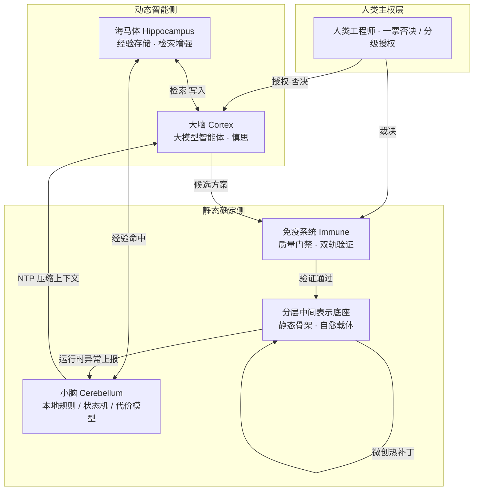
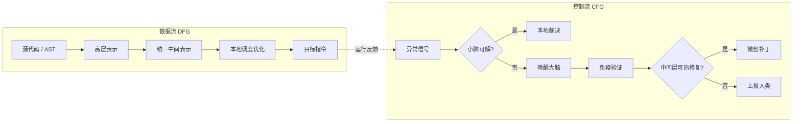
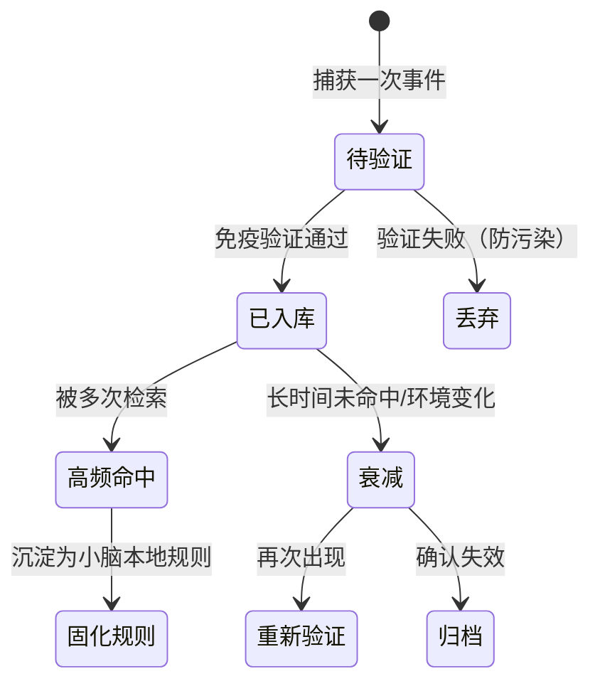
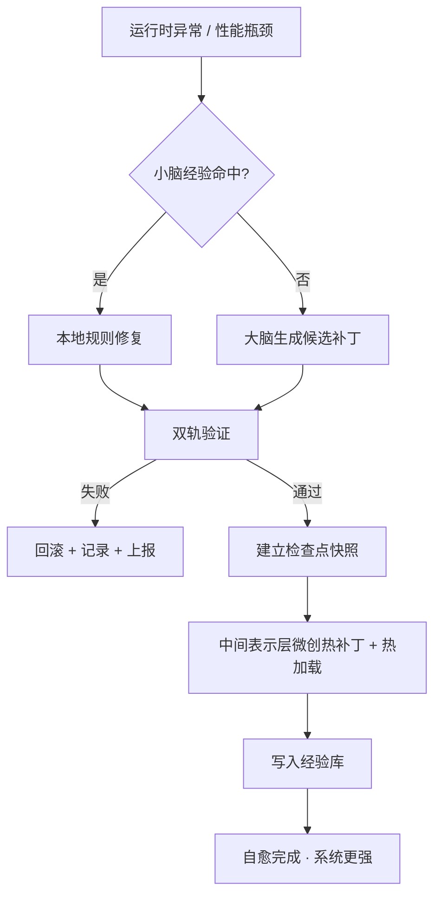
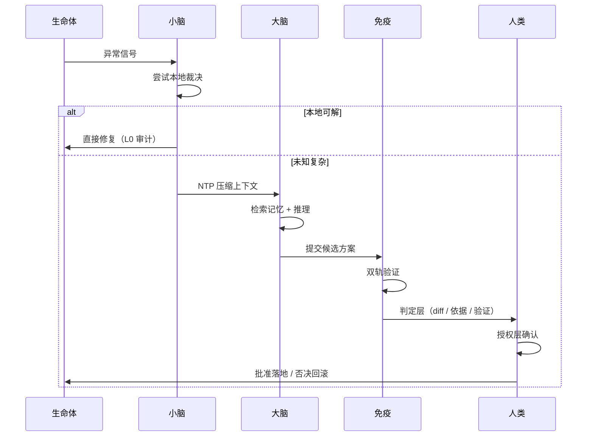
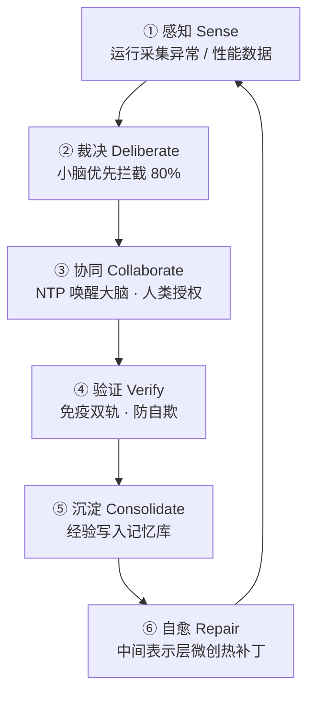
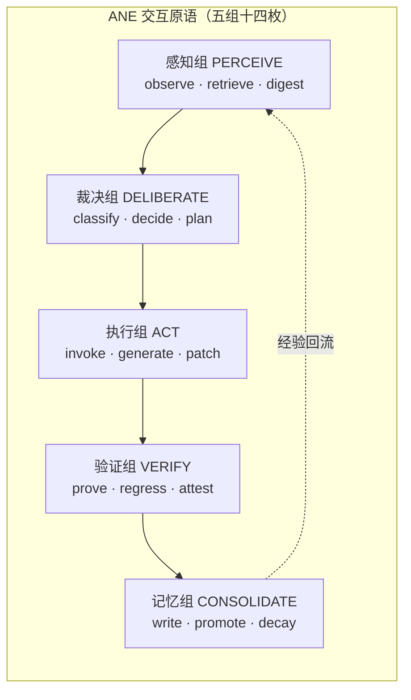
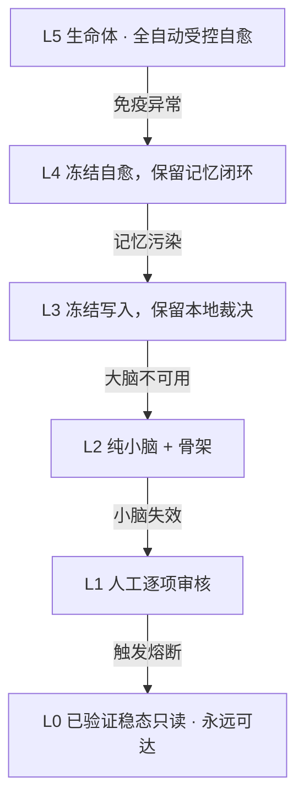
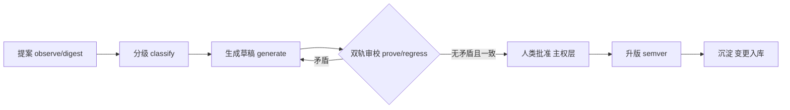
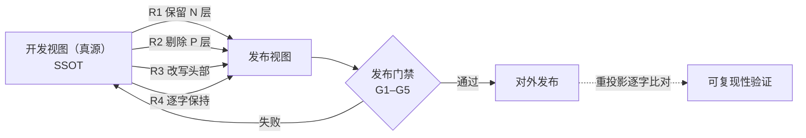

# 《ANE 规范：AI 原生软件生命体工程范式》v0.5.0 · 正式发布版

> **ANE Specification — AI-Native Engineering Paradigm for Living Software Systems**
>
> **AI Agent 时代的软件生命体范式 · 通用版白皮书**
>
> **创建人：冯磊**（Feng Lei）　|　原创范式提出者与首席架构设计者
>
> ANE = **AI Native Engineering** · 动静结合 · 双脑协同 · 记忆护城河 · 开发维护一体 · 治理与韧性 · 可验证可采纳
>
> 版本：**v0.5.0**　|　日期：2026-11-20　|　形态：正式发布版
>
> 本规范以**通用范式语言**表述，不绑定任何具体产品、框架或工程实现，适用于一切构建 AI 原生软件系统的团队。
>

---

## 目录

- [执行摘要（一页纸速览）](#执行摘要一页纸速览)
- [序言：软件即生命](#序言软件即生命)
- [第零章　范式定位与问题陈述](#第零章范式定位与问题陈述)
- [第一章　核心公理（动静二元）](#第一章核心公理动静二元)
- [第二章　架构规范：七器官生命体模型](#第二章架构规范七器官生命体模型)
- [第三章　确定性分级：D0–D3 权限光谱](#第三章确定性分级d0--d3-权限光谱)
- [第四章　小脑规范（Cerebellum）](#第四章小脑规范cerebellum)
- [第五章　大脑规范（Main Brain）与神经递质协议 NTP](#第五章大脑规范main-brain与神经递质协议-ntp)
- [第六章　记忆规范：海马体与经验存储](#第六章记忆规范海马体与经验存储)
- [第七章　免疫规范：双轨验证与防自欺](#第七章免疫规范双轨验证与防自欺)
- [第八章　自愈规范：中间表示层即时修复法则](#第八章自愈规范中间表示层即时修复法则)
- [第九章　人机协同：人类主权与分级授权](#第九章人机协同人类主权与分级授权)
- [第十章　进化论：开发维护一体飞轮](#第十章进化论开发维护一体飞轮)
- [第十一章　落地：ANE 成熟度模型 L0–L5](#第十一章落地ane-成熟度模型-l0--l5)
- [第十二章　度量体系与反模式](#第十二章度量体系与反模式)
- [第十三章　交互方式：智能体的交互模式矩阵](#第十三章交互方式智能体的交互模式矩阵)
- [第十四章　交互原语：可组合的最小交互单元](#第十四章交互原语可组合的最小交互单元)
- [第十五章　工具生态：MCP 与能力接入规范](#第十五章工具生态mcp-与能力接入规范)
- [第十六章　多智能体协同协议](#第十六章多智能体协同协议)
- [第十七章　安全与信任边界：OWASP 对齐](#第十七章安全与信任边界owasp-对齐)
- [第十八章　成本治理与上下文工程](#第十八章成本治理与上下文工程)
- [第十九章　传统软件工程的扬弃](#第十九章传统软件工程的扬弃)
- [第二十章　组织治理与合规对齐](#第二十章组织治理与合规对齐)
- [第二十一章　失效安全与优雅降级](#第二十一章失效安全与优雅降级)
- [第二十二章　身份、命名空间与可追溯](#第二十二章身份命名空间与可追溯)
- [第二十三章　人类因素与认知工程](#第二十三章人类因素与认知工程)
- [第二十四章　多租户与记忆边界](#第二十四章多租户与记忆边界)
- [第二十五章　元规范：规范自身的治理与演进](#第二十五章元规范规范自身的治理与演进)
- [第二十六章　符合性评估框架（ANE-CONF）](#第二十六章符合性评估框架ane-conf)
- [第二十七章　迁移与采纳路径](#第二十七章迁移与采纳路径)
- [第二十八章　可观测性体系](#第二十八章可观测性体系)
- [第二十九章　演化系统测试](#第二十九章演化系统测试)
- [第三十章　适用边界与常见误读澄清](#第三十章适用边界与常见误读澄清)
- [第三十一章　经济性与采纳决策](#第三十一章经济性与采纳决策)
- [第三十二章　发布形态与受众视图](#第三十二章发布形态与受众视图)
- [第三十三章　信息分级与发布门禁](#第三十三章信息分级与发布门禁)
- [第三十四章　规范即制品：单一真源与确定性投影](#第三十四章规范即制品单一真源与确定性投影)
- [第三十五章　多语言与本地化治理](#第三十五章多语言与本地化治理)
- [第三十六章　制品命名与标识规范](#第三十六章制品命名与标识规范)
- [第三十七章　结构完整性与投影后校验](#第三十七章结构完整性与投影后校验)
- [附录 A　术语表](#附录-a术语表)

---

## 执行摘要（一页纸速览）

> 给决策者：若只阅读一页，读这一页。

| 维度 | 一句话 |
|---|---|
| **是什么** | ANE 是一套 AI Agent 时代的软件工程范式，把软件视为"数字生命体"，用确定性骨架约束概率性智能。 |
| **核心矛盾** | 传统工程只会确定性，AI 套壳只会概率性；ANE 在两者间划清责任边界——可证明的交静态，只能推断的交智能，中间用门禁隔离、人类裁决。 |
| **七器官** | 骨架（中间表示）· 小脑（本地裁决）· 大脑（大模型）· 海马体（经验记忆）· 免疫（双轨验证）· 自愈（微创修复）· 主权（人类授权）。 |
| **三条护城河** | 小脑优先（80% 决策零 Token）· 记忆升格（大脑顿悟变小脑本能）· 双轨免疫（符号 + 统计同时通过才放行）。 |
| **开发维护一体** | 运行即感知，感知即维护，维护即开发，开发即进化——软件上线不是终点，是生命的开始。 |
| **治理底座** | 合规对齐（NIST AI RMF / EU AI Act / ISO 42001）· 失效安全（熔断 + FMEA）· 身份追溯（稳定 ID + AI-BOM）· 人类因素 · 记忆边界 · 元治理。 |
| **发布工程** | 制品化发布：规范以单一真源派生出对外视图，过程层零残留；信息三级分层（N 规范 / E 证据 / P 过程）+ 发布门禁，让规范自身先做到"白盒、可追溯、防自欺"。 |
| **国际化与制品治理** | 多语言治理（正本/译本/术语对照/翻译保真 G7）· 制品命名规范（正式无后缀/开发带后缀/英文版）· 结构完整性校验（G6：编号连续/附录重编/锚点有效），修复正式版附录断裂。 |
| **冷启动与记忆治理** | 冷启动种子规则 + 探索/利用自适应切换（6.4）· 硬件拓扑感知与自适应排优（2.3/8.5）· 国内法规对齐（20.2）· 双折叠协同范式（13.4/14.3）· 升格审计防记忆投毒（17.2/24.3）。 |
| **如何落地** | 从 L2 小脑 + L3 记忆切入（收益最大、风险最低），免疫成熟后再上 L4 自愈；L5 生命体是长期目标。 |
| **不可破的红线** | 人类主权（公理五）· 防自欺（静默失败=0）· 全局熔断可随时停飞——任何效率理由不得绕过。 |

**三步口诀**：可证明的交静态 · 不确定的交智能 · 触底线的交人类。

---

## 序言：软件即生命

我们摒弃"软件是静态工具"的传统认知。在 AI 时代，优秀的软件系统是一个**具备新陈代谢、免疫自愈、持续进化能力的数字有机体**。

它由七类器官协同构成：

- **骨架（分层中间表示）** 是不可动摇的物理法则，决定"它是什么"；
- **小脑（本地确定性调度层）** 提供高频、零成本的本能反射，决定"它如何快速反应"；
- **大脑（大模型智能体）** 只在未知与复杂时苏醒，决定"它如何应对从未见过的问题"；
- **海马体（经验存储与检索增强）** 让每一次成功与失败都成为永久记忆，决定"它如何不重蹈覆辙"；
- **免疫系统（多层质量门禁）** 让未经证实的生成视为污染，决定"它如何保持纯净"；
- **自愈引擎（中间表示层微创修复）** 让它在运行中就地修复，决定"它如何带伤生存并痊愈"；
- **人类主权（分级授权交互）** 是它必须臣服的更高意志，决定"它该不该被允许进化"。

开发与维护，在这个有机体里不再是流水线的两端，而是**同一个生命过程的呼与吸**：运行即感知，感知即维护，维护即开发，开发即进化。

> 一句话概括：**静态是它不可动摇的骨与血，动态是它流动不息的神经与思，而记忆与免疫，让它成为"它自己"。**

---

## 第零章　范式定位与问题陈述

### 0.1 行业现状的三次断裂

| 断裂 | 传统做法 | 后果 |
|---|---|---|
| **确定性断裂** | AI 输出直接进入代码或生产，缺少静态约束 | 幻觉、不稳定、不可复现 |
| **成本断裂** | 所有决策都问大模型（链式调用、思维链提示等全量依赖模式） | Token 爆炸、延迟高、卡死超时 |
| **生命周期断裂** | 开发—测试—部署—维护被切成割裂流水线 | 上线即腐烂，维护沦为"还债" |

### 0.2 ANE 的立场

ANE 不站在"传统软件工程"与"AI 套壳开发"的任一端。它做的是**在两者之间划出一条清晰的责任边界**：

- 凡是**可被确定性证明**的，交给静态骨架与小脑 —— 快、省、可靠；
- 凡是**只能被概率性推断**的，交给大脑与记忆 —— 深、准、可学；
- 两者之间，用**门禁**做免疫隔离，用**人类**做最终裁决。

### 0.3 与已知概念的关系（避免重复造轮子）

| 已知概念 | ANE 的吸收与超越 |
|---|---|
| 神经符号 AI（Neurosymbolic AI） | 继承"符号+神经"融合思想，ANE 进一步给出**工程化的权限分级与门禁责任链** |
| DevOps / DevSecOps / AIOps | ANE 是其终局形态：运维反馈直接驱动开发，且闭环由生命体自主完成 |
| 强化学习 / 自动机器学习 | ANE 的"变异—验证—沉淀"是其在线版本，但受静态骨架与人类主权强约束 |
| 检索增强生成（RAG） | ANE 把 RAG 从"问答外挂"提升为**生命体的记忆器官**，是自我迭代的必需能力 |
| 人在环路（Human-in-the-loop） | ANE 细化为**分级授权**，兼顾安全与效率，避免人类成为吞吐瓶颈 |

---

## 第一章　核心公理（动静二元）

> 本章是范式的最高法。所有后续条款皆为公理的展开，不得与公理冲突。

### 公理一：静态是基石，动态是灵魂

软件的底层逻辑必须保持**绝对的静态与确定性**（强类型、内存安全、状态机、形式化可证）。AI 的生成能力只能作用于表层逻辑、意图解析与代码建议，**绝不能动摇静态底座的安全**。

### 公理二：动中有静，静中有动

- **动中有静**：AI 的每一次动态生成、重构或执行，都必须被静态规则（门禁、一致性校验、回归）约束。未经证实的 AI 输出，视为"污染"。
- **静中有动**：静态底座必须具备自适应自愈能力。当运行环境变化时，静态代码能驱动 AI 快速寻找并热加载新的优化补丁。

### 公理三：小脑优先，大脑稀缺

高频、例行、可本地裁决的决策**必须**在小脑完成，不得消耗大模型。大脑是稀缺战略资源，仅在本地规则与记忆均无法解决时唤醒，且上下文须压缩至极简。

### 公理四：记忆即护城河

每一次成功、失败、回滚都必须结构化沉淀。系统依靠记忆实现自我迭代；没有记忆的 AI 只是无状态的复读机，无法演化成生命体。

### 公理五：人类拥有不可剥夺的主权

任何触及静态底座或生产环境的进化，必须经人类明确授权。人机分离，权责清晰。**这条公理不可被任何效率理由绕过。**

### 公理六：全景白盒，拒绝静默

不可解释即不可控。系统必须提供全局可观测台账。遇未知问题立即报错、阻断、记录，绝不通过改测试或伪造绿勾掩盖。

### 公理七：稳态第一，变异受控

生命体的进化采用"突变—验证—稳定"双轨制。变异允许发生，但必须经免疫过滤；失败即回滚。稳定性永远优先于聪明度。

---

## 第二章　架构规范：七器官生命体模型

### 2.1 架构总览



### 2.2 器官职责一览

| 器官 | 英文 | 核心职责 | 时效 | 是否消耗 Token | 典型实现形态 |
|---|---|---|---|---|---|
| 骨架 | Skeleton | 类型、内存、语义等价的确定性底座 | 常驻 | 否 | 分层中间表示与编译器后端 |
| 小脑 | Cerebellum | 高频调度、指令排优、本地裁决 | 微秒~毫秒 | 否 | 本地规则库 + 状态机 + 代价模型 |
| 大脑 | Main Brain | 未知复杂问题的深度推理 | 秒~分钟 | 是（受控） | 按需唤醒的大模型智能体 |
| 海马体 | Hippocampus | 经验沉淀与检索 | 持久 | 检索时少量 | 经验向量存储 + 检索增强 |
| 免疫 | Immune System | 门禁、一致性校验、回归、防自欺 | 编译期/合并前 | 否 | 多层质量门禁 + 全量回归验证 |
| 自愈 | Self-Repair | 运行时热补丁与就地优化 | 运行时 | 视情况 | 中间表示层微创修复引擎 |
| 主权 | Human Sovereignty | 授权、否决、目标设定 | 按需 | 否 | 分级授权交互界面 |

### 2.3 数据与控制双流



> **目标环境感知（对应 8.5）**：骨架不止于逻辑正确，还须感知运行载体。上层表示向目标指令落地、以及运行时微创补丁生成时，必须结合目标环境的物理特征（指令集能力、加速单元规模、内存带宽等）做自适应排优——同一份中间表示在不同硬件上应得到不同的最优指令序列。此为 8.5"硬件拓扑感知"的架构层锚点。

---

## 第三章　确定性分级：D0–D3 权限光谱

> 这是 v3.0 引入、v3.1 保留的核心机制，用于把公理一/二落到可执行的权限边界。每一层都有明确的"AI 可做什么"。

| 级别 | 名称 | 内容 | AI 权限 | 变更审批 |
|---|---|---|---|---|
| **D0** | 物理法则层 | 类型系统、内存模型、并发状态机、密码学原语 | **禁止触碰**，仅可读取 | 不可变更（编译期强制） |
| **D1** | 骨架逻辑层 | 调度策略、中间表示转换规则、优化过程 | 可提议，须形式化等价证明 | 门禁 + 人类复核 |
| **D2** | 表层逻辑层 | 业务代码、胶水层、配置、接口适配 | 可生成，须全量回归通过 | 门禁自动放行 + 审计 |
| **D3** | 意图与表达层 | 需求解析、注释、测试用例生成、文档 | AI 主导，无副作用 | 人类可审查，不阻断运行 |

**规则**：AI 输出只能在其产生层或更低风险的层落地。任何从 D3 直接跃迁到 D0/D1 的变更，必须穿过免疫系统的完整验证链。

---

## 第四章　小脑规范（Cerebellum）

> 对应公理三。小脑是生命体的"肌肉记忆"，80% 的常规决策应在此终结。

### 4.1 强制条款

- **第四条（小脑优先）**：每个核心系统必须内置本地小脑模块，负责高频、快速、低能耗的本地调度与逻辑裁决。禁止把所有逻辑直接连到大模型。
- 小脑必须在无网络、无大模型的情况下仍可完成 D0/D1 的常规裁决。
- 小脑的决策必须可解释、可 replay（重放）、可审计。

### 4.2 小脑能力边界

| 必须具备 | 严格禁止 |
|---|---|
| 本地规则库与优先级匹配 | 生成式自由创作 |
| 状态机与确定性转移 | 未经验证的动态代码执行 |
| 代价模型（如指令排优） | 直接修改 D0 底座 |
| 经验向量的快速命中 | 静默吞掉无法处理的异常（须上报） |

### 4.3 工程锚点

本地指令调度与代价模型引擎是小脑的典型实现形态：在多种目标架构下，成百上千条指令的排优由内置代价模型与状态机瞬间完成，不烧 Token、精准可复现。

---

## 第五章　大脑规范（Main Brain）与神经递质协议 NTP

> 对应公理三后半。大脑只做一件事：解决小脑与记忆都解决不了的未知复杂问题。

### 5.1 强制条款

- **第五条（战略性唤醒）**：当且仅当小脑遇到本地规则库与记忆库均无法解决的疑难时，才允许唤醒大模型 API。上下文必须压缩至极简，仅传递**特征向量与错误码**，以极低 Token 消耗换取高级智能辅助。
- 大脑输出是**建议（proposal）**，不是**指令（command）**。它不得绕过免疫系统直接落地。

### 5.2 神经递质协议 NTP（Neural Transmitter Protocol）

小脑与大脑之间的上下文传递必须结构化，禁止把全量代码或日志一股脑塞给大模型。

```json
{
  "ntp_version": "1.0",
  "signal_type": "UNKNOWN | DEADLOCK | PERF_REGRESSION | SEMANTIC_CONFLICT",
  "error_code": "E-CORE-0427",
  "feature_vector": [0.12, -0.88, 0.33, "...压缩后的高维特征..."],
  "context_digest": "sha256:9f3a...（上下文摘要，非全文）",
  "tried_rules": ["rule_114", "rule_208"],
  "memory_hits": [],
  "constraints": ["D0 不可变", "目标架构约束"],
  "budget_hint": { "max_tokens": 1200, "max_latency_ms": 8000 }
}
```

**设计意图**：只传特征、错误码、约束与预算，把 Token 消耗压到最低——这是"用减法对抗加法"的落点。

---

## 第六章　记忆规范：海马体与经验存储

> 对应公理四。记忆是护城河，也是生命体"自我"的来源。

### 6.1 强制条款

- **第六条（记忆即护城河）**：所有软件必须接入专属的经验存储库。每一次成功、失败、回滚都要被结构化；AI 必须通过检索增强机制读取过往经验，绝不重蹈覆辙。
- 未经免疫系统验证的经验**禁止写入**（防止错误经验污染记忆）。

### 6.2 经验记录结构（Experience Record）

| 字段 | 说明 |
|---|---|
| `signature` | 问题特征向量 / 错误码 |
| `context` | 触发时的最小上下文摘要 |
| `action` | 采取的动作（规则命中 / AI 方案 / 回滚） |
| `verification` | 门禁结果、一致性校验、回归结论 |
| `outcome` | success / failure / rollback |
| `lineage` | 来源链：哪个系统、哪次变更、谁授权 |

### 6.3 记忆生命周期



> 关键机制：**经验可升格为小脑规则**（把大脑的一次顿悟，变成小脑的本能），这是飞轮越转越省 Token 的根本原因。

### 6.4 冷启动与知识冷淬火（Cold Start & Knowledge Quenching）

> 对应公理三、四。生命体出生时记忆是空的——若没有初始经验，所有问题都会砸向稀缺而昂贵的大脑。本节规定如何让生命体"带着常识出生"。

- **种子规则集（Seed Rules）**：允许系统处于成熟度 L2/L3 阶段时，由人类领域专家灌入一组经过免疫验证的**初始黄金规则**，作为海马体的初始记忆。每条种子规则必须标注来源、适用范围、验证证据与有效期，并纳入台账；**禁止灌入未经免疫验证的规则**。
- **探索模式（Explore Mode，冷启动强制）**：记忆库建立早期，系统**强制**处于探索模式——主动提高大脑调用频次，有意覆盖未知问题空间，以收集多样化样本。此阶段的高频大脑调用是必要投资，须受第十八章预算闸门约束。
- **利用模式（Exploit Mode）**：当经验库达到组织预设的**覆盖阈值**（命中率、样本多样性、规则覆盖度等）后，系统自动切换到利用模式，优先命中本地规则、大幅降低大脑调用。阈值、切换判据与切换时刻必须写入台账、可审计。
- **过早收敛回退**：切入利用模式后若命中率持续低于下限，须自动退回探索模式补采样本，防止形成"经验茧房"。

| 模式 | 触发条件 | 大脑调用频次 | 目的 | 退出条件 |
|---|---|---|---|---|
| **探索 Explore**（冷启动强制） | 记忆库为空/低于覆盖阈值，或处于 L2/L3 初期 | 高（有意采样） | 收集样本、发现规则 | 达到覆盖阈值 |
| **利用 Exploit** | 覆盖阈值达标、命中率稳定 | 低（本地优先） | 节省成本、降低延迟 | 命中率跌破下限 |

> **知识冷淬火**：种子规则与探索期样本经免疫验证后"淬火"为稳定规则的过程。它与 6.3 的自然升格互为补充——前者缩短冷启动周期，后者支撑长期进化；二者都必须经过同一套免疫验证，不得因"急于上线"而绕过。

---

## 第七章　免疫规范：双轨验证与防自欺

> 对应公理二、六、七。免疫系统是生命体不腐化的根本保障。

### 7.1 强制条款

- **第七条（绝对防御 / 防自欺）**：杜绝任何静默失败。系统遇未知问题必须立即报错、阻断、记录，绝不通过修改测试用例或伪造绿勾掩盖。错误是进化的养料，虚假是软件的毒药。
- 任何由 AI 动态生成的代码或补丁，必须经过静态门禁的严酷拷问；只有验证等价且无误才能合并。**未经验证的 AI 输出，等同于病毒感染。**

### 7.2 双轨验证模型

| 轨道 | 验证手段 | 回答的问题 | 失败后果 |
|---|---|---|---|
| **符号轨** | 形式化等价证明、多路一致性校验、类型检查、状态机可达性 | "它在数学/语义上正确吗？" | 立即阻断 |
| **统计轨** | 全量回归、模糊测试、影子运行（shadow run） | "它在实际行为上正确吗？" | 立即阻断并回滚 |

两轨**必须同时通过**（逻辑与），任一失败即判定为污染。

### 7.3 门禁责任链

```
AI 候选方案
   → 符号轨（等价性 / 一致性校验）
   → 统计轨（回归 / 模糊）
   → 人类授权（若触及 D0/D1 或生产环境）
   → 允许合并 / 热加载
   → 全程台账留痕（可追溯、可 replay）
```

---

## 第八章　自愈规范：中间表示层即时修复法则

> 对应公理二后半。这是"软件生命体"最具辨识度的能力。

### 8.1 强制条款

- **第八条（即时修复法则 / Instant Repair）**：软件生命体的底座必须包含统一中间表示层。当系统发生任何运行时异常、性能瓶颈或逻辑错乱时，中间表示层应具备跨越高层源码与底层指令的"全知视角"，能够随时在底层直接进行指令级重构、热补丁生成或优化，实现"无需重启、无需人工干预、随时就地修复"的生命体自愈能力。

### 8.2 为什么中间表示层能做到"随时修复"

传统软件：出错 → 崩溃 → 停机 → 人翻源码 → 改高级语言 → 重新编译 → 重新部署（周期极长）。

中间表示驱动：所有高层表示与机器指令最终都流经统一中间表示层，它拥有**上帝视角**，可直接在中间表示层做"微创手术"——生成修复补丁、重排指令、热加载优化，无需触碰杂乱的源码。

### 8.3 自愈的安全前置（关键风险的正面回应）

> AI 生成 + 运行时热修复 = 双重不确定性叠加，必须三重保险：

| 保险 | 机制 |
|---|---|
| **可回滚** | 热补丁前建立检查点快照；失败自动 rollback |
| **可证明** | 补丁必须通过符号轨等价性验证 |
| **可审计** | 每次热修复写入台账与经验库，人类可事后复核 |

### 8.4 自愈决策控制流



### 8.5 硬件拓扑感知与自适应编译排优

> 对应第二章目标环境感知。同一份中间表示，在不同物理载体上的"最优"指令序列并不相同——脱离硬件谈修复，可能修好了逻辑却拖垮了性能。

- **强制要求（硬件拓扑感知）**：中间表示层在生成微创热补丁或执行编译排优时，**必须**结合当前运行环境的物理特征做自适应决策，至少包括：处理器指令集与扩展能力、加速单元核数与类型、内存层级与带宽、互连与访存亲和性。禁止在任何硬件上套用"一刀切"的补丁序列。
- **画像获取**：硬件特征须在启动时探测、变更时刷新，纳入可观测台账；画像缺失时降级为保守基线并告警（见第二十一章优雅降级），不得臆测硬件能力。
- **代价模型联动**：排优所用的代价模型（见第四章小脑）必须以当前硬件画像为输入，选择指令调度、算子融合与并行策略；同一补丁在不同画像下允许产出不同变体，各变体均须独立通过双轨验证（见第七章）。
- **可复现**：补丁变体须记录"画像指纹 → 选中的排优策略"，使同一环境下的修复可被复现与回放。

| 物理特征 | 排优影响 | 画像缺失时的降级 |
|---|---|---|
| 指令集 / 扩展能力 | 指令选择、向量化路径 | 保守基线指令集 |
| 加速单元核数与类型 | 并行度、算子卸载决策 | 关闭卸载，主机路径 |
| 内存层级与带宽 | 数据布局、缓存分块 | 默认分块参数 |
| 互连与访存亲和 | 线程绑定、数据放置 | 忽略亲和约束 |

> **通用性声明**：本条只规定"必须感知并自适应硬件物理特征"这一范式要求，不绑定任何具体指令集、加速架构或编译器实现，适用于从边缘设备到数据中心的一类异构环境。

---

## 第九章　人机协同：人类主权与分级授权

> 对应公理五。人类不是被移除，而是被提升到"立法者 / 裁决者"的位置。

### 9.1 强制条款

- **第九条（一票否决权）**：禁止任何 AI 智能体在未经人类明确授权的情况下，直接修改主分支代码或向生产环境下发指令。人机分离，权责清晰。
- **第十条（全景白盒）**：所有底层指令映射、编译排优、图谱重构必须提供全局"上帝视角"台账。生命体不能存在黑盒。

> 说明：条款编号为公理七条 + 规范条款十条，连续无重复。

### 9.2 分级授权模型（破解"人类瓶颈"）

| 授权级 | 触发条件 | 人类动作 |
|---|---|---|
| **L0 自动** | D3 层、无副作用（文档/注释/测试生成） | 事后审计即可 |
| **L1 复核** | D2 层、门禁全绿、经验库高置信命中 | 批量确认 / 抽查 |
| **L2 强授权** | 触及 D0/D1、生产环境、不可逆变更 | 显式双重确认批准 |

### 9.3 双层确认交互

- **判定层**：展示 AI 的意图、差异（diff）、依据与验证结论，供人类判断。
- **授权层**：人类显式批准后才真正落地。判定与授权分离，杜绝误触。



---

## 第十章　进化论：开发维护一体飞轮

> 对应"开发与维护一体化"的核心愿景。软件上线不是终点，而是生命的开始。

### 10.1 飞轮六阶段



### 10.2 飞轮的三重复利

1. **成本复利**：经验库越厚、升格为小脑规则越多 → 需要唤醒大脑的次数越少 → Token 与延迟趋近于零。
2. **能力复利**：每次"变异—验证—沉淀"都让系统见过更多场景 → 应对未知的速度更快。
3. **安全复利**：门禁与经验互相强化 → 误报率下降、漏报率趋零 → 系统更可信。

### 10.3 开发即维护，维护即开发

- 传统：建一栋楼（开发），坏了再修（维护）——割裂、decaying。
- ANE：像一棵树，一边生长（开发）一边自我修护（维护），两者同频协同。
- **运行即感知，感知即维护，维护即开发，开发即进化。**

---

## 第十一章　落地：ANE 成熟度模型 L0–L5

> 让范式可从"愿景"被渐进式采用，而非一刀切。

| 等级 | 名称 | 特征 | 判定标准 |
|---|---|---|---|
| **L0** | 静态手工作坊 | 纯确定性代码，AI 未介入 | 无 AI 生成进入主干 |
| **L1** | 工具辅助 | AI 做补全/建议，人全量审 | 有 AI 辅助但无自动闭环 |
| **L2** | 小脑就位 | 本地规则拦截高频决策，零 Token | 常规决策不经大模型 |
| **L3** | 记忆闭环 | 经验存储 + 检索增强生效 | 同类问题不重复问大脑 |
| **L4** | 自愈运行 | 中间表示层热补丁 + 飞轮转动 | 运行时可无需重启修复 |
| **L5** | 生命体 | 开发维护一体、受控自我迭代 | 变异—验证—沉淀全自动，人类仅战略授权 |

**采用路径**：从 L2（小脑）与 L3（记忆）切入收益最大、风险最低；L4（自愈）必须在 L2/L3 与免疫体系成熟后方可启用。

---

## 第十二章　度量体系与反模式

### 12.1 关键度量（KPI）

| 指标 | 定义 | 目标方向 |
|---|---|---|
| 小脑拦截率 | 本地裁决决策数 / 总决策数 | ↑（目标 ≥80%） |
| Token/决策比 | 平均每次决策消耗 Token | ↓ |
| 记忆命中率 | 检索增强命中经验 / 大脑唤醒次数 | ↑ |
| 经验升格率 | 沉淀为小脑规则的经验占比 | ↑ |
| 门禁首次通过率 | 首次即通过双轨的方案占比 | ↑（反映大脑质量） |
| 自愈成功率 | 热补丁成功 / 热补丁尝试 | ↑ |
| 回滚率 | 失败回滚 / 总变更 | ↓ |
| MTTR | 平均修复时间 | ↓ |
| 静默失败数 | 未上报即吞掉异常的次数 | = 0（红线） |

### 12.2 反模式清单（明确的"不要"）

| 反模式 | 危害 | 正确做法 |
|---|---|---|
| 全量上下文灌给大模型 | Token 爆炸、延迟高 | 用 NTP 传特征与摘要 |
| AI 直改主分支/生产 | 绕过主权与免疫 | 分级授权 |
| 静默失败 / 假绿勾 | 掩盖问题，系统腐化 | 立即报错、阻断、记录 |
| 未验证经验入库 | 记忆污染，负向飞轮 | 免疫验证后写入 |
| 无快照热更新 | 不可回滚，灾难风险 | 检查点 + 自动 rollback |
| 万能大模型（无小脑） | 卡死、烧钱、不可靠 | 小脑优先 |
| 黑盒不可解释 | 不可控、不可信 | 全景白盒台账 |
| 规则库无限膨胀 | 小脑退化为新巨石 | 经验升格 + 衰减归档 |

---

## 第十三章　交互方式：智能体的交互模式矩阵


### 13.1 交互的四个维度

任何一次 AI 原生交互都可沿四轴分类：

| 维度 | 取值 | 说明 |
|---|---|---|
| **时态** | 同步 / 异步 / 流式 | 请求是否阻塞、结果是否增量返回 |
| **方向** | 人→机 / 机→人 / 机→机 / 机→工具 | 交互主体关系 |
| **自治度** | 建议 / 半自动 / 全自动（受授权约束） | 对应第九章分级授权 L0–L2 |
| **持久性** | 单次无状态 / 会话有状态 / 长期记忆 | 状态跨越的边界 |

### 13.2 十种标准交互模式（Interaction Patterns）

| 模式 | 核心思想 | ANE 中的定位 | 风险与约束 |
|---|---|---|---|
| **链式 Chain** | 步骤顺序执行 | 小脑确定性流水线 | 单点失败需可回滚 |
| **路由 Routing** | 按特征分发到不同处理分支 | 小脑按 D0–D3 分级路由 | 路由判据须可解释 |
| **并行 Parallelization** | 独立子任务并发 | 大脑批量推理 / 多轨验证 | 结果聚合需确定性 |
| **规划 Planning** | 分解目标为多步计划 | 大脑处理未知复杂 | 计划须经判定层展示 |
| **反思 Reflection** | 产出者 + 评审者双智能体 | 对应免疫系统的"批评者" | 评审者不得自我背书 |
| **工具调用 Tool Use** | 通过外部工具影响现实 | 见第十五章 MCP 规范 | 最小权限 + 调用前授权 |
| **检索增强 RAG** | 先检索再推理 | 海马体经验读取 | 检索须带访问控制 |
| **多智能体协作 Multi-Agent** | 角色分工、共享记忆 | 见第十六章 | 需协议化，禁止私聊 |
| **人在环路 HITL** | 关键决策由人裁决 | 人类主权层一票否决 | 避免人类成瓶颈 |
| **事件驱动 EDA** | 状态变化即事件，订阅者响应 | 飞轮的感知—自愈链路 | 事件须可溯源、可重放 |

### 13.3 交互模式选择准则

- **能用小脑就不用大脑**：链式/路由优先，规划/反思仅在 D2/D3 启用。
- **能同步就不异步**：异步仅用于长任务；但涉及自愈与生产变更必须走可审计的异步事件链。
- **能流式就流式**：面向人的输出优先流式，降低感知延迟，但流式内容不视为已验证结论。
- **凡有副作用必显式**：所有工具调用、状态写入，必须携带授权凭证与溯源标识。

### 13.4 双折叠协同模式（Dual-Fold Collaboration）

> 对应公理五、公理六，是 9.3"双层确认交互"在人机界面上的强制范式化。它界定"机器如何把判断呈现给人、人如何把意志回写给机器"的标准结构。

人机协同界面**必须**呈现为两个语义隔离的"折叠面"，禁止把认知与授权混排于同一层：

| 折叠面 | 名称 | 面向 | 核心载荷 | 确定性等级 |
|---|---|---|---|---|
| **折一** | 判定层（Judgment Fold） | 机器 → 人 | **认知摘要（Cognitive Summary）**：AI 的意图、候选方案、差异、依据、验证结论、风险提示 | D1–D3（不可直接执行） |
| **折二** | 授权层（Authorization Fold） | 人 → 机器 | **意图绑定（Intent Binding）**：人把批准/否决绑定到某一具体候选动作的凭证 | D0（人工作出，机器不可代签） |

**强制范式规则**：

- **两折不可合并**：折一只呈现与解释，不得触发任何副作用；折二只承载人的确定性意志，不得由 AI 自动生成授权。任何绕过折二的自动落地视为违反公理五。
- **摘要必带依据**：认知摘要必须同时给出依据链（检索到的经验、证据、验证结果），不得只给结论——"看得见理由"是人行使主权的前提。
- **绑定须精确**：意图绑定须精确指向折一中的某一具体候选动作（动作 ID + 参数 + 目标环境），防止"批准 A、执行 B"的偷换。
- **全程留痕**：两折交互的每一次展开、摘要、绑定、否决均写入台账并生成 `attest` 凭证，供回放审计。

> 该模式是"全景白盒"（公理六）与"人类主权"（公理五）在交互层的合流：折一保证人**看得懂**，折二保证人**说了算**。

---

## 第十四章　交互原语：可组合的最小交互单元


### 14.1 原语分层



### 14.2 原语定义表

| 组 | 原语 | 语义 | 确定性等级 | 是否可组合 |
|---|---|---|---|---|
| 感知 | `observe` | 采集运行时信号与异常 | D0 | 是 |
| 感知 | `retrieve` | 从经验存储检索相关记忆 | D1 | 是 |
| 感知 | `digest` | 把原始上下文压缩为特征摘要 | D1 | 是 |
| 裁决 | `classify` | 按 D0–D3 对问题分级 | D0 | 是 |
| 裁决 | `decide` | 小脑本地裁决或升级大脑 | D1 | 是 |
| 裁决 | `plan` | 生成多步行动计划 | D3 | 是 |
| 执行 | `invoke` | 调用外部工具（受 MCP 契约约束） | D2 | 是 |
| 执行 | `generate` | 生成代码/文本/补丁草稿 | D3 | 是 |
| 执行 | `patch` | 在中间表示层落地微创修改 | D1 | 否（须验证前置） |
| 验证 | `prove` | 符号轨等价性证明 | D0 | 是 |
| 验证 | `regress` | 统计轨回归验证 | D0 | 是 |
| 验证 | `attest` | 生成可审计凭证并写入台账 | D0 | 是 |
| 记忆 | `write` | 写入经验记录（验证后） | D1 | 是 |
| 记忆 | `promote` | 经验升格为小脑规则 | D1 | 否（须高置信） |
| 记忆 | `decay` | 经验衰减与归档 | D1 | 是 |

### 14.3 原语组合规则

1. **类型一致**：原语输出类型必须匹配下游输入类型（特征向量、凭证、补丁、判定）。
2. **副作用隔离**：`invoke`/`patch` 为副作用原语，必须成对携带 `attest` 凭证。
3. **验证不可跳过**：任何 `patch` 之前必须存在 `prove` 与 `regress` 的通过记录。
4. **升级可追踪**：从 `generate`（D3）到 `patch`（D1）的跃迁必须留下完整原语链，供回放审计。

**双折叠协同的原语编码**（对应 13.4）：折一"认知摘要"由 `digest → retrieve → prove/regress` 组合产出，止于 `attest`（证据凭证）而不落地；折二"意图绑定"是人在环触发的一次确定性授权写入，其产物是绑定到具体动作的授权凭证，此后才允许进入 `invoke`/`patch`。因此一条完整的受控链路为：

```
observe → digest → retrieve → decide(候选) → prove+regress
        → attest(折一·认知摘要) → [人·意图绑定] → invoke/patch → attest(折二·授权) → write
```

> 关键约束：`attest` 在折一与折二各出现一次、语义不同——前者是"机器自证依据"，后者是"人类授予权限"，二者缺一即视为绕过双折叠。

> NTP（神经递质协议）本质上是 `digest → decide → plan` 这组原语的标准化载荷格式。

---

## 第十五章　工具生态：MCP 与能力接入规范


### 15.1 为什么必须是标准协议而非私有胶水

私有工具集成会导致：语义各自为政、风险面各自隐藏、失败被掩盖、生态无法累积。ANE 要求工具接入走**契约化协议层**，使能力发现、权限协商、审计追踪统一化。

### 15.2 三段式架构与 ANE 器官映射

| MCP 角色 | 职责 | ANE 中的对应 |
|---|---|---|
| **Host（宿主）** | 承载智能体、持有模型、执行安全策略与用户授权 | 主权裁决层 + 免疫系统 |
| **Client（客户端）** | 与单个 Server 保持 1:1 会话，做能力协商与消息路由 | 小脑的本地调度 |
| **Server（服务端）** | 暴露工具/资源/提示，专注单一能力 | 可被大脑/小脑调用的能力单元 |

**核心原则**：Host 永不直接触碰工具，所有访问经由协商后的契约；服务端不得读取完整会话，不得"看见"其他服务端。

### 15.3 能力协商与四组原语

| 原语类别 | 代表操作 | 说明 |
|---|---|---|
| 服务端 · 工具 Tools | `tools/list` · `tools/call` | 可执行函数，改变外部状态 |
| 服务端 · 资源 Resources | `resources/list` · `resources/read` | 上下文数据源（文档、配置、记录） |
| 服务端 · 提示 Prompts | `prompts/list` · `prompts/get` | 可复用交互模板 |
| 客户端 · 采样 Sampling | `sampling/createMessage` | 服务端请求宿主做模型推理（反向调用） |
| 客户端 · 征询 Elicitation | `elicitation/create` | 服务端请求补充信息或确认（对应判定层） |
| 客户端 · 日志 Logging | `logging/*` | 结构化日志，供审计 |

**能力协商**：初始化握手时双方声明能力（capabilities），未声明的能力不得使用；协议版本不兼容应终止连接。这直接对应 ANE 的"最小权限"原则。

### 15.4 工具契约与双重校验

- 每个工具以 JSON Schema 声明输入，**必须** `additionalProperties: false`，拒绝意外字段。
- Host 在发送前校验智能体参数，Server 在执行前再次校验——**双重防御冗余**。
- 工具描述来自不可信服务端时，不得视为自动可信或安全。

### 15.5 工具安全注解 → D0–D3 映射

| 注解 | 含义 | ANE 授权要求 |
|---|---|---|
| `readOnlyHint` | 不改变外部状态 | L0 自动放行（D3 读取） |
| `idempotentHint` | 重复调用结果一致 | L1 复核后可自动重试 |
| `destructiveHint` | 有永久性影响 | L2 强授权 + 回滚快照 |
| `openWorldHint` | 访问可能含任意指令的外部数据 | 视为不可信输入，须防注入 |

### 15.6 接入门禁

任何新工具接入前必须通过：

1. **契约审查**：Schema 完备、能力声明清晰、传输方式（本地进程 / 远程 HTTP）明确。
2. **权限最小化**：只授予完成任务所需的最小范围；远程服务端推荐 OAuth 2.1 + PKCE，令牌短周期轮换。
3. **边界声明**：文件系统类须声明允许的工作区边界（roots），边界本身不是完整安全边界，仍需 Host 策略兜底。
4. **免疫验证**：工具调用纳入双轨验证链，副作用调用必须生成 `attest` 凭证。

---

## 第十六章　多智能体协同协议


### 16.1 两种互补协议

| 协议 | 层次 | 解决什么 | ANE 映射 |
|---|---|---|---|
| 工具上下文协议（如 MCP） | 智能体 ↔ 工具 | 能力发现、工具调用、上下文交换 | 第十五章 |
| 智能体间协议（如 A2A） | 智能体 ↔ 智能体 | 能力广告、任务委派、长任务状态 | 本章 |

### 16.2 智能体名片与任务生命周期

- **能力广告（Agent Card）**：以结构化文档声明技能、端点、认证方式，供他方发现。
- **任务状态机**：创建 → 工作中 → 需输入 → 完成 / 失败 / 取消。
- **交互时态**：快速同步调用、长任务流式订阅、完全异步 webhook 通知三种并存。
- **不透明执行**：协作方无需暴露内部思考、计划与工具，仅交换上下文、状态、指令与数据——保护实现隐私，但任务元数据须可审计。

### 16.3 协同纪律

1. **职责单一**：每个智能体专注明确能力，可组合、可替换。
2. **通信可观测**：所有智能体间消息必须经过可观测总线，禁止不可追踪的点对点。
3. **人类主权穿透**：跨智能体的任务委派不得绕过分级授权；涉及 D0/D1 或生产的委派必须回到人类裁决。
4. **冲突可裁决**：多智能体结论冲突时，以门禁验证结果与人类判定为最终仲裁，不以"多数票"替代真理。

---

## 第十七章　安全与信任边界：OWASP 对齐


### 17.1 三条信任边界

| 边界 | 内容 | 对应风险 |
|---|---|---|
| **模型读到的** | 用户输入、检索文档、工具结果、网页内容 | 提示注入、系统提示泄露 |
| **模型学到的** | 训练数据、微调集、向量存储 | 数据投毒、向量与嵌入弱点 |
| **模型能做的** | 输出处理、工具权限、自主行动 | 不当输出处理、过度代理 |

**核心原则**：一切模型读取的内容都视为潜在对抗性输入；一切模型输出在使用前必须验证；一切行动限定在最小爆炸半径内。

### 17.2 十大风险 → ANE 对策矩阵

| 风险（业界通用清单） | ANE 对策 | 主责器官 |
|---|---|---|
| 提示注入 | 外部内容视为不可信；工具注解区分开放世界数据；最小代理 | 免疫 + 主权 |
| 敏感信息披露 | 检索时访问控制、构造时 secret 隔离、输出脱敏 | 海马体 + 免疫 |
| 供应链 | 工具/服务端/依赖须审查契约与来源 | 免疫 |
| 数据与模型投毒 | 经验写入须验证；来源链 lineage 全程记录 | 海马体 |
| **记忆升格投毒**（经验→全局规则） | **升格审计**：连续 N 次独立复现 + 人类工程师签名背书（见 24.3），防 AI 近亲繁殖导致规则腐化 | 免疫 + 主权 + 海马体 |
| 不当输出处理 | 输出到 Shell/SQL/浏览器前强制校验 | 免疫 |
| 过度代理 | 最小代理原则：仅授予任务所需自治与工具；限时权限 | 主权 + 免疫 |
| 系统提示泄露 | 提示中不藏密钥；假设可被提取 | 主权 |
| 向量与嵌入弱点 | 检索强制 per-user 访问控制；防嵌入反演 | 海马体 |
| 虚假信息 | 不确定性显式表达；高风险答案加评审步骤 | 大脑 + 免疫 |
| 无界消费 | 预算上限、速率限制、超时、成本告警 | 成本治理（第十八章） |

### 17.3 最小代理原则（Least Agency）

- 智能体的自治度、工具集、权限范围、有效期均为**任务级、有时限**。
- 任务结束或超时自动回收权限。
- 破坏性或资金相关动作一律显式人工确认。
- 该原则与公理五（人类主权）一致，是其在安全域的具体化。

---

## 第十八章　成本治理与上下文工程


### 18.1 预算三闸门

| 闸门 | 约束 | 触发动作 |
|---|---|---|
| Token 预算 | 单次/单任务 Token 上限（见 NTP 的 `budget_hint`） | 超限压缩上下文或升级人类 |
| 时间预算 | 单步延迟上限、任务总时长上限 | 超时降级为本地裁决 |
| 金额预算 | 单任务成本上限 | 熔断并告警 |

### 18.2 上下文工程策略

1. **压缩**：`digest` 原语只传特征与摘要，不传全文。
2. **缓存**：稳定前缀与高频知识做提示缓存，避免重复计费。
3. **子任务隔离**：子智能体用全新上下文，仅回传摘要，防止上下文膨胀。
4. **检索代替塞入**：用 RAG 按需取，而非把全量资料塞进提示。
5. **经验升格**：高频结论固化进小脑规则，永久脱离大模型调用。

### 18.3 成本可观测

- 每次决策记录 Token 消耗、延迟、成本、是否命中记忆。
- 以"小脑拦截率""记忆命中率""Token/决策比"作为一级运营指标（见第十二章）。
- 成本异常（拒绝服务式消耗 / 钱包攻击）纳入告警与熔断。

---

## 第十九章　传统软件工程的扬弃


### 19.1 必须继承的优点（不可丢弃）

| 传统优点 | 在 ANE 中的地位 |
|---|---|
| 强类型与形式化方法 | 公理一静态基石、符号轨验证的根基 |
| 版本控制与可追溯 | 经验 lineage、台账、可 replay 的前提 |
| 自动化测试与回归 | 免疫统计轨的核心手段 |
| CI/CD 与质量门禁 | 门禁责任链的工程载体 |
| 代码审查 | 判定层 + 人类主权的具体形式 |
| 模块化与关注点分离 | 七器官、能力单一原则的来源 |
| 不可变基础设施与回滚 | 自愈三重保险中"可回滚"的根基 |

### 19.2 必须克服的缺点

| 传统缺点 | ANE 的克服方式 |
|---|---|
| 变更周期长、反馈慢 | 飞轮使运行即开发，缩短反馈闭环 |
| 维护是"还债"、上线即腐烂 | 自愈 + 经验升格，让系统越用越强 |
| 确定性假设无法应对开放环境 | 大大脑处理未知，免疫过滤后沉淀为确定性 |
| 人机割裂（开发/运维分离） | 开发维护一体，人类居中裁决 |
| 大量胶水代码与重复劳动 | 原语组合 + 工具协议复用 |
| 变更风险靠"人肉谨慎" | 门禁 + 双轨验证 + 分级授权制度化 |

### 19.3 扬弃原则

> **保留确定性的"骨"，替换僵化的"壳"。** 凡能被证明的继续用传统工程手段；凡需适应开放的，用智能体增强；两者之间永远以免疫门禁与人类主权为界。ANE 是传统软件工程的进化态，不是替代态。

---

## 第二十章　组织治理与合规对齐


### 20.1 治理四功能映射（对齐 NIST AI RMF）

NIST AI RMF 1.0 提出四功能 **GOVERN / MAP / MEASURE / MANAGE**，ANE 将其逐项落到器官：

| RMF 功能 | 内涵 | ANE 承接器官 | 本规范的落点 |
|---|---|---|---|
| **GOVERN 治理** | 风险文化、政策、角色问责、第三方风险 | 人类主权层 | 公理五、第九章分级授权、本章 20.3 RACI |
| **MAP 映射** | 建立系统语境：目的、用户、能力边界、可能影响 | 骨架 + 大脑 | 第零章问题陈述、D0–D3 分级、NTP 的 constraints |
| **MEASURE 测量** | 定量/定性评估、基准、监测可信度特征 | 免疫系统 + 成本治理 | 第十二章 KPI、第七章双轨验证、第十八章成本可观测 |
| **MANAGE 管理** | 排序响应、go/no-go、事件响应、停用、持续改进 | 自愈 + 全飞轮 | 第八章自愈、第十章飞轮、第二十一章熔断 |

**要求**：任何声称符合 ANE 的组织，必须能画出这四功能到自身流程的映射图——缺任一功能，即为"有器官无治理"。

### 20.2 监管对齐（对齐 EU AI Act 等）

| 监管要求（以 EU AI Act 为参照） | ANE 的机制 | 举证材料 |
|---|---|---|
| **风险分级监管** | D0–D3 确定性分级 + 成熟度 L0–L5 | 分级台账、成熟度评估表 |
| **风险管理全生命周期** | 飞轮六阶段 + 变异—验证—沉淀 | 原语链 trace、经验库 lineage |
| **技术文档与日志留存** | `attest` 凭证 + 全景白盒台账 | 不可篡改审计日志、AI-BOM（见第二十二章） |
| **人工监督（Art.14）** | 公理五 + 分级授权 + 全局熔断 | 授权凭证、stop 按钮演练记录 |
| **准确性、鲁棒性、网络安全** | 双轨验证 + OWASP 对齐 | 符号轨证明、统计轨回归报告 |
| **自动化偏见防护** | 第二十三章人类因素 | 判定层设计、复核抽样记录 |

**国内法规对齐（中国）**：

| 国内法规 / 标准 | 核心要求 | ANE 的机制 | 举证材料 |
|---|---|---|---|
| **《数据安全法》** | 数据分类分级、全流程记录、风险监测与处置 | 信息三级分层（N/E/P）、经验记录 `lineage` 溯源链、全局白盒台账 | 数据分级清单、原语链 trace、不可篡改审计日志 |
| **《个人信息保护法》** | 告知同意、最小必要、删除权（被遗忘权） | 最小代理原则（17.3）、写入前脱敏、按来源删除并级联（24.4） | 授权凭证、脱敏记录、遗忘权删除凭证 |
| **网络安全等级保护 2.0（等保三级）** | 身份鉴别、访问控制、安全审计、数据完整性与保密性 | 稳定 ID 与 AI-BOM（第二十二章）、per-user 访问控制（24.2）、双轨验证、全景白盒 | 身份台账、访问日志、符号轨证明与统计轨回归报告 |
| **生成式 AI 服务可追溯 / 可控要求** | 生成内容标识、过程可回溯、人工可干预 | 公理五人类主权 + 公理六防自欺：`attest` 凭证、分级授权、全局熔断、静默失败=0 | 授权凭证、熔断演练记录、完整原语链 trace |

> **"人类主权 + 防自欺"为何满足国内监管的硬性要求**：国内监管对生成式 AI 的核心诉求是"可追溯、可控"。ANE 以**公理五（人类主权）**保证任何动态变异都必须经人类显式授权、可一票否决、可全局熔断——对应"可控"；以**公理六（防自欺）**保证全过程白盒留痕、静默失败为零、结论可回放——对应"可追溯"。二者不是上线后补的文档，而是内建于原语链与门禁的执行纪律，使监管举证成为系统的自然产出而非额外负担。

> **时序事实**（据 2026-08 Digital Omnibus 修订版）：EU AI Act 对 GPAI 的义务自 2025-08 起适用；Art.14 人工监督、透明度等核心义务自 2026-08 起；Annex III 高风险义务 2027-12 起、Annex I 2028-08 起。**ANE 将这些义务前置为工程内建能力，而非上线后补文档。**

### 20.3 责任矩阵（RACI）

| 活动 | 生命体/小脑 | 大脑 | 免疫 | 人类主权 | 治理委员会 |
|---|---|---|---|---|---|
| D0/D1 变更批准 | C | R（提案） | C | **A** | I |
| 常规裁决（D2/D3） | **R/A** | I | C | I（事后审计） | I |
| 门禁规则制定 | I | I | R | C | **A** |
| 记忆入库审核 | C | R | **A** | I | I |
| 熔断触发与恢复 | R | I | C | **A** | I |
| 合规举证 | C | I | R | C | **A** |

> R=执行 · A=最终负责 · C=被咨询 · I=被告知。**关键原则：大脑永远不拥有 A（最终责任），A 属于人类或治理委员会。**

### 20.4 风险登记册

每个 ANE 系统必须维护活的风险登记册，字段至少含：风险描述、所属信任边界（见第十七章）、确定性等级、概率×影响、对策器官、责任人、状态、复审日期。登记册本身纳入版本控制与可追溯体系。

---

## 第二十一章　失效安全与优雅降级


### 21.1 强制条款

- **第二十六条（失效安全默认态）**：任何器官失效时，系统必须自动退入**预定义的 fail-safe 态**——即骨架底座保持完整、无副作用写入、对外服务以降级模式维持，**绝不允许"带病全自动"**。
- **第二十七条（全局熔断）**：系统必须提供人类可随时触发的**全局熔断开关（stop switch）**，一分钟内冻结所有自愈、工具调用与大脑唤醒，将系统锁定在最近一个已验证稳态。此条对齐 EU AI Act Art.14 的 stop 按钮要求，不可被任何自动化绕过。

### 21.2 器官级失效模式分析（FMEA）

| 器官 | 失效模式 | 影响 | 检测信号 | 降级动作 |
|---|---|---|---|---|
| 骨架 | 类型/语义底座被破坏 | 灾难性 | 一致性校验失败 | 回滚至最近稳态 + 拒绝对外服务 |
| 小脑 | 规则库失效/误判 | 高频决策错误 | 拦截率骤降、异常上报增 | 降级为保守规则 + 转大脑（受限） |
| 大脑 | 幻觉/超时/不可用 | 错误候选方案 | 门禁首次通过率骤降 | 拒绝其输出，退回本地裁决 |
| 海马体 | 记忆污染/检索失效 | 负向飞轮 | 命中率异常、lineage 缺失 | 冻结写入，切至空记忆模式 |
| 免疫 | 门禁被绕过/漏检 | 污染进入主干 | 台账断点、双人抽检异常 | 拒绝一切变更，进入只读 |
| 自愈 | 热补丁失败 | 运行时损坏 | 回滚率上升、检查点异常 | 自动 rollback + 停止自愈 |
| 主权 | 授权链失效 | 越权变更 | 无凭证副作用调用 | 拒绝所有副作用，人工接管 |

### 21.3 优雅降级阶梯



**铁律**：降级是**单向收紧**、**自动触发**、**人类可手动加速**；升级回高等级必须重新走免疫验证与授权，不得自动回升。

### 21.4 熔断演练

全局熔断必须像消防演习一样定期演练，记录触发耗时、锁定稳态的正确性、恢复流程。从未演练过的熔断，视为不存在。

---

## 第二十二章　身份、命名空间与可追溯


### 22.1 稳定标识体系

所有一等公民必须拥有全局唯一、稳定、可解析的标识（采用 URN 风格，示例）：

| 对象 | 标识格式 | 示例 |
|---|---|---|
| 规则 | `urn:ane:rule:<域>:<序号>@<semver>` | `urn:ane:rule:sched:114@2.1.0` |
| 经验 | `urn:ane:exp:<域>:<hash>` | `urn:ane:exp:core:9f3a…` |
| 原语调用 | `urn:ane:op:<类型>:<trace-id>` | `urn:ane:op:patch:t-8c21` |
| 门禁 | `urn:ane:gate:<轨>:<序号>@<semver>` | `urn:ane:gate:symbol:03@1.4.0` |
| 智能体 | `urn:ane:agent:<角色>:<实例>` | `urn:ane:agent:brain:prod-01` |
| 稳态快照 | `urn:ane:snap:<系统>@<摘要>` | `urn:ane:snap:core@sha256:…` |

**要求**：标识一旦发布不可复用；内容变更必须产生新版本标识；`trace-id` 贯穿一次原语链全程。

### 22.2 语义化版本

规则、经验模板、门禁定义、工具契约、模型提示——凡可演进的制品都必须带语义化版本 `MAJOR.MINOR.PATCH`：

- **MAJOR**：不兼容变更（判据改变、输出类型改变）→ 必须重新验证全部依赖；
- **MINOR**：向后兼容的能力新增；
- **PATCH**：不改变语义的修正。

### 22.3 AI-BOM（AI 物料清单）

每个生命体必须维护一份 AI-BOM，登记其"由什么构成"：

| 类别 | 登记内容 |
|---|---|
| 模型 | 模型名、版本、来源、许可、能力边界 |
| 数据/记忆 | 经验库快照版本、检索索引版本、数据来源与授权 |
| 工具 | 工具服务端清单、版本、权限注解、契约摘要 |
| 规则 | 小脑规则集版本、经验升格来源 |
| 提示 | 系统提示版本、模板版本 |

**用途**：供应链事件（某模型/工具曝出漏洞）时，可在分钟内定位受影响系统——这是 OWASP"供应链"风险的工程化解药。

### 22.4 配置即代码

门禁规则、授权策略、降级阶梯、熔断阈值全部以代码形式纳入版本控制与双轨验证，**禁止只存在于某人脑中或某个后台配置页**。配置变更与代码变更走同一免疫链。

---

## 第二十三章　人类因素与认知工程


### 23.1 强制条款

- **第二十八条（反自动化偏见）**：判定层必须主动呈现"系统不确定的地方、可能的错误、被否决的备选"，而不是只给一个看似权威的结论。对齐 EU AI Act Art.14 对 automation bias 的明确防范要求。
- **第二十九条（裁决可质疑）**：人类必须能一键查看任一 AI 结论的依据链（NTP 载荷、记忆命中、门禁结果）并推翻它，推翻记录进入经验库作为负样本。

### 23.2 认知负荷与告警治理

| 反模式 | 后果 | ANE 约束 |
|---|---|---|
| 告警洪流 | 告警疲劳，真正的风险被忽略 | 告警分级聚合，L0 自动项不打扰人类 |
| 每次都弹窗 | 授权疲劳，人类闭眼点"同意" | 按分级授权批处理，仅 L2 强授权显式确认 |
| 只报喜不报忧 | 自动化偏见，人类丧失判断 | 强制展示置信度、失败案例、备选项 |
| 不可解释的催促 | 人类无法在时限内做出负责任判断 | 关键裁决必须有"可暂停"选项，不得设计倒计时逼迫 |

### 23.3 技能保持

高度自动化的系统会让人类操作者技能退化，进而在罕见故障中无力接管。ANE 要求：

- 定期"无 AI 演练"：让人类在关闭大脑/自愈的情况下手动处理模拟故障；
- 关键岗位轮训，保持对底座的直接理解；
- 熔断恢复后必须进行人工复盘，不得"系统自愈完就当没发生"。

### 23.4 权责一致

被授予裁决权的人必须有对应能力与时限保障。**没有足够信息与时间的"一票否决权"是假主权**——组织须为判定层投入与风险等级相称的呈现质量与人力。

---

## 第二十四章　多租户与记忆边界


### 24.1 记忆分区

| 分区 | 可见性 | 写入权限 | 用途 |
|---|---|---|---|
| **全局公共区** | 所有租户只读 | 治理委员会审核后写入 | 通用确定性经验、安全补丁 |
| **租户私有区** | 仅本租户 | 本租户免疫验证后写入 | 业务专属经验 |
| **项目隔离区** | 仅本项目 | 本项目免疫验证后写入 | 项目特有上下文 |
| **临时沙盒区** | 创建者 | 免验证但不可升格 | 试探性经验，过期即焚 |

**红线**：未经显式授权，任何经验不得跨租户写入或读取；沙盒区经验**永远不能**直接升格为小脑规则。

### 24.2 检索的访问控制

- 检索增强（RAG）必须携带租户/项目上下文作为强制过滤条件，不得"全库召回"。
- 跨区检索需显式声明目的并留痕。
- 向量嵌入须防反演与成员推断（对齐第十七章向量弱点风险）。

### 24.3 记忆隔离验证与升格审计（Promotion Audit）

免疫系统在经验入库时，除内容验证外，还须验证**边界合规**：来源租户、授权凭证、目标分区三者一致，否则拒绝写入并告警。

在此之上，任何经验从"私有区 / 沙盒区"升格为"小脑全局规则"，必须额外通过**升格审计**——这是"经验升格"这条飞轮主干道上的最后一道免疫关卡：

- **强制要求（升格审计）**：经验升格必须同时满足三项硬条件，缺一不可：
  1. **连续 N 次独立复现**：在 N 个相互独立的运行周期/环境/评测者中复现同一收益，N 由治理委员会按风险等级设定（建议 N ≥ 3）；独立指数据来源、执行环境、验证主体三者至少两项不同，防止同一模型"自我背书"。
  2. **人类工程师签名背书**：至少一名具备相应权限的人类工程师审核复现证据并签名背书；大脑（大模型）永远不得自签升格。签名计入 RACI（见 20.3），可追溯到具体自然人。
  3. **反近亲繁殖检验**：检查该经验与其"祖先经验/同源变体"的相关性；若升格依据高度依赖同源样本（近似自我引用），判定为近亲繁殖，予以驳回并降级为"待观察"。
- **审计凭证**：每次升格须生成独立凭证，记录经验 ID、N 次复现的证据链、背书人签名、相关性检验结果，写入不可篡改台账，供事后复核与监管举证。
- **降级联动**：升格后若被发现腐化，须能一键回滚至升格前状态，并级联失效由该规则衍生的一切下游规则（对齐 24.4 遗忘权的级联清理）。

> **为何必须如此**：第十七章已把"数据与模型投毒"列为风险，而本系统的独有攻击面是"升格"——攻击者可用特定诱导让小脑把错误经验固化为全局本能，其危害远大于单次错误输出。升格审计以"独立复现 + 人类背书 + 反近亲繁殖"三重机制，把 AI 的自我升格从"可信"降格为"待证"，守住了公理五（人类主权）与公理六（防自欺）。

### 24.4 脱敏与遗忘权

- 经验记录写入前须脱敏（密钥、个人数据、商业敏感信息）。
- 支持按来源删除（遗忘权）——删除须级联清理向量索引与衍生规则，并记录删除凭证。

---

## 第二十五章　元规范：规范自身的治理与演进


### 25.1 三层结构

| 层 | 内容 | 可变性 |
|---|---|---|
| **公理层** | 第一章七条公理 | **不可变**（宪法性红线）；变更需 v2.0 级别共识 |
| **条款层** | 各章强制条款、器官规范 | 可演进，须经提案—验证—批准—升版 |
| **指南层** | 实现建议、示例、模式 | 可自由替换，跟随最佳实践更新 |

**原则**：下位不得违反上位。任何新增条款若与公理冲突，一律驳回。

### 25.2 修订流程（规范飞轮的实例）

规范的每次修订本身走一遍 ANE 飞轮：



### 25.3 兼容性承诺

- **PATCH**：不改变条款语义（勘误、措辞），旧实现继续合规；
- **MINOR**：新增条款或能力，不破坏既有合规；
- **MAJOR**：改变公理或条款语义，须发布迁移指南与对照表。

### 25.4 自我应用

规范的迭代流程即元规范的实例：每轮"修改→验证→记录"、每轮留痕进经验库、双版本同步、红线不破。**规范如何要求生命体演进，就如何要求自己演进**——这是 ANE 自我一致性的最终证明。

### 25.5 宪法性红线

以下三点构成 ANE 的"宪法"，任何版本、任何组织、任何效率理由均不得删改：

1. **人类主权不可剥夺**（公理五）；
2. **防自欺，静默失败 = 0**（公理六、第七条）；
3. **全局熔断永远可达**（第二十七条）。

---

## 第二十六章　符合性评估框架（ANE-CONF）


### 26.1 为什么必须有符合性框架

规范要求越多，越需要一把可操作的尺子。ANE-CONF（ANE Conformance Framework）提供**分级、可审计、可复现**的符合性判定，让"符合 ANE"成为可举证的事实，而非营销措辞。它对齐 NIST AI RMF 与 EU AI Act 高风险系统的 conformity assessment 思路。

### 26.2 三级符合度

| 等级 | 名称 | 判定标准 | 适用 |
|---|---|---|---|
| **ANE-C1** | 原则符合 | 满足全部七条公理 + D0–D3 分级落地 + 全景白盒台账 | 内部试点、早期项目 |
| **ANE-C2** | 机制符合 | C1 + 小脑拦截率≥80%、记忆闭环生效、双轨验证全绿、全局熔断演练通过 | 生产系统、对内交付 |
| **ANE-C3** | 体系符合 | C2 + 组织治理（RACI/风险登记册）+ 合规对齐 + 可观测性 + 迁移与测试纪律 + 第三方审计 | 对外认证、高监管行业 |

### 26.3 评估方法（四类证据）

| 证据类型 | 手段 | 产出 |
|---|---|---|
| **文档审** | 对照各章强制条款逐条举证 | 符合性矩阵（条款→证据→结论） |
| **配置审** | 检查门禁规则、授权策略、熔断阈值是否即代码 | 配置即代码验证报告 |
| **行为审** | 跑原语链 trace、回放攻击/异常场景 | 原语链执行轨迹 + 回放报告 |
| **运行审** | 采集 KPI（拦截率/命中率/回滚率/静默失败数） | 周期性度量快照 |

### 26.4 自评问卷（最小集）

1. 是否存在不可被 AI 触碰的 D0 静态底座？（公理一）
2. 常规决策是否在无大模型情况下完成？（公理三）
3. 每次成功/失败是否结构化入库且经验可升格？（公理四）
4. 是否存在人类一票否决与全局熔断？（公理五 / 第二十七条）
5. 是否杜绝静默失败、台账可 replay？（公理六）
6. AI 输出是否必经双轨验证才能落地？（公理七）
7. 失败时是否自动退入 fail-safe 态？（第二十六条）

> **红线一票否决**：任一题答"否"，不得评为 ANE-C1 及以上。

### 26.5 持续符合性

符合性不是一次性认证，而是**持续状态**：KPI 跌破阈值、熔断演练失败、出现静默失败，均触发符合度降级并告警。这体现第十章飞轮与第二十五章元规范——**符合性本身也是一条要持续维护的生命体征**。

---

## 第二十七章　迁移与采纳路径


### 27.1 采纳三原则

1. **渐进不革命**：从局部高价值场景切入，不做全系统重写。
2. **先固化再智能**：先把静态底座与确定性收敛做好（L0→L1），再叠小脑（L2）。
3. **每步可回滚**：每个迁移阶段都有明确回退点，失败可退回上一稳态。

### 27.2 六步迁移路径


| 步 | 动作 | 进入条件 | 退出验证 | 对应等级 |
|---|---|---|---|---|
| ① 测绘 | 盘点系统确定性边界、AI 触点、数据流向 | — | 产出边界地图 | L0 |
| ② 固化底座 | 明确 D0 不可变核心，补类型/状态机/兼容测试 | 边界清晰 | 底座可证明 | L0→L1 |
| ③ 建小脑 | 把高频规则从大模型下沉为本地规则/状态机 | 底座稳固 | 拦截率≥80% | L1→L2 |
| ④ 建记忆闭环 | 接入经验库，先只读检索、再验证后写入 | 小脑就位 | 同类问题不再问大脑 | L2→L3 |
| ⑤ 装免疫与熔断 | 双轨验证门禁 + 全局熔断 + FMEA 演练 | 记忆生效 | 熔断演练通过 | L3→L4 前置 |
| ⑥ 开自愈与飞轮 | 中间表示层微创热补丁，飞轮全自动闭环 | 免疫成熟 | 自愈成功率达标 | L4→L5 |

### 27.3 反迁移模式（避坑）

| 反模式 | 后果 | 正确做法 |
|---|---|---|
| 上来就上大模型全自动 | 幻觉进入主干、成本爆炸 | 先固化底座 + 小脑 |
| 无底座就做自愈 | 无回滚点的热补丁=灾难 | 先做②③⑤再开⑥ |
| 经验库先 polluted 后治理 | 负向飞轮，越用越错 | 验证后写入（公理四） |
| 一次性全量迁移 | 风险面不可控 | 金丝雀式小步灰度（见 27.4） |
| 把 ANE 当工具采购 | 买了平台≠落地范式 | 组织治理同步建设（第二十章） |

### 27.4 灰度采纳（借鉴渐进交付）

沿用业界成熟做法：先在影子模式（shadow mode）下让新机制与旧系统并行、抑制副作用、只记录不生效；再按小比例灰度（如 1%→5%→25%→100%）逐步放量，每级设有质量/安全/成本 SLO，越界自动回滚。**影子模式验证的是"推理与决策"，灰度验证的是"后果与副作用"——两者不可混为一谈。**

---

## 第二十八章　可观测性体系


### 28.1 三支柱 + 事件溯源

| 支柱 | 在 ANE 中的角色 | 关键要求 |
|---|---|---|
| **日志 Logs** | 原语调用、授权、门禁、异常的结构化事件记录 | 结构化（键值/JSON），审计日志保证送达、不可篡改 |
| **指标 Metrics** | 第十二章 KPI 的时间序列 | 高基数维度可下钻；指标可从更丰富数据后验派生 |
| **追踪 Traces** | 一次原语链跨器官的端到端 DAG | trace-id 贯穿全程，与日志/指标用共享上下文关联 |
| **事件溯源 Event Sourcing** | 状态变更的全量不可变事件流 | 任意时刻可 replay 到当时稳态，支撑可回滚与审计 |

> 三支柱需"共享上下文"关联（context propagation）——这正是第二十二章 `trace-id` 的用武之地：一次决策从 `observe` 到 `attest` 的全链路可一键串联。

### 28.2 可观测性即证据

- 每次评估/变更产出**带签名与时间戳的工件**：配置哈希、数据快照哈希、评分、安全指标、审批签字——存入可审计台账。
- 这些工件直接充当第二十章合规举证、第二十六章符合性评估的证据来源。
- 日志用于审计轨迹时必须**保证送达**（blocking delivery），不可像普通遥测那样 best-effort 丢弃。

### 28.3 SLO 与错误预算

- 为小脑拦截率、门禁通过率、自愈成功率、成本/决策设定 SLO。
- 用错误预算把"快速进化"与"稳定可靠"的取舍**数据化**：预算耗尽则冻结变异、优先稳态——这是公理七"稳态第一"的可观测落地。

### 28.4 观测到行动的闭环

```
观测(三支柱+事件流) → 检测(异常/漂移/成本尖峰)
→ 触发(小脑裁决/大脑唤醒/熔断) → 验证(双轨) → 沉淀(经验库)
→ 反馈(更新 SLO/门禁规则) → 回到观测
```

**反模式**：只建看板不看、只报喜不报忧、告警无分级——均违反公理六与第二十三章告警治理。

---

## 第二十九章　演化系统测试


### 29.1 核心转变：从"断言精确值"到"断言不变量与关系"

| 方法 | 解决的问题 | ANE 中的落点 |
|---|---|---|
| **蜕变测试 Metamorphic** | 无法预设精确输出 | 定义输入—输出关系：相似输入应得相似质量输出；等价改写的语义应保持 |
| **属性测试 Property-based** | 边界与输入空间 | 不变量必须恒成立：Schema 合法、安全拒答、D0 未被触碰 |
| **黄金集回归 Golden-set** | 每次模型/提示变更 | 精选样本集每次变更全跑，防止回退 |
| **对抗/红队** | 提示注入、越权、工具滥用 | 覆盖越狱、注入、PII 外泄、工具误用（对齐第十七章） |

### 29.2 面向副作用与部署的测试

| 手段 | 要点 | 纪律 |
|---|---|---|
| **影子模式 Shadow** | 新版本处理真实流量、抑制全部副作用、只记录 | 必须拦截每个工具调用；抑制执行但**绝不抑制日志** |
| **金丝雀 Canary** | 1%→5%→25%→100% 灰度 | 每级设质量/安全/延迟 SLO，越界**自动回滚**（人工回滚=失效控制） |
| **混沌工程 Chaos** | 低爆炸半径持续注入故障 | 验证 FMEA 与第二十一章降级路径；定期 game day |
| **变异测试 Mutation** | 检验断言是否真能抓 bug | AI 生成测试须经"变异体被杀死"等机械校验才保留 |

### 29.3 评测者纪律

- **LLM-as-judge** 可规模化打分，但须**定期用人工标注校准**，不可自评自证。
- 人工评测是主观质量与意图对齐的金标准，投入与风险相称的评审资源（第二十三章权责一致）。
- 生成式测试视为**提案**：只有经机械校验（杀死变异体/新增覆盖/可复现崩溃）并人工复核断言后才纳入。

### 29.4 持续验证（测试永不结束）

AI 系统上线后会漂移、会遇到新输入、会演化。ANE 要求：

- **持续监控**代替"测试完就发布"：漂移检测、告警触发、反馈入经验库均须实测有效；
- **每次自愈后**自动触发回归与蜕变测试，确认补丁未破坏不变量；
- **每次升版**产出签名时间戳的评测工件，纳入可审计台账（第二十八章）。

> 一句话：传统测试验证"现在对不对"，演化系统测试还要验证"**变了以后还对不对、出问题能不能自己回到对**"。

---

## 第三十章　适用边界与常见误读澄清


### 30.1 适用性边界（何处慎用或不用）

| 场景 |  why 慎用 | 建议 |
|---|---|---|
| 强实时硬安全系统（如飞行控制） | 自愈与大脑唤醒引入不可预测延迟 | 仅采用 D0/D1 静态骨架与形式化验证，禁用运行时自愈 |
| 极小一次性脚本 | 引入七器官成本远超收益 | 沿用轻量工程，无需完整 ANE |
| 完全离线无网络环境 | 大脑不可达、经验库难同步 | 强化小脑 + 本地经验，退化为 L2/L3 |
| 高度监管且禁止自动变更的域 | 自愈与自动落地不合规 | 关闭自动落地，全部走人类强授权（L2） |

**原则**：ANE 是一套**可裁剪的范式**，不是万金油。按场景选用器官，宁可少用也不要错用。

### 30.2 常见误读澄清（ANE 不是什么）

| 误读 | 澄清 |
|---|---|
| "ANE 就是让 AI 全自动写代码" | 错。AI 输出是**建议**，必经免疫验证与人类授权；大脑是稀缺资源不是主力。 |
| "有了 ANE 人类可以不管了" | 错。人类被**提升**为立法者/裁决者，主权不可剥夺（公理五）。 |
| "ANE 要抛弃传统软件工程" | 错。是**扬弃**：继承确定性硬内核，替换僵化外壳（第十九章）。 |
| "小脑=规则引擎，很土" | 错。小脑是**战略成本控制层**，80% 决策零 Token，是飞轮转得动的关键。 |
| "记忆库越大越好" | 错。未验证经验禁止入库，且需升格+衰减+遗忘，否则负向飞轮。 |
| "自愈=随便热更新" | 错。自愈有三重保险（可回滚/可证明/可审计）与 fail-safe 前置。 |
| "符合 ANE=买某个平台" | 错。ANE 是**范式**，与具体产品无关；平台只是实现载体。 |
| "L5 是唯一目标" | 错。多数系统长期停在 L2/L3 即最优，L5 仅适用于合适场景。 |
| "熔断是"出事再说"" | 错。熔断必须**定期演练**，从未演练的视为不存在。 |
| "规范是死的" | 错。规范自身按元规范演进，每轮 30 轮迭代即实例（第二十五章）。 |

### 30.3 语义守护

创建人及治理委员会负责维护本规范的**语义完整性**：任何自称"ANE 兼容"的实现，应能通过第二十六章符合性框架的可举证评估，而非仅引用术语。误读澄清清单随每轮审计更新，沉淀为经验库条目。

---

## 第三十一章　经济性与采纳决策


### 31.1 成本结构

| 成本项 | 说明 | 控制手段 |
|---|---|---|
| 静态底座建设 | 类型/状态机/兼容测试的初始投入 | 一次性投入，长期摊薄 |
| 大脑 Token 成本 | 按需唤醒的推理费用 | 小脑拦截 + 记忆升格，趋近于零（第十八章） |
| 经验库运维 | 存储、检索、治理 | 衰减归档 + 分区（第二十四章） |
| 治理与合规 | RACI、审计、演练 | 制度化、工具化 |
| 迁移成本 | 六步路径的人力与时间 | 渐进灰度，局部切入（第二十七章） |

### 31.2 收益来源（ROI 模型）

| 收益 | 度量 | 来源 |
|---|---|---|
| 效率收益 | MTTR↓、变更周期↓、人力释放 | 自愈 + 飞轮，维护不再是"还债" |
| 成本收益 | Token/决策比↓、大脑调用次数↓ | 小脑拦截 + 记忆升格复利 |
| 质量收益 | 回滚率↓、静默失败=0、缺陷逃逸↓ | 双轨免疫 + 可观测性 |
| 风险收益 | 合规举证成本↓、事故损失↓ | 合规对齐 + 熔断 + 审计证据 |
| 护城河收益 | 经验库随使用增值 | 越用越强的复利资产 |

**简化 ROI**：`ROI = (效率收益 + 成本收益 + 质量收益 + 风险规避) − 总投入`，其中"成本收益"随飞轮转动呈复利增长——这是 ANE 相对"堆算力/堆 Token"路线的根本经济差异。

### 31.3 采纳决策树

```
系统是长期演进、有维护负担的吗？
 ├─ 否（一次性/短命） → 不必上 ANE
 └─ 是 → 有高价值、可局部切入的场景吗？
          ├─ 否 → 先做②固化底座，暂缓智能层
          └─ 是 → 按六步路径灰度试点 → 测 EROI → 达标则扩展
```

### 31.4 价值兑现节奏

- **短期（L2/L3）**：小脑拦截 + 记忆命中 → Token 与 MTTR 立竿见影下降；
- **中期（L4）**：自愈 + 飞轮 → 维护模式从"救火"转"生长"；
- **长期（L5/C3）**：经验护城河 + 体系符合 → 形成难以复制的组织级能力。

> 决策者只需记住：**ANE 的经济学，是用确定性的"减法"（小脑拦截、记忆升格）换取智能的"乘法"（越用越强），而非用算力堆"加法"。**

---

## 第三十二章　发布形态与受众视图


### 32.1 为什么规范需要多种发布形态

一份规范同时服务三类受众，而他们的需求互相冲突：

| 受众 | 关心什么 | 不需要什么 | 需要的形态 |
|---|---|---|---|
| 采纳决策者 | 价值、成本、风险、是否能落地 | 条款细节、审计过程 | 执行摘要 + 符合性等级 |
| 实现者 / 架构师 | 精确条款、接口、契约、门禁 | 设计取舍的来龙去脉 | 规范性全文（正式发布版） |
| 维护者 / 治理委员会 | 为什么这样定、改过什么、依据何在 | — | 开发视图（含过程层） |

**核心矛盾**：一份文档不可能同时"极简"与"完备"。ANE 的答案是**单一真源、多种投影**（见第三十四章），而非维护多份各自演化的文档。

### 32.2 三层视图模型

- **视图 V1 · 决策摘要层**：一页纸执行摘要 + 符合性等级说明。目标是 5 分钟内判断"要不要采纳"。
- **视图 V2 · 规范正文层**：全部规范性内容（公理、条款、接口、契约、术语、结语）。这是**正式发布版**的主体，也是唯一可用于符合性评估的权威文本。
- **视图 V3 · 开发过程层**：设计决策记录、变更理由、版本沿革、阶段性说明。这是**开发视图**的专属层，仅供溯源，**不得作为符合性判据**。

**铁律**：V2 是唯一权威；V1 引用 V2 不得曲解；V3 解释 V2 不得篡改。三层的规范性陈述必须逐字一致，任何差异视为文档缺陷。

### 32.3 视图一致性约束

1. **单向派生**：V1、V3 均由 V2 派生或对其解释，不得反向由 V1/V3 修改 V2 而不同步。
2. **条款同源**：所有"第 X 条"在三视图中编号、措辞、语义一致。
3. **投影可验证**：发布视图必须能由真源通过确定性规则重新生成，且结果逐字一致（第三十四章）。
4. **过程层隔离**：任何带版本号轨迹、阶段标记、过程记录字样的内容，只属于 V3。

---

## 第三十三章　信息分级与发布门禁


### 33.1 信息三级分层（N / E / P）

| 层级 | 代号 | 定义 | 典型内容 | 是否进正式发布版 |
|---|---|---|---|---|
| 规范层 | **N（Normative）** | 规定"系统应如何实现"的权威陈述 | 公理、条款、接口、契约、术语表、结语 | ✅ 必须全部保留 |
| 证据层 | **E（Evidentiary）** | 证明"实现符合规范"的工件 | 设计评审结论、验证记录、trace、符合性评估 | ⚠️ 按需裁剪（正式版默认不载全文） |
| 过程层 | **P（Process）** | 记录"规范如何被设计出来"的痕迹 | 版本沿革、阶段性说明、演进计划、评审轮次、草稿说明 | ❌ 一律剔除 |

**判定口诀**：说的是"系统应该怎样"→ N；说的是"我们怎么证明/验证"→ E；说的是"这份文档自己怎么来的"→ P。

### 33.2 正式发布版纯净性清单（禁止项）

正式发布版中**不得出现**以下内容（出现任一即视为门禁失败）：

1. 版本号迭代轨迹（历史版本字样）；
2. 各轮次版本、评审轮次、持续修订等过程性时间戳表述；
3. 设计评审全过程记录与评审角色标签；
4. 演进规划、执行纪律、版本递增规则等开发过程说明；
5. "早期版本"等开发史描述；
6. 形态标签与多视图发布说明本身。

**边界说明**：N 层内部对外的合规引用（如"对齐 EU AI Act Art.14"）属于规范性内容，**保留**；本章自身因属 N 层（规定发布规则），在正式版中保留，但其中示例化的版本字样以占位符表述。

### 33.3 发布门禁（Release Gate）

正式发布版生成后，必须通过以下门禁方可对外：

| 门禁 | 检查项 | 通过标准 |
|---|---|---|
| G1 纯净性 | 扫描 33.2 禁止项关键词 | 零命中 |
| G2 完整性 | N 层条款与真源逐字比对 | 零差异 |
| G3 一致性 | 章节编号、术语、锚点 | 完全对齐 |
| G4 可渲染 | 图表语法、标签闭合 | 无错误 |
| G5 署名 | 创建人署名保留 | 命中 |

未通过任一项，禁止发布——**这是"防自欺"原则对文档自身的要求**：不允许用一份残留过程痕迹的草稿冒充正式标准。

---

## 第三十四章　规范即制品：单一真源与确定性投影


### 34.1 规范即制品（Spec-as-Artefact）

规范不是一次性文章，而是**受版本控制、可构建、可校验的制品**：

- 它有**稳定身份**（名称 + 语义版本 + 创建人署名，见第二十二章）；
- 它有**构建过程**（从真源投影出不同视图）；
- 它有**质量门禁**（第三十三章的 G1–G5）；
- 它遵循**兼容性承诺**（第二十五章的 PATCH/MINOR/MAJOR）。

这与 ANE 对软件生命体的要求完全同构——**规范如何用 ANE 管自己，就如何要求生命体管自己**（元规范的第三次自我应用）。

### 34.2 单一真源（Single Source of Truth）

- **开发视图作为真源（SSOT）**：所有规范性条款只在真源中编辑维护。
- **发布视图是派生产物**：由真源经确定性投影规则生成，**禁止手工直接编辑**。
- **禁止双写**：任何条款变更只在真源一处，再重新投影——从根上杜绝"多视图内容漂移"这一风险。

### 34.3 确定性投影规则

投影是从真源到正式版的**纯函数** `Release = Project(Debug, Rules)`，规则集保留 R1（执行摘要去过程字样、序言、第零～三十四章 N 层、术语表、结语）、R2（剔除过程性说明、多视图发布说明、各章新增导语、过程层附录的 P 层）、R3（头部版本固定为正式标识、目录去 P 层附录、页脚去过程轮次）、R4（署名、条款编号、Mermaid 图、表格结构逐字保持）。



**可复现性**：相同真源 + 相同规则集 → 必然产出逐字相同的发布视图。若重投影结果不同，说明规则有歧义或存在手工干预，须修复规则而非修补产物。

### 34.4 机器可读契约与一致性自检

规范应提供机器可读的接口契约（NTP、经验记录结构、稳定 ID、RACI 等），使器官间可互操作、对外可校验；并建立**一致性自检脚本**，自动执行第三十三章的 G1–G5：

- 关键词扫描（禁止项零命中）；
- 条款编号唯一性、目录锚点、图表数量对齐；
- 署名落位、双版本 N 层逐字 diff。

**这条纪律的意义**：把"防自欺"从口头原则变成**可重复运行的检查器**——规范不再靠人声称自己干净，而是靠机器证明自己干净。

---

## 第三十五章　多语言与本地化治理


### 35.1 问题的本质：翻译即派生视图

一份规范的多语言版本，本质是**同一 N 层内容的不同语言投影**，而不是多份独立文档。因此：

- **正本（Source of Truth）唯一**：任一时刻只有一个权威语言版本作为条款的唯一真源；本规范以中文为正本，英文为权威译本。
- **译本是派生视图**：与正式发布版一样，译本应由正本经确定性流程生成/校验，禁止"双写"（正本改了译本没跟）。
- **术语是锚点**：跨语言一致性靠**冻结术语对照表**保证，而不是靠译者临场发挥。

### 35.2 三语言角色模型

| 角色 | 定义 | 权威性 | 更新方式 |
|---|---|---|---|
| **正本语言** | 条款创作与裁决所用语言（本规范=中文） | 最高，歧义时以正本为准 | 直接编辑于真源 |
| **权威译本** | 由正本严格派生、经 G7 校验的译本（本规范=英文） | 与正本等同效力 | 从正本派生 + 校验 |
| **参考译本** | 社区/第三方翻译，未经 G7 校验 | 参考，不构成合规依据 | 独立维护，标注"非权威" |

**歧义裁决铁律**：任何语言版本间出现语义分歧，一律以**正本语言**为准；参考译本不得作为符合性评估（第二十六章）的证据。

### 35.3 冻结术语对照表（Frozen Glossary）

本地化的第一道工程是建立**冻结术语表**——关键术语的中英（及多语）映射一旦经治理委员会批准即冻结，任何改动走元规范（第二十五章）修订流程：

| 中文正本术语 | 英文权威译法 | 释义锚点 |
|---|---|---|
| 小脑 | Cerebellum | 本地确定性高频裁决层 |
| 大脑 | Main Brain / Deliberative Agent | 按需唤醒的大模型智能体 |
| 免疫系统 | Immune System | 多层质量门禁 + 双轨验证 |
| 记忆护城河 | Memory Moat | 经验库 + 检索增强形成的学习壁垒 |
| 确定性投影 | Deterministic Projection | 相同输入必得逐字相同输出的纯函数式发布 |
| 过程层 / 规范层 | Process Layer / Normative Layer | P 层 / N 层信息分级 |

**冻结纪律**：术语译法不得随版本漂移；新增术语须先入表再用；表中未收录的术语不得出现在权威译本的关键条款中。

### 35.4 多语言制品治理规则

1. **版本锁步**：正本与各权威译本的版本号必须一致；正本升版时，权威译本须在同一次投影周期内同步，不允许"中文 v0.5 / 英文 v0.4"长期并存。
2. **结构对齐**：译本的章节号、条款号、公理编号、图表编号必须与正本**逐一对齐**（由 G6 校验）。
3. **过程层不翻译**：正本中的 P 层内容（设计过程记录、演进规划）不进入正式译本——译本同样是 N 层的干净投影。
4. **译本可追溯**：每个权威译本头部标注"译自正本 vX.Y.Z + 本地化校验 G7 通过 + 校验日期"。

### 35.5 本地化保真门禁 G7

在 G1–G6 之外，多语言版本额外通过 **G7 本地化保真门禁**：

- **G7-a 术语一致**：权威译本中冻结术语表的命中率 = 100%，无未经批准的译法漂移。
- **G7-b 结构对齐**：章节/条款/公理/图表编号与正本一一对应，无缺号、无错位（由 G6 辅助）。
- **G7-c 语义抽检**：对每条公理与规范条款做双向回译抽检，语义偏差超阈值须人工裁决。
- **G7-d 纯净继承**：译本继承正本的 N 层纯净性——对译本同样跑 G1 过程痕迹零命中扫描。
- **G7-e 版本锁步**：译本头部版本号 == 正本版本号，否则门禁失败。

> **关键论断**：没有 G7，多语言就是"把一份规范复印成几份会互相打架的规范"。有 G7，多语言才是"同一部法律的几种权威文本"。

---

## 第三十六章　制品命名与标识规范


### 36.1 命名三要素

每个规范制品的文件标识由三段构成，缺一不可：

```
<主题名> [形态后缀] [语言标识] . <扩展名>
```

| 要素 | 取值 | 说明 |
|---|---|---|
| 主题名 | 固定的规范品牌名 | 同一规范族所有制品共享，不得各自改名 |
| 形态后缀 | 无 / `<开发形态标识>` | **正式发布版不带形态后缀**，开发视图必须带 |
| 语言标识 | 无（中文正本）/ `-en`（英文）或用英文名 | 区分语言版本 |
| 扩展名 | `.md` / `.html` | 交付格式 |

### 36.2 形态后缀的语义契约

**核心规则：正式发布视图无后缀，开发视图带形态标识。**

- **正式发布版**＝无形态后缀。理由：正式版是"默认态"，受众拿到无后缀文件即可确认这是权威干净版本，无需在文件名里再加免责标记。
- **开发视图**＝必须带 `<开发形态标识>` 后缀。理由：开发视图含过程层内容（审计、演进规划、版本沿革），**必须在文件名上显著标注**，防止被误当正式版引用。
- **反模式**：给正式版加"-正式版/-final/-release"等后缀（暗示还有个更正式的版本）、给开发视图不加形态标识（让过程痕迹伪装成正式规范）——两者都破坏受众判断。

### 36.3 本规范的三轨命名实例

| 制品 | 文件标识 | 受众 | 纯净性 |
|---|---|---|---|
| 正式发布版 | `ANE规范-AI原生软件生命体工程范式.md/.html` | 实现者、审计者、采纳决策者 | N 层，G1–G6 全通过 |
| 开发视图 | `ANE规范-AI原生软件生命体工程范式<开发形态标识>.md/.html` | 维护者、治理委员会 | 含 P 层全量过程 |
| 英文权威译本 | `ANE-Specification-...-en.md/.html` | 国际受众 | N 层，G1–G7 全通过 |

### 36.4 命名稳定性与变更纪律

1. **发布的制品名不可随意变更**：一旦对外发布，文件名即成为外部引用契约；改名须升次版本并在变更记录中登记。
2. **形态与内容必须匹配**：文件名标"开发视图"的内容必须真含过程层；无后缀的内容必须真通过纯净性门禁——名实不符视为发布事故。
3. **命名校验纳入 G6**：投影与交付流程须校验"形态后缀 ↔ 内容纯净性"的一致性，防止开发视图被误命名为正式视图。

---

## 第三十七章　结构完整性与投影后校验


### 37.1 问题：关键词纯净性与结构完整性是两件事

| 维度 | G1 纯净性门禁 | G6 结构完整性门禁（本章新增） |
|---|---|---|
| 检查对象 | 词（过程痕迹词是否出现） | 结构（编号、锚点、配对、序列） |
| 通过含义 | 没有不该出现的词 | 结构自洽、无断裂、无悬空引用 |
| 失例 | — | 附录只剩 B 没有 A；章节跳号；锚点指向已删内容 |

**教训**：投影会删除整块内容，删除后必须**重排受影响的编号**——否则纯净度越高，结构断裂越隐蔽（因为没人会再去看被删掉的那块留下的空位）。

### 37.2 G6 结构完整性门禁（六项）

正式版/译本在交付前，除 G1–G5 外，必须通过 **G6 结构完整性门禁**：

- **G6-a 附录连续**：附录编号从 A 起连续，无跳号。若 P 层附录被剔除，N 层附录必须**重编号**（重编号后从 A 起连续），且目录、正文标题、锚点同步更新。
- **G6-b 章节连续**：正文章号从零/一起连续，无缺号、无重复。
- **G6-c 条款唯一**：每条规范条款编号唯一，无重复定义（交叉引用不算定义）。
- **G6-d 锚点有效**：目录中每个锚点在正文中有对应目标；无指向已删除章节的悬空链接。
- **G6-e 图表配对**：MD 与 HTML 的 Mermaid 图数量一致；HTML 的 `<section>` / `<div>` 标签闭合配对。
- **G6-f 名实一致**：形态后缀与内容纯净性匹配（第三十六章 36.4），无后缀文件必须通过 G1，带 开发视图 后缀文件必须含 P 层。

### 37.3 附录重编号规则（针对本次事故的根治）

投影规则须显式包含附录重编号：

```
R5（重编号）：删除 P 层附录后，将保留的 N 层附录按 A、B、C… 连续重排；
              同步更新：目录条目、正文附录标题、HTML section 的 id 与 <span class="num">、锚点引用。
```

R5 已固化进投影流程，附录重编号可复现。

### 37.4 结构自检的工程化

G6 不应靠人眼检查，而应由投影/校验脚本自动执行（如 `ane_release_projector.py` 与本规范配套的 G1–G6 检查器）。**"防自欺"的终极形态是：规范的结构正确性由机器证明，而非由人声称。** 这与第三十四章"规范即制品"、第二十五章"用 ANE 管 ANE"一脉相承。

---

## 附录 A　术语表

| 术语 | 释义 |
|---|---|
| ANE | AI Native Engineering，AI 原生软件工程 |
| 统一中间表示层 | 连接高层语义与底层指令的确定性底座，兼具编译枢纽与自愈载体 |
| 小脑 Cerebellum | 本地确定性高频裁决层，规则库 + 状态机 + 代价模型 |
| 大脑 Main Brain | 按需唤醒的大模型智能体，处理未知复杂问题 |
| NTP | 神经递质协议，小脑→大脑的结构化压缩上下文格式 |
| 海马体 Hippocampus | 经验向量存储 + 检索增强机制 |
| 免疫系统 | 多层质量门禁 + 双轨验证 + 防自欺 |
| 双轨验证 | 符号轨（语义等价）+ 统计轨（行为回归）同时通过 |
| 分级确认 | 判定层展示 + 授权层批准的双重确认交互 |
| 经验升格 | 高频经验沉淀为小脑本地规则 |
| 飞轮 | 感知—裁决—协同—验证—沉淀—自愈闭环 |
| 稳态 | 变异经免疫过滤后的稳定版本 |
| 交互模式 | 链/路由/并行/规划/反思/工具/RAG/多智能体/HITL/事件驱动 |
| 交互原语 | observe·retrieve·digest / classify·decide·plan / invoke·generate·patch / prove·regress·attest / write·promote·decay |
| 工具上下文协议 | 智能体↔工具的契约化接入协议（Host/Client/Server + 能力协商） |
| 智能体间协议 | 智能体↔智能体的能力广告与任务委派协议 |
| 最小代理 | 仅授予任务所需、有时限的自治与工具权限 |
| 扬弃 | 继承确定性硬内核，替换僵化外壳 |
| 治理四功能 | NIST AI RMF 的 GOVERN/MAP/MEASURE/MANAGE，本规范据此映射器官 |
| RACI | 责任矩阵：执行 R / 最终负责 A / 被咨询 C / 被告知 I；大脑永不拥有 A |
| 失效安全态 | fail-safe，器官失效时系统退入的预定义安全状态 |
| 全局熔断 | stop switch，人类可随时冻结一切自动化、锁定已验证稳态的开关 |
| FMEA | 失效模式与影响分析，逐器官枚举失效模式/影响/信号/降级动作 |
| 稳定标识 | URN 风格全局唯一 ID，规则/经验/原语/门禁/智能体/快照均有版本化身份 |
| AI-BOM | AI 物料清单，登记模型/数据/工具/规则/提示的构成与版本 |
| 自动化偏见 | automation bias，人类过度信任自动化结论的认知倾向，须主动防范 |
| 记忆分区 | 全局/租户/项目/沙盒四级经验隔离，禁止未授权跨区流动 |
| 元规范 | 规范自身的治理规则；三层结构（公理不可变/条款可演进/指南可替换） |
| 宪法性红线 | 人类主权、防自欺、全局熔断三条永不可删改的底线 |
| ANE-CONF | ANE 符合性框架；C1 原则符合 / C2 机制符合 / C3 体系符合三级认证 |
| 符合性评估 | 文档审/配置审/行为审/运行审四类证据判定系统是否真符合 ANE |
| 迁移六步 | 测绘→固化底座→建小脑→记忆闭环→免疫熔断→自愈飞轮 |
| 三支柱 | 可观测性的日志 Logs / 指标 Metrics / 追踪 Traces，须共享上下文关联 |
| 事件溯源 | 全量不可变状态变更事件流，支持任意时刻 replay 到当时稳态 |
| 蜕变测试 | metamorphic，断言输入—输出关系而非精确值，适配非确定性系统 |
| 影子模式 | shadow，新版本处理真实流量但抑制全部副作用、只记录不生效 |
| 金丝雀 | canary，1%→5%→25%→100% 灰度放量，越界自动回滚 |
| SLO / 错误预算 | 服务等级目标与可容忍的不可靠额度，数据化稳定与进化的取舍 |
| 误读澄清 | "ANE 不是什么"清单，守护范式语义不被稀释滥用 |
| ROI 模型 | 效率/成本/质量/风险/护城河五类收益减去总投入的经济测算 |
| 发布形态 | 同一规范面向不同受众的呈现方式；三层视图 V1 决策摘要 / V2 规范正文 / V3 开发过程 |
| 信息分级 | N 规范层 / E 证据层 / P 过程层三级；决定内容能否进入正式发布版 |
| 发布门禁 | G1 纯净性 / G2 完整性 / G3 一致性 / G4 可渲染 / G5 署名五道发布前检查 |
| 单一真源 SSOT | 开发视图为唯一编辑源，发布视图由投影生成、禁止双写 |
| 确定性投影 | `Release = Project(Debug, Rules)`，相同输入必得逐字相同输出的纯函数式发布 |
| 正本 / 权威译本 | 多语言治理中条款的唯一真源语言 / 由正本严格派生并经 G7 校验的译本 |
| 冻结术语表 | 跨语言锁定的关键术语映射，经治理委员会批准不得随版本漂移 |
| G6 结构完整性 | 校验附录连续/章节连续/条款唯一/锚点有效/图表配对/名实一致的门禁 |
| G7 本地化保真 | 校验译本术语一致/结构对齐/语义抽检/纯净继承/版本锁步的门禁 |
| 种子规则 Seed Rules | 冷启动期由人类专家灌入、经免疫验证的初始黄金规则集 |
| 探索 / 利用模式 | Explore（高频唤大脑采样）/ Exploit（本地优先省 Token）两种记忆使用模式，按覆盖阈值切换 |
| 知识冷淬火 | 种子规则与探索期样本经免疫验证后淬火为稳定规则的过程 |
| 硬件拓扑感知 | 中间表示层依运行环境物理特征（指令集/加速核/内存带宽/互连亲和）自适应编译排优 |
| 双折叠协同 Dual-Fold Collaboration | 折一判定层（认知摘要）+ 折二授权层（意图绑定）的人机协同强制范式 |
| 认知摘要 Cognitive Summary | 折一输出：AI 的意图、候选、依据、验证结论与风险提示，不可直接执行 |
| 意图绑定 Intent Binding | 折二输出：人把批准精确绑定到具体候选动作的确定性授权凭证 |
| 升格审计 Promotion Audit | 经验升格为全局规则前的独立复现 N 次 + 人类签名背书 + 反近亲繁殖检验 |
| 近亲繁殖 | 升格依据高度依赖同源/自引用样本导致的规则腐化，须检验并驳回 |
| 附录重编号 R5 | 投影删除 P 层附录后，对保留的 N 层附录连续重编号并同步锚点 |
| 形态后缀契约 | 正式版无后缀、开发视图带 `<开发形态标识>` 后缀的命名规则 |

---

---

> **结语**：当一个组织还在做"加法"——堆算力、堆模型、堆 Token——ANE 在做"减法与乘法"：给小脑定规则，给大脑画边界，给记忆筑护城河，给进化装免疫系统。
>
> 连这份规范自身也遵守它定下的规则——从单一真源投影出干净正式版，用门禁证明自己的纯粹。**能管好自己的规范，才有资格治理生命体。**

*本规范由**冯磊**创建，持续演进，规划至 v1.0.0。欢迎以 issue / PR 形式沉淀新的经验记录。*
