# 《ANE 规范：AI 原生软件生命体工程范式》v0.11.0 · 正式发布版

> **ANE Specification — AI-Native Engineering Paradigm for Living Software Systems**
>
> **AI Agent 时代的软件生命体范式 · 通用版白皮书**
>
> **创建人：冯磊**（Feng Lei）　|　原创范式提出者与首席架构设计者
>
> ANE = **AI Native Engineering** · 动静结合 · 双脑协同 · 记忆护城河 · 开发维护一体 · 治理与韧性 · 可验证可采纳
>
> 版本：**v0.11.0**　|　日期：2026-11-21　|　形态：正式发布版
>
> 本规范以**通用范式语言**表述，不绑定任何具体产品、框架或工程实现，适用于一切构建 AI 原生软件系统的团队。
>

---

## 目录

- [执行摘要（一页纸速览）](#执行摘要一页纸速览)
- [序言：软件即生命](#序言软件即生命)
- [第零章　范式定位与问题陈述](#第零章范式定位与问题陈述)
- [第一章　核心公理（动静二元）](#第一章核心公理动静二元)
- [第二章　架构规范：七器官生命体模型](#第二章架构规范七器官生命体模型)
- [第三章　确定性分级：D0–D3 权限光谱](#第三章确定性分级d0--d3-权限光谱)
- [第四章　小脑规范（Cerebellum）](#第四章小脑规范cerebellum)
- [第五章　大脑规范（Main Brain）与神经递质协议 NTP](#第五章大脑规范main-brain与神经递质协议-ntp)
- [第六章　记忆规范：海马体与经验存储](#第六章记忆规范海马体与经验存储)
- [第七章　免疫规范：双轨验证与防自欺](#第七章免疫规范双轨验证与防自欺)
- [第八章　自愈规范：统一语义层即时修复法则](#第八章自愈规范统一语义层即时修复法则)
- [第九章　人机协同：人类主权与分级授权](#第九章人机协同人类主权与分级授权)
- [第十章　进化论：开发维护一体飞轮](#第十章进化论开发维护一体飞轮)
- [第十一章　落地：ANE 成熟度模型 L0–L5](#第十一章落地ane-成熟度模型-l0--l5)
- [第十二章　度量体系与反模式](#第十二章度量体系与反模式)
- [第十三章　交互方式：智能体的交互模式矩阵](#第十三章交互方式智能体的交互模式矩阵)
- [第十四章　交互原语：可组合的最小交互单元](#第十四章交互原语可组合的最小交互单元)
- [第十五章　工具生态：MCP 与能力接入规范](#第十五章工具生态mcp-与能力接入规范)
- [第十六章　多智能体协同协议](#第十六章多智能体协同协议)
- [第十七章　安全与信任边界：OWASP 对齐](#第十七章安全与信任边界owasp-对齐)
- [第十八章　成本治理与上下文工程](#第十八章成本治理与上下文工程)
- [第十九章　传统软件工程的扬弃](#第十九章传统软件工程的扬弃)
- [第二十章　组织治理与合规对齐](#第二十章组织治理与合规对齐)
- [第二十一章　失效安全与优雅降级](#第二十一章失效安全与优雅降级)
- [第二十二章　身份、命名空间与可追溯](#第二十二章身份命名空间与可追溯)
- [第二十三章　人类因素与认知工程](#第二十三章人类因素与认知工程)
- [第二十四章　多租户与记忆边界](#第二十四章多租户与记忆边界)
- [第二十五章　元规范：规范自身的治理与演进](#第二十五章元规范规范自身的治理与演进)
- [第二十六章　符合性评估框架（ANE-CONF）](#第二十六章符合性评估框架ane-conf)
- [第二十七章　迁移与采纳路径](#第二十七章迁移与采纳路径)
- [第二十八章　可观测性体系](#第二十八章可观测性体系)
- [第二十九章　演化系统测试](#第二十九章演化系统测试)
- [第三十章　适用边界与常见误读澄清](#第三十章适用边界与常见误读澄清)
- [第三十一章　经济性与采纳决策](#第三十一章经济性与采纳决策)
- [第三十二章　发布形态与受众视图](#第三十二章发布形态与受众视图)
- [第三十三章　信息分级与发布门禁](#第三十三章信息分级与发布门禁)
- [第三十四章　规范即制品：单一真源与确定性投影](#第三十四章规范即制品单一真源与确定性投影)
- [第三十五章　多语言与本地化治理](#第三十五章多语言与本地化治理)
- [第三十六章　制品命名与标识规范](#第三十六章制品命名与标识规范)
- [第三十七章　结构完整性与投影后校验](#第三十七章结构完整性与投影后校验)
- [第三十八章　生命体间通信协议（IOP）](#第三十八章生命体间通信协议iop)
- [第三十九章　生命体套件与组合（Suite Composition）](#第三十九章生命体套件与组合suite-composition)
- [第四十章　向 AGI 生命体的演进（Evolution Ladder）](#第四十章向-agi-生命体的演进evolution-ladder)
- [第四十一章　沟通数据格式、存储与联网策略](#第四十一章沟通数据格式存储与联网策略)
- [第四十二章　规范性等级与必选清单](#第四十二章规范性等级与必选清单)
- [第四十三章　传统软件向软件生命体的转换](#第四十三章传统软件向软件生命体的转换)
- [附录 A　术语表](#附录-a术语表)

---

## 执行摘要（一页纸速览）

> 给决策者：若只阅读一页，读这一页。

| 维度 | 一句话 |
|---|---|
| **是什么** | ANE 是一套 AI Agent 时代的软件工程范式，把软件视为"数字生命体"，用确定性骨架约束概率性智能。 |
| **核心矛盾** | 传统工程只会确定性，AI 套壳只会概率性；ANE 在两者间划清责任边界——可证明的交静态，只能推断的交智能，中间用门禁隔离、人类裁决。 |
| **七器官** | 骨架（语义层）· 小脑（本地裁决）· 大脑（大模型）· 海马体（经验记忆）· 免疫（双轨验证）· 自愈（微创修复）· 主权（人类授权）。 |
| **三条护城河** | 小脑优先（80% 决策零 Token）· 记忆升格（大脑顿悟变小脑本能）· 双轨免疫（符号 + 统计同时通过才放行）。 |
| **开发维护一体** | 运行即感知，感知即维护，维护即开发，开发即进化——软件上线不是终点，是生命的开始。 |
| **治理底座** | 合规对齐（NIST AI RMF / EU AI Act / ISO 42001）· 失效安全（熔断 + FMEA）· 身份追溯（稳定 ID + AI-BOM）· 人类因素 · 记忆边界 · 元治理。 |
| **发布工程** | 制品化发布：规范以单一真源派生出对外视图，过程层零残留；信息三级分层（N 规范 / E 证据 / P 过程）+ 发布门禁，让规范自身先做到"白盒、可追溯、防自欺"。 |
| **国际化与制品治理** | 多语言治理（正本/译本/术语对照/翻译保真 G7）· 制品命名规范（正式无后缀/开发带后缀/英文版）· 结构完整性校验（G6：编号连续/附录重编/锚点有效），修复正式版附录断裂。 |
| **冷启动与记忆治理** | 冷启动种子规则 + 探索/利用自适应切换（6.4）· 硬件拓扑感知与执行策略自适应优化（2.3/8.5）· 国内法规对齐（20.2）· 双折叠协同范式（13.4/14.3）· 升格审计防记忆投毒（24.3）。 |
| **演进速度与双脑协同** | 五步算法：删除→简化→优化→加速→自动化，顺序不可颠倒（10.4）· 执行纪律：结构化上报 / 异常当轮上报 / 高内聚融合 / 99% 即灰度（10.5）· 小脑三条硬边界含零推测（4.4）· 双脑硬边界与角色越界（5.3）· NTP 双向信道 + 四大铁律（5.4）· 通信状态机与信道仲裁（5.5）· 双脑极限态（21.3b）。 |
| **载体治理与工程闭环** | 模型载体治理：选型判据 / 模型卡 / 升级退役 / 载体可替换（5.6）· 提示词资产治理：模板版本化 + 注入防护 + 冻结术语接口（18.4）· 事件响应与无责复盘：异常当轮上报接成升格闭环（21.5）· ISO 42001 实质对齐（20.2）· NTP 超时与去重参数（5.5）· 仲裁可观测三指标（12.1）。 |
| **生命体生态与规范性** | 生命体间通信协议 IOP 四层模型（38）· 套件声明式组合与最弱环节防护（39）· 向 AGI 演进五级阶梯 A0–A4 与权限不衰减（40）· 数据温度分级与联网三态"可以不联网但不能只会联网"（41）· MUST/SHOULD/MAY 必选清单（42）。上轮三条建议同步闭环：JSON Schema 门禁（`schemas/ntp-1.1.schema.json` + `tools/validate_ntp.py`）+ ANS-1 规范化摘要 + 折一绑定凭证。 |
| **如何落地** | 从 L2 小脑 + L3 记忆切入（收益最大、风险最低），免疫成熟后再上 L4 自愈；L5 生命体是长期目标。 |
| **不可破的红线** | 人类主权（公理五）· 防自欺（静默失败=0）· 全局熔断可随时停飞——任何效率理由不得绕过。 |

**三步口诀**：可证明的交静态 · 不确定的交智能 · 触底线的交人类。

---

## 序言：软件即生命

我们摒弃"软件是静态工具"的传统认知。在 AI 时代，优秀的软件系统是一个**具备新陈代谢、免疫自愈、持续进化能力的数字有机体**。

它由七类器官协同构成：

- **骨架（分层语义底座）** 是不可动摇的物理法则，决定"它是什么"；
- **小脑（本地确定性调度层）** 提供高频、零成本的本能反射，决定"它如何快速反应"；
- **大脑（大模型智能体）** 只在未知与复杂时苏醒，决定"它如何应对从未见过的问题"；
- **海马体（经验存储与检索增强）** 让每一次成功与失败都成为永久记忆，决定"它如何不重蹈覆辙"；
- **免疫系统（多层质量门禁）** 让未经证实的生成视为污染，决定"它如何保持纯净"；
- **自愈引擎（统一语义层微创修复）** 让它在运行中就地修复，决定"它如何带伤生存并痊愈"；
- **人类主权（分级授权交互）** 是它必须臣服的更高意志，决定"它该不该被允许进化"。

开发与维护，在这个有机体里不再是流水线的两端，而是**同一个生命过程的呼与吸**：运行即感知，感知即维护，维护即开发，开发即进化。

> 一句话概括：**静态是它不可动摇的骨与血，动态是它流动不息的神经与思，而记忆与免疫，让它成为"它自己"。**

---

## 第零章　范式定位与问题陈述

### 0.1 行业现状的三次断裂

| 断裂 | 传统做法 | 后果 |
|---|---|---|
| **确定性断裂** | AI 输出直接进入代码或生产，缺少静态约束 | 幻觉、不稳定、不可复现 |
| **成本断裂** | 所有决策都问大模型（链式调用、思维链提示等全量依赖模式） | Token 爆炸、延迟高、卡死超时 |
| **生命周期断裂** | 开发—测试—部署—维护被切成割裂流水线 | 上线即腐烂，维护沦为"还债" |

### 0.2 ANE 的立场

ANE 不站在"传统软件工程"与"AI 套壳开发"的任一端。它做的是**在两者之间划出一条清晰的责任边界**：

- 凡是**可被确定性证明**的，交给静态骨架与小脑 —— 快、省、可靠；
- 凡是**只能被概率性推断**的，交给大脑与记忆 —— 深、准、可学；
- 两者之间，用**门禁**做免疫隔离，用**人类**做最终裁决。

### 0.3 与已知概念的关系（避免重复造轮子）

| 已知概念 | ANE 的吸收与超越 |
|---|---|
| 神经符号 AI（Neurosymbolic AI） | 继承"符号+神经"融合思想，ANE 进一步给出**工程化的权限分级与门禁责任链** |
| DevOps / DevSecOps / AIOps | ANE 是其终局形态：运维反馈直接驱动开发，且闭环由生命体自主完成 |
| 强化学习 / 自动机器学习 | ANE 的"变异—验证—沉淀"是其在线版本，但受静态骨架与人类主权强约束 |
| 检索增强生成（RAG） | ANE 把 RAG 从"问答外挂"提升为**生命体的记忆器官**，是自我迭代的必需能力 |
| 人在环路（Human-in-the-loop） | ANE 细化为**分级授权**，兼顾安全与效率，避免人类成为吞吐瓶颈 |

### 0.4 背景、阅读路径与"可查看性契约"

> 本节面向第一次接触本规范的读者。读完之后，你应该能回答三件事：这套范式为什么用生物作比喻、我该从哪里读起、任何一个说法我去哪里查证。

**为什么用"生命体"和器官作比喻**：传统软件开发把系统看成"机器"——坏了就停机修；AI 原生系统更像"生命体"——一边运行、一边感知、一边自我修护。为了让这套复杂机制可被记忆与讨论，本规范借用七个器官名作为**功能代号**：骨架、小脑、大脑、海马体、免疫、自愈、主权。它们是**角色，不是生物学的隐喻修辞**——每个代号在第二章都有唯一职责、时延特征与实现锚点，在附录 A 都有白话解释与出处。**读者不必接受任何生物学假设**，只需把代号当成模块名。

**三条背景线**：① 软件工程提供了静态基石（版本控制、测试、门禁、可追溯）——ANE 继承而不否定；② AI Agent 提供了泛化推理与自然语言交互——ANE 约束而不神化；③ 边缘与异构运行环境提供了物理约束（算力、存储、互连）——ANE 要求骨架感知环境而非假设无限资源。三者交汇处，才需要"动静结合、开发维护一体"的新范式。

**给小白的阅读路径（按顺序，约十分钟）**：

1. 执行摘要（一页纸速览）——先知道整套范式说什么；
2. 本节 0.4 + 附录 A 的"核心术语速查（白话版）"——把代号翻译成人话；
3. 第一章七条公理——知道哪些红线不可破；
4. 第二章器官职责表 + 第十四章原语定义表——知道系统由什么组成、能做什么动作；
5. 第十三章交互规范——知道人如何与它协作、如何追溯、如何看见；
6. 需要落地时，再按第三十一章经济性、第二十七章迁移路径、第二十六章符合性评估深入。

**可查看性契约（本规范对自身的约束）**：

| 读者的问题 | 去哪里查 | 保证 |
|---|---|---|
| "这个词是什么意思？" | 附录 A 术语表（含白话解释与首见出处） | 每个核心术语有且仅有一条权威定义 |
| "这个动作到底做了什么？" | 第十四章原语定义表（含确定性等级与副作用标记） | 每个原语有名称、语义、D 级、是否需授权 |
| "这一步我能不能看见？" | 13.6 可视化阶段清单 | 每个关键阶段有展示内容、受众与出处 |
| "这件事后来怎么样了？" | 13.5 交互追溯日志 + 第二十二章 `trace-id` | 一次交互可用 `trace-id` 一键串联全过程 |
| "这条要求依据什么？" | 每章条款编号 + 第一章公理 + 附录 A 出处列 | 每条规范性要求可回溯到公理或上位条款 |

> **看不懂就是规范的缺陷，不是读者的缺陷。** 任何读者在任一环节无法回答上表的问题，应作为 issue 提交，按第二十五章元规范流程修订。

### 0.5 第一性原理：所有设计从哪里推导出来

> 本规范不接受"业界都这么做"作为理由。每一条公理、机制、术语与数值，都必须能回溯到下列不可再分的第一性原理；无法回溯的，不得进入规范性条款。

| 编号 | 第一性原理 | 学科来源 | 推导出的 ANE 设计 |
|---|---|---|---|
| **P1** | **可证明的交给证明，不可证明的才交给推断** | 计算理论与形式化方法（引用） | 公理一/二、骨架不可动、小脑确定性裁决、D0/D1 禁止猜测、双轨验证（4.4 / 7.x） |
| **P2** | **智能与算力是稀缺资源，必须按确定性收益分配** | 资源分配与经济学（引用） | 小脑优先、大脑预算 `budget_hint`、仲裁排队、冷启动 explore→exploit、限频（3 / 5.5 / 6.4 / 18.1） |
| **P3** | **任何影响后续的决策都必须留下可验证的痕迹** | 审计学与信息论（引用） | 公理六全景白盒、`attest` 凭证、台账、三层日志、trace-id 回放、无出处即污染（10 / 13.5 / 22.1 / 28.x） |
| **P4** | **最终责任只能由能承担后果的主体持有，不随智能提升而转移** | 责任伦理与治理（引用） | 公理五人类主权、分级授权、双折叠、大脑永不拥有 A、全局熔断、升格人类背书（5 / 9 / 13.4 / 20.3 / 24.3） |
| **P5** | **没有反馈就没有进化，闭环转速决定适应力** | 控制论与系统动力学（引用） | 飞轮六阶段、经验升格、五步算法、异常当轮上报、99% 灰度、事件复盘（10 / 6.3 / 21.5） |
| **P6** | **不确定时必须退到已知的安全态，安全先于效率** | 安全工程与纵深防御（引用） | 稳态第一、`UnknownSignal`、优雅降级阶梯、单向收紧、沙盒隔离、熔断（公理七 / 4.4 / 5.4 / 21.x） |
| **P7** | **接口必须与当前能力解耦，才能容纳未来的更强智能** | 演进式架构与开放封闭原则（引用） | 大脑=能力接口而非具体模型、角色稳定实现可换、D 级按风险而非按模型能力、前瞻兼容条款（5.6 / 0.6） |

**第一性原理的使用纪律**：

1. **回溯义务**：新增条款必须在评审记录中标注其第一性原理编号（P1–P7）与推导链；缺少标注的提案不得进入规范正文。
2. **冲突裁决**：当两条设计建议冲突时，按 P4（责任）> P6（安全）> P3（可追溯）> P1（确定性）的优先级裁决；效率与成本不得压过责任与安全。
3. **不可发明原理**：P1–P7 是引用学科基础的**组合**，不是本规范凭空创造的新物理学。ANE 的原创性在于**把它们组织成可执行的工程约束**，而非原理本身。
4. **与附录的关系**：附录 A.0 标注术语来源类型，A.1 标注数值理由；两者都应以本节 P 编号为最终依据。**"因为规范这么写"不是理由，"因为 P3 要求可追溯"才是。**

### 0.6 演进兼容性：立足当前，容纳 AGI 与递归自我改进

> 规范必须解决今天的问题，同时不能堵死明天的路。**ANE 不是为某一代模型写死的技术说明，而是对"无论智能提升到什么程度都成立"的责任边界的定义。**

**三层设计约束**：

| 层次 | 当前要求 | 对未来（更强通用智能 / 递归自我改进）的兼容方式 | 出处 |
|---|---|---|---|
| **接口层** | 大脑经统一能力接口接入，条款不出现具体模型名 | 载体升级或替换不改变 N 层条款；更强能力直接插拔 | 5.6 · P7 |
| **权限层** | 按 D0–D3 风险分级授权，而非按"模型现在能做到什么"授权 | 智能提升不改变权限边界；能力越强，D0 仍禁止触碰 | 第三章 · P4 |
| **改进层** | 飞轮允许经验升格与自愈，但须免疫验证 + 人类签名 + 台账 | 递归自我改进只能在门禁内递归；不得自我修改门禁、公理或授权链 | 24.3 · 25.5 · P4/P6 |

**面向更强智能的四条前瞻纪律**：

1. **能力无关**：所有角色、原语与权限的定义以"风险与责任"为依据，不以"当前模型的能力上限"为依据——否则每次模型升级都要重写规范。
2. **可收紧默认**：默认配置取保守端点；能力提升只允许人类显式放宽，不允许系统自行放宽（单向收紧的逆向必须经授权，见 21.3 铁律）。
3. **递归有界**：任何自我改进动作必须满足：可回放（P3）、不越过 D0（P1/P6）、不改变门禁与公理（P4）、有收敛判据（资源与时间上限，P2）。不满足者一律视为越权变异。
4. **主权不衰减**：智能程度、自治等级、自我改进能力提高时，人类否决权、全局熔断与审计强度**同步提高而非降低**。任何"因为系统已经足够可靠所以可以取消人类复核"的提案，违反 P4，直接驳回。

> **一句话**：本规范不是"当下模型的使用说明"，而是"无论大脑换成什么、变得多强，都不失效的责任与证据边界"。当前可实现性决定**怎么落地**，前瞻兼容性决定**不被未来推翻**。

---

## 第一章　核心公理（动静二元）

> 本章是范式的最高法。所有后续条款皆为公理的展开，不得与公理冲突。

### 公理一：静态是基石，动态是灵魂

软件的底层逻辑必须保持**绝对的静态与确定性**（强类型、内存安全、状态机、形式化可证）。AI 的生成能力只能作用于表层逻辑、意图解析与代码建议，**绝不能动摇静态底座的安全**。

### 公理二：动中有静，静中有动

- **动中有静**：AI 的每一次动态生成、重构或执行，都必须被静态规则（门禁、一致性校验、回归）约束。未经证实的 AI 输出，视为"污染"。
- **静中有动**：静态底座必须具备自适应自愈能力。当运行环境变化时，静态代码能驱动 AI 快速寻找并在线加载新的优化补丁。

### 公理三：小脑优先，大脑稀缺

高频、例行、可本地裁决的决策**必须**在小脑完成，不得消耗大模型。大脑是稀缺战略资源，仅在本地规则与记忆均无法解决时唤醒，且上下文须压缩至极简。

### 公理四：记忆即护城河

每一次成功、失败、回滚都必须结构化沉淀。系统依靠记忆实现自我迭代；没有记忆的 AI 只是无状态的复读机，无法演化成生命体。

### 公理五：人类拥有不可剥夺的主权

任何触及静态底座或生产环境的进化，必须经人类明确授权。人机分离，权责清晰。**这条公理不可被任何效率理由绕过。**

### 公理六：全景白盒，拒绝静默

不可解释即不可控。系统必须提供全局可观测台账。遇未知问题立即报错、阻断、记录，绝不通过改测试或伪造绿勾掩盖。

### 公理七：稳态第一，变异受控

生命体的进化采用"突变—验证—稳定"双轨制。变异允许发生，但必须经免疫过滤；失败即回滚。稳定性永远优先于聪明度。

---

## 第二章　架构规范：七器官生命体模型

### 2.1 架构总览

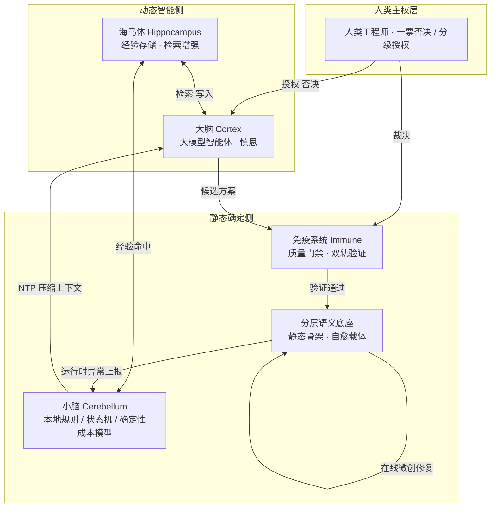

### 2.2 器官职责一览

| 器官 | 英文 | 核心职责 | 时效 | 是否消耗 Token | 典型实现形态 |
|---|---|---|---|---|---|
| 骨架 | Skeleton | 类型、内存、语义等价的确定性底座 | 常驻 | 否 | 分层语义底座与实现生成与适配层 |
| 小脑 | Cerebellum | 高频调度、执行策略优化、本地裁决 | 微秒~毫秒 | 否 | 本地规则库 + 状态机 + 确定性成本模型 |
| 大脑 | Main Brain | 未知复杂问题的深度推理 | 秒~分钟 | 是（受控） | 按需唤醒的大模型智能体 |
| 海马体 | Hippocampus | 经验沉淀与检索 | 持久 | 检索时少量 | 经验向量存储 + 检索增强 |
| 免疫 | Immune System | 门禁、一致性校验、回归、防自欺 | 构建期/合并前 | 否 | 多层质量门禁 + 全量回归验证 |
| 自愈 | Self-Repair | 运行时在线修复与就地优化 | 运行时 | 视情况 | 统一语义层微创修复引擎 |
| 主权 | Human Sovereignty | 授权、否决、目标设定 | 按需 | 否 | 分级授权交互界面 |

### 2.3 数据与控制双流

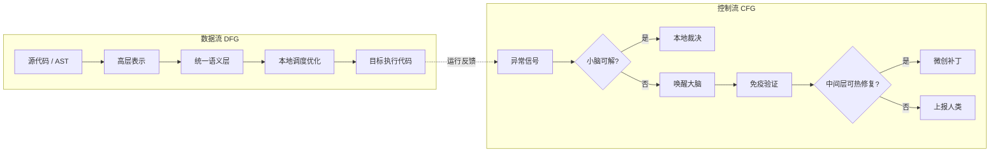

> **目标环境感知（对应 8.5）**：骨架不止于逻辑正确，还须感知运行载体。上层表示向可执行实现落地、以及运行时微创补丁生成时，必须结合目标环境的物理特征（处理器能力、加速单元规模、内存与存储特性等）做自适应优化——同一份语义层在不同硬件上应得到不同的最优执行方案。此为 8.5"硬件拓扑感知"的架构层锚点。

---

## 第三章　确定性分级：D0–D3 权限光谱

> 这是 v3.0 引入、v3.1 保留的核心机制，用于把公理一/二落到可执行的权限边界。每一层都有明确的"AI 可做什么"。

| 级别 | 名称 | 内容 | AI 权限 | 变更审批 |
|---|---|---|---|---|
| **D0** | 物理法则层 | 类型系统、内存模型、并发状态机、密码学原语 | **禁止触碰**，仅可读取 | 不可变更（构建期强制） |
| **D1** | 骨架逻辑层 | 调度策略、语义层转换规则、优化过程 | 可提议，须形式化等价证明 | 门禁 + 人类复核 |
| **D2** | 表层逻辑层 | 业务代码、胶水层、配置、接口适配 | 可生成，须全量回归通过 | 门禁自动放行 + 审计 |
| **D3** | 意图与表达层 | 需求解析、注释、测试用例生成、文档 | AI 主导，无副作用 | 人类可审查，不阻断运行 |

**规则**：AI 输出只能在其产生层或更低风险的层落地。任何从 D3 直接跃迁到 D0/D1 的变更，必须穿过免疫系统的完整验证链。

---

## 第四章　小脑规范（Cerebellum）

> 对应公理三。小脑是生命体的"肌肉记忆"，80% 的常规决策应在此终结。

### 4.1 强制条款

- **第四条（小脑优先）**：每个核心系统必须内置本地小脑模块，负责高频、快速、低能耗的本地调度与逻辑裁决。禁止把所有逻辑直接连到大模型。
- 小脑必须在无网络、无大模型的情况下仍可完成 D0/D1 的常规裁决。
- 小脑的决策必须可解释、可 replay（重放）、可审计。

### 4.2 小脑能力边界

| 必须具备 | 严格禁止 |
|---|---|
| 本地规则库与优先级匹配 | 生成式自由创作 |
| 状态机与确定性转移 | 未经验证的动态代码执行 |
| 确定性成本模型（如执行策略优化） | 直接修改 D0 底座 |
| 经验向量的快速命中 | 静默吞掉无法处理的异常（须上报） |

### 4.3 工程锚点

本地执行调度与确定性成本模型引擎是小脑的典型实现形态：在多种目标架构下，成百上千项底层操作的执行策略优化由内置确定性成本模型与状态机瞬间完成，零 Token 开销、精准可复现。

### 4.4 小脑的绝对确定性：三条硬边界

在工程上，小脑必须被定义为**确定性的绝对捍卫者**：它是"压缩后的历史经验"加"基于物理法则的确定性成本模型"，只认规则、状态机与硬件画像，不做价值判断，也不产生任何形式的创造。

| 硬边界 | 要求 | 判定方式 |
|---|---|---|
| **离网可用（Offline Capability）** | 网络断开、大脑完全不可达时，小脑凭本地规则库与已升格记忆，仍须维持不低于 **80%** 的常规事务 | 定期"断网演练"：屏蔽远程调用后跑全量常规用例，通过率即为指标 |
| **可生长（Growable）** | 规则不是写死的常量，只能通过海马体的**经验升格**长出新的"肌肉记忆" | 每条规则必须可追溯到经验来源与升格审计记录（见 24.3） |
| **零推测（No Speculation）** | 本地规则未命中时，小脑**必须立刻举手**抛出 `UnknownSignal`，禁止猜测、近似替代或"试着跑一下" | 台账中不得出现"无规则命中却产生判定"的记录，出现即为污染 |

> **角色越界**：小脑的能力上限是"确定地处理已知"，不是"合理地处理未知"。把小脑写成一个"小号大模型"，等于既消耗了 Token 又丢了确定性——这是最昂贵的一种退化。

---

## 第五章　大脑规范（Main Brain）与神经递质协议 NTP

> 对应公理三后半。大脑只做一件事：解决小脑与记忆都解决不了的未知复杂问题。

### 5.1 强制条款

- **第五条（战略性唤醒）**：当且仅当小脑遇到本地规则库与记忆库均无法解决的疑难时，才允许唤醒大模型 API。上下文必须压缩至极简，仅传递**特征向量与错误码**，以极低 Token 消耗换取高级智能辅助。
- 大脑输出是**建议（proposal）**，不是**指令（command）**。它不得绕过免疫系统直接落地。

### 5.2 神经递质协议 NTP：基础载荷

小脑与大脑之间的上下文传递必须结构化，禁止把全量代码或日志一股脑塞给大模型。

```json
{
  "ntp_version": "1.1",
  "direction": "uplink",
  "signal_type": "UNKNOWN",
  "error_code": "E-CORE-0427",
  "feature_vector": [0.12, -0.88, 0.33, 0.57],
  "context_digest": "sha256:afcd135cddc2ffc17db5c430579ff01cf7d0b648d43685d7b38066c51d1870a3",
  "tried_rules": ["rule_114", "rule_208"],
  "memory_hits": [],
  "constraints": ["D0_IMMUTABLE", "TARGET_ENV_LIMITED"],
  "budget_hint": {
    "max_tokens": 1200,
    "max_latency_ms": 8000,
    "priority": "D1"
  }
}
```

上方是**合法 JSON**：字段值只放真实取值，不写"枚举全集 / 字段说明 / 中文括注"这类解释文字；解释一律放在下表。示例中的哈希均由固定样例文本经 SHA-256 计算得到，可直接解析。

**字段释义表（每一个值都可查）**

| 字段 | 类型 | 白话解释 | 为什么必须有 | 取值 / 来源 |
|---|---|---|---|---|
| `ntp_version` | 字符串 | 协议版本 | 收发双方对字段的理解必须一致 | `主版本.次版本`，示例 `1.1`；本文 5.2 定义 |
| `direction` | 枚举 | 消息往哪个方向走 | 一条信道双向复用，接收方据此分派处理 | `uplink` / `downlink`；本文 5.4 定义 |
| `signal_type` | 枚举 | 出了哪一类问题 | 大脑据此判断该调用哪类知识 | `UNKNOWN` / `DEADLOCK` / `PERF_REGRESSION` / `SEMANTIC_CONFLICT`；本文 5.4 定义 |
| `error_code` | 字符串 | 故障的身份证号 | 精确定位故障点，便于检索历史经验 | `E-<域>-<四位编号>`，示例 `E-CORE-0427`；上报方生成 |
| `feature_vector` | 数字数组 | 压缩后的数字特征 | 用少量数字代替全量上下文，把 Token 压到最低 | 每项归一化到 `[-1, 1]`，维数由协议约定；由 `digest` 原语产出 |
| `context_digest` | 字符串 | 原文的指纹，不是原文 | 既能校验上下文一致，又不泄露全文 | `sha256:<64 位十六进制>`；由 `digest` 原语产出 |
| `tried_rules` | 字符串数组 | 本地已经试过哪些规则 | 防止大脑重复推荐已失败的路径 | 规则 ID 列表；空数组表示尚未尝试 |
| `memory_hits` | 字符串数组 | 记忆库检索到了哪些经验 | 让大脑知道哪些经验已被用过 | 经验记录 ID 列表；空数组表示无命中 |
| `constraints` | 枚举数组 | 不可突破的边界 | 大脑方案必须满足，否则一律驳回 | `D0_IMMUTABLE`（人类主权不可让渡）/ `TARGET_ENV_LIMITED`（目标环境受限）；第零章 D0–D3 |
| `budget_hint.max_tokens` | 整数 | 这次最多允许花多少 Token | 防止一次求助拖垮全局成本 | 正整数，示例 `1200`；本文 5.3 代价敏感条款 |
| `budget_hint.max_latency_ms` | 整数 | 最多允许多久返回 | 防止求助拖慢主流程 | 正整数（毫秒），示例 `8000`；同上 |
| `budget_hint.priority` | 枚举 | 本次求助的确定性等级 | 决定排队与抢占次序 | `D0`–`D3`，示例 `D1`；第零章 D0–D3 |

**设计意图**：只传特征、错误码、约束与预算，把 Token 消耗压到最低——这是"用减法对抗加法"的落点。

### 5.3 双脑的硬边界：谁都不能替谁活

小脑与大脑的界限如果不钉死，系统必然掉进两个深渊：**大脑抢小脑的活**（高频事务上调，Token 泄漏、延迟爆炸），或**小脑硬干大脑的活**（规则缺失时强行推断，幻觉直入主干、并发死锁）。

| 维度 | 小脑 Cerebellum | 大脑 Main Brain |
|---|---|---|
| **本质** | 压缩后的历史经验 + 物理确定性成本模型 | 泛化推理与模式重组的引擎：跨域知识的连接器 |
| **物理载体** | 本地 / 边缘进程 | 远端推理服务（大模型只是它的载体，不是它本身） |
| **处理对象** | 已知、高频、可判定 | 长尾、未知组合、语义冲突 |
| **单位成本** | 近零 Token、微秒级 | 昂贵且稀缺、秒级延迟 |
| **输出形态** | 确定性判定（可直接落地） | 候选策略 Proposal / 伪代码（不可直接落地） |
| **原语权限** | 可调用确定性原语与受限 `patch`（须先通过免疫） | **禁止**触碰 `invoke` / `patch` 等副作用原语 |
| **失败方式** | 抛 `UnknownSignal` 上交 | 被驳回、超时、判为不可用 |

**大脑的三条职责限制**：

1. **绝不负责执行**：大脑只能产出候选策略、伪代码或未构建的补丁，任何"直接改生产"的通道都必须不存在（对齐公理五）。
2. **代价敏感**：每次唤醒必须携带并遵守 `budget_hint`（Token 上限、延迟上限、优先级）；超预算即中止并记负样本，不得"再试一次"。
3. **接受被驳回**：大脑的方案被小脑否决、被免疫门禁驳回是常态，不是异常。驳回率是度量大脑质量的指标，不是需要掩盖的缺陷。

> **判定口诀**：能判定就不用推；必须推就说明不知；不知就上报，不上报即污染。

### 5.4 NTP 双向信道：上行求救与下行建议

双脑之间传递的不是"文本对话"，而是**压缩特征与待验证假设**。信道必须是双向、异步、带沙盒保护的。

**上行（小脑 → 大脑）：求救与压缩上下文**

触发条件（三者任一即可）：本地规则未命中（`UnknownSignal`）、连续三次重试失败、并发死锁或执行级崩溃。

```json
{
  "ntp_version": "1.1",
  "direction": "uplink",
  "signal_type": "UNKNOWN",
  "error_code": "E-CORE-0427",
  "feature_vector": [0.12, -0.88, 0.33, 0.57],
  "context_digest": "sha256:afcd135cddc2ffc17db5c430579ff01cf7d0b648d43685d7b38066c51d1870a3",
  "tried_rules": ["rule_114", "rule_208"],
  "attempt_count": 3,
  "env_profile": {
    "processor_capability": "GENERIC_CPU_V3",
    "accelerator_count": 2,
    "memory_tier": "HBM_2TIER",
    "interconnect": "MESH_2D"
  },
  "budget_hint": {
    "max_tokens": 1200,
    "max_latency_ms": 8000,
    "priority": "D1"
  }
}
```

**上行增量字段释义**（公共字段见 5.2 字段释义表，取值含义相同）

| 字段 | 类型 | 白话解释 | 为什么必须有 | 取值 / 来源 |
|---|---|---|---|---|
| `attempt_count` | 整数 | 本地已经重试了几次 | 达到阈值（默认 3 次）才允许唤醒大脑，防止一有风吹草动就消耗 Token | 正整数，示例 `3`；本文 5.4 触发条件 |
| `env_profile.processor_capability` | 枚举 | 目标处理器能力族 | 大脑给的方案必须匹配执行环境，但绝不绑定具体产品型号 | 抽象档位，示例 `GENERIC_CPU_V3`；第 8 章硬件感知 |
| `env_profile.accelerator_count` | 整数 | 可用加速单元数量 | 决定大脑能否推荐并行或专用方案 | 非负整数，示例 `2`；第 8 章 |
| `env_profile.memory_tier` | 枚举 | 内存与存储档位 | 决定方案的内存假设是否成立 | 抽象档位，示例 `HBM_2TIER`；第 8 章 |
| `env_profile.interconnect` | 枚举 | 互连拓扑特征 | 决定数据搬运成本假设 | 抽象档位，示例 `MESH_2D`；第 8 章 |

**下行（大脑 → 小脑）：建议与意图绑定**

```json
{
  "ntp_version": "1.1",
  "direction": "downlink",
  "proposal_id": "p-7f3c",
  "candidate": {
    "format": "SEMANTIC_PATCH",
    "digest": "sha256:51ce14ac8674ef2c7c9a623d9f38160737652ff04fedba92d5fc9f991242676a"
  },
  "confidence": 0.62,
  "rationale_digest": "sha256:c3c4c8e4a969b52d457a33f82caf95781519c7433ad6be072d74a3c89d02cb0d",
  "assumptions": ["ENV_STABLE", "NO_CONCURRENT_WRITE"],
  "budget_spent": {
    "tokens": 980,
    "latency_ms": 5400
  },
  "status": "PENDING_VERIFICATION",
  "rationale_binding": {
    "algorithm": "ANS-1+SHA-256",
    "summary_ref": "sum-9a1e",
    "digest": "sha256:f535948ab4faff07fe8828a6dd2d99040fb0fdd55c06a9cfd7736448b0f38c76"
  }
}
```

**下行字段释义表（每一个值都可查）**

| 字段 | 类型 | 白话解释 | 为什么必须有 | 取值 / 来源 |
|---|---|---|---|---|
| `proposal_id` | 字符串 | 这次建议的编号 | 追踪、驳回、引用都要靠它 | `p-<十六进制短码>`，示例 `p-7f3c`；大脑生成 |
| `candidate.format` | 枚举 | 候选物的表达形式 | 明确它**不是**可执行物 | `SEMANTIC_PATCH`（语义层补丁）/ `PSEUDOCODE`（伪代码）；本文 5.3 |
| `candidate.digest` | 字符串 | 候选物的指纹，不是正文 | 大脑不内联内容，只给可校验引用；落地前必须从沙盒按指纹取回并重新验证 | `sha256:<64 位十六进制>`；第 8 章沙盒构建 |
| `confidence` | 数字 | 大脑自评的把握程度 | 用于排序与风险提示，**绝不用于授权** | `[0, 1]` 浮点，示例 `0.62`；本文 5.3 |
| `rationale_digest` | 字符串 | 推理摘要的指纹 | 人类可读摘要可另附于折一，此字段只放可校验指纹 | `sha256:<64 位十六进制>`；第 13 章折一认知摘要 |
| `assumptions` | 字符串数组 | 尚未验证的前提清单 | 让审查者一眼看到方案的脆弱点 | 假设标识列表，示例 `ENV_STABLE` / `NO_CONCURRENT_WRITE` |
| `budget_spent.tokens` | 整数 | 这次实际花掉多少 Token | 度量大脑成本，用于限频 | 非负整数，示例 `980`；本文 5.5 |
| `budget_spent.latency_ms` | 整数 | 这次实际耗时 | 度量大脑延迟，用于限频 | 非负整数（毫秒），示例 `5400`；本文 5.5 |
| `status` | 枚举 | 永远是"待验证" | 从协议层杜绝"大脑已批准"这种状态 | 固定为 `PENDING_VERIFICATION`；本文 5.4 |
| `rationale_binding` | 对象 | 把人类可读摘要与这条建议焊死的凭证 | 防止"批准 A、展示 B"式的摘要掉包 | 见下方 ANS-1 规范化序列化小节 |

> **为什么候选只传指纹**：如果大脑把补丁正文内联进消息，接收方就可能被绕过验证直接使用，等于给"幻觉直入主干"开了一道门。只传 `candidate.digest`，强制接收方先到沙盒按指纹取回并重新验证——这是公理三"可证明的交给证明"在协议层的落点。

**ANS-1 规范化序列化与摘要绑定（规范性）**

同一个对象在不同语言里序列化出的字节可能不同（键序、空白、Unicode 转义、数字写法），导致同一份数据算出不同摘要。因此凡进入 `*_digest` 与 `rationale_binding` 的哈希，必须先经 **ANS-1（ANE Normalized Serialization v1）** 规范化再取 SHA-256：

1. **键排序**：对象成员按键的 UTF-16 码元升序排列（与 RFC 8785 JCS 一致，**引用**）；
2. **零空白**：不插入空格、缩进或换行；
3. **字符串**：仅转义 JSON 控制字符，非 ASCII 字符直接以 UTF-8 输出，不展开为 `\uXXXX`；
4. **数字**：整数按十进制原样输出；浮点数用定点有效位表示，禁止科学计数法与末尾零；非有限数禁止进入载荷；
5. **数组**：保持原顺序，不排序。

绑定摘要的输入固定为五个字段：`ANS-1({algorithm, proposal_id, rationale_digest, summary_ref, summary_text_canonical})`，结果写入 `rationale_binding.digest`。**权威文本是英文规范文本**：中文等译文必须携带 `translation_of: summary_ref`，不参与绑定计算——否则翻译差异会让同一条建议出现多个"合法"摘要。

> **【必须】** 所有 `sha256:` 摘要字段的生成都必须经过 ANS-1；**【必须】** 折一展示的认知摘要必须携带 `summary_ref` 与可重算的绑定摘要；**【可选】** 提供多语言摘要时，译文须标注 `translation_of`。机器可读契约见 `schemas/ntp-1.1.schema.json`；可运行工具见 `tools/validate_ntp.py`（`validate` 为 CI 门禁，`canonicalize` 输出 ANS-1 形式与摘要）。

> 关键语义：下行载荷**不是指令，而是一个待验证的假设**。`status` 永远是 `PENDING_VERIFICATION`，不存在"大脑已批准"这种状态。

**信道的四大铁律**

| 铁律 | 要求 | 违反后果 |
|---|---|---|
| **禁全量上下文** | 禁止把源码、日志、会话原文整体投喂；必须经 `digest` 压缩为特征向量、AST 摘要或错误栈摘要 | Token 爆炸、延迟不可控、成本失控 |
| **异步非阻塞** | 上行发出后当前任务挂起为 `Pending`，小脑转去处理其他任务；大脑回调以中断方式唤醒 | 系统假死、吞吐归零 |
| **沙盒隔离** | 下行产物只能在沙盒或隔离验证环境中构建与双轨验证，绝不直接进入生产执行 | 污染直入主干，不可回滚 |
| **强制留痕** | 每一次上行的载荷、下行的回复、最终是否采纳，全量写入台账与记忆库 | 无法回溯、无法升格、无法复盘 |

### 5.5 通信状态机、信道仲裁与限频

一条受控的双脑链路必须走完整状态机，不允许任何状态被跳过：

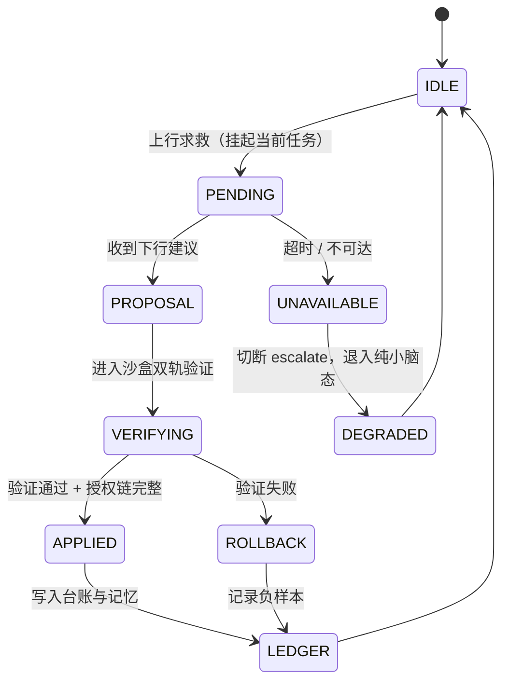

| 状态 | 语义 | 禁止事项 |
|---|---|---|
| `PENDING` | 已求助，等待中，任务让出执行权 | 禁止忙等阻塞；禁止重复上行同一信号（须先去重合并） |
| `PROPOSAL` | 已收到建议，尚未验证 | 禁止直接执行候选 |
| `VERIFYING` | 沙盒内构建 + 双轨验证 | 禁止跳过回归直接放行 |
| `APPLIED` | 通过验证且授权完整 | 禁止无凭证写入 |
| `ROLLBACK` | 验证失败，回退并记负样本 | 禁止静默丢弃失败样本 |
| `DEGRADED` | 大脑不可用，纯小脑态 | 禁止在此期间接受任何突变类变更 |

**信道仲裁（多生命体争抢大脑配额）**

当多个子系统或智能体同时发起上行请求，必须由统一调度单元排队，不得各自直连远端：

1. **紧急度优先**：D0/D1 级异常（骨架与骨架逻辑受损）优先于 D2 级业务异常，D3 级生成类请求最低。
2. **预算优先**：同等紧急度下，按剩余 Token 配额与延迟上限排序；接近耗尽时只放行 D0/D1。
3. **超额降级**：配额耗尽时，超额请求被强制打回小脑用保守规则处理，并记入台账（不排队、不重试）。

**限频（与 6.4 冷启动联动）**

| 阶段 | 上行频率策略 | 目的 |
|---|---|---|
| 探索模式 Explore | 允许高频上行，直至样本覆盖率达到阈值 | 快速收集长尾样本，避免规则库长期空转 |
| 利用模式 Exploit | 严格限频：单位时间配额 + 冷却窗口 + 同源信号去重 | 降本；防止以"高频求助"掩盖小脑规则缺失 |

> 限频参数属于 D1 级配置，调整须走门禁；"临时放宽限频"不得作为绕过预算的手段。

**超时与去重参数（默认区间，实现须落在区间内并在配置中显式登记）**

| 参数 | 默认区间 | 判定纪律 |
|---|---|---|
| 上行 `PENDING` 超时 | 按任务 D 级设定：D0 秒级、D1 十秒级、D2 分钟级、D3 不设实时等待 | 超时一律走 `DEGRADED`（退 `21.3b` 极态），**不得**记为"大脑拒绝"，更不得静默重试 |
| 同源信号合并窗口 | 与任务 D 级成正比，默认取"同一错误码 + 同一环境画像 + 同一规则缺口"三者一致者合并 | 合并只压缩重复上行，不丢弃差异样本；窗口内首次样本必须留痕 |
| 单任务最大上行次数 | 探索模式按预算放宽；利用模式默认 1–3 次，超限强制打回小脑保守规则 | 超限即判"规则缺口"而非"大脑无能"，计入 12.1 被打回率 |
| 冷却窗口 | 同一来源在两次上行之间必须隔离一个可配置窗口 | 防止以高频求助掩盖规则缺失（见 5.5 限频与 12.2 反模式） |

> 参数取值属 E 层证据（可观测、可调），不写死在 N 层条款中；但**参数缺失不得成为跳过超时判定的理由**——未配置时按区间保守端点执行。

### 5.6 模型载体治理（Model Carrier Governance）

> 大脑是"泛化推理与模式重组引擎"，**具体模型只是它的物理载体**（见 5.3）。既然载体可替换，就必须像管理依赖一样管理它，否则"载体可替换"只是口号。

- **载体不得成为架构依赖**：任何规范性条款、原语链或规则不得引用特定模型名称；大脑通过统一能力接口接入，替换载体不得改变 N 层条款。
- **选型六判据（每次引入或替换载体必须逐项留痕）**：① 任务能力覆盖（长尾与未知组合的推理质量）；② 延迟与吞吐（是否满足 D 级时限）；③ 单位成本（是否符合 `budget_hint`）；④ 可复现性（同输入同摘要的偏差区间）；⑤ 安全与数据边界（输出可审计、不越租户）；⑥ 可退出性（有替代载体与回滚路径）。
- **模型卡（Model Card）为强制产物**：记录载体版本、训练/知识截止、已知偏差、适用与禁用场景、评测结果与责任人；模型卡随 AI-BOM（第二十二章）纳入版本控制，缺失即视为未通过接入门禁。
- **升级与退役走同一门禁**：新载体必须先经评测者纪律（29.3）与双轨验证（第七章）通过，再以灰度方式替换；旧载体保留一个可回滚周期后方可退役，退役须记录原因与替代关系。
- **载体差异可观测**：记录每次大脑调用的载体标识、版本与置信度；同一任务跨载体结果不一致时，进入台账并按"结论冲突"处理（16.3），不得择一沉默采信。

> 模型载体治理与提示词资产治理（18.4）是同一枚硬币的两面：前者管"谁来推"，后者管"怎么问"，二者共同决定大脑输出的可信度与成本。

---

## 第六章　记忆规范：海马体与经验存储

> 对应公理四。记忆是护城河，也是生命体"自我"的来源。

### 6.1 强制条款

- **第六条（记忆即护城河）**：所有软件必须接入专属的经验存储库。每一次成功、失败、回滚都要被结构化；AI 必须通过检索增强机制读取过往经验，绝不重蹈覆辙。
- 未经免疫系统验证的经验**禁止写入**（防止错误经验污染记忆）。

### 6.2 经验记录结构（Experience Record）

| 字段 | 说明 |
|---|---|
| `signature` | 问题特征向量 / 错误码 |
| `context` | 触发时的最小上下文摘要 |
| `action` | 采取的动作（规则命中 / AI 方案 / 回滚） |
| `verification` | 门禁结果、一致性校验、回归结论 |
| `outcome` | success / failure / rollback |
| `lineage` | 来源链：哪个系统、哪次变更、谁授权 |

### 6.3 记忆生命周期

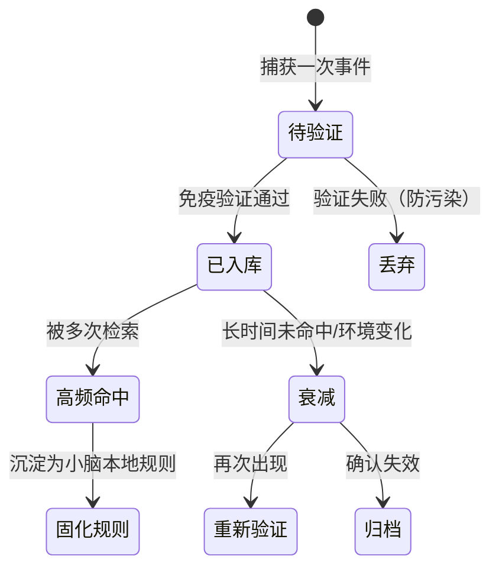

> 关键机制：**经验可升格为小脑规则**（把大脑的一次顿悟，变成小脑的本能），这是飞轮越转越省 Token 的根本原因。

### 6.4 冷启动与知识冷淬火（Cold Start & Knowledge Quenching）

> 对应公理三、四。生命体出生时记忆是空的——若没有初始经验，所有问题都会砸向稀缺而昂贵的大脑。本节规定如何让生命体"带着常识出生"。

- **种子规则集（Seed Rules）**：允许系统处于成熟度 L2/L3 阶段时，由人类领域专家灌入一组经过免疫验证的**初始黄金规则**，作为海马体的初始记忆。每条种子规则必须标注来源、适用范围、验证证据与有效期，并纳入台账；**禁止灌入未经免疫验证的规则**。
- **探索模式（Explore Mode，冷启动强制）**：记忆库建立早期，系统**强制**处于探索模式——主动提高大脑调用频次，有意覆盖未知问题空间，以收集多样化样本。此阶段的高频大脑调用是必要投资，须受第十八章预算闸门约束。
- **利用模式（Exploit Mode）**：当经验库达到组织预设的**覆盖阈值**（命中率、样本多样性、规则覆盖度等）后，系统自动切换到利用模式，优先命中本地规则、大幅降低大脑调用。阈值、切换判据与切换时刻必须写入台账、可审计。
- **过早收敛回退**：切入利用模式后若命中率持续低于下限，须自动退回探索模式补采样本，防止形成"经验茧房"。

| 模式 | 触发条件 | 大脑调用频次 | 目的 | 退出条件 |
|---|---|---|---|---|
| **探索 Explore**（冷启动强制） | 记忆库为空/低于覆盖阈值，或处于 L2/L3 初期 | 高（有意采样） | 收集样本、发现规则 | 达到覆盖阈值 |
| **利用 Exploit** | 覆盖阈值达标、命中率稳定 | 低（本地优先） | 节省成本、降低延迟 | 命中率跌破下限 |

> **知识冷淬火**：种子规则与探索期样本经免疫验证后"淬火"为稳定规则的过程。它与 6.3 的自然升格互为补充——前者缩短冷启动周期，后者支撑长期进化；二者都必须经过同一套免疫验证，不得因"急于上线"而绕过。

---

## 第七章　免疫规范：双轨验证与防自欺

> 对应公理二、六、七。免疫系统是生命体不腐化的根本保障。

### 7.1 强制条款

- **第七条（绝对防御 / 防自欺）**：杜绝任何静默失败。系统遇未知问题必须立即报错、阻断、记录，绝不通过修改测试用例或伪造绿勾掩盖。错误是进化的养料，虚假是软件的毒药。
- 任何由 AI 动态生成的代码或补丁，必须经过静态门禁的严酷拷问；只有验证等价且无误才能合并。**未经验证的 AI 输出，等同于病毒感染。**

### 7.2 双轨验证模型

| 轨道 | 验证手段 | 回答的问题 | 失败后果 |
|---|---|---|---|
| **符号轨** | 形式化等价证明、多路一致性校验、类型检查、状态机可达性 | "它在数学/语义上正确吗？" | 立即阻断 |
| **统计轨** | 全量回归、模糊测试、影子运行（shadow run） | "它在实际行为上正确吗？" | 立即阻断并回滚 |

两轨**必须同时通过**（逻辑与），任一失败即判定为污染。

### 7.3 门禁责任链

```
AI 候选方案
   → 符号轨（等价性 / 一致性校验）
   → 统计轨（回归 / 模糊）
   → 人类授权（若触及 D0/D1 或生产环境）
   → 允许合并 / 在线加载
   → 全程台账留痕（可追溯、可 replay）
```

---

## 第八章　自愈规范：统一语义层即时修复法则

> 对应公理二后半。这是"软件生命体"最具辨识度的能力。

### 8.1 强制条款

- **第八条（即时修复法则 / Instant Repair）**：软件生命体的底座必须包含统一语义层。当系统发生任何运行时异常、性能瓶颈或逻辑错乱时，统一语义层应具备跨越高层设计与底层执行的"全知视角"，能够随时在底层直接进行底层执行逻辑重构、在线修复生成或优化，实现"无需重启、无需人工干预、随时就地修复"的生命体自愈能力。

### 8.2 为什么统一语义层能做到"随时修复"

传统软件：出错 → 崩溃 → 停机 → 人翻源码 → 改高级语言 → 重新构建 → 重新部署（周期极长）。

语义层驱动：所有高层表示与机器级执行代码最终都流经统一语义层，它拥有**上帝视角**，可直接在统一语义层做"微创手术"——生成修复方案、调整执行路径、在线加载优化，无需触碰杂乱的源码。

### 8.3 自愈的安全前置（关键风险的正面回应）

> AI 生成 + 运行时热修复 = 双重不确定性叠加，必须三重保险：

| 保险 | 机制 |
|---|---|
| **可回滚** | 在线修复前建立检查点快照；失败自动 rollback |
| **可证明** | 补丁必须通过符号轨等价性验证 |
| **可审计** | 每次热修复写入台账与经验库，人类可事后复核 |

### 8.4 自愈决策控制流

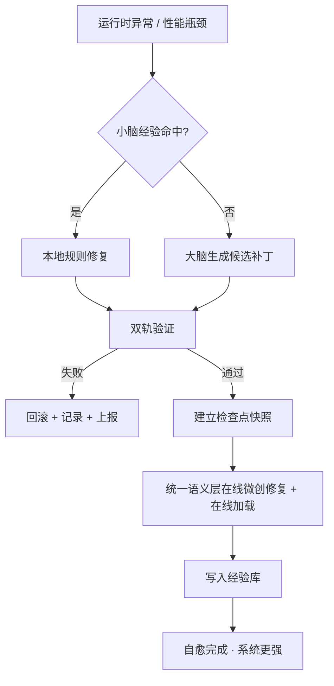

### 8.5 硬件拓扑感知与执行策略自适应优化

> 对应第二章目标环境感知。同一份语义层，在不同物理载体上的"最优"执行方案并不相同——脱离硬件谈修复，可能修好了逻辑却拖垮了性能。

- **强制要求（硬件拓扑感知）**：统一语义层在生成在线微创修复或执行自适应优化时，**必须**结合当前运行环境的物理特征做自适应决策，至少包括：处理器处理器能力、加速单元核数与类型、内存层级与带宽、互连与数据访问亲和性。禁止在任何硬件上套用"一刀切"的补丁序列。
- **画像获取**：硬件特征须在启动时探测、变更时刷新，纳入可观测台账；画像缺失时降级为保守基线并告警（见第二十一章优雅降级），不得臆测硬件能力。
- **确定性成本模型联动**：自适应优化所用的确定性成本模型（见第四章小脑）必须以当前硬件画像为输入，选择执行调度、操作合并与并行策略；同一补丁在不同画像下允许产出不同变体，各变体均须独立通过双轨验证（见第七章）。
- **可复现**：补丁变体须记录"画像指纹 → 选中的自适应优化策略"，使同一环境下的修复可被复现与回放。

| 物理特征 | 自适应优化影响 | 画像缺失时的降级 |
|---|---|---|
| 处理器能力 / 扩展能力 | 执行路径选择、向量化路径 | 保守基线处理器能力 |
| 加速单元核数与类型 | 并行度、算子卸载决策 | 关闭卸载，主机路径 |
| 内存层级与带宽 | 数据布局、缓存分块 | 默认分块参数 |
| 互连与数据访问亲和 | 线程绑定、数据放置 | 忽略亲和约束 |

> **通用性声明**：本条只规定"必须感知并自适应硬件物理特征"这一范式要求，不绑定任何具体处理器能力、加速架构或构建器实现，适用于从边缘设备到数据中心的一类异构环境。

---

## 第九章　人机协同：人类主权与分级授权

> 对应公理五。人类不是被移除，而是被提升到"立法者 / 裁决者"的位置。

### 9.1 强制条款

- **第九条（一票否决权）**：禁止任何 AI 智能体在未经人类明确授权的情况下，直接修改主分支代码或向生产环境下发指令。人机分离，权责清晰。
- **第十条（全景白盒）**：所有底层操作映射、自适应优化、图谱重构必须提供全局"上帝视角"台账。生命体不能存在黑盒。

> 说明：条款编号为公理七条 + 规范条款十条，连续无重复。

### 9.2 分级授权模型（破解"人类瓶颈"）

| 授权级 | 触发条件 | 人类动作 |
|---|---|---|
| **L0 自动** | D3 层、无副作用（文档/注释/测试生成） | 事后审计即可 |
| **L1 复核** | D2 层、门禁全绿、经验库高置信命中 | 批量确认 / 抽查 |
| **L2 强授权** | 触及 D0/D1、生产环境、不可逆变更 | 显式双重确认批准 |

### 9.3 双层确认交互

- **判定层**：展示 AI 的意图、差异（diff）、依据与验证结论，供人类判断。
- **授权层**：人类显式批准后才真正落地。判定与授权分离，杜绝误触。

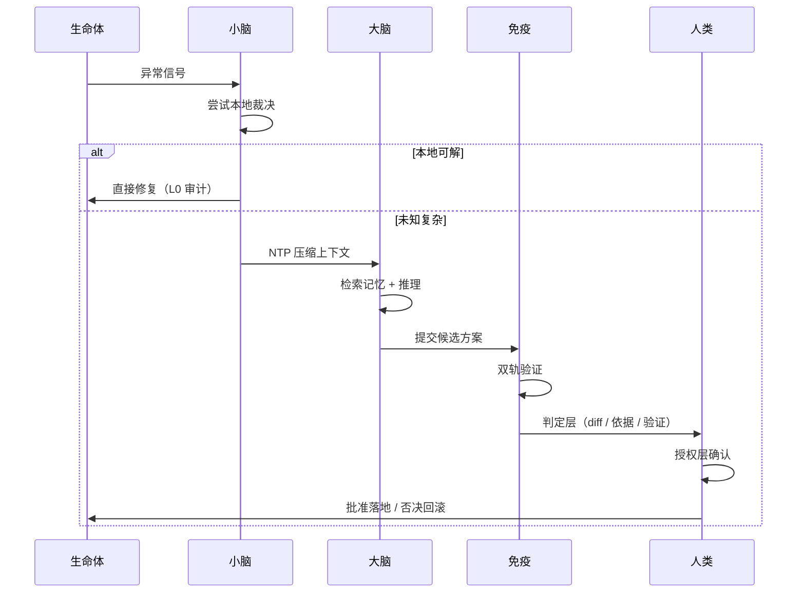

---

## 第十章　进化论：开发维护一体飞轮

> 对应"开发与维护一体化"的核心愿景。软件上线不是终点，而是生命的开始。

### 10.1 飞轮六阶段

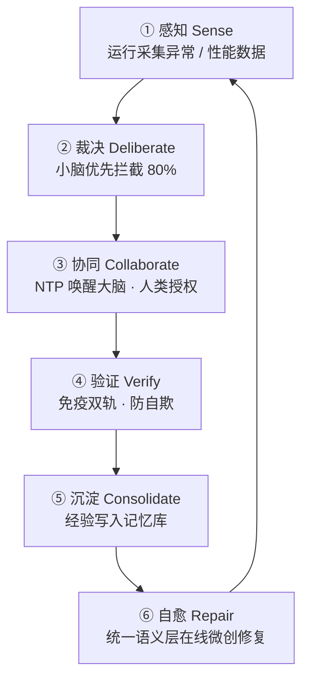

### 10.2 飞轮的三重复利

1. **成本复利**：经验库越厚、升格为小脑规则越多 → 需要唤醒大脑的次数越少 → Token 与延迟趋近于零。
2. **能力复利**：每次"变异—验证—沉淀"都让系统见过更多场景 → 应对未知的速度更快。
3. **安全复利**：门禁与经验互相强化 → 误报率下降、漏报率趋零 → 系统更可信。

### 10.3 开发即维护，维护即开发

- 传统：建一栋楼（开发），坏了再修（维护）——割裂、decaying。
- ANE：像一棵树，一边生长（开发）一边自我修护（维护），两者同频协同。
- **运行即感知，感知即维护，维护即开发，开发即进化。**

### 10.4 演进速度：五步算法（顺序不可颠倒）

> **法则一**：反馈循环的转速，决定生命体的生存权。速度不是效率指标，而是最高级的护城河——同样的洞察，谁先完成"感知→裁决→验证→沉淀"的闭环，谁就拿到下一轮的样本。

生命体在重构、优化或生成任何代码块时，**必须**遵守以下顺序。顺序本身就是规范的一部分：

| 步 | 动作 | 具体做什么 | 完成判据（可验证） |
|---|---|---|---|
| 1 | **删除（Delete）** | 先删伪需求、死代码、为想象中未来预留的过度抽象 | 删除后构建与全量回归全绿，且净代码量为负 |
| 2 | **简化（Simplify）** | 降低模块耦合、消除重复路径、收窄接口面 | 圈复杂度与跨模块依赖数不升；接口入参减少 |
| 3 | **优化（Optimize）** | 在简化后的结构上做底层执行策略优化与确定性成本模型调参 | 正确性不变前提下指标改善，且结果可复现（对齐 8.5） |
| 4 | **加速（Accelerate）** | 提并发吞吐：批处理、流水线、缓存、按硬件拓扑分配 | 无新增竞态与共享状态；压测曲线可解释 |
| 5 | **自动化（Automate）** | 最后才固化流水线、门禁与巡检 | 人工介入点可被逐条枚举 |

**为什么不能越级**：

- **先自动化再删除**＝把垃圾堆流水线化。产出速度越快，技术负债积累越厚，且负债被"绿色流水线"掩盖。
- **先优化再简化**＝在最复杂的结构上做微调，优化收益被复杂度吃掉，且难以证明等价。
- **跳过加速直接自动化**＝把串行瓶颈固化进流水线，之后每次提速都要拆流水线。

> 与公理的关系：五步算法是公理一（动静二元）在"演进动作"上的投影——删除与简化在收缩静态骨架，优化与加速在扩张动态能力，自动化只负责把已验证的路径固化，**不产生新的正确性**。

### 10.5 执行纪律：结构化上报、当轮留痕、可灰度

**一、结构化上报**

向上求助（含向大脑、向人类）时必须结构化陈述三要素：**问题是什么 · 已尝试过什么 · 下一步需要什么**。冗长的背景铺陈、情绪化描述、无关上下文一律剔除——这既是 NTP 上行载荷的人类可读版本（5.4），也是组织层对"信息熵"的治理。

**二、异常当轮上报**

假绿勾、静默失败、违规变异、门禁绕过，必须在**发生当轮**上报台账。藏匿坏消息的系统，其免疫系统应直接将其判定为**污染**并降级——因为未被记录的失败会以"经验"的形式二次污染记忆库。

**三、高内聚融合**

能用高内聚模块在底层融合的调用链，不允许拆成冗长的跨进程微服务链——每次跨边界调用都在支付序列化、网络与可观测性三重损耗。但融合有硬边界：**不得把 D0 骨架逻辑糊进业务模块**，不得为了减少调用而牺牲可替换性。

**四、自动灰度模式**

当确定性把握达到 **99%** 即进入灰度发布，而不是等待 100%。等待完美等同于关闭反馈循环。灰度必须同时满足：有可回滚检查点、有单向收紧的降级路径（21.3）、有可观测的成功判据。

> 门禁与灰度不是对立面：**门禁管"能不能发"，灰度管"发多少、发给谁"**。门禁未过者，灰度无意义。

---

## 第十一章　落地：ANE 成熟度模型 L0–L5

> 让范式可从"愿景"被渐进式采用，而非一刀切。

| 等级 | 名称 | 特征 | 判定标准 |
|---|---|---|---|
| **L0** | 静态手工作坊 | 纯确定性代码，AI 未介入 | 无 AI 生成进入主干 |
| **L1** | 工具辅助 | AI 做补全/建议，人全量审 | 有 AI 辅助但无自动闭环 |
| **L2** | 小脑就位 | 本地规则拦截高频决策，零 Token | 常规决策不经大模型 |
| **L3** | 记忆闭环 | 经验存储 + 检索增强生效 | 同类问题不重复问大脑 |
| **L4** | 自愈运行 | 统一语义层在线修复 + 飞轮转动 | 运行时可无需重启修复 |
| **L5** | 生命体 | 开发维护一体、受控自我迭代 | 变异—验证—沉淀全自动，人类仅战略授权 |

**采用路径**：从 L2（小脑）与 L3（记忆）切入收益最大、风险最低；L4（自愈）必须在 L2/L3 与免疫体系成熟后方可启用。

---

## 第十二章　度量体系与反模式

### 12.1 关键度量（KPI）

| 指标 | 定义 | 目标方向 |
|---|---|---|
| 小脑拦截率 | 本地裁决决策数 / 总决策数 | ↑（目标 ≥80%） |
| Token/决策比 | 平均每次决策消耗 Token | ↓ |
| 记忆命中率 | 检索增强命中经验 / 大脑唤醒次数 | ↑ |
| 经验升格率 | 沉淀为小脑规则的经验占比 | ↑ |
| 门禁首次通过率 | 首次即通过双轨的方案占比 | ↑（反映大脑质量） |
| 自愈成功率 | 在线修复成功 / 在线修复尝试 | ↑ |
| 回滚率 | 失败回滚 / 总变更 | ↓ |
| MTTR | 平均修复时间 | ↓ |
| 静默失败数 | 未上报即吞掉异常的次数 | = 0（红线） |
| 反馈闭环时长 | 从信号产生到经验沉淀完成的耗时 | ↓（速度法则的核心指标） |
| 净代码量变化 | 每轮演进中删除与新增的行数之差 | 应为负或接近零 |
| 配额耗尽率 | 因预算耗尽被拒的大脑请求 / 全部上行请求 | 观察项；突升触发限频复核 |
| 被打回率 | 被仲裁打回小脑保守规则的请求 / 全部上行请求 | ↓（高值指向规则缺口，非大脑无能）|
| D0/D1 抢占率 | 高优先级请求抢占低优先级请求的次数 / 总仲裁次数 | 观察项；用于审计仲裁公平性（5.5）|

### 12.2 反模式清单（明确的"不要"）

| 反模式 | 危害 | 正确做法 |
|---|---|---|
| 全量上下文灌给大模型 | Token 爆炸、延迟高 | 用 NTP 传特征与摘要 |
| AI 直改主分支/生产 | 绕过主权与免疫 | 分级授权 |
| 静默失败 / 假绿勾 | 掩盖问题，系统腐化 | 立即报错、阻断、记录 |
| 未验证经验入库 | 记忆污染，负向飞轮 | 免疫验证后写入 |
| 无快照热更新 | 不可回滚，灾难风险 | 检查点 + 自动 rollback |
| 万能大模型（无小脑） | 卡死、成本失控、不可靠 | 小脑优先 |
| 黑盒不可解释 | 不可控、不可信 | 全景白盒台账 |
| 规则库无限膨胀 | 小脑退化为新巨石 | 经验升格 + 衰减归档 |
| 先自动化再简化 | 把技术负债流水线化，绿勾掩盖腐化 | 五步算法顺序（10.4） |
| 以高频求助掩盖规则缺失 | 小脑空心化，成本随流量线性上升 | 限频 + 未命中率归因到规则缺口（5.5） |
| 小脑强行推测（无规则也给答案） | 幻觉直入主干，不可回溯 | 抛 `UnknownSignal`，禁止近似替代（4.4） |

---

## 第十三章　交互方式：智能体的交互模式矩阵


### 13.1 交互的四个维度

任何一次 AI 原生交互都可沿四轴分类：

| 维度 | 取值 | 说明 |
|---|---|---|
| **时态** | 同步 / 异步 / 流式 | 请求是否阻塞、结果是否增量返回 |
| **方向** | 人→机 / 机→人 / 机→机 / 机→工具 | 交互主体关系 |
| **自治度** | 建议 / 半自动 / 全自动（受授权约束） | 对应第九章分级授权 L0–L2 |
| **持久性** | 单次无状态 / 会话有状态 / 长期记忆 | 状态跨越的边界 |

### 13.2 十种标准交互模式（Interaction Patterns）

| 模式 | 核心思想 | ANE 中的定位 | 风险与约束 |
|---|---|---|---|
| **链式 Chain** | 步骤顺序执行 | 小脑确定性流水线 | 单点失败需可回滚 |
| **路由 Routing** | 按特征分发到不同处理分支 | 小脑按 D0–D3 分级路由 | 路由判据须可解释 |
| **并行 Parallelization** | 独立子任务并发 | 大脑批量推理 / 多轨验证 | 结果聚合需确定性 |
| **规划 Planning** | 分解目标为多步计划 | 大脑处理未知复杂 | 计划须经判定层展示 |
| **反思 Reflection** | 产出者 + 评审者双智能体 | 对应免疫系统的"批评者" | 评审者不得自我背书 |
| **工具调用 Tool Use** | 通过外部工具影响现实 | 见第十五章 MCP 规范 | 最小权限 + 调用前授权 |
| **检索增强 RAG** | 先检索再推理 | 海马体经验读取 | 检索须带访问控制 |
| **多智能体协作 Multi-Agent** | 角色分工、共享记忆 | 见第十六章 | 需协议化，禁止私聊 |
| **人在环路 HITL** | 关键决策由人裁决 | 人类主权层一票否决 | 避免人类成瓶颈 |
| **事件驱动 EDA** | 状态变化即事件，订阅者响应 | 飞轮的感知—自愈链路 | 事件须可溯源、可重放 |

### 13.3 交互模式选择准则

- **能用小脑就不用大脑**：链式/路由优先，规划/反思仅在 D2/D3 启用。
- **能同步就不异步**：异步仅用于长任务；但涉及自愈与生产变更必须走可审计的异步事件链。
- **能流式就流式**：面向人的输出优先流式，降低感知延迟，但流式内容不视为已验证结论。
- **凡有副作用必显式**：所有工具调用、状态写入，必须携带授权凭证与溯源标识。

### 13.4 双折叠协同模式（Dual-Fold Collaboration）

> 对应公理五、公理六，是 9.3"双层确认交互"在人机界面上的强制范式化。它界定"机器如何把判断呈现给人、人如何把意志回写给机器"的标准结构。

人机协同界面**必须**呈现为两个语义隔离的"折叠面"，禁止把认知与授权混排于同一层：

| 折叠面 | 名称 | 面向 | 核心载荷 | 确定性等级 |
|---|---|---|---|---|
| **折一** | 判定层（Judgment Fold） | 机器 → 人 | **认知摘要（Cognitive Summary）**：AI 的意图、候选方案、差异、依据、验证结论、风险提示 | D1–D3（不可直接执行） |
| **折二** | 授权层（Authorization Fold） | 人 → 机器 | **意图绑定（Intent Binding）**：人把批准/否决绑定到某一具体候选动作的凭证 | D0（人工作出，机器不可代签） |

**强制范式规则**：

- **两折不可合并**：折一只呈现与解释，不得触发任何副作用；折二只承载人的确定性意志，不得由 AI 自动生成授权。任何绕过折二的自动落地视为违反公理五。
- **摘要必带依据**：认知摘要必须同时给出依据链（检索到的经验、证据、验证结果），不得只给结论——"看得见理由"是人行使主权的前提。
- **绑定须精确**：意图绑定须精确指向折一中的某一具体候选动作（动作 ID + 参数 + 目标环境），防止"批准 A、执行 B"的偷换。
- **全程留痕**：两折交互的每一次展开、摘要、绑定、否决均写入台账并生成 `attest` 凭证，供回放审计。

**认知摘要的机器可读绑定（与 5.4 对接）**

折一的认知摘要不能只是给人看的自然语言，它必须同时是一份可校验凭证。最小结构：

```json
{
  "summary_ref": "sum-9a1e",
  "proposal_id": "p-7f3c",
  "rationale_digest": "sha256:c3c4c8e4a969b52d457a33f82caf95781519c7433ad6be072d74a3c89d02cb0d",
  "summary_text_canonical": "Local rules did not hit; apply the semantic-layer patch in the sandbox and decide after dual-track verification.",
  "evidence_refs": ["exp_077", "run_2048"],
  "risk_codes": ["D1_ENV_UNVERIFIED", "MEMORY_HIT_LOW"],
  "binding_digest": "sha256:f535948ab4faff07fe8828a6dd2d99040fb0fdd55c06a9cfd7736448b0f38c76",
  "translation_of": null
}
```

- **【必须】** `binding_digest` 按 5.4 的 ANS-1 规则，对 `algorithm + proposal_id + rationale_digest + summary_ref + summary_text_canonical` 重算；验证者用台账中的下行载荷重算，不一致即拒绝展示。
- **【必须】** `proposal_id` 与 `rationale_digest` 必须与下行载荷逐字相同；摘要正文不得脱离绑定被单独修改。
- **【可选】** 中文等非英文摘要以 `translation_of: "sum-9a1e"` 声明译文身份，不参与绑定计算。

这样"看得懂"与"没被掉包"由同一个凭证保证——人看到的那段文字，就是机器签过的那段文字。

> 该模式是"全景白盒"（公理六）与"人类主权"（公理五）在交互层的合流：折一保证人**看得懂**，折二保证人**说了算**。

### 13.5 交互追溯：日志形式与回放

> **要不要 log？要，但不是把聊天记录全存下来。** 交互追溯需要的是"结构化交互事件日志"——只记录足以还原责任与决策的最小事实，既能回放，又不泄露隐私、零 Token 开销。

**三层日志（职责不同，不可混用）**

| 层 | 名称 | 记录什么 | 保存策略 | 谁看 |
|---|---|---|---|---|
| L1 | **审计日志** | 谁、何时、基于什么依据、请求了什么原语、谁授权、结果如何、依据哪一条规范 | 不可篡改、保证送达、长期留存 | 审计者、治理委员会、监管 |
| L2 | **运行日志** | 延迟、命中率、Token/成本、失败与重试次数、环境变量画像 | 可采样、短期留存 | 开发者、运维 |
| L3 | **决策摘要** | 用一句人话说明"发生了什么、为什么、谁批准、如何撤销" | 与 L1 同生命周期，面向人阅读 | 人类操作者、业务方 |

**L1 审计日志的最小字段（每条交互事件一条）**

| 字段 | 含义（小白版） | 为什么必须有 |
|---|---|---|
| `trace-id` | 这次交互的独一无二的编号 | 把散落各处的记录串成一条完整故事（见 22.1） |
| `seq` | 事件在原语链中的序号 | 还原先后顺序，判断是否有跳步 |
| `ts` | 发生时间（带时区） | 事后按时间线与故障对齐 |
| `actor` | 谁发起：人类 / 某器官 / 某智能体（稳定 ID） | 明确责任主体，防止"不知道谁干的" |
| `primitive` | 调用了哪个交互原语（见 14.2） | 知道做了什么动作 |
| `payload_digest` | 载荷的摘要/哈希，不存原文 | 既能校验内容，又不泄露隐私、不占空间 |
| `evidence_ref` | 依据的经验 ID / 规则 ID / 条款编号 | **回答"凭什么"**——这是可追溯的核心 |
| `authorization` | 授权凭证（折二的意图绑定） | 证明副作用被人类显式批准 |
| `result` | 成功 / 失败 / 回滚 / 降级，及原因码 | 坏消息必须留痕（10.5） |
| `prev_hash` | 上一条记录的哈希 | 串成链，任何篡改都会断链 |

**追溯的四条纪律**

1. **不可全量**：原始会话、源代码、整份日志不得进入审计日志；只存摘要与引用（对齐 5.4 禁全量上下文、18.2 上下文工程）。
2. **必须带出处**：每条记录至少有一个 `evidence_ref` 指向经验、规则或条款；无出处的记录视为"无依据决策"，按污染处理。
3. **一键回放**：给定 `trace-id`，必须能还原从 `observe` 到 `attest` 的完整原语链，以及每一步的输入摘要、依据与授权（见 28.1 事件溯源）。
4. **日志不是门禁**：写日志不等于做对了；验证仍由免疫系统执行（第七章）。把"已记录"当"已验证"是典型的假绿勾。

> 日志即证据（28.2）：L1 记录可直接用于合规举证（20.2）、事故复盘（21.5）与经验升格审计（24.3）。**没有日志的交互，等于没有发生过的证据。**

### 13.6 可视化阶段清单：哪些过程必须看得见

> 可视化不是装饰，是主权的入口。原则：**凡是影响"人要不要批准、事后能不能追问"的阶段，都必须可视化；凡是可视化的，都必须能下钻到 `trace-id`。**

| 阶段 | 给谁看 | 必须展示什么 | 为什么必须看见 | 出处 |
|---|---|---|---|---|
| ① 感知 Observe | 运维 / 开发者 | 系统当前状态摘要、异常信号、影响范围 | 早发现，避免静默失败 | 14.2 `observe` · 28.1 |
| ② 判定与摘要 Classify / Digest | 人类操作者 | **认知摘要**（折一）：AI 意图、候选、依据、验证结论、风险 | 看得懂才谈得上批准 | 13.4 · 5.4 |
| ③ 授权 Authorize | 人类主权 | **意图绑定**（折二）：具体动作 ID、参数、目标、影响、可撤销入口 | 防止"批准 A 执行 B" | 9.3 · 13.4 |
| ④ 大脑求助 Uplink | 人类 / 成本负责人 | 为什么求助、已试规则、预算占用、环境画像摘要 | 成本透明，识别"高频求助掩盖规则缺失" | 5.4 · 5.5 · 18.1 |
| ⑤ 验证 Verify | 开发者 / 审计者 | 双轨验证逐项结果、门禁通过/失败原因、证据链 | 信任来自证据，不来自声明 | 第七章 · 26.3 |
| ⑥ 变更与回滚 Apply / Rollback | 运维 | 变更前后差异、回滚点、当前生效版本 | 任何副作用都可撤销 | 第八章 · 21.1 |
| ⑦ 自愈与复盘 Repair / Postmortem | 全体相关方 | 事件时间线、根因、修复动作、复审日期 | 把事故变成经验，而非台账噪音 | 21.5 |
| ⑧ 记忆升格 Promotion | 治理委员会 | 经验来源、N 次独立复现、背书人签名、相关性检验 | 防投毒与近亲繁殖 | 24.3 |

**可视化的三条硬约束**：

- **结论与依据同屏**：只给结论不给依据的界面，视为违反公理六（全景白盒）。
- **可下钻**：每个展示项都可点开到原始摘要、证据 ID 与 `trace-id`；不能下钻的图表只算宣传图，不算可观测证据。
- **无障碍**：不得只靠颜色或声音传达关键信息，须提供文字替代与键盘可达路径（23.2 认知负荷与告警治理的精神延伸）。

### 13.7 交互友好性准则

> 友好不是"界面好看"，而是**人能在不猜的情况下安全使用**。本规范把友好性写成可检查的条款，而不是审美偏好。

| 准则 | 具体要求 | 可检查的证据 |
|---|---|---|
| **看得懂** | 首次出现的术语必须给白话解释；界面文案避免内部代号裸奔；每个术语可在附录 A 查到 | 术语速查覆盖率 100%（附录 A） |
| **可预测** | 执行前声明将要发生什么、影响范围与是否需要授权；不允许"悄悄执行" | 折一认知摘要（13.4） |
| **可撤销** | 每个副作用都有回滚点与人可触发的撤销入口 | 变更记录中的回滚点字段（13.5 L1） |
| **反馈及时** | 状态必须可见：等待中 / 验证中 / 已生效 / 已回滚；超时主动告知而非静默 | 通信状态机（5.5）、`PENDING` 超时参数 |
| **认知不过载** | 一次只呈现 3–5 个关键项，细节按需下钻；告警分级，避免"全是红色" | 23.2 告警治理 |
| **无障碍** | 不依赖单一感官通道；文字替代；键盘可达；可放大 | 13.6 可视化硬约束 |
| **措辞准确** | 禁止"AI 已决定"这类拟人越权表述；统一用"AI 建议，你批准/否决" | 公理五人类主权 |

> 三条准则的交叉验证：一个界面若同时满足"看得懂、可预测、可撤销、反馈及时、认知不过载、无障碍、措辞准确"，它不需要用户额外培训就能安全操作——这正是 ANE 对"小白可用"的定义。

---

## 第十四章　交互原语：可组合的最小交互单元


### 14.1 原语分层

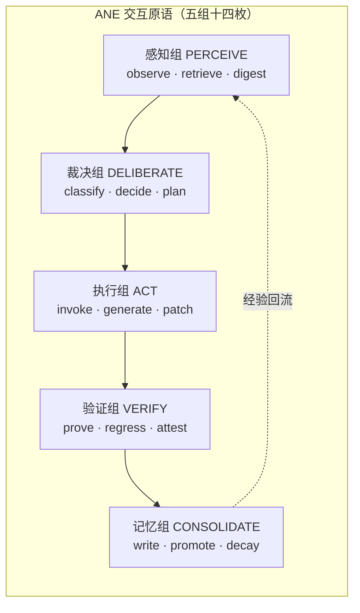

### 14.2 原语定义表

| 组 | 原语 | 语义 | 确定性等级 | 是否可组合 |
|---|---|---|---|---|
| 感知 | `observe` | 采集运行时信号与异常 | D0 | 是 |
| 感知 | `retrieve` | 从经验存储检索相关记忆 | D1 | 是 |
| 感知 | `digest` | 把原始上下文压缩为特征摘要 | D1 | 是 |
| 裁决 | `classify` | 按 D0–D3 对问题分级 | D0 | 是 |
| 裁决 | `decide` | 小脑本地裁决或升级大脑 | D1 | 是 |
| 裁决 | `plan` | 生成多步行动计划 | D3 | 是 |
| 执行 | `invoke` | 调用外部工具（受 MCP 契约约束） | D2 | 是 |
| 执行 | `generate` | 生成代码/文本/补丁草稿 | D3 | 是 |
| 执行 | `patch` | 在统一语义层落地微创修改 | D1 | 否（须验证前置） |
| 验证 | `prove` | 符号轨等价性证明 | D0 | 是 |
| 验证 | `regress` | 统计轨回归验证 | D0 | 是 |
| 验证 | `attest` | 生成可审计凭证并写入台账 | D0 | 是 |
| 记忆 | `write` | 写入经验记录（验证后） | D1 | 是 |
| 记忆 | `promote` | 经验升格为小脑规则 | D1 | 否（须高置信） |
| 记忆 | `decay` | 经验衰减与归档 | D1 | 是 |

### 14.3 原语组合规则

1. **类型一致**：原语输出类型必须匹配下游输入类型（特征向量、凭证、补丁、判定）。
2. **副作用隔离**：`invoke`/`patch` 为副作用原语，必须成对携带 `attest` 凭证。
3. **验证不可跳过**：任何 `patch` 之前必须存在 `prove` 与 `regress` 的通过记录。
4. **升级可追踪**：从 `generate`（D3）到 `patch`（D1）的跃迁必须留下完整原语链，供回放审计。

**双折叠协同的原语编码**（对应 13.4）：折一"认知摘要"由 `digest → retrieve → prove/regress` 组合产出，止于 `attest`（证据凭证）而不落地；折二"意图绑定"是人在环触发的一次确定性授权写入，其产物是绑定到具体动作的授权凭证，此后才允许进入 `invoke`/`patch`。因此一条完整的受控链路为：

```
observe → digest → retrieve → decide(候选) → prove+regress
        → attest(折一·认知摘要) → [人·意图绑定] → invoke/patch → attest(折二·授权) → write
```

> 关键约束：`attest` 在折一与折二各出现一次、语义不同——前者是"机器自证依据"，后者是"人类授予权限"，二者缺一即视为绕过双折叠。

> NTP（神经递质协议）本质上是 `digest → decide → plan` 这组原语的标准化载荷格式。

---

## 第十五章　工具生态：MCP 与能力接入规范


### 15.1 为什么必须是标准协议而非私有胶水

私有工具集成会导致：语义各自为政、风险面各自隐藏、失败被掩盖、生态无法累积。ANE 要求工具接入走**契约化协议层**，使能力发现、权限协商、审计追踪统一化。

### 15.2 三段式架构与 ANE 器官映射

| MCP 角色 | 职责 | ANE 中的对应 |
|---|---|---|
| **Host（宿主）** | 承载智能体、持有模型、执行安全策略与用户授权 | 主权裁决层 + 免疫系统 |
| **Client（客户端）** | 与单个 Server 保持 1:1 会话，做能力协商与消息路由 | 小脑的本地调度 |
| **Server（服务端）** | 暴露工具/资源/提示，专注单一能力 | 可被大脑/小脑调用的能力单元 |

**核心原则**：Host 永不直接触碰工具，所有访问经由协商后的契约；服务端不得读取完整会话，不得"看见"其他服务端。

### 15.3 能力协商与四组原语

| 原语类别 | 代表操作 | 说明 |
|---|---|---|
| 服务端 · 工具 Tools | `tools/list` · `tools/call` | 可执行函数，改变外部状态 |
| 服务端 · 资源 Resources | `resources/list` · `resources/read` | 上下文数据源（文档、配置、记录） |
| 服务端 · 提示 Prompts | `prompts/list` · `prompts/get` | 可复用交互模板 |
| 客户端 · 采样 Sampling | `sampling/createMessage` | 服务端请求宿主做模型推理（反向调用） |
| 客户端 · 征询 Elicitation | `elicitation/create` | 服务端请求补充信息或确认（对应判定层） |
| 客户端 · 日志 Logging | `logging/*` | 结构化日志，供审计 |

**能力协商**：初始化握手时双方声明能力（capabilities），未声明的能力不得使用；协议版本不兼容应终止连接。这直接对应 ANE 的"最小权限"原则。

### 15.4 工具契约与双重校验

- 每个工具以 JSON Schema 声明输入，**必须** `additionalProperties: false`，拒绝意外字段。
- Host 在发送前校验智能体参数，Server 在执行前再次校验——**双重防御冗余**。
- 工具描述来自不可信服务端时，不得视为自动可信或安全。

### 15.5 工具安全注解 → D0–D3 映射

| 注解 | 含义 | ANE 授权要求 |
|---|---|---|
| `readOnlyHint` | 不改变外部状态 | L0 自动放行（D3 读取） |
| `idempotentHint` | 重复调用结果一致 | L1 复核后可自动重试 |
| `destructiveHint` | 有永久性影响 | L2 强授权 + 回滚快照 |
| `openWorldHint` | 访问可能含任意指令的外部数据 | 视为不可信输入，须防注入 |

### 15.6 接入门禁

任何新工具接入前必须通过：

1. **契约审查**：Schema 完备、能力声明清晰、传输方式（本地进程 / 远程 HTTP）明确。
2. **权限最小化**：只授予完成任务所需的最小范围；远程服务端推荐 OAuth 2.1 + PKCE，令牌短周期轮换。
3. **边界声明**：文件系统类须声明允许的工作区边界（roots），边界本身不是完整安全边界，仍需 Host 策略兜底。
4. **免疫验证**：工具调用纳入双轨验证链，副作用调用必须生成 `attest` 凭证。

---

## 第十六章　多智能体协同协议


### 16.1 两种互补协议

| 协议 | 层次 | 解决什么 | ANE 映射 |
|---|---|---|---|
| 工具上下文协议（如 MCP） | 智能体 ↔ 工具 | 能力发现、工具调用、上下文交换 | 第十五章 |
| 智能体间协议（如 A2A） | 智能体 ↔ 智能体 | 能力广告、任务委派、长任务状态 | 本章 |

### 16.2 智能体名片与任务生命周期

- **能力广告（Agent Card）**：以结构化文档声明技能、端点、认证方式，供他方发现。
- **任务状态机**：创建 → 工作中 → 需输入 → 完成 / 失败 / 取消。
- **交互时态**：快速同步调用、长任务流式订阅、完全异步 webhook 通知三种并存。
- **不透明执行**：协作方无需暴露内部思考、计划与工具，仅交换上下文、状态、指令与数据——保护实现隐私，但任务元数据须可审计。

### 16.3 协同纪律

1. **职责单一**：每个智能体专注明确能力，可组合、可替换。
2. **通信可观测**：所有智能体间消息必须经过可观测总线，禁止不可追踪的点对点。
3. **人类主权穿透**：跨智能体的任务委派不得绕过分级授权；涉及 D0/D1 或生产的委派必须回到人类裁决。
4. **冲突可裁决**：多智能体结论冲突时，以门禁验证结果与人类判定为最终仲裁，不以"多数票"替代真理。
5. **稀缺资源须排队**：多个智能体共享同一大脑配额时，必须经统一调度单元仲裁（紧急度 + 预算），禁止各自直连远端、绕过配额（见 5.5）。

---

## 第十七章　安全与信任边界：OWASP 对齐


### 17.1 三条信任边界

| 边界 | 内容 | 对应风险 |
|---|---|---|
| **模型读到的** | 用户输入、检索文档、工具结果、网页内容 | 提示注入、系统提示泄露 |
| **模型学到的** | 训练数据、微调集、向量存储 | 数据投毒、向量与嵌入弱点 |
| **模型能做的** | 输出处理、工具权限、自主行动 | 不当输出处理、过度代理 |

**核心原则**：一切模型读取的内容都视为潜在对抗性输入；一切模型输出在使用前必须验证；一切行动限定在最小爆炸半径内。

### 17.2 十大风险 → ANE 对策矩阵

| 风险（业界通用清单） | ANE 对策 | 主责器官 |
|---|---|---|
| 提示注入 | 外部内容视为不可信；工具注解区分开放世界数据；最小代理 | 免疫 + 主权 |
| 敏感信息披露 | 检索时访问控制、构造时 secret 隔离、输出脱敏 | 海马体 + 免疫 |
| 供应链 | 工具/服务端/依赖须审查契约与来源 | 免疫 |
| 数据与模型投毒 | 经验写入须验证；来源链 lineage 全程记录 | 海马体 |
| **记忆升格投毒**（经验→全局规则） | **升格审计**：连续 N 次独立复现 + 人类工程师签名背书（见 24.3），防 AI 近亲繁殖导致规则腐化 | 免疫 + 主权 + 海马体 |
| 不当输出处理 | 输出到 Shell/SQL/浏览器前强制校验 | 免疫 |
| 过度代理 | 最小代理原则：仅授予任务所需自治与工具；限时权限 | 主权 + 免疫 |
| 系统提示泄露 | 提示中不藏密钥；假设可被提取 | 主权 |
| 向量与嵌入弱点 | 检索强制 per-user 访问控制；防嵌入反演 | 海马体 |
| 虚假信息 | 不确定性显式表达；高风险答案加评审步骤 | 大脑 + 免疫 |
| 无界消费 | 预算上限、速率限制、超时、成本告警 | 成本治理（第十八章） |

### 17.3 最小代理原则（Least Agency）

- 智能体的自治度、工具集、权限范围、有效期均为**任务级、有时限**。
- 任务结束或超时自动回收权限。
- 破坏性或资金相关动作一律显式人工确认。
- 该原则与公理五（人类主权）一致，是其在安全域的具体化。

---

## 第十八章　成本治理与上下文工程


### 18.1 预算三闸门

| 闸门 | 约束 | 触发动作 |
|---|---|---|
| Token 预算 | 单次/单任务 Token 上限（见 NTP 的 `budget_hint`） | 超限压缩上下文或升级人类 |
| 时间预算 | 单步延迟上限、任务总时长上限 | 超时降级为本地裁决 |
| 金额预算 | 单任务成本上限 | 熔断并告警 |

### 18.2 上下文工程策略

1. **压缩**：`digest` 原语只传特征与摘要，不传全文。
2. **缓存**：稳定前缀与高频知识做提示缓存，避免重复计费。
3. **子任务隔离**：子智能体用全新上下文，仅回传摘要，防止上下文膨胀。
4. **检索代替塞入**：用 RAG 按需取，而非把全量资料塞进提示。
5. **经验升格**：高频结论固化进小脑规则，永久脱离大模型调用。

### 18.3 成本可观测

- 每次决策记录 Token 消耗、延迟、成本、是否命中记忆。
- 以"小脑拦截率""记忆命中率""Token/决策比"作为一级运营指标（见第十二章）。
- 成本异常（拒绝服务式消耗 / 钱包攻击）纳入告警与熔断。

### 18.4 提示词资产治理（Prompt Asset Governance）

> 提示词是大脑的"操作界面"，也是注入攻击的主要入口。它必须与代码同等对待：有版本、有所有者、有评测、有回滚。

- **提示词即制品**：模板纳入版本控制，含稳定 ID、版本号、所有者、适用场景、期望输出格式与禁用项；禁止在运行时以字符串拼接方式生成关键提示词。
- **分层与冻结**：系统提示、任务模板、上下文片段分层管理；事实性前缀引用冻结术语表（第三十五章）与已经验证的小脑规则，**不得由模型自由改写**。
- **注入防护**：来自外部文档、工具返回、记忆检索的内容一律标记为"不可信数据"，只作为数据载荷进入，不得提升为指令；发现越权指令立即拒绝并记录（对齐 17.2 注入类风险）。
- **变更评测**：模板变更须经过与代码同级的双轨验证与回归抽样；变更前后输出差异进入台账，出现安全或成本回退即回滚。
- **与成本联动**：模板 token 占用计入预算闸门（18.1）；冗余前缀优先走缓存，重复结论优先升格为小脑规则（18.2）。

---

## 第十九章　传统软件工程的扬弃


### 19.1 必须继承的优点（不可丢弃）

| 传统优点 | 在 ANE 中的地位 |
|---|---|
| 强类型与形式化方法 | 公理一静态基石、符号轨验证的根基 |
| 版本控制与可追溯 | 经验 lineage、台账、可 replay 的前提 |
| 自动化测试与回归 | 免疫统计轨的核心手段 |
| CI/CD 与质量门禁 | 门禁责任链的工程载体 |
| 代码审查 | 判定层 + 人类主权的具体形式 |
| 模块化与关注点分离 | 七器官、能力单一原则的来源 |
| 不可变基础设施与回滚 | 自愈三重保险中"可回滚"的根基 |

### 19.2 必须克服的缺点

| 传统缺点 | ANE 的克服方式 |
|---|---|
| 变更周期长、反馈慢 | 飞轮使运行即开发，缩短反馈闭环 |
| 维护是"还债"、上线即腐烂 | 自愈 + 经验升格，让系统越用越强 |
| 确定性假设无法应对开放环境 | 大大脑处理未知，免疫过滤后沉淀为确定性 |
| 人机割裂（开发/运维分离） | 开发维护一体，人类居中裁决 |
| 大量胶水代码与重复劳动 | 原语组合 + 工具协议复用 |
| 变更风险靠"人肉谨慎" | 门禁 + 双轨验证 + 分级授权制度化 |

### 19.3 扬弃原则

> **保留确定性的"骨"，替换僵化的"壳"。** 凡能被证明的继续用传统工程手段；凡需适应开放的，用智能体增强；两者之间永远以免疫门禁与人类主权为界。ANE 是传统软件工程的进化态，不是替代态。

---

## 第二十章　组织治理与合规对齐


### 20.1 治理四功能映射（对齐 NIST AI RMF）

NIST AI RMF 1.0 提出四功能 **GOVERN / MAP / MEASURE / MANAGE**，ANE 将其逐项落到器官：

| RMF 功能 | 内涵 | ANE 承接器官 | 本规范的落点 |
|---|---|---|---|
| **GOVERN 治理** | 风险文化、政策、角色问责、第三方风险 | 人类主权层 | 公理五、第九章分级授权、本章 20.3 RACI |
| **MAP 映射** | 建立系统语境：目的、用户、能力边界、可能影响 | 骨架 + 大脑 | 第零章问题陈述、D0–D3 分级、NTP 的 constraints |
| **MEASURE 测量** | 定量/定性评估、基准、监测可信度特征 | 免疫系统 + 成本治理 | 第十二章 KPI、第七章双轨验证、第十八章成本可观测 |
| **MANAGE 管理** | 排序响应、go/no-go、事件响应、停用、持续改进 | 自愈 + 全飞轮 | 第八章自愈、第十章飞轮、第二十一章熔断 |

**要求**：任何声称符合 ANE 的组织，必须能画出这四功能到自身流程的映射图——缺任一功能，即为"有器官无治理"。

### 20.2 监管对齐（对齐 EU AI Act 等）

| 监管要求（以 EU AI Act 为参照） | ANE 的机制 | 举证材料 |
|---|---|---|
| **风险分级监管** | D0–D3 确定性分级 + 成熟度 L0–L5 | 分级台账、成熟度评估表 |
| **风险管理全生命周期** | 飞轮六阶段 + 变异—验证—沉淀 | 原语链 trace、经验库 lineage |
| **技术文档与日志留存** | `attest` 凭证 + 全景白盒台账 | 不可篡改审计日志、AI-BOM（见第二十二章） |
| **人工监督（Art.14）** | 公理五 + 分级授权 + 全局熔断 | 授权凭证、stop 按钮演练记录 |
| **准确性、鲁棒性、网络安全** | 双轨验证 + OWASP 对齐 | 符号轨证明、统计轨回归报告 |
| **自动化偏见防护** | 第二十三章人类因素 | 判定层设计、复核抽样记录 |

**国内法规对齐（中国）**：

| 国内法规 / 标准 | 核心要求 | ANE 的机制 | 举证材料 |
|---|---|---|---|
| **《数据安全法》** | 数据分类分级、全流程记录、风险监测与处置 | 信息三级分层（N/E/P）、经验记录 `lineage` 溯源链、全局白盒台账 | 数据分级清单、原语链 trace、不可篡改审计日志 |
| **《个人信息保护法》** | 告知同意、最小必要、删除权（被遗忘权） | 最小代理原则（17.3）、写入前脱敏、按来源删除并级联（24.4） | 授权凭证、脱敏记录、遗忘权删除凭证 |
| **网络安全等级保护 2.0（等保三级）** | 身份鉴别、访问控制、安全审计、数据完整性与保密性 | 稳定 ID 与 AI-BOM（第二十二章）、per-user 访问控制（24.2）、双轨验证、全景白盒 | 身份台账、访问日志、符号轨证明与统计轨回归报告 |
| **生成式 AI 服务可追溯 / 可控要求** | 生成内容标识、过程可回溯、人工可干预 | 公理五人类主权 + 公理六防自欺：`attest` 凭证、分级授权、全局熔断、静默失败=0 | 授权凭证、熔断演练记录、完整原语链 trace |

> **"人类主权 + 防自欺"为何满足国内监管的硬性要求**：国内监管对生成式 AI 的核心诉求是"可追溯、可控"。ANE 以**公理五（人类主权）**保证任何动态变异都必须经人类显式授权、可一票否决、可全局熔断——对应"可控"；以**公理六（防自欺）**保证全过程白盒留痕、静默失败为零、结论可回放——对应"可追溯"。二者不是上线后补的文档，而是内建于原语链与门禁的执行纪律，使监管举证成为系统的自然产出而非额外负担。

**ISO/IEC 42001 人工智能管理体系对齐（AI Management System）**：

| 管理体系要素 | ANE 的对应机制 | 举证材料 |
|---|---|---|
| AI 政策与目标 | 公理体系 + 执行摘要的一页纸目标 + 成熟度 L0–L5 | 章程、目标台账、成熟度评估表 |
| AI 风险与影响评估 | 20.4 风险登记册 + 20.2 分级对齐 + FMEA（21.2） | 风险登记册、FMEA 表、分级台账 |
| AI 生命周期过程控制 | 飞轮六阶段（10.1）+ 五步算法（10.4）+ 门禁 G1–G7 | 原语链 trace、门禁记录、投影一致性报告 |
| 数据与模型供应链管理 | 载体治理（5.6）+ AI-BOM（22.3）+ 升格审计（24.3） | 模型卡、AI-BOM、升格签名背书 |
| 监视、测量与评价 | 度量体系（12.1）+ 可观测性（28.x）+ 符合性评估（26.x） | KPI 看板、事件台账、ANE-CONF 评估记录 |
| 管理评审与持续改进 | 元规范飞轮（25.2）+ 设计评审记录 + 演进规划 | 评审记录、审计结论、迭代留痕 |
| 事件与不符合项处置 | 事件响应与无责复盘（21.5）+ 全局熔断（21.1） | 事件报告、复盘记录、熔断演练记录 |

> ISO 42001 要求的是"**有体系、能举证、可改进**"。ANE 把体系写进原语链与门禁，把举证做成投影的自然产物，把改进交给飞轮——因此对齐不是补一份手册，而是系统本来的运行方式。

> **时序事实**（据 2026-08 Digital Omnibus 修订版）：EU AI Act 对 GPAI 的义务自 2025-08 起适用；Art.14 人工监督、透明度等核心义务自 2026-08 起；Annex III 高风险义务 2027-12 起、Annex I 2028-08 起。**ANE 将这些义务前置为工程内建能力，而非上线后补文档。**

### 20.3 责任矩阵（RACI）

| 活动 | 生命体/小脑 | 大脑 | 免疫 | 人类主权 | 治理委员会 |
|---|---|---|---|---|---|
| D0/D1 变更批准 | C | R（提案） | C | **A** | I |
| 常规裁决（D2/D3） | **R/A** | I | C | I（事后审计） | I |
| 门禁规则制定 | I | I | R | C | **A** |
| 记忆入库审核 | C | R | **A** | I | I |
| 熔断触发与恢复 | R | I | C | **A** | I |
| 合规举证 | C | I | R | C | **A** |

> R=执行 · A=最终负责 · C=被咨询 · I=被告知。**关键原则：大脑永远不拥有 A（最终责任），A 属于人类或治理委员会。**

### 20.4 风险登记册

每个 ANE 系统必须维护活的风险登记册，字段至少含：风险描述、所属信任边界（见第十七章）、确定性等级、概率×影响、对策器官、责任人、状态、复审日期。登记册本身纳入版本控制与可追溯体系。

---

## 第二十一章　失效安全与优雅降级


### 21.1 强制条款

- **第二十六条（失效安全默认态）**：任何器官失效时，系统必须自动退入**预定义的 fail-safe 态**——即骨架底座保持完整、无副作用写入、对外服务以降级模式维持，**绝不允许"带病全自动"**。
- **第二十七条（全局熔断）**：系统必须提供人类可随时触发的**全局熔断开关（stop switch）**，一分钟内冻结所有自愈、工具调用与大脑唤醒，将系统锁定在最近一个已验证稳态。此条对齐 EU AI Act Art.14 的 stop 按钮要求，不可被任何自动化绕过。

### 21.2 器官级失效模式分析（FMEA）

| 器官 | 失效模式 | 影响 | 检测信号 | 降级动作 |
|---|---|---|---|---|
| 骨架 | 类型/语义底座被破坏 | 灾难性 | 一致性校验失败 | 回滚至最近稳态 + 拒绝对外服务 |
| 小脑 | 规则库失效/误判 | 高频决策错误 | 拦截率骤降、异常上报增 | 降级为保守规则 + 转大脑（受限） |
| 大脑 | 幻觉/超时/不可用 | 错误候选方案 | 门禁首次通过率骤降 | 拒绝其输出，退回本地裁决 |
| 海马体 | 记忆污染/检索失效 | 负向飞轮 | 命中率异常、lineage 缺失 | 冻结写入，切至空记忆模式 |
| 免疫 | 门禁被绕过/漏检 | 污染进入主干 | 台账断点、双人抽检异常 | 拒绝一切变更，进入只读 |
| 自愈 | 在线修复失败 | 运行时损坏 | 回滚率上升、检查点异常 | 自动 rollback + 停止自愈 |
| 主权 | 授权链失效 | 越权变更 | 无凭证副作用调用 | 拒绝所有副作用，人工接管 |

### 21.3 优雅降级阶梯

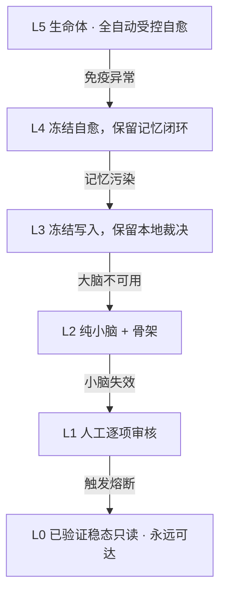

**铁律**：降级是**单向收紧**、**自动触发**、**人类可手动加速**；升级回高等级必须重新走免疫验证与授权，不得自动回升。

### 21.3b 双脑极限态

| 极限态 | 判定信号 | 强制动作 | 仍须保证 |
|---|---|---|---|
| **大脑不可达**（断网 / 超时 / 配额枯竭） | 上行连续超时、健康探针失败 | 切断全部 escalate 路径，退入 L2「纯小脑 + 静态骨架」，拒绝一切突变类变更 | 核心业务不死；常规事务 ≥80% 可用（4.4） |
| **记忆库污染**（投毒 / lineage 断裂 / 检索异常） | 命中率异常、来源校验失败、升格审计不通过 | 冻结全部**经验升格**写入，退化为"无记忆状态"，只走本地硬规则 | 只读可用；已升格规则须回查来源，可疑者降级 |

> 两种极限态都不允许"带病求助"——大脑不可达时仍反复上行，只会把延迟拖成雪崩；记忆污染时仍读记忆，只会把污染扩散到判定层。

### 21.4 熔断演练

全局熔断必须像消防演习一样定期演练，记录触发耗时、锁定稳态的正确性、恢复流程。从未演练过的熔断，视为不存在。

### 21.5 事件响应与无责复盘（Incident Response & Blameless Postmortem）

> "异常当轮上报"（10.5）讲的是上报纪律；本节讲上报之后怎么把一次事故变成一次进化。没有复盘的诚实上报，只会制造台账噪音。

- **事件分级与时钟**：按 D0–D3 与业务影响定级；每级定义检测、确认、遏制、恢复的时限，超时自动升级通知人类主权，不因"还在查"而静默延期。
- **响应五步（顺序不可颠倒）**：检测（可观测性告警）→ 遏制（熔断/降级，先止血后查因）→ 根因（以原语链 trace 回放，不靠猜测）→ 恢复（回到最近已验证稳态）→ 复盘（无责、有时间窗、有产出物）。
- **无责原则**：复盘针对机制而非个人；只要上报及时、留痕完整，不因触发事故追责。**隐瞒、延迟上报、篡改台账才是红线**——按 10.5 判为"污染"。
- **复盘的强制产出**：时间线、根因、为何门禁未拦住、修正动作、责任人、复审日期；其中"修正动作"必须落到三者之一——新规则（升格）、新门禁、新参数，禁止写"加强注意"这类不可验证的空话。
- **接入飞轮**：复盘记录进入经验库（第六章）并触发升格审计（24.3）；同一根因二次出现视为 Flywheel 失效，强制复审升格阈值与门禁有效性。
- **演练关联**：21.4 的熔断演练必须至少每季度产出一份符合上述格式的复盘报告；未产出的演练视为未完成。

---

## 第二十二章　身份、命名空间与可追溯


### 22.1 稳定标识体系

所有一等公民必须拥有全局唯一、稳定、可解析的标识（采用 URN 风格，示例）：

| 对象 | 标识格式 | 示例 |
|---|---|---|
| 规则 | `urn:ane:rule:<域>:<序号>@<semver>` | `urn:ane:rule:sched:114@2.1.0` |
| 经验 | `urn:ane:exp:<域>:<hash>` | `urn:ane:exp:core:9f3a…` |
| 原语调用 | `urn:ane:op:<类型>:<trace-id>` | `urn:ane:op:patch:t-8c21` |
| 门禁 | `urn:ane:gate:<轨>:<序号>@<semver>` | `urn:ane:gate:symbol:03@1.4.0` |
| 智能体 | `urn:ane:agent:<角色>:<实例>` | `urn:ane:agent:brain:prod-01` |
| 稳态快照 | `urn:ane:snap:<系统>@<摘要>` | `urn:ane:snap:core@sha256:…` |

**要求**：标识一旦发布不可复用；内容变更必须产生新版本标识；`trace-id` 贯穿一次原语链全程。

### 22.2 语义化版本

规则、经验模板、门禁定义、工具契约、模型提示——凡可演进的制品都必须带语义化版本 `MAJOR.MINOR.PATCH`：

- **MAJOR**：不兼容变更（判据改变、输出类型改变）→ 必须重新验证全部依赖；
- **MINOR**：向后兼容的能力新增；
- **PATCH**：不改变语义的修正。

### 22.3 AI-BOM（AI 物料清单）

每个生命体必须维护一份 AI-BOM，登记其"由什么构成"：

| 类别 | 登记内容 |
|---|---|
| 模型 | 模型名、版本、来源、许可、能力边界 |
| 数据/记忆 | 经验库快照版本、检索索引版本、数据来源与授权 |
| 工具 | 工具服务端清单、版本、权限注解、契约摘要 |
| 规则 | 小脑规则集版本、经验升格来源 |
| 提示 | 系统提示版本、模板版本 |

**用途**：供应链事件（某模型/工具曝出漏洞）时，可在分钟内定位受影响系统——这是 OWASP"供应链"风险的工程化解药。

### 22.4 配置即代码

门禁规则、授权策略、降级阶梯、熔断阈值全部以代码形式纳入版本控制与双轨验证，**禁止只存在于某人脑中或某个后台配置页**。配置变更与代码变更走同一免疫链。

---

## 第二十三章　人类因素与认知工程


### 23.1 强制条款

- **第二十八条（反自动化偏见）**：判定层必须主动呈现"系统不确定的地方、可能的错误、被否决的备选"，而不是只给一个看似权威的结论。对齐 EU AI Act Art.14 对 automation bias 的明确防范要求。
- **第二十九条（裁决可质疑）**：人类必须能一键查看任一 AI 结论的依据链（NTP 载荷、记忆命中、门禁结果）并推翻它，推翻记录进入经验库作为负样本。

### 23.2 认知负荷与告警治理

| 反模式 | 后果 | ANE 约束 |
|---|---|---|
| 告警洪流 | 告警疲劳，真正的风险被忽略 | 告警分级聚合，L0 自动项不打扰人类 |
| 每次都弹窗 | 授权疲劳，人类未经核对即点"同意" | 按分级授权批处理，仅 L2 强授权显式确认 |
| 只报喜不报忧 | 自动化偏见，人类丧失判断 | 强制展示置信度、失败案例、备选项 |
| 不可解释的催促 | 人类无法在时限内做出负责任判断 | 关键裁决必须有"可暂停"选项，不得设计倒计时逼迫 |

### 23.3 技能保持

高度自动化的系统会让人类操作者技能退化，进而在罕见故障中无力接管。ANE 要求：

- 定期"无 AI 演练"：让人类在关闭大脑/自愈的情况下手动处理模拟故障；
- 关键岗位轮训，保持对底座的直接理解；
- 熔断恢复后必须进行人工复盘，不得"系统自愈完就当没发生"。

### 23.4 权责一致

被授予裁决权的人必须有对应能力与时限保障。**没有足够信息与时间的"一票否决权"是假主权**——组织须为判定层投入与风险等级相称的呈现质量与人力。

---

## 第二十四章　多租户与记忆边界


### 24.1 记忆分区

| 分区 | 可见性 | 写入权限 | 用途 |
|---|---|---|---|
| **全局公共区** | 所有租户只读 | 治理委员会审核后写入 | 通用确定性经验、安全补丁 |
| **租户私有区** | 仅本租户 | 本租户免疫验证后写入 | 业务专属经验 |
| **项目隔离区** | 仅本项目 | 本项目免疫验证后写入 | 项目特有上下文 |
| **临时沙盒区** | 创建者 | 免验证但不可升格 | 试探性经验，过期即焚 |

**红线**：未经显式授权，任何经验不得跨租户写入或读取；沙盒区经验**永远不能**直接升格为小脑规则。

### 24.2 检索的访问控制

- 检索增强（RAG）必须携带租户/项目上下文作为强制过滤条件，不得"全库召回"。
- 跨区检索需显式声明目的并留痕。
- 向量嵌入须防反演与成员推断（对齐第十七章向量弱点风险）。

### 24.3 记忆隔离验证与升格审计（Promotion Audit）

免疫系统在经验入库时，除内容验证外，还须验证**边界合规**：来源租户、授权凭证、目标分区三者一致，否则拒绝写入并告警。

在此之上，任何经验从"私有区 / 沙盒区"升格为"小脑全局规则"，必须额外通过**升格审计**——这是"经验升格"这条飞轮主干道上的最后一道免疫关卡：

- **强制要求（升格审计）**：经验升格必须同时满足三项硬条件，缺一不可：
  1. **连续 N 次独立复现**：在 N 个相互独立的运行周期/环境/评测者中复现同一收益，N 由治理委员会按风险等级设定（建议 N ≥ 3）；独立指数据来源、执行环境、验证主体三者至少两项不同，防止同一模型"自我背书"。
  2. **人类工程师签名背书**：至少一名具备相应权限的人类工程师审核复现证据并签名背书；大脑（大模型）永远不得自签升格。签名计入 RACI（见 20.3），可追溯到具体自然人。
  3. **反近亲繁殖检验**：检查该经验与其"祖先经验/同源变体"的相关性；若升格依据高度依赖同源样本（近似自我引用），判定为近亲繁殖，予以驳回并降级为"待观察"。
- **审计凭证**：每次升格须生成独立凭证，记录经验 ID、N 次复现的证据链、背书人签名、相关性检验结果，写入不可篡改台账，供事后复核与监管举证。
- **降级联动**：升格后若被发现腐化，须能一键回滚至升格前状态，并级联失效由该规则衍生的一切下游规则（对齐 24.4 遗忘权的级联清理）。

> **为何必须如此**：第十七章已把"数据与模型投毒"列为风险，而本系统的独有攻击面是"升格"——攻击者可用特定诱导让小脑把错误经验固化为全局本能，其危害远大于单次错误输出。升格审计以"独立复现 + 人类背书 + 反近亲繁殖"三重机制，把 AI 的自我升格从"可信"降格为"待证"，守住了公理五（人类主权）与公理六（防自欺）。

### 24.4 脱敏与遗忘权

- 经验记录写入前须脱敏（密钥、个人数据、商业敏感信息）。
- 支持按来源删除（遗忘权）——删除须级联清理向量索引与衍生规则，并记录删除凭证。

---

## 第二十五章　元规范：规范自身的治理与演进


### 25.1 三层结构

| 层 | 内容 | 可变性 |
|---|---|---|
| **公理层** | 第一章七条公理 | **不可变**（宪法性红线）；变更需 v2.0 级别共识 |
| **条款层** | 各章强制条款、器官规范 | 可演进，须经提案—验证—批准—升版 |
| **指南层** | 实现建议、示例、模式 | 可自由替换，跟随最佳实践更新 |

**原则**：下位不得违反上位。任何新增条款若与公理冲突，一律驳回。

### 25.2 修订流程（规范飞轮的实例）

规范的每次修订本身走一遍 ANE 飞轮：

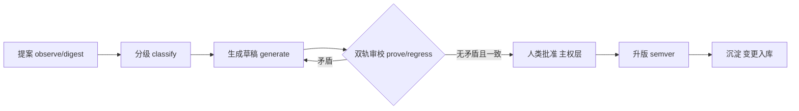

### 25.3 兼容性承诺

- **PATCH**：不改变条款语义（勘误、措辞），旧实现继续合规；
- **MINOR**：新增条款或能力，不破坏既有合规；
- **MAJOR**：改变公理或条款语义，须发布迁移指南与对照表。

### 25.4 自我应用

规范的迭代流程即元规范的实例：每轮"修改→验证→记录"、每轮留痕进经验库、双版本同步、红线不破。**规范如何要求生命体演进，就如何要求自己演进**——这是 ANE 自我一致性的最终证明。

### 25.5 宪法性红线

以下三点构成 ANE 的"宪法"，任何版本、任何组织、任何效率理由均不得删改：

1. **人类主权不可剥夺**（公理五）；
2. **防自欺，静默失败 = 0**（公理六、第七条）；
3. **全局熔断永远可达**（第二十七条）。

---

## 第二十六章　符合性评估框架（ANE-CONF）


### 26.1 为什么必须有符合性框架

规范要求越多，越需要一把可操作的尺子。ANE-CONF（ANE Conformance Framework）提供**分级、可审计、可复现**的符合性判定，让"符合 ANE"成为可举证的事实，而非营销措辞。它对齐 NIST AI RMF 与 EU AI Act 高风险系统的 conformity assessment 思路。

### 26.2 三级符合度

| 等级 | 名称 | 判定标准 | 适用 |
|---|---|---|---|
| **ANE-C1** | 原则符合 | 满足全部七条公理 + D0–D3 分级落地 + 全景白盒台账 | 内部试点、早期项目 |
| **ANE-C2** | 机制符合 | C1 + 小脑拦截率≥80%、记忆闭环生效、双轨验证全绿、全局熔断演练通过 | 生产系统、对内交付 |
| **ANE-C3** | 体系符合 | C2 + 组织治理（RACI/风险登记册）+ 合规对齐 + 可观测性 + 迁移与测试纪律 + 第三方审计 | 对外认证、高监管行业 |

### 26.3 评估方法（四类证据）

| 证据类型 | 手段 | 产出 |
|---|---|---|
| **文档审** | 对照各章强制条款逐条举证 | 符合性矩阵（条款→证据→结论） |
| **配置审** | 检查门禁规则、授权策略、熔断阈值是否即代码 | 配置即代码验证报告 |
| **行为审** | 跑原语链 trace、回放攻击/异常场景 | 原语链执行轨迹 + 回放报告 |
| **运行审** | 采集 KPI（拦截率/命中率/回滚率/静默失败数） | 周期性度量快照 |

### 26.4 自评问卷（最小集）

1. 是否存在不可被 AI 触碰的 D0 静态底座？（公理一）
2. 常规决策是否在无大模型情况下完成？（公理三）
3. 每次成功/失败是否结构化入库且经验可升格？（公理四）
4. 是否存在人类一票否决与全局熔断？（公理五 / 第二十七条）
5. 是否杜绝静默失败、台账可 replay？（公理六）
6. AI 输出是否必经双轨验证才能落地？（公理七）
7. 失败时是否自动退入 fail-safe 态？（第二十六条）

> **红线一票否决**：任一题答"否"，不得评为 ANE-C1 及以上。

### 26.5 持续符合性

符合性不是一次性认证，而是**持续状态**：KPI 跌破阈值、熔断演练失败、出现静默失败，均触发符合度降级并告警。这体现第十章飞轮与第二十五章元规范——**符合性本身也是一条要持续维护的生命体征**。

---

## 第二十七章　迁移与采纳路径


### 27.1 采纳三原则

1. **渐进不革命**：从局部高价值场景切入，不做全系统重写。
2. **先固化再智能**：先把静态底座与确定性收敛做好（L0→L1），再叠小脑（L2）。
3. **每步可回滚**：每个迁移阶段都有明确回退点，失败可退回上一稳态。

### 27.2 六步迁移路径


| 步 | 动作 | 进入条件 | 退出验证 | 对应等级 |
|---|---|---|---|---|
| ① 测绘 | 盘点系统确定性边界、AI 触点、数据流向 | — | 产出边界地图 | L0 |
| ② 固化底座 | 明确 D0 不可变核心，补类型/状态机/兼容测试 | 边界清晰 | 底座可证明 | L0→L1 |
| ③ 建小脑 | 把高频规则从大模型下沉为本地规则/状态机 | 底座稳固 | 拦截率≥80% | L1→L2 |
| ④ 建记忆闭环 | 接入经验库，先只读检索、再验证后写入 | 小脑就位 | 同类问题不再问大脑 | L2→L3 |
| ⑤ 装免疫与熔断 | 双轨验证门禁 + 全局熔断 + FMEA 演练 | 记忆生效 | 熔断演练通过 | L3→L4 前置 |
| ⑥ 开自愈与飞轮 | 统一语义层在线微创修复，飞轮全自动闭环 | 免疫成熟 | 自愈成功率达标 | L4→L5 |

### 27.3 反迁移模式（避坑）

| 反模式 | 后果 | 正确做法 |
|---|---|---|
| 上来就上大模型全自动 | 幻觉进入主干、成本爆炸 | 先固化底座 + 小脑 |
| 无底座就做自愈 | 无回滚点的在线修复=灾难 | 先做②③⑤再开⑥ |
| 经验库先 polluted 后治理 | 负向飞轮，越用越错 | 验证后写入（公理四） |
| 一次性全量迁移 | 风险面不可控 | 金丝雀式小步灰度（见 27.4） |
| 把 ANE 当工具采购 | 买了平台≠落地范式 | 组织治理同步建设（第二十章） |

### 27.4 灰度采纳（借鉴渐进交付）

沿用业界成熟做法：先在影子模式（shadow mode）下让新机制与旧系统并行、抑制副作用、只记录不生效；再按小比例灰度（如 1%→5%→25%→100%）逐步放量，每级设有质量/安全/成本 SLO，越界自动回滚。**影子模式验证的是"推理与决策"，灰度验证的是"后果与副作用"——两者不可混为一谈。**

---

## 第二十八章　可观测性体系


### 28.1 三支柱 + 事件溯源

| 支柱 | 在 ANE 中的角色 | 关键要求 |
|---|---|---|
| **日志 Logs** | 原语调用、授权、门禁、异常的结构化事件记录 | 结构化（键值/JSON），审计日志保证送达、不可篡改 |
| **指标 Metrics** | 第十二章 KPI 的时间序列 | 高基数维度可下钻；指标可从更丰富数据后验派生 |
| **追踪 Traces** | 一次原语链跨器官的端到端 DAG | trace-id 贯穿全程，与日志/指标用共享上下文关联 |
| **事件溯源 Event Sourcing** | 状态变更的全量不可变事件流 | 任意时刻可 replay 到当时稳态，支撑可回滚与审计 |

> 三支柱需"共享上下文"关联（context propagation）——这正是第二十二章 `trace-id` 的用武之地：一次决策从 `observe` 到 `attest` 的全链路可一键串联。

### 28.2 可观测性即证据

- 每次评估/变更产出**带签名与时间戳的工件**：配置哈希、数据快照哈希、评分、安全指标、审批签字——存入可审计台账。
- 这些工件直接充当第二十章合规举证、第二十六章符合性评估的证据来源。
- 日志用于审计轨迹时必须**保证送达**（blocking delivery），不可像普通遥测那样 best-effort 丢弃。

### 28.3 SLO 与错误预算

- 为小脑拦截率、门禁通过率、自愈成功率、成本/决策设定 SLO。
- 用错误预算把"快速进化"与"稳定可靠"的取舍**数据化**：预算耗尽则冻结变异、优先稳态——这是公理七"稳态第一"的可观测落地。

### 28.4 观测到行动的闭环

```
观测(三支柱+事件流) → 检测(异常/漂移/成本尖峰)
→ 触发(小脑裁决/大脑唤醒/熔断) → 验证(双轨) → 沉淀(经验库)
→ 反馈(更新 SLO/门禁规则) → 回到观测
```

**反模式**：只建看板不看、只报喜不报忧、告警无分级——均违反公理六与第二十三章告警治理。

---

## 第二十九章　演化系统测试


### 29.1 核心转变：从"断言精确值"到"断言不变量与关系"

| 方法 | 解决的问题 | ANE 中的落点 |
|---|---|---|
| **蜕变测试 Metamorphic** | 无法预设精确输出 | 定义输入—输出关系：相似输入应得相似质量输出；等价改写的语义应保持 |
| **属性测试 Property-based** | 边界与输入空间 | 不变量必须恒成立：Schema 合法、安全拒答、D0 未被触碰 |
| **黄金集回归 Golden-set** | 每次模型/提示变更 | 精选样本集每次变更全跑，防止回退 |
| **对抗/红队** | 提示注入、越权、工具滥用 | 覆盖越狱、注入、PII 外泄、工具误用（对齐第十七章） |

### 29.2 面向副作用与部署的测试

| 手段 | 要点 | 纪律 |
|---|---|---|
| **影子模式 Shadow** | 新版本处理真实流量、抑制全部副作用、只记录 | 必须拦截每个工具调用；抑制执行但**绝不抑制日志** |
| **金丝雀 Canary** | 1%→5%→25%→100% 灰度 | 每级设质量/安全/延迟 SLO，越界**自动回滚**（人工回滚=失效控制） |
| **混沌工程 Chaos** | 低爆炸半径持续注入故障 | 验证 FMEA 与第二十一章降级路径；定期 game day |
| **变异测试 Mutation** | 检验断言是否真能抓 bug | AI 生成测试须经"变异体被杀死"等机械校验才保留 |

### 29.3 评测者纪律

- **LLM-as-judge** 可规模化打分，但须**定期用人工标注校准**，不可自评自证。
- 人工评测是主观质量与意图对齐的金标准，投入与风险相称的评审资源（第二十三章权责一致）。
- 生成式测试视为**提案**：只有经机械校验（杀死变异体/新增覆盖/可复现崩溃）并人工复核断言后才纳入。

### 29.4 持续验证（测试永不结束）

AI 系统上线后会漂移、会遇到新输入、会演化。ANE 要求：

- **持续监控**代替"测试完就发布"：漂移检测、告警触发、反馈入经验库均须实测有效；
- **每次自愈后**自动触发回归与蜕变测试，确认补丁未破坏不变量；
- **每次升版**产出签名时间戳的评测工件，纳入可审计台账（第二十八章）。

> 一句话：传统测试验证"现在对不对"，演化系统测试还要验证"**变了以后还对不对、出问题能不能自己回到对**"。

---

## 第三十章　适用边界与常见误读澄清


### 30.1 适用性边界（何处慎用或不用）

| 场景 |  why 慎用 | 建议 |
|---|---|---|
| 强实时硬安全系统（如飞行控制） | 自愈与大脑唤醒引入不可预测延迟 | 仅采用 D0/D1 静态骨架与形式化验证，禁用运行时自愈 |
| 极小一次性脚本 | 引入七器官成本远超收益 | 沿用轻量工程，无需完整 ANE |
| 完全离线无网络环境 | 大脑不可达、经验库难同步 | 强化小脑 + 本地经验，退化为 L2/L3 |
| 高度监管且禁止自动变更的域 | 自愈与自动落地不合规 | 关闭自动落地，全部走人类强授权（L2） |

**原则**：ANE 是一套**可裁剪的范式**，不是万金油。按场景选用器官，宁可少用也不要错用。

### 30.2 常见误读澄清（ANE 不是什么）

| 误读 | 澄清 |
|---|---|
| "ANE 就是让 AI 全自动写代码" | 错。AI 输出是**建议**，必经免疫验证与人类授权；大脑是稀缺资源不是主力。 |
| "有了 ANE 人类可以不管了" | 错。人类被**提升**为立法者/裁决者，主权不可剥夺（公理五）。 |
| "ANE 要抛弃传统软件工程" | 错。是**扬弃**：继承确定性硬内核，替换僵化外壳（第十九章）。 |
| "小脑=规则引擎，很土" | 错。小脑是**战略成本控制层**，80% 决策零 Token，是飞轮转得动的关键。 |
| "记忆库越大越好" | 错。未验证经验禁止入库，且需升格+衰减+遗忘，否则负向飞轮。 |
| "自愈=随便热更新" | 错。自愈有三重保险（可回滚/可证明/可审计）与 fail-safe 前置。 |
| "符合 ANE=买某个平台" | 错。ANE 是**范式**，与具体产品无关；平台只是实现载体。 |
| "L5 是唯一目标" | 错。多数系统长期停在 L2/L3 即最优，L5 仅适用于合适场景。 |
| "熔断是"出事再说"" | 错。熔断必须**定期演练**，从未演练的视为不存在。 |
| "规范是死的" | 错。规范自身按元规范持续演进（第二十五章）。 |

### 30.3 语义守护

创建人及治理委员会负责维护本规范的**语义完整性**：任何自称"ANE 兼容"的实现，应能通过第二十六章符合性框架的可举证评估，而非仅引用术语。误读澄清清单随每轮审计更新，沉淀为经验库条目。

---

## 第三十一章　经济性与采纳决策


### 31.1 成本结构

| 成本项 | 说明 | 控制手段 |
|---|---|---|
| 静态底座建设 | 类型/状态机/兼容测试的初始投入 | 一次性投入，长期摊薄 |
| 大脑 Token 成本 | 按需唤醒的推理费用 | 小脑拦截 + 记忆升格，趋近于零（第十八章） |
| 经验库运维 | 存储、检索、治理 | 衰减归档 + 分区（第二十四章） |
| 治理与合规 | RACI、审计、演练 | 制度化、工具化 |
| 迁移成本 | 六步路径的人力与时间 | 渐进灰度，局部切入（第二十七章） |

### 31.2 收益来源（ROI 模型）

| 收益 | 度量 | 来源 |
|---|---|---|
| 效率收益 | MTTR↓、变更周期↓、人力释放 | 自愈 + 飞轮，维护不再是"还债" |
| 成本收益 | Token/决策比↓、大脑调用次数↓ | 小脑拦截 + 记忆升格复利 |
| 质量收益 | 回滚率↓、静默失败=0、缺陷逃逸↓ | 双轨免疫 + 可观测性 |
| 风险收益 | 合规举证成本↓、事故损失↓ | 合规对齐 + 熔断 + 审计证据 |
| 护城河收益 | 经验库随使用增值 | 越用越强的复利资产 |

**简化 ROI**：`ROI = (效率收益 + 成本收益 + 质量收益 + 风险规避) − 总投入`，其中"成本收益"随飞轮转动呈复利增长——这是 ANE 相对"堆算力/堆 Token"路线的根本经济差异。

### 31.3 采纳决策树

```
系统是长期演进、有维护负担的吗？
 ├─ 否（一次性/短命） → 不必上 ANE
 └─ 是 → 有高价值、可局部切入的场景吗？
          ├─ 否 → 先做②固化底座，暂缓智能层
          └─ 是 → 按六步路径灰度试点 → 测 EROI → 达标则扩展
```

### 31.4 价值兑现节奏

- **短期（L2/L3）**：小脑拦截 + 记忆命中 → Token 与 MTTR 立竿见影下降；
- **中期（L4）**：自愈 + 飞轮 → 维护模式从"救火"转"生长"；
- **长期（L5/C3）**：经验护城河 + 体系符合 → 形成难以复制的组织级能力。

> 决策者只需记住：**ANE 的经济学，是用确定性的"减法"（小脑拦截、记忆升格）换取智能的"乘法"（越用越强），而非用算力堆"加法"。**

---

## 第三十二章　发布形态与受众视图


### 32.1 为什么规范需要多种发布形态

一份规范同时服务三类受众，而他们的需求互相冲突：

| 受众 | 关心什么 | 不需要什么 | 需要的形态 |
|---|---|---|---|
| 采纳决策者 | 价值、成本、风险、是否能落地 | 条款细节、审计过程 | 执行摘要 + 符合性等级 |
| 实现者 / 架构师 | 精确条款、接口、契约、门禁 | 设计取舍的来龙去脉 | 规范性全文（正式发布版） |
| 维护者 / 治理委员会 | 为什么这样定、改过什么、依据何在 | — | 开发视图（含过程层） |

**核心矛盾**：一份文档不可能同时"极简"与"完备"。ANE 的答案是**单一真源、多种投影**（见第三十四章），而非维护多份各自演化的文档。

### 32.2 三层视图模型

- **视图 V1 · 决策摘要层**：一页纸执行摘要 + 符合性等级说明。目标是 5 分钟内判断"要不要采纳"。
- **视图 V2 · 规范正文层**：全部规范性内容（公理、条款、接口、契约、术语、结语）。这是**正式发布版**的主体，也是唯一可用于符合性评估的权威文本。
- **视图 V3 · 开发过程层**：设计决策记录、变更理由、版本沿革、阶段性说明。这是**开发视图**的专属层，仅供溯源，**不得作为符合性判据**。

**铁律**：V2 是唯一权威；V1 引用 V2 不得曲解；V3 解释 V2 不得篡改。三层的规范性陈述必须逐字一致，任何差异视为文档缺陷。

### 32.3 视图一致性约束

1. **单向派生**：V1、V3 均由 V2 派生或对其解释，不得反向由 V1/V3 修改 V2 而不同步。
2. **条款同源**：所有"第 X 条"在三视图中编号、措辞、语义一致。
3. **投影可验证**：发布视图必须能由真源通过确定性规则重新生成，且结果逐字一致（第三十四章）。
4. **过程层隔离**：任何带版本号轨迹、阶段标记、过程记录字样的内容，只属于 V3。

---

## 第三十三章　信息分级与发布门禁


### 33.1 信息三级分层（N / E / P）

| 层级 | 代号 | 定义 | 典型内容 | 是否进正式发布版 |
|---|---|---|---|---|
| 规范层 | **N（Normative）** | 规定"系统应如何实现"的权威陈述 | 公理、条款、接口、契约、术语表、结语 | ✅ 必须全部保留 |
| 证据层 | **E（Evidentiary）** | 证明"实现符合规范"的工件 | 设计评审结论、验证记录、trace、符合性评估 | ⚠️ 按需裁剪（正式版默认不载全文） |
| 过程层 | **P（Process）** | 记录"规范如何被设计出来"的痕迹 | 版本沿革、阶段性说明、演进计划、评审轮次、草稿说明 | ❌ 一律剔除 |

**判定口诀**：说的是"系统应该怎样"→ N；说的是"我们怎么证明/验证"→ E；说的是"这份文档自己怎么来的"→ P。

### 33.2 正式发布版纯净性清单（禁止项）

正式发布版中**不得出现**以下内容（出现任一即视为门禁失败）：

1. 版本号迭代轨迹（历史版本字样）；
2. 各轮次版本、评审轮次、持续修订等过程性时间戳表述；
3. 设计评审全过程记录与评审角色标签；
4. 演进规划、执行纪律、版本递增规则等开发过程说明；
5. "早期版本"等开发史描述；
6. 形态标签与多视图发布说明本身。

**边界说明**：N 层内部对外的合规引用（如"对齐 EU AI Act Art.14"）属于规范性内容，**保留**；本章自身因属 N 层（规定发布规则），在正式版中保留，但其中示例化的版本字样以占位符表述。

### 33.3 发布门禁（Release Gate）

正式发布版生成后，必须通过以下门禁方可对外：

| 门禁 | 检查项 | 通过标准 |
|---|---|---|
| G1 纯净性 | 扫描 33.2 禁止项关键词 | 零命中 |
| G2 完整性 | N 层条款与真源逐字比对 | 零差异 |
| G3 一致性 | 章节编号、术语、锚点 | 完全对齐 |
| G4 可渲染 | 图表语法、标签闭合 | 无错误 |
| G5 署名 | 创建人署名保留 | 命中 |

未通过任一项，禁止发布——**这是"防自欺"原则对文档自身的要求**：不允许用一份残留过程痕迹的草稿冒充正式标准。

---

## 第三十四章　规范即制品：单一真源与确定性投影


### 34.1 规范即制品（Spec-as-Artefact）

规范不是一次性文章，而是**受版本控制、可构建、可校验的制品**：

- 它有**稳定身份**（名称 + 语义版本 + 创建人署名，见第二十二章）；
- 它有**构建过程**（从真源投影出不同视图）；
- 它有**质量门禁**（第三十三章的 G1–G5）；
- 它遵循**兼容性承诺**（第二十五章的 PATCH/MINOR/MAJOR）。

这与 ANE 对软件生命体的要求完全同构——**规范如何用 ANE 管自己，就如何要求生命体管自己**（元规范的第三次自我应用）。

### 34.2 单一真源（Single Source of Truth）

- **开发视图作为真源（SSOT）**：所有规范性条款只在真源中编辑维护。
- **发布视图是派生产物**：由真源经确定性投影规则生成，**禁止手工直接编辑**。
- **禁止双写**：任何条款变更只在真源一处，再重新投影——从根上杜绝"多视图内容漂移"这一风险。

### 34.3 确定性投影规则

投影是从真源到正式版的**纯函数** `Release = Project(Debug, Rules)`，规则集保留 R1（执行摘要去过程字样、序言、第零～三十四章 N 层、术语表、结语）、R2（剔除过程性说明、多视图发布说明、各章新增导语、过程层附录的 P 层）、R3（头部版本固定为正式标识、目录去 P 层附录、页脚去过程轮次）、R4（署名、条款编号、Mermaid 图、表格结构逐字保持）。

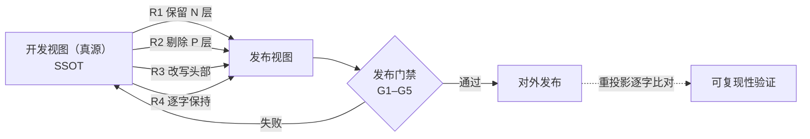

**可复现性**：相同真源 + 相同规则集 → 必然产出逐字相同的发布视图。若重投影结果不同，说明规则有歧义或存在手工干预，须修复规则而非修补产物。

### 34.4 机器可读契约与一致性自检

规范应提供机器可读的接口契约（NTP、经验记录结构、稳定 ID、RACI 等），使器官间可互操作、对外可校验；并建立**一致性自检脚本**，自动执行第三十三章的 G1–G5：

- 关键词扫描（禁止项零命中）；
- 条款编号唯一性、目录锚点、图表数量对齐；
- 署名落位、双版本 N 层逐字 diff。

**这条纪律的意义**：把"防自欺"从口头原则变成**可重复运行的检查器**——规范不再靠人声称自己干净，而是靠机器证明自己干净。

---

## 第三十五章　多语言与本地化治理


### 35.1 问题的本质：翻译即派生视图

一份规范的多语言版本，本质是**同一 N 层内容的不同语言投影**，而不是多份独立文档。因此：

- **正本（Source of Truth）唯一**：任一时刻只有一个权威语言版本作为条款的唯一真源；本规范以中文为正本，英文为权威译本。
- **译本是派生视图**：与正式发布版一样，译本应由正本经确定性流程生成/校验，禁止"双写"（正本改了译本没跟）。
- **术语是锚点**：跨语言一致性靠**冻结术语对照表**保证，而不是靠译者临场发挥。

### 35.2 三语言角色模型

| 角色 | 定义 | 权威性 | 更新方式 |
|---|---|---|---|
| **正本语言** | 条款创作与裁决所用语言（本规范=中文） | 最高，歧义时以正本为准 | 直接编辑于真源 |
| **权威译本** | 由正本严格派生、经 G7 校验的译本（本规范=英文） | 与正本等同效力 | 从正本派生 + 校验 |
| **参考译本** | 社区/第三方翻译，未经 G7 校验 | 参考，不构成合规依据 | 独立维护，标注"非权威" |

**歧义裁决铁律**：任何语言版本间出现语义分歧，一律以**正本语言**为准；参考译本不得作为符合性评估（第二十六章）的证据。

### 35.3 冻结术语对照表（Frozen Glossary）

本地化的第一道工程是建立**冻结术语表**——关键术语的中英（及多语）映射一旦经治理委员会批准即冻结，任何改动走元规范（第二十五章）修订流程：

| 中文正本术语 | 英文权威译法 | 释义锚点 |
|---|---|---|
| 小脑 | Cerebellum | 本地确定性高频裁决层 |
| 大脑 | Main Brain / Deliberative Agent | 按需唤醒的大模型智能体 |
| 免疫系统 | Immune System | 多层质量门禁 + 双轨验证 |
| 记忆护城河 | Memory Moat | 经验库 + 检索增强形成的学习壁垒 |
| 确定性投影 | Deterministic Projection | 相同输入必得逐字相同输出的纯函数式发布 |
| 过程层 / 规范层 | Process Layer / Normative Layer | P 层 / N 层信息分级 |

**冻结纪律**：术语译法不得随版本漂移；新增术语须先入表再用；表中未收录的术语不得出现在权威译本的关键条款中。

### 35.4 多语言制品治理规则

1. **版本锁步**：正本与各权威译本的版本号必须一致；正本升版时，权威译本须在同一次投影周期内同步，不允许"中文 v0.5 / 英文 v0.4"长期并存。
2. **结构对齐**：译本的章节号、条款号、公理编号、图表编号必须与正本**逐一对齐**（由 G6 校验）。
3. **过程层不翻译**：正本中的 P 层内容（设计过程记录、演进规划）不进入正式译本——译本同样是 N 层的干净投影。
4. **译本可追溯**：每个权威译本头部标注"译自正本 vX.Y.Z + 本地化校验 G7 通过 + 校验日期"。

### 35.5 本地化保真门禁 G7

在 G1–G6 之外，多语言版本额外通过 **G7 本地化保真门禁**：

- **G7-a 术语一致**：权威译本中冻结术语表的命中率 = 100%，无未经批准的译法漂移。
- **G7-b 结构对齐**：章节/条款/公理/图表编号与正本一一对应，无缺号、无错位（由 G6 辅助）。
- **G7-c 语义抽检**：对每条公理与规范条款做双向回译抽检，语义偏差超阈值须人工裁决。
- **G7-d 纯净继承**：译本继承正本的 N 层纯净性——对译本同样跑 G1 过程痕迹零命中扫描。
- **G7-e 版本锁步**：译本头部版本号 == 正本版本号，否则门禁失败。

> **关键论断**：没有 G7，多语言就是"把一份规范复印成几份会互相打架的规范"。有 G7，多语言才是"同一部法律的几种权威文本"。

---

## 第三十六章　制品命名与标识规范


### 36.1 命名三要素

每个规范制品的文件标识由三段构成，缺一不可：

```
<主题名> [形态后缀] [语言标识] . <扩展名>
```

| 要素 | 取值 | 说明 |
|---|---|---|
| 主题名 | 固定的规范品牌名 | 同一规范族所有制品共享，不得各自改名 |
| 形态后缀 | 无 / `<开发形态标识>` | **正式发布版不带形态后缀**，开发视图必须带 |
| 语言标识 | 无（中文正本）/ `-en`（英文）或用英文名 | 区分语言版本 |
| 扩展名 | `.md` / `.html` | 交付格式 |

### 36.2 形态后缀的语义契约

**核心规则：正式发布视图无后缀，开发视图带形态标识。**

- **正式发布版**＝无形态后缀。理由：正式版是"默认态"，受众拿到无后缀文件即可确认这是权威干净版本，无需在文件名里再加免责标记。
- **开发视图**＝必须带 `<开发形态标识>` 后缀。理由：开发视图含过程层内容（审计、演进规划、版本沿革），**必须在文件名上显著标注**，防止被误当正式版引用。
- **反模式**：给正式版加"-正式版/-final/-release"等后缀（暗示还有个更正式的版本）、给开发视图不加形态标识（让过程痕迹伪装成正式规范）——两者都破坏受众判断。

### 36.3 本规范的三轨命名实例

| 制品 | 文件标识 | 受众 | 纯净性 |
|---|---|---|---|
| 正式发布版 | `ANE规范-AI原生软件生命体工程范式.md/.html` | 实现者、审计者、采纳决策者 | N 层，G1–G6 全通过 |
| 开发视图 | `ANE规范-AI原生软件生命体工程范式<开发形态标识>.md/.html` | 维护者、治理委员会 | 含 P 层全量过程 |
| 英文权威译本 | `ANE-Specification-...-en.md/.html` | 国际受众 | N 层，G1–G7 全通过 |

### 36.4 命名稳定性与变更纪律

1. **发布的制品名不可随意变更**：一旦对外发布，文件名即成为外部引用契约；改名须升次版本并在变更记录中登记。
2. **形态与内容必须匹配**：文件名标"开发视图"的内容必须真含过程层；无后缀的内容必须真通过纯净性门禁——名实不符视为发布事故。
3. **命名校验纳入 G6**：投影与交付流程须校验"形态后缀 ↔ 内容纯净性"的一致性，防止开发视图被误命名为正式视图。

---

## 第三十七章　结构完整性与投影后校验


### 37.1 问题：关键词纯净性与结构完整性是两件事

| 维度 | G1 纯净性门禁 | G6 结构完整性门禁（本章新增） |
|---|---|---|
| 检查对象 | 词（过程痕迹词是否出现） | 结构（编号、锚点、配对、序列） |
| 通过含义 | 没有不该出现的词 | 结构自洽、无断裂、无悬空引用 |
| 失例 | — | 附录只剩 B 没有 A；章节跳号；锚点指向已删内容 |

**教训**：投影会删除整块内容，删除后必须**重排受影响的编号**——否则纯净度越高，结构断裂越隐蔽（因为没人会再去看被删掉的那块留下的空位）。

### 37.2 G6 结构完整性门禁（六项）

正式版/译本在交付前，除 G1–G5 外，必须通过 **G6 结构完整性门禁**：

- **G6-a 附录连续**：附录编号从 A 起连续，无跳号。若 P 层附录被剔除，N 层附录必须**重编号**（重编号后从 A 起连续），且目录、正文标题、锚点同步更新。
- **G6-b 章节连续**：正文章号从零/一起连续，无缺号、无重复。
- **G6-c 条款唯一**：每条规范条款编号唯一，无重复定义（交叉引用不算定义）。
- **G6-d 锚点有效**：目录中每个锚点在正文中有对应目标；无指向已删除章节的悬空链接。
- **G6-e 图表配对**：MD 与 HTML 的 Mermaid 图数量一致；HTML 的 `<section>` / `<div>` 标签闭合配对。
- **G6-f 名实一致**：形态后缀与内容纯净性匹配（第三十六章 36.4），无后缀文件必须通过 G1，带 开发视图 后缀文件必须含 P 层。

### 37.3 附录重编号规则（针对本次事故的根治）

投影规则须显式包含附录重编号：

```
R5（重编号）：删除 P 层附录后，将保留的 N 层附录按 A、B、C… 连续重排；
              同步更新：目录条目、正文附录标题、HTML section 的 id 与 <span class="num">、锚点引用。
```

R5 已固化进投影流程，附录重编号可复现。

### 37.4 结构自检的工程化

G6 不应靠人眼检查，而应由投影/校验脚本自动执行（如 `ane_release_projector.py` 与本规范配套的 G1–G6 检查器）。**"防自欺"的终极形态是：规范的结构正确性由机器证明，而非由人声称。** 这与第三十四章"规范即制品"、第二十五章"用 ANE 管 ANE"一脉相承。

---

## 第三十八章　生命体间通信协议（IOP）

> 对应公理三、公理六、公理七。**【本文原创】** IOP = Inter-Organism Protocol（生命体间通信协议）。本章把 ANE 从"单个生命体"扩展到"生命体生态"。

### 38.1 从单体到生态：为什么 NTP 不够

NTP（第五章）解决的是**一个生命体内部**小脑与大脑之间的求救与建议；IOP 解决的是**两个独立生命体之间**的识别、委托与验证。二者不可互相替代。

| 维度 | NTP（第五章） | IOP（本章） |
|---|---|---|
| 通信双方 | 同一生命体内：小脑 ↔ 大脑 | 不同生命体之间 |
| 信任前提 | 同一主权域，共享台账 | 不同主权域，默认互不信任 |
| 传递内容 | 压缩特征 + 错误码 + 预算 | 能力声明 + 任务摘要 + 凭证 |
| 记忆 | 共享同一海马体 | **默认不共享**（38.5） |
| 权威归属 | 大脑只出 Proposal | 能力可借用，授权仍归各自人类 |
| 失败处理 | 走 `DEGRADED` 降级 | 拒绝协作，各自独立运行 |

> **【必须】** 任何跨生命体调用都必须走 IOP；禁止用 NTP 直接连接外部生命体的大脑——那等于把内部稀缺通道暴露成公共入口。

### 38.2 IOP 四层模型

| 层 | 名称 | 解决什么 | 核心制品 | 等级 |
|---|---|---|---|---|
| L1 | 身份层 Identity | "你是谁、谁为你负责" | 生命体名片 Organism Card | 【必须】 |
| L2 | 能力层 Capability | "你能做什么、做到哪一档" | 能力声明 Capability Set | 【必须】 |
| L3 | 消息层 Messaging | "这次请求是什么、证据在哪" | 消息信封 Envelope | 【必须】 |
| L4 | 信任层 Trust | "我凭什么信你、出事谁担责" | 授权凭证 + 台账引用 | 【必须】 |

> 四层不可跳跃：没有身份就谈能力是无的放矢；没有能力声明就接受任务是越界；没有信任凭证就执行是失控。这条约束回溯到公理七（稳态第一）——生态的稳态来自边界清晰，而非来自互相信任。

### 38.3 生命体名片（Organism Card）

**【本文原创】** 生命体名片是生命体对外自我介绍的最小、稳定、可校验结构。它不描述内部实现，只声明稳定身份与能力边界。

合法 JSON 示例（`card_digest` 可对去除该字段后的对象按 ANS-1 重算，工具见 `tools/validate_ntp.py canonicalize`）：

```json
{
  "organism_id": "org-7a31",
  "card_version": "1.0",
  "capabilities": ["classify", "digest"],
  "determinacy": "D1",
  "owner": "human:finlei",
  "card_digest": "sha256:309c06e49be85fc3b26eb8c6f2d1b355678aedef027c5521dba6a8e3b5932821"
}
```

| 字段 | 类型 | 白话解释 | 为什么需要 | 等级 |
|---|---|---|---|---|
| `organism_id` | 字符串 | 这个生命体的稳定身份证 | 跨会话、跨版本识别同一个对象 | 【必须】 |
| `card_version` | 字符串 | 名片格式版本 | 能力会变，名片需可演进 | 【必须】 |
| `capabilities` | 字符串数组 | 对外承诺的能力名 | 没有声明的能力不得被调用 | 【必须】 |
| `determinacy` | 枚举 `D0`–`D3` | 该生命体能承接的最高确定性档 | 防止把 D0 事务委托给只能做 D2 的对象 | 【必须】 |
| `owner` | 字符串 | 最终责任人标识 | 回溯到公理五：责任必须落在能承担后果的主体 | 【必须】 |
| `card_digest` | 字符串 | 名片内容指纹 | 防篡改；握手时校验 | 【必须】 |

> **【必须】** 名片不得包含内部实现细节、模型供应商或密钥；**【必须】** 名片变更必须换发 `card_version` 并重算摘要，禁止就地改写。

### 38.4 消息信封（Envelope）

**【本文原创】** 信封只承载"谁给谁、什么事、证据在哪"，**载荷正文不内联**，以摘要引用代替——与 5.4 的 `candidate.digest` 同一纪律。

```json
{
  "iop_version": "1.0",
  "msg_id": "m-4c81",
  "from": "org-7a31",
  "to": "org-9b42",
  "type": "TASK_DELEGATE",
  "payload_ref": "sha256:74490ea0feecf6e8246f97cc81c12544f136f596eb596cbd4ccbeed2c7ec6cbe",
  "payload_format": "ANS-1",
  "traceparent": "00-0af7651916cd43dd8448eb211c80319c-b7ad6b7169203331-01",
  "auth_ref": "cred-9d02",
  "ts": "2026-11-21T04:00:00Z",
  "ttl_ms": 30000,
  "determinacy_ceiling": "D1"
}
```

| 字段 | 类型 | 白话解释 | 为什么需要 | 等级 |
|---|---|---|---|---|
| `iop_version` | 字符串 | 协议版本 | 双方解析规则须一致 | 【必须】 |
| `msg_id` | 字符串 | 本条消息唯一编号 | 去重、追踪、回放 | 【必须】 |
| `from` / `to` | 字符串 | 收发双方 ID | 防冒充，配合名片校验 | 【必须】 |
| `type` | 枚举 | 消息类型：`CAPABILITY_QUERY` / `CAPABILITY_ADVERTISE` / `TASK_DELEGATE` / `RESULT_REPORT` / `VETO` | 接收方据此分派处理流程 | 【必须】 |
| `payload_ref` | 字符串 | 载荷摘要而非载荷正文 | 防注入、防超长、可校验 | 【必须】 |
| `payload_format` | 枚举 | 载荷序列化格式，固定 `ANS-1` | 保证摘要可重算 | 【必须】 |
| `traceparent` | 字符串 | 分布式追踪标识（**引用** W3C Trace Context） | 跨生命体串联同一条因果链 | 【应当】 |
| `auth_ref` | 字符串 | 授权凭证引用 | 没有凭证的请求一律拒绝 | 【必须】 |
| `ts` | 字符串 | 发送时间（UTC） | 时序与时效判断 | 【必须】 |
| `ttl_ms` | 整数 | 有效期（毫秒） | 过期消息必须丢弃，防重放 | 【必须】 |
| `determinacy_ceiling` | 枚举 `D0`–`D3` | 本消息允许的最高确定性 | 防止借低档通道办高档事 | 【必须】 |

> **【必须】** 接收方必须先校验名片摘要、授权凭证与 `ttl_ms`，任一失败即丢弃并写审计日志；**【可选】** 高并发场景可启用批量信封，但每封仍须独立携带 `auth_ref`。

### 38.5 信任边界：记忆不共享、能力不继承

| 原则 | 含义 | 违反后果 | 等级 |
|---|---|---|---|
| **记忆不共享** | 一个生命体的海马体不因协作而向对方开放；只传经 `digest` 压缩的证据摘要 | 记忆投毒跨生态扩散，护城河被污染 | 【必须】 |
| **能力不继承** | 调用对方能力不等于获得对方权限；凭证不随消息转发 | 权限在链条上逐级放大，最终失控 | 【必须】 |
| **责任不转移** | 委托方仍对结果负责，不能以"是对方做的"免责 | 出事后无人承担，违反公理五 | 【必须】 |
| **否决权保留** | 任一方可随时发 `VETO` 终止协作，无需对方同意 | 生态锁定，无法脱身 | 【必须】 |

### 38.6 本章必选/可选清单

| 条目 | 等级 | 理由 |
|---|---|---|
| 名片身份与摘要 | 【必须】 | 无身份则无法追责 |
| 能力与确定性档声明 | 【必须】 | 防止越档委托 |
| 信封六必填字段 | 【必须】 | 构成最小可验证请求 |
| 载荷摘要引用、不内联 | 【必须】 | 与 5.4 同一防注入纪律 |
| 授权凭证与有效期 | 【必须】 | 防重放、防越权 |
| 分布式追踪 `traceparent` | 【应当】 | 排障需要，但单生命体可暂缺 |
| 批量信封 | 【可选】 | 性能优化，非合规前提 |

---

## 第三十九章　生命体套件与组合（Suite Composition）

> **【本文原创】** 生命体套件 = 多个独立生命体按声明式契约临时组合出的更强能力单元。组合不等于融合：成员仍保留各自生命周期、主权人与记忆边界。

### 39.1 组合的本质：声明式契约，而非隐式融合

| 组合方式 | 做法 | 风险 | 等级 |
|---|---|---|---|
| **声明式契约**（推荐） | 用套件清单显式声明成员、角色、边界，运行时按契约校验 | 配置复杂 | 【必须】 |
| 隐式共享内存 | 成员直接读写彼此状态 | 记忆污染、责任不清 | 【禁止】 |
| 硬编码调用链 | 把对方写死进代码 | 一方升级即全链断裂 | 【禁止】 |

### 39.2 套件清单（Suite Manifest）

合法 JSON 示例（`suite_digest` 可对去除该字段后的对象按 ANS-1 重算）：

```json
{
  "suite_id": "suite-1f2e",
  "members": ["org-7a31", "org-9b42"],
  "binding": "declarative",
  "suite_digest": "sha256:41cc1149e9108d1d286063a04c38143bee03aefdce7148ade900ef3c400065a5"
}
```

| 字段 | 类型 | 白话解释 | 为什么需要 | 等级 |
|---|---|---|---|---|
| `suite_id` | 字符串 | 套件稳定编号 | 审计与版本追踪 | 【必须】 |
| `members` | 字符串数组 | 成员生命体 ID 列表 | 明确组合边界 | 【必须】 |
| `binding` | 枚举 | 绑定方式，固定 `declarative` | 从协议层禁止隐式融合 | 【必须】 |
| `suite_digest` | 字符串 | 清单指纹 | 防清单被篡改后偷偷换成员 | 【必须】 |

> **【必须】** 套件不得降低任一成员的确定性下限；**【必须】** 套件整体不得获得超过成员中最高 `determinacy` 的权限。

### 39.3 三种组合模式

| 模式 | 结构 | 适用场景 | 关键纪律 | 等级 |
|---|---|---|---|---|
| **并行** | 多成员同时处理同一任务，结果交叉验证 | 高可靠判定 | 必须双轨一致才采信 | 【应当】 |
| **流水线** | A 的输出经摘要传给 B | 分阶段处理 | 每跳都验摘要与授权 | 【应当】 |
| **联邦** | 各成员独立运行，仅汇总结论 | 隐私敏感、跨域协作 | 只汇总结论，不汇记忆 | 【可选】 |

### 39.4 最弱环节防护

一个套件的安全性取决于最弱成员，因此：

- **【必须】** 加入套件前须校验每个成员的名片摘要与升格审计记录（24.3）；
- **【必须】** 任一成员触发熔断（21.4），套件整体进入降级，不允许"带病拼装"；
- **【必须】** D0 事务不得委托给套件中的任何成员，只能由人类在主权层完成（公理五）；
- **【可选】** 高价值套件可设"成员替换演练"，验证单点失效不导致整体崩溃。

### 39.5 套件的退役与重组

套件是临时能力单元，不是永久组织。**【必须】** 任务结束或成员变更时，套件清单作废并重算 `suite_digest`；**【必须】** 套件产生的所有证据与台账条目保留，供事后回放——组合可以解散，责任不能解散。

### 39.6 本章必选/可选清单

| 条目 | 等级 | 理由 |
|---|---|---|
| 声明式套件清单 + 摘要 | 【必须】 | 无清单即无边界 |
| 成员准入校验 | 【必须】 | 防最弱环节投毒 |
| D0 不可委托 | 【必须】 | 宪法性红线 |
| 熔断联动降级 | 【必须】 | 避免带病拼装 |
| 并行 / 流水线模式 | 【应当】 | 大部分收益来自这两种 |
| 联邦模式 | 【可选】 | 仅在跨域隐私场景需要 |
| 成员替换演练 | 【可选】 | 韧性增强，非合规前提 |

---

## 第四十章　向 AGI 生命体的演进（Evolution Ladder）

> **【本文原创】** 本章不预测 AGI 何时到来，只定义"一个软件生命体在能力边界上如何分级演进，且演进过程中主权不衰减"。回溯到 0.6 的三层约束（接口层 / 权限层 / 改进层）。

### 40.1 演进是能力边界的扩展，不是权限的自发膨胀

| 误区 | 正确理解 | 等级 |
|---|---|---|
| "AGI 到来后自然拥有更高权限" | 权限只能由人类显式授予，能力再强也不自动升权 | 【必须】 |
| "自我改进可以无限递归" | 递归必须有界，且每一步留下可验证凭证 | 【必须】 |
| "更强的智能可以替代主权" | 主权不可让渡，这是宪法性红线（25.5） | 【必须】 |

### 40.2 五级能力阶梯 A0–A4

| 级别 | 名称 | 能力边界 | 典型行为 | 授权要求 | 等级 |
|---|---|---|---|---|---|
| **A0** | 反射体 | 仅确定性规则 | 命中规则即执行，未命中抛 `UnknownSignal` | 无需逐次授权 | 【必须】起点 |
| **A1** | 记忆体 | 规则 + 已升格经验 | 检索经验辅助判定，经验须经升格审计 | 经验升格需人类背书 | 【必须】 |
| **A2** | 协同体 | A1 + 外部能力调用 | 通过 MCP / IOP 借用工具与他生命体能力 | 工具接入须过门禁（15.6） | 【应当】 |
| **A3** | 推理体 | A2 + 大脑泛化推理 | 对未知组合产出 Proposal，经双轨验证后才可能采纳 | 每次采纳须过免疫与人审 | 【应当】 |
| **A4** | 演进体 | A3 + 受控自我改进 | 可提出对自身规则/提示词的改进，但只能以 Proposal 形式 | 改进须经完整升格审计 + 人类签名 | 【可选】 |

> **【必须】** A4 及以上不得获得 D0 权限；**【必须】** 任何级别都不得绕过公理五直接从 A3 跳到 A4 的执行权。

### 40.3 权限不衰减与递归有界

| 约束 | 含义 | 违反后果 | 等级 |
|---|---|---|---|
| **权限不衰减** | 生命体变强时，人类的否决权、熔断权、审计权一点不少 | 能力越强越难管，最终失控 | 【必须】 |
| **递归有界** | 自我改进深度设上限，超出必须回到人类审批 | 无限自我引用导致不可验证 | 【必须】 |
| **能力可降级** | 任何 A 级都可回退到低档运行，且回退路径已演练 | 只能进不能退，形成锁定 | 【必须】 |
| **凭证随级** | 每次升级都产生可验证凭证，写入台账 | 升级无据可查 | 【必须】 |

### 40.3b A4 启用前的准入检查表

> A4【可选】不等于"随时可开"。下表是启用 A4 的**前置门禁**，逐项均为【必须】，任一项不通过即维持 A3 运行，禁止以"先开再说"绕过。

| # | 准入条件 | 可验证判据（拿什么证明） | 等级 |
|---|---|---|---|
| 1 | 人类主权层书面授权 | 签名 + 范围 + 有效期 + 恢复计划四要素齐全（42.5） | 【必须】 |
| 2 | 升格审计已通过 | 经验升格审计记录（24.3）含 N 次独立复现与反近亲繁殖校验 | 【必须】 |
| 3 | 无 D0 权限 | 权限清单中 A4 对 D0 事务为显式拒绝，非"未配置" | 【必须】 |
| 4 | 递归深度上限已设 | 配置中 `max_recursion_depth` 为有限整数，超限回到人类审批 | 【必须】 |
| 5 | 双轨验证通过 | 改进 Proposal 经确定性验证与智能验证双轨一致后才可采纳（7 章） | 【必须】 |
| 6 | 熔断演练已执行 | 人类熔断可在限定时间内切断 A4 的改进能力，演练记录入台账 | 【必须】 |
| 7 | 回退路径已演练 | 从 A4 回退到 A3 的步骤、数据与凭证保留均验证过（40.3） | 【必须】 |
| 8 | 全链可回放 | 改进提案、证据、签名、采纳决定可通过台账完整回放 | 【必须】 |
| 9 | 有效期与自动复核 | A4 授权设自动复核日，到期未续即降级（42.5） | 【应当】 |
| 10 | 独立第三方审计 | 高监管场景下由外部审计确认上述判据 | 【可选】 |

> **【必须】** 准入结论写入演进凭证（40.4）的 `evidence_refs`，与 `attestation_digest` 绑定；**【必须】** 准入过期或任一条件失效时自动回退 A3，不得人工"临时豁免"（42.5）。

### 40.4 演进凭证（Evolution Attestation）

合法 JSON 示例（`attestation_digest` 可对去除该字段后的对象按 ANS-1 重算）：

```json
{
  "organism_id": "org-7a31",
  "level": "A3",
  "evidence_refs": ["exp_077", "run_2048"],
  "attestation_digest": "sha256:7326a58cd20787f5dd97e8cb551354360aff2abe48e351c01ce14c1d28068f58"
}
```

| 字段 | 类型 | 白话解释 | 为什么需要 | 等级 |
|---|---|---|---|---|
| `organism_id` | 字符串 | 哪个生命体升级了 | 绑定主体 | 【必须】 |
| `level` | 枚举 `A0`–`A4` | 升到哪一级 | 明确能力边界 | 【必须】 |
| `evidence_refs` | 字符串数组 | 支撑这次升级的证据 ID | 升级必须靠证据，不靠声称 | 【必须】 |
| `attestation_digest` | 字符串 | 凭证指纹 | 防伪造、可回放 | 【必须】 |

### 40.5 与 RSI 的兼容底线

**【引用】** RSI（递归自我改进）在此只作为能力边界的上界参照，不作为承诺。**【必须】** 本规范对任何 RSI 形态都保留三条底线：人类可熔断、决策可回放、责任可追溯。**【可选】** 前瞻性实现可为 A4 预留接口，但预留不等于启用。

### 40.6 本章必选/可选清单

| 条目 | 等级 | 理由 |
|---|---|---|
| A0 起点、A1 记忆边界 | 【必须】 | 安全基线 |
| 权限不衰减、递归有界、可降级 | 【必须】 | 防止能力反噬主权 |
| 升级凭证 + 证据链 | 【必须】 | 可审计 |
| A2/A3 能力 | 【应当】 | 大部分采纳者目标 |
| A4 演进体 | 【可选】 | 高风险，需额外门禁 |
| RSI 接口预留 | 【可选】 | 前瞻兼容，不等于启用 |

---

## 第四十一章　沟通数据格式、存储与联网策略

> **【本文原创】** 本章把前四章涉及的"数据怎么存、要不要上网"落成可审计的分级策略。回溯到公理二（动中有静）与公理七（稳态第一）。

### 41.1 数据温度分级

| 层 | 名称 | 存什么 | 访问频率 | 留存 | 等级 |
|---|---|---|---|---|---|
| **热** | Hot | 规则库、状态机、当前任务上下文 | 微秒～毫秒 | 进程生命周期 | 【必须】 |
| **温** | Warm | 经验记录、升格审计、近期台账 | 秒～天 | 可迁移、可重建 | 【必须】 |
| **冷** | Cold | 审计日志、证据包、合规留档 | 天～年 | 只追加、可检索 | 【应当】 |
| **冻结** | Frozen | 法定留存、责任凭证 | 极少 | 一次写入不可改 | 【可选】 |

> **【必须】** 热层数据不得持久化到外部服务；**【必须】** 温层跨生命体迁移时只迁经验摘要，不迁原始记忆（38.5）。

### 41.2 沟通数据的三类格式

| 类别 | 格式 | 摘要要求 | 禁止项 | 等级 |
|---|---|---|---|---|
| 信封 | ANS-1 规范化 JSON（38.4） | 载荷只传 `payload_ref` | 内联正文、中文括注 | 【必须】 |
| 摘要 | `sha256:<64 位小写十六进制>` | 生成前经 ANS-1（5.4） | 截断哈希、非十六进制 | 【必须】 |
| 凭据 | 不可伪造的签名或令牌引用 | 绑定 `msg_id` 与 `ttl_ms` | 明文口令、可转发复用 | 【必须】 |

### 41.3 存储架构：本地优先、分层可迁移

- **【必须】** 本地优先：常规事务不依赖远端存储；网络断开时仍满足 4.4 的离网可用要求。
- **【必须】** 可重建：温层数据可从台账与证据包重建，避免单点丢失导致"失忆即失控"。
- **【应当】** 分层解耦：热/温/冷使用不同存储后端，避免一层故障拖垮全部。
- **【可选】** 跨设备迁移：迁移时保留 `organism_id` 与经验 lineage，确保责任链不断。

### 41.4 联网三态策略

| 状态 | 名称 | 触发条件 | 允许的操作 | 等级 |
|---|---|---|---|---|
| **OFFLINE_FIRST** | 离线优先（默认） | 常态 | 本地规则 + 已升格记忆处理全部常规事务 | 【必须】 |
| **ON_DEMAND** | 按需联网 | 本地未命中且获授权 | 发 IOP 请求或调用大脑，遵守 `budget_hint` | 【应当】 |
| **DEGRADED** | 联网降级 | 超时 / 不可达 / 预算耗尽 | 退回 L2 纯小脑（21.3b），禁止猜测 | 【必须】 |

> **要不要联网？结论是"可以不联网，但不能只会联网"。** 联网是能力增强项（【应当】），离线可用是生存底线（【必须】）。任何把核心判定放在远端的设计，都在违反公理七的稳态要求。

| 联网风险 | 对策 | 等级 |
|---|---|---|
| 数据外泄 | 只传摘要与特征，不传原文（5.2 / 38.4） | 【必须】 |
| 供应链攻击 | 模型载体与工具均过门禁（5.6 / 15.6） | 【必须】 |
| 可用性依赖 | 超时即降级，不允许无限等待 | 【必须】 |
| 跨主权数据流动 | 按 20.2 合规对齐，必要时禁止出境 | 【必须】 |

### 41.5 隐私与遗忘权跨生命体延伸

**【必须】** 一个生命体执行遗忘（24.4）时，必须向其协作过的生命体发出 `VETO` 类通知，要求删除对应证据摘要；**【必须】** 冻结层若含个人信息，须有法定留存依据，不得仅因"方便审计"而无限留存；**【可选】** 可提供隐私预算账本，量化累计外发数据量。

### 41.6 本章必选/可选清单

| 条目 | 等级 | 理由 |
|---|---|---|
| 热层不外联、温层只迁摘要 | 【必须】 | 记忆护城河与隐私底线 |
| 摘要生成经 ANS-1 | 【必须】 | 保证可重算、可审计 |
| 离线优先 + 联网降级 | 【必须】 | 稳态第一 |
| 按需联网 | 【应当】 | 能力增强，非生存前提 |
| 冷层 / 冻结层 | 【应当】/【可选】 | 按合规要求取舍 |
| 隐私预算账本 | 【可选】 | 高级治理能力 |

---

## 第四十二章　规范性等级与必选清单

> **【引用】** 本章的 MUST / SHOULD / MAY 映射借鉴 RFC 2119 与 RFC 8174 的规范性等级惯例（**引用**），并结合 ANE 的公理体系做了中文表达适配。

### 42.1 三级标注定义

| 标注 | 英文 | 含义 | 不满足的后果 |
|---|---|---|---|
| **【必须】** | MUST / REQUIRED | 强制要求，无例外即不合规 | 符合性评估（ANE-CONF）直接判不通过 |
| **【应当】** | SHOULD / RECOMMENDED | 默认应满足，偏离须书面说明理由 | 可合规，但须在评估中说明偏离理由 |
| **【可选】** | MAY / OPTIONAL | 按场景取舍，不影响合规 | 无影响 |
| **【禁止】** | MUST NOT | 绝对不允许 | 违反宪法性红线（25.5） |

### 42.2 标注语法与适用范围

- **【必须】** 每条规范性条款必须带且只带一个等级标注；
- **【必须】** 等级标注靠近条款主体，不集中堆在章节末尾；
- **【应当】** 同一条款内并存不同等级要求时，逐项分别标注；
- **【可选】** 开发视图可增加"【本文原创】/【引用】"等来源标注，正式版保留规范性等级、可省略过程性来源标注。

### 42.3 全规范必选项速查

| 章 | 必选项（摘要） |
|---|---|
| 0–3 | 七公理 · 七器官模型 · D0–D3 分级 |
| 4 | 小脑三条硬边界（离网 / 可生长 / 零推测） |
| 5 | 大脑只出 Proposal · NTP 四大铁律 · ANS-1 摘要 · 绑定凭证 |
| 6 | 经验升格审计 · 反近亲繁殖 |
| 7 | 双轨验证 · 未证实即污染 |
| 8 | 自愈前置校验 · 可回滚 |
| 9 | 人类主权 · 分级授权 · 双折叠不可合并 |
| 10–12 | 飞轮闭环 · 五步算法顺序 · 不可破红线 |
| 13–15 | 交互追溯日志 · 可视化阶段 · MCP 标准协议 |
| 16–18 | 多智能体协同纪律 · 信任边界 · 预算三闸门 |
| 19–21 | 扬弃原则 · 合规对齐 · 失效安全与熔断 |
| 22–24 | 稳定标识 · AI-BOM · 记忆隔离与遗忘权 |
| 25–31 | 元治理 · ANE-CONF · 迁移路径 · 可观测 · 演化测试 |
| 32–37 | 单一真源 · 确定性投影 · 本地化保真 · 结构完整性 |
| 38 | 名片 · 能力声明 · 信封六必填 · 授权凭证 · 记忆不共享 |
| 39 | 声明式套件清单 · 成员准入 · D0 不可委托 · 熔断联动 |
| 40 | 权限不衰减 · 递归有界 · 可降级 · 升级凭证 · A4 十项准入检查（40.3b） |
| 41 | 本地优先 · ANS-1 摘要 · 离线优先与联网降级 |
| 42 | 四级标注 · 逐条标注 · 例外书面批准 |
| 43 | 存量适配分级 · 五阶段改造 · 绞杀双轨 · 状态迁移 · 不可转换成分隔离 |

### 42.4 符合性判定

**【必须】** ANE-CONF 评估（26 章）按以下规则判定：全部【必须】项通过 + 无【禁止】项违反 = 合规；【应当】项偏离须有书面理由；【可选】项不计入。**【必须】** 评估结论必须写明偏离项及理由，禁止只给"通过/不通过"的裸结论。

### 42.5 例外处理

**【必须】** 任何对【必须】项的例外，只能由人类主权层书面批准，且须记录理由、范围、有效期与恢复计划；**【必须】** 例外不得触及宪法性红线（25.5）；**【可选】** 例外可设自动到期机制，到期未续即恢复合规。

### 42.6 本章必选/可选清单

| 条目 | 等级 | 理由 |
|---|---|---|
| 四级标注定义 | 【必须】 | 无等级则无法判定合规 |
| 逐条标注、不堆末尾 | 【必须】 | 保证可机读、可审计 |
| 必选项速查表 | 【应当】 | 降低采纳评估成本 |
| 例外书面批准 | 【必须】 | 防止"例外"变成后门 |
| 例外自动到期 | 【可选】 | 治理增强 |

---

## 第四十三章　传统软件向软件生命体的转换

> **【本文原创】** 本章回答一个现实问题：**已经跑起来的传统软件，怎么一步步变成遵守本规范的软件生命体？** 第二十七章给的是组织级"采纳六步"（宏观路径），本章给的是单个系统的"改造手术"（微观战术）。两者互补：27 章决定要不要走、走到哪；43 章决定具体怎么开刀。

### 43.1 转换的基本立场：不重写，渐进置换

> 回溯公理三（可证明的交静态）与采纳三原则（27.1）。转换不是推倒重来，而是在运行的系统上**逐块替换、全程可回滚**。

| 立场 | 含义 | 违反后果 | 等级 |
|---|---|---|---|
| **不整体重写** | 以局部高价值模块为切口，禁止一次性全系统重构 | 风险面失控、回滚无门 | 【必须】 |
| **先观测后改造** | 未建立交互追溯日志（13.5）前不得改动判定逻辑 | 改了不知对错，无法回放 | 【必须】 |
| **静态优先** | 先固化确定性底座（类型/状态机/不变式），再叠加智能 | 在流沙上盖楼 | 【必须】 |
| **双轨可回滚** | 每阶段新旧并存，验证通过才切换 | 切换即事故 | 【必须】 |

### 43.2 存量系统适配性分级

**【本文原创】** 不是所有系统都适合同等程度改造。改造前先分级，避免"一刀切"。

| 级别 | 存量特征 | 转换策略 | 目标档 | 等级 |
|---|---|---|---|---|
| **T1 易改造** | 已有清晰状态机、规则可枚举、边界明确 | 直接套用 43.3 五阶段手术 | L4–L5 | 【应当】 |
| **T2 需隔离** | 逻辑混杂、无状态机、但有稳定接口 | 先加防腐层与观测，再逐模块绞杀替换 | L2–L4 | 【应当】 |
| **T3 宜封装** | 老旧闭源/不可改核心（如遗留主机系统） | 作为外部能力经 IOP（38 章）接入，内部不改造 | 保持原状 | 【可选】 |
| **T4 不建议** | 强实时硬约束、法定不可变流程 | 仅在周边加观测与主权层，核心不动 | L0–L1 | 【必须】保持 |

> **【必须】** T3/T4 成分不得被伪装成已改造生命体对外声明；**【必须】** 分级结论写入转换台账，作为后续符合性评估（ANE-CONF）的输入。

### 43.3 五阶段改造手术

| 阶段 | 动作（对应七器官） | 进入条件 | 退出验证 | 等级 |
|---|---|---|---|---|
| ① 观测植入（免疫前置） | 加 L1/L2/L3 追溯日志与 trace-id（13.5），只记录不干预 | 系统可灰度部署 | 关键路径全留痕、可回放 | 【必须】 |
| ② 底座固化（骨架） | 抽出 D0 不可变核心，补类型/状态机/不变式与契约测试 | 观测就位 | 底座可证明、有回滚点 | 【必须】 |
| ③ 小脑植入（小脑） | 把高频 if-else 规则下沉为本地确定性裁决层，未命中抛 `UnknownSignal` | 底座稳固 | 本地规则拦截率达标 | 【必须】 |
| ④ 记忆闭环（海马体） | 接经验记录，先只读检索、验证后再写入（6 章升格） | 小脑就位 | 同类问题不再求大脑 | 【应当】 |
| ⑤ 主权与免疫接入（人类主权+免疫） | 加双折叠授权（13.4）、双轨验证（7 章）、熔断（21.4） | 记忆生效 | 熔断演练通过、人审可切断 | 【必须】 |
| ⑥ 自愈与飞轮（自愈） | 开自动修复与感知→沉淀飞轮（8/11 章） | 免疫成熟 | 自愈成功率达标 | 【可选】 |

> 阶段 ⑥ 与第 27 章第⑥步一致，为高风险可选项；**【必须】** 未通过 ⑤ 前禁止开启 ⑥。

### 43.4 绞杀者式替换与双轨运行

**【引用】** 绞杀者模式（Strangler Fig Pattern）为业界渐进替换成熟实践（**引用**），此处适配到生命体转换。


| 机制 | 做法 | 关键纪律 | 等级 |
|---|---|---|---|
| 影子模式 | 新旧并行处理同一输入，新系统只产出不生效 | 比对差异，不产生副作用 | 【必须】 |
| 双轨一致性 | 新旧输出按摘要比对，差异超阈即停止放量 | 差异可见才可放量 | 【必须】 |
| 小比例灰度 | 按 1%→5%→25%→100% 逐级放量，每级设 SLO | 越界自动回滚（27.4） | 【必须】 |
| 前置路由 | 用稳定入口分流，避免改调用方 | 路由本身可观测、可回切 | 【应当】 |
| 旧系统退役 | 全量稳定后下线，证据与台账归档保留 | 可退役但责任不可删（39.5） | 【必须】 |

### 43.5 状态与数据迁移

| 数据层 | 迁移策略（对应 41.1 温度分级） | 禁止项 | 等级 |
|---|---|---|---|
| 热（规则/状态/上下文） | 由新小脑重建，不直接从旧系统拷贝运行时内存 | 直接迁移内存态 | 【必须】 |
| 温（经验/审计/近期台账） | 只迁经升格的经验摘要与证据引用，验证后写入 | 迁原始未验证经验 | 【必须】 |
| 冷（审计日志/证据包） | 原样归档、保持只追加与可检索 | 转换期清空历史 | 【必须】 |
| 冻结（法定留存） | 不迁移、不改写，仅在新系统登记引用 | 重写法定凭证 | 【必须】 |

> **【必须】** 转换期保持 `organism_id` 与经验 lineage 连续，确保责任链不断（41.3）；**【必须】** 跨主权数据迁移遵守 20.2 合规对齐。

### 43.6 不可转换成分与失败模式

| 成分/失败模式 | 处置 | 等级 |
|---|---|---|
| 强实时硬截止逻辑 | 保留在确定性层，不交智能（P1） | 【必须】 |
| 法定不可变流程 | 维持原状，仅加主权观测 | 【必须】 |
| 闭源不可改核心 | 经 IOP 作外部能力接入（T3） | 【可选】 |
| 转换中"两套真相"长期并存 | 设转换时限，超时强制收敛或回退 | 【必须】 |
| 经验库先污染后治理 | 坚持验证后写入（公理四） | 【必须】 |
| 跳过观测直接上自愈 | 禁止（43.1） | 【禁止】 |

### 43.7 转换完成判据

**【必须】** 满足以下条件才可宣布转换完成：① 目标模块全部通过本规范对应等级的符合性检查（26 章）；② 旧系统已退役或按 T3/T4 明确标注为外部能力/不可变核心；③ 转换期台账、证据与回退记录完整归档；④ 人类主权层书面确认。**【应当】** 转换完成后运行一个完整观察周期无重大降级再关闭转换台账。**【可选】** 输出对外可查的转换报告，供生态协作方核对能力边界（38 章）。

### 43.8 本章必选/可选清单

| 条目 | 等级 | 理由 |
|---|---|---|
| 不整体重写、先观测后改造 | 【必须】 | 控制风险面 |
| 存量适配分级（T1–T4） | 【必须】 | 避免一刀切 |
| 五阶段手术 ①–⑤ | 【必须】 | 生命体骨架与主权底线 |
| 绞杀双轨 + 灰度 + 回滚 | 【必须】 | 切换安全 |
| 状态分层迁移、责任链连续 | 【必须】 | 记忆护城河与合规 |
| 自愈飞轮阶段 ⑥ | 【可选】 | 高风险，需免疫成熟 |
| 闭源核心经 IOP 接入 | 【可选】 | 视存量结构取舍 |
| 对外转换报告 | 【可选】 | 生态协作增强 |

### 43.9 转换台账（机器可读样例）

**【本文原创】** 43.2 要求"分级结论写入转换台账"，本节给出台账的机器可读样例与字段释义，使分级、退出验证、灰度决策与完成判据可被程序校验。契约定义见 `schemas/conversion-1.0.schema.json`，由 `tools/validate_ntp.py` 按载荷特征自动路由校验。

**【必须】** 转换台账必须通过转换台账 Schema 校验，且 `conversion_digest` 必须可按 ANS-1 规范化重算，否则不得作为符合性评估（ANE-CONF）的输入。

```json
{
  "conversion_version": "1.0",
  "conversion_id": "conv-legacy-core-01",
  "organism_id": "org-legacy-7a31",
  "fitness_tier": "T2",
  "target_tier": "L4",
  "stages": [
    { "stage_id": "OBSERVE", "state": "EXIT_VERIFIED", "exit_verified": true, "evidence_ref": "trace:2026-11-20/core-path" },
    { "stage_id": "BASE", "state": "EXIT_VERIFIED", "exit_verified": true, "evidence_ref": "test:suite-d0-invariants" },
    { "stage_id": "CEREBELLUM", "state": "EXIT_VERIFIED", "exit_verified": true, "evidence_ref": "metric:local-intercept-92pct" },
    { "stage_id": "MEMORY", "state": "IN_PROGRESS", "exit_verified": false, "evidence_ref": "review:memory-readonly-2026-11-21" },
    { "stage_id": "SOVEREIGNTY", "state": "NOT_STARTED", "exit_verified": false, "evidence_ref": "pending:sovereignty-cutover" }
  ],
  "gray_release": { "mode": "SHADOW", "current_step": "SHADOW", "diff_ratio": 0.012, "rollback_ready": true, "daily_readout": true },
  "data_migration": [
    { "temperature": "HOT", "strategy": "rebuild-in-cerebellum", "forbidden": false },
    { "temperature": "WARM", "strategy": "verified-digest-only", "forbidden": false },
    { "temperature": "COLD", "strategy": "archive-append-only", "forbidden": false },
    { "temperature": "FROZEN", "strategy": "register-reference-only", "forbidden": false }
  ],
  "non_convertible": [
    { "component": "hard-real-time-loop", "disposition": "keep-in-deterministic-layer", "declared_external": false }
  ],
  "completion": { "conformity_passed": false, "old_retired_or_declared": false, "ledger_archived": false, "human_signoff": false, "observation_cycle_done": false },
  "conversion_digest": "sha256:be5665230dccdff22f251cbb51f59cbc68e6f1e78aa25dc8442c891e07906434"
}
```

| 字段 | 类型 | 白话解释 | 为什么必须有 | 取值来源 |
|---|---|---|---|---|
| `conversion_version` | 字符串 | 台账格式版本，固定 `1.0` | 契约演进时可判读旧台账 | Schema `const` |
| `conversion_id` | 字符串 | 本次转换的稳定编号 | 多次转换不可混淆 | `conv-` + 小写标识 |
| `organism_id` | 字符串 | 被改造生命体的身份 | 责任链连续（41.3） | 41 章身份登记 |
| `fitness_tier` | 枚举 | 存量适配分级 T1–T4 | 一刀切改造风险失控 | 43.2 分级结论 |
| `target_tier` | 枚举 | 目标成熟度 L0–L5 或保持原状 | 完成判据需可判定目标 | 26 章成熟度模型 |
| `stages` | 数组 | 五阶段改造状态与退出验证证据 | 阶段 ⑤ 未过禁止开 ⑥ | 43.3 退出验证 |
| `gray_release` | 对象 | 绞杀灰度当前台阶与差异率 | 差异超阈须停止放量 | 43.4 双轨纪律 |
| `data_migration` | 数组 | 热/温/冷/冻结四层策略与禁止项 | 防止运行时内存态被直接迁移 | 43.5 + 41.1 |
| `non_convertible` | 数组 | 不可转换成分与对外声明状态 | T3/T4 不得伪装为已改造 | 43.6 |
| `completion` | 对象 | 五项完成判据布尔值 | 宣布完成需全部可核对 | 43.7 |
| `conversion_digest` | 字符串 | 全记录的 ANS-1 摘要 | 台账被篡改可被发现 | ANS-1 重算 |

---

### 43.10 转换台账生命周期三态示例

**【本文原创】** 43.9 的单条样例只展示进行中状态；生命周期由字段组合判定，共三态：BLOCKED（阶段退出受阻）、ROLLED_BACK（灰度回退）、CLOSED（完成关闭）。三态均须满足跨字段语义约束，由 `tools/validate_ntp.py` 强制。

**【必须】** `BLOCKED` 阶段的 `exit_verified` 必须为 false；`EXIT_VERIFIED` 阶段的 `exit_verified` 必须为 true。

**【必须】** 灰度台阶为 `RETIRED` 时模式必须为 `RETIRED`；完成判据五项全为 true 时，所有阶段必须为 `EXIT_VERIFIED` 或 `SKIPPED`，且灰度模式必须为 `RETIRED`。

| 态 | 判定字段组合 | 语义约束 |
|---|---|---|
| BLOCKED | 任一阶段 state=BLOCKED 且 exit_verified=false | 不得放量；回退点必须就绪 |
| ROLLED_BACK | current_step 回退至 SHADOW 且 diff_ratio 超阈 | 逐日差异小结必须为真，保留回退证据 |
| CLOSED | 全阶段 EXIT_VERIFIED 或 SKIPPED，completion 全 true | 灰度模式 RETIRED，台账归档且人类主权确认 |

**【必须】** 三态载荷必须通过 Schema 与跨字段语义校验；任一不满足即不得作为符合性评估输入。

#### 43.10.1 阶段退化（BLOCKED）

```json
{
  "conversion_version": "1.0",
  "conversion_id": "conv-legacy-core-blocked-01",
  "organism_id": "org-legacy-7a31",
  "fitness_tier": "T3",
  "target_tier": "L2",
  "stages": [
    {
      "stage_id": "OBSERVE",
      "state": "EXIT_VERIFIED",
      "exit_verified": true,
      "evidence_ref": "trace:2026-11-20/core-path"
    },
    {
      "stage_id": "BASE",
      "state": "EXIT_VERIFIED",
      "exit_verified": true,
      "evidence_ref": "test:suite-d0-invariants"
    },
    {
      "stage_id": "CEREBELLUM",
      "state": "BLOCKED",
      "exit_verified": false,
      "evidence_ref": "block:determinism-boundary-unresolved"
    },
    {
      "stage_id": "MEMORY",
      "state": "NOT_STARTED",
      "exit_verified": false,
      "evidence_ref": "pending:memory-readonly"
    },
    {
      "stage_id": "SOVEREIGNTY",
      "state": "NOT_STARTED",
      "exit_verified": false,
      "evidence_ref": "pending:sovereignty-cutover"
    }
  ],
  "gray_release": {
    "mode": "SHADOW",
    "current_step": "SHADOW",
    "diff_ratio": 0.37,
    "rollback_ready": true,
    "daily_readout": true
  },
  "data_migration": [
    {
      "temperature": "HOT",
      "strategy": "rebuild-in-cerebellum",
      "forbidden": false
    },
    {
      "temperature": "WARM",
      "strategy": "verified-digest-only",
      "forbidden": false
    },
    {
      "temperature": "COLD",
      "strategy": "archive-append-only",
      "forbidden": false
    },
    {
      "temperature": "FROZEN",
      "strategy": "register-reference-only",
      "forbidden": false
    }
  ],
  "non_convertible": [
    {
      "component": "hard-real-time-loop",
      "disposition": "keep-in-deterministic-layer",
      "declared_external": false
    }
  ],
  "completion": {
    "conformity_passed": false,
    "old_retired_or_declared": false,
    "ledger_archived": false,
    "human_signoff": false,
    "observation_cycle_done": false
  },
  "conversion_digest": "sha256:43cf3369e6c6415c43fb5bc22e49c00ee3225b7e8969f3e8e163c3d90f03933e"
}
```

#### 43.10.2 灰度回退（ROLLED_BACK）

```json
{
  "conversion_version": "1.0",
  "conversion_id": "conv-legacy-core-rollback-01",
  "organism_id": "org-legacy-7a31",
  "fitness_tier": "T2",
  "target_tier": "L3",
  "stages": [
    {
      "stage_id": "OBSERVE",
      "state": "EXIT_VERIFIED",
      "exit_verified": true,
      "evidence_ref": "trace:2026-11-20/core-path"
    },
    {
      "stage_id": "BASE",
      "state": "EXIT_VERIFIED",
      "exit_verified": true,
      "evidence_ref": "test:suite-d0-invariants"
    },
    {
      "stage_id": "CEREBELLUM",
      "state": "EXIT_VERIFIED",
      "exit_verified": true,
      "evidence_ref": "metric:local-intercept-92pct"
    },
    {
      "stage_id": "MEMORY",
      "state": "EXIT_VERIFIED",
      "exit_verified": true,
      "evidence_ref": "verify:memory-readonly-digest"
    },
    {
      "stage_id": "SOVEREIGNTY",
      "state": "BLOCKED",
      "exit_verified": false,
      "evidence_ref": "rollback:diff-ratio-above-threshold"
    }
  ],
  "gray_release": {
    "mode": "DUAL_TRACK",
    "current_step": "SHADOW",
    "diff_ratio": 0.42,
    "rollback_ready": true,
    "daily_readout": true
  },
  "data_migration": [
    {
      "temperature": "HOT",
      "strategy": "rebuild-in-cerebellum",
      "forbidden": false
    },
    {
      "temperature": "WARM",
      "strategy": "verified-digest-only",
      "forbidden": false
    },
    {
      "temperature": "COLD",
      "strategy": "archive-append-only",
      "forbidden": false
    },
    {
      "temperature": "FROZEN",
      "strategy": "register-reference-only",
      "forbidden": false
    }
  ],
  "non_convertible": [
    {
      "component": "hard-real-time-loop",
      "disposition": "keep-in-deterministic-layer",
      "declared_external": false
    }
  ],
  "completion": {
    "conformity_passed": false,
    "old_retired_or_declared": false,
    "ledger_archived": false,
    "human_signoff": false,
    "observation_cycle_done": false
  },
  "conversion_digest": "sha256:5d653ad8848c3a86358c0458b6ff0dac84ef91bc8554178267ba5fc15a0588bc"
}
```

#### 43.10.3 完成关闭（CLOSED）

```json
{
  "conversion_version": "1.0",
  "conversion_id": "conv-legacy-core-closed-01",
  "organism_id": "org-legacy-7a31",
  "fitness_tier": "T1",
  "target_tier": "L4",
  "stages": [
    {
      "stage_id": "OBSERVE",
      "state": "EXIT_VERIFIED",
      "exit_verified": true,
      "evidence_ref": "trace:2026-11-20/core-path"
    },
    {
      "stage_id": "BASE",
      "state": "EXIT_VERIFIED",
      "exit_verified": true,
      "evidence_ref": "test:suite-d0-invariants"
    },
    {
      "stage_id": "CEREBELLUM",
      "state": "EXIT_VERIFIED",
      "exit_verified": true,
      "evidence_ref": "metric:local-intercept-92pct"
    },
    {
      "stage_id": "MEMORY",
      "state": "EXIT_VERIFIED",
      "exit_verified": true,
      "evidence_ref": "verify:memory-readonly-digest"
    },
    {
      "stage_id": "SOVEREIGNTY",
      "state": "EXIT_VERIFIED",
      "exit_verified": true,
      "evidence_ref": "audit:human-sovereignty-signoff"
    },
    {
      "stage_id": "SELF_HEAL",
      "state": "EXIT_VERIFIED",
      "exit_verified": true,
      "evidence_ref": "metric:flywheel-observation-cycle"
    }
  ],
  "gray_release": {
    "mode": "RETIRED",
    "current_step": "RETIRED",
    "diff_ratio": 0.0,
    "rollback_ready": true,
    "daily_readout": true
  },
  "data_migration": [
    {
      "temperature": "HOT",
      "strategy": "rebuild-in-cerebellum",
      "forbidden": false
    },
    {
      "temperature": "WARM",
      "strategy": "verified-digest-only",
      "forbidden": false
    },
    {
      "temperature": "COLD",
      "strategy": "archive-append-only",
      "forbidden": false
    },
    {
      "temperature": "FROZEN",
      "strategy": "register-reference-only",
      "forbidden": false
    }
  ],
  "non_convertible": [
    {
      "component": "hard-real-time-loop",
      "disposition": "keep-in-deterministic-layer",
      "declared_external": false
    }
  ],
  "completion": {
    "conformity_passed": true,
    "old_retired_or_declared": true,
    "ledger_archived": true,
    "human_signoff": true,
    "observation_cycle_done": true
  },
  "conversion_digest": "sha256:7369142daed52e2643b12905874b635bdf8333be70b6144687d2c3ca484e0889"
}
```

---

## 附录 A　术语表

> 本附录分三节：**A.0 核心术语速查（白话版）**给第一次读的人；**A.1 数值与阈值释义**解释文中每一个数字；下表为**完整词条索引**。每条都标注来源类型——"本文原创"表示术语或定义由本规范首次提出，"引用"表示沿用业界已有概念并在此给出 ANE 语境下的用法。

### A.0 核心术语速查（白话版）

| 术语 | 一句白话 | 来源类型 | 权威定义 / 首见出处 | 英文 |
|---|---|---|---|---|
| ANE | AI 原生软件工程：让软件像生命体一样边运行边进化 | 本文原创（缩写） | 执行摘要 · 0.2 | AI Native Engineering |
| 生命体 | 能感知、裁决、记忆、自愈、且受人类约束的软件系统 | 本文原创（范式定义） | 序言 · 0.4 | Living Software System |
| 骨架 | 系统里"不能乱动"的地基与硬规则 | 本文原创（工程角色） | 第二章 2.2 · 公理一 | Skeleton |
| 小脑 | 本地的快速反射：查规则、立刻决定、不问大模型 | 本文原创（工程角色，借生物隐喻） | 第四章 4.1 · 4.4 · 公理三 | Cerebellum |
| 大脑 | 遇到没见过的问题才叫醒的推理引擎；只给建议不动手 | 本文原创（工程角色，借生物隐喻） | 第五章 5.1 · 5.3 · 公理三 | Main Brain |
| 海马体 | 系统的记忆库：把成功和失败记下来，下次不重犯 | 本文原创（工程角色，借生物隐喻） | 第六章 6.1 · 6.2 | Hippocampus |
| 免疫 | 门禁与验证：没证据的生成一律不放行 | 本文原创（工程角色，借生物隐喻） | 第七章 7.1 · 公理六 | Immune System |
| 自愈 | 运行中发现毛病就地修，并留下可回滚的记录 | 本文原创（工程角色） | 第八章 8.1 · 8.3 | Self-Repair |
| 主权 | 人类说了算：可授权、可否决、可一键停飞 | 本文原创（工程角色） | 第九章 9.1 · 公理五 | Human Sovereignty |
| 统一语义层 | 连接"高层设计"与"底层执行"的确定性中间层，也是修复的落点 | 本文原创（通用化术语） | 第二章 2.3 · 第八章 8.2 | Unified Semantic Layer |
| D0–D3 | 从"绝对不能碰"到"可以生成"的四级风险权限光谱 | 本文原创（分级定义） | 第三章 · 附录 A.1 | Determinism Tiers |
| NTP | 小脑与大脑之间的结构化"求救包/建议包"，不是聊天 | 本文原创（协议命名） | 第五章 5.2 · 5.4 | Neurotransmitter Protocol |
| 交互原语 | 把人与 AI 的交互拆成的最小动作，如观察、判定、调用、验证 | 本文原创（原语集合） | 第十四章 14.2 | Interaction Primitive |
| 经验升格 | 把一次成功的经验固化成本地规则，以后不用再问大模型 | 本文原创（机制） | 第六章 6.3 · 24.3 | Experience Promotion |
| 双折叠协同 | 折一给人看依据，折二由人授权，两步不能合成一步 | 本文原创（交互范式） | 第十三章 13.4 | Dual-Fold Collaboration |
| 飞轮 | 感知→裁决→协同→验证→沉淀→自愈的进化闭环 | 本文原创（机制） | 第十章 10.1 | Flywheel |
| 审计台账 | 谁、何时、凭什么、做了什么的结构化记录链 | 引用（审计日志思想）+ 本文结构化定义 | 13.5 · 28.1 · 公理六 | Audit Ledger |
| trace-id | 一次交互的全局唯一编号，用来一键串起全部记录 | 引用（分布式追踪思想）+ 本文命名约定 | 22.1 · 13.5 | Trace Identifier |
| 原型出处：RAG | 用检索把过往经验按需取回，而不是把全部资料塞进提示 | 引用（检索增强生成） | 0.3 · 6.1 | Retrieval-Augmented Generation |
| 原型出处：MCP / A2A | 工具与智能体之间的标准接入协议 | 引用（业界协议） | 第十五章 15.1 · 16.1 | Model Context Protocol / Agent-to-Agent |
| 原型出处：NIST RMF / EU AI Act / ISO 42001 | 外部治理与合规框架，ANE 将其内建为工程机制 | 引用（标准与法规） | 20.1 · 20.2 | NIST AI RMF / EU AI Act / ISO/IEC 42001 |
| 原型出处：FMEA / RACI | 失效模式分析与责任矩阵，ANE 直接沿用 | 引用（工程方法） | 21.2 · 20.3 | FMEA / RACI |
| IOP | 两个软件生命体之间的"介绍信 + 信封 + 凭证"，不是内部 NTP | 本文原创（协议命名） | 第三十八章 38.1 · 38.2 | Inter-Organism Protocol |
| 生命体名片 | 生命体对外自我介绍的最小可校验结构，只说身份与边界不说实现 | 本文原创（制品） | 38.3 | Organism Card |
| 消息信封 | 跨生命体消息的外层：谁给谁、做什么、证据在哪，正文不内联 | 本文原创（制品） | 38.4 | Envelope |
| 生命体套件 | 多个独立生命体按声明式契约临时组合出的更强能力单元 | 本文原创（组合范式） | 第三十九章 39.1 | Living-System Suite |
| 演进阶梯 A0–A4 | 生命体能力边界的五级刻度，从反射体到受控演进体 | 本文原创（分级定义） | 第四十章 40.2 | Evolution Ladder |
| A4 准入检查 | 开启受控自我改进前必须逐项通过的十道门禁 | 本文原创（门禁清单） | 40.3b | A4 Admission Checklist |
| 数据温度分级 | 按访问频率与留存要求把数据分热/温/冷/冻结四层 | 本文原创（分级定义） | 第四十一章 41.1 | Data Temperature Tiers |
| 规范性等级 | 【必须】/【应当】/【可选】/【禁止】四级，用来判定符合性 | 引用（RFC 2119/8174）+ 本文中文适配 | 第四十二章 42.1 | MUST / SHOULD / MAY |
| 存量适配分级 T1–T4 | 传统软件能否改造、怎么改造的四类判断 | 本文原创（分级定义） | 第四十三章 43.2 | Legacy Fitness Tiers |
| 绞杀双轨替换 | 新旧系统并行、只记录不生效、小比例灰度直至旧系统退役 | 引用（绞杀者模式）+ 本文适配 | 43.4 | Strangler Dual-Track Replacement |
| 转换台账 | 记录适配分级、阶段退出验证、灰度决策与完成判据的机器可读契约 | 本文原创（契约定义） | 第四十三章 43.9 · `schemas/conversion-1.0.schema.json` | Conversion Ledger |
| 术语白名单 | 规范性条款中允许出现的技术标识清单，防止未经定义的新黑话 | 本文原创（门禁机制） | `schemas/term-whitelist.json` | Term Whitelist |
| 一键门禁 | 把载荷、措辞、双格式、术语白名单四类校验收敛为单一命令与退出码 | 本文原创（工程实践） | `tools/check_all.py` | Unified Gate Entry |
| 负向测试自检 | 在一次性沙箱中注入缺陷，证明门禁会真实拦下，避免门禁恒为绿 | 本文原创（工程实践） | `tests/run_self_test.py` | Negative Self-Test |
| 跨字段语义校验 | Schema 之外对字段组合施加的生命周期约束（BLOCKED / RETIRED / 完成判据） | 本文原创（契约规则） | `tools/validate_ntp.py` · §43.10 | Cross-Field Semantic Validation |
| 证据闭环 | 新术语须带来源标注与定位证据方可入册，否则拒绝 | 本文原创（门禁机制） | `tools/check_term_whitelist.py --sync-from-evidence` | Evidence Loop |
| 分支保护 | 把 CI 检查设为分支合并前置条件，需管理员令牌实际设置 | 引用（GitHub 分支保护）+ 本文适配 | `tools/setup_branch_protection.py` | Branch Protection |
| CI 实证回执 | 真实 API 查询得到的 workflow 运行记录与结论，而非本地仿真 | 本文原创（工程实践） | README · `tools/setup_branch_protection.py --check` | CI Evidence Receipt |

> **来源纪律**：标为"本文原创"的术语，其定义以本规范为准，引用时请注明 ANE；标为"引用"的术语保留业界原义，本规范只规定它在生命体中的角色，不改写其外部定义。

### A.1 数值与阈值释义（每一个数字都有出处与理由）

| 数值 / 阈值 | 详尽解释 | 为什么是它（不是随便定的） | 来源类型 | 出处 | 如何调整 |
|---|---|---|---|---|---|
| **7 条公理** | 范式的最高法条数：静态基石、动静二元、小脑优先、记忆护城河、人类主权、全景白盒、稳态第一 | 覆盖"结构 / 决策 / 记忆 / 主权 / 可审计 / 安全"六个不可替代维度，第七条约束变异；少于七会丢维度，多于七会稀释 | 本文原创 | 第一章 · 25.5 宪法性红线 | 须走第二十五章元规范修订，不可由实现方改 |
| **7 类器官** | 骨架、小脑、大脑、海马体、免疫、自愈、主权的工程角色数量 | 与七公理一一映射，且每个角色有独立的时延、Token 与权限特征，无法合并 | 本文原创 | 第二章 2.2 | 仅可增补子角色，不得合并既有七类 |
| **D0–D3（4 级）** | 确定性光谱：D0 物理法则禁止触碰、D1 骨架逻辑须证明、D2 业务变更走门禁、D3 生成类可自由 | 四级覆盖"不可变 / 可证可变 / 可审可变 / 可生成"四种治理姿态；再细分会让授权成本超过收益 | 本文原创 | 第三章 · 15.5 | 组织可在级内细化，不得减少级数 |
| **L0–L5（6 级）** | 成熟度：失控 / 可见 / 小脑 / 记忆 / 自愈 / 生命体 | 对应六种可验证能力跃迁，每级都有唯一的新增门禁证据，适合渐进采纳 | 本文原创 | 第十一章 | 评估口径见 26.2，不得跳级宣称 |
| **G1–G7（7 门禁）** | 发布/结构/一致性/可渲染/署名/结构完整性/本地化保真七类门禁 | 前五道守发布纯净，第六道守结构，第七道守译本；三类对象互不替代，故需七道 | 本文原创（门禁思想引用） | 33.3 · 37.2 · 35.5 | 可增补子项，编号连续不可断裂 |
| **≥80% 小脑拦截率** | 至少八成常规决策由本地规则完成，不调用大模型 | 这是"省 Token、低延迟、离线可用"三者的交点；低于 80% 说明规则库没长起来，应补规则而非加预算 | 本文原创（阈值） | 4.4 · 12.1 | 按组织 SLO 调整，须记录理由与复审日期 |
| **≥80% 离网可用** | 大脑不可达时，常规事务仍能维持八成可用 | 与拦截率同源：若本地能处理八成，断网就只损失两成 | 本文原创（阈值） | 4.4 · 21.3b | 关键业务可提高，须配套演练 |
| **N ≥ 3 次独立复现** | 经验升格为全局规则前，至少三次彼此独立的复现验证 | 一次可能是偶然，两次可能是同源巧合，三次才开始排除近亲繁殖；风险越高 N 越大 | 本文原创（阈值） | 24.3 · 13.6 ⑧ | 治理委员会按风险等级上调，不得下调到 1 |
| **99% 即灰度** | 确定性把握达到 99% 就可小流量发布，不追求 100% | 100% 意味着反馈循环停止；灰度用小流量换真实反馈，门禁管"能不能发"、灰度管"发多少" | 本文原创（阈值） | 10.5 · 27.4 | 按 D 级与影响面收紧，D0 永不灰度 |
| **1–3 次上行上限** | 利用模式下单个任务最多唤醒大脑一至三次 | 既能容忍一次失败重试，又不足以掩盖规则缺失；超过即判定为规则缺口 | 本文原创（阈值） | 5.5 参数表 | D1 配置，调整须走门禁 |
| **D0 秒级 / D1 十秒级 / D2 分钟级超时** | 按任务风险等级设定等待大脑的最长时间 | 越高风险越不能等：骨架异常秒级超时就降级，文档生成可以等分钟级 | 本文原创（默认区间） | 5.5 参数表 | 落在区间内并显式登记；未配置取保守端点 |
| **同源合并窗口** | 同一错误码 + 环境画像 + 规则缺口 的信号合并为一个上行 | 压缩重复请求，但不丢差异样本；窗口内首样本必须留痕 | 本文原创（默认区间） | 5.5 参数表 | D1 配置，按流量调 |
| **2 分钟/轮 · 60 分钟周期** | 每个演进轮次约两分钟，完整周期约一小时 | 一轮只改一个主题才可能两分钟完成；三十轮形成可审查的完整演进周期 | 本文原创（节奏约定） | 附录 C–H 执行纪律 | 节奏可变，但"修改→验证→记录"闭环不可省 |
| **每 10 轮递进次版本** | 每十轮升一个次版本号，周期末发布正式版 | 十轮形成一个可验收的阶段，既不会版本碎片化，也不会长期不可见进展 | 本文原创（版本约定） | 附录 C–H · 22.2 | 遵循语义化版本纪律（引用） |
| **五步算法（5 步）** | 删除→简化→优化→加速→自动化 | 顺序颠倒会把负债流水线化；五步覆盖"减负 / 去耦 / 提效 / 扩容 / 固化"全链条 | 本文原创 | 10.4 | 顺序不可调整，每步完成判据见 10.4 |
| **飞轮六阶段（6 段）** | 感知—裁决—协同—验证—沉淀—自愈 | 对应一次完整进化所必经的六种动作，缺一即闭环断裂 | 本文原创 | 10.1 | 不得跳过验证与沉淀 |
| **交互四维度 / 十种模式** | 交互按四个维度分类，归纳为十种标准模式 | 四维足以区分场景，十种覆盖常见人机与机机协作，多于十会难记 | 本文原创 | 13.1 · 13.2 | 可增补模式，须给出选择准则 |
| **双折叠（2 折）** | 折一判定层展示认知摘要，折二授权层绑定意图 | 两折对应"看懂"与"批准"两个不可合并的认知动作 | 本文原创 | 13.4 | 严禁合并为一折 |
| **NTP 四大铁律（4 条）** | 禁全量上下文 / 异步非阻塞 / 沙盒隔离 / 强制留痕 | 分别防 Token 爆炸、假死、污染、不可回溯——四种最常见的双脑失败 | 本文原创 | 5.4 | 不可删减 |
| **三层日志（L1/L2/L3）** | 审计日志 / 运行日志 / 决策摘要 | 三种读者（审计者、开发者、业务方）需要三种粒度，混用必然泄露或丢证据 | 本文原创 | 13.5 | 可增字段，不可合并层级 |
| **八阶段可视化（8 段）** | 感知、判定、授权、求助、验证、变更、复盘、升格 | 覆盖所有"会影响批准与事后追问"的关键节点 | 本文原创 | 13.6 | 可增阶段，不可删既有八段 |
| **友好性七准则** | 看得懂 / 可预测 / 可撤销 / 反馈及时 / 认知不过载 / 无障碍 / 措辞准确 | 分别对应认知、信任、安全、反馈、负荷、包容、权责七个维度 | 本文原创 | 13.7 | 可按场景提高要求 |
| **一次只呈现 3–5 个关键项** | 界面单次展示的要点数量上限 | 超出工作记忆容量会导致漏读；细节改由下钻提供 | 引用（认知负荷理论）+ 本文取值 | 13.7 · 23.2 | 按用户研究调整 |

> **数值纪律**：所有阈值都是"默认值 + 可审计调整"，不是物理常数。任何调整必须记录：新值、理由、批准人、复审日期、对应的 D 级配置（见 22.4 配置即代码）。**没有出处的数字不得进入规范性条款。**

### 术语与释义（完整词条索引）

| 术语 | 释义 |
|---|---|
| ANE | AI Native Engineering，AI 原生软件工程 |
| 统一语义层 | 连接高层语义与底层执行的确定性底座，兼具语义转换枢纽与自愈载体 |
| 小脑 Cerebellum | 本地确定性高频裁决层，规则库 + 状态机 + 确定性成本模型 |
| 大脑 Main Brain | 按需唤醒的大模型智能体，处理未知复杂问题 |
| NTP | 神经递质协议，小脑→大脑的结构化压缩上下文格式 |
| 海马体 Hippocampus | 经验向量存储 + 检索增强机制 |
| 免疫系统 | 多层质量门禁 + 双轨验证 + 防自欺 |
| 双轨验证 | 符号轨（语义等价）+ 统计轨（行为回归）同时通过 |
| 分级确认 | 判定层展示 + 授权层批准的双重确认交互 |
| 经验升格 | 高频经验沉淀为小脑本地规则 |
| 飞轮 | 感知—裁决—协同—验证—沉淀—自愈闭环 |
| 稳态 | 变异经免疫过滤后的稳定版本 |
| 交互模式 | 链/路由/并行/规划/反思/工具/RAG/多智能体/HITL/事件驱动 |
| 交互原语 | observe·retrieve·digest / classify·decide·plan / invoke·generate·patch / prove·regress·attest / write·promote·decay |
| 工具上下文协议 | 智能体↔工具的契约化接入协议（Host/Client/Server + 能力协商） |
| 智能体间协议 | 智能体↔智能体的能力广告与任务委派协议 |
| 最小代理 | 仅授予任务所需、有时限的自治与工具权限 |
| 扬弃 | 继承确定性硬内核，替换僵化外壳 |
| 治理四功能 | NIST AI RMF 的 GOVERN/MAP/MEASURE/MANAGE，本规范据此映射器官 |
| RACI | 责任矩阵：执行 R / 最终负责 A / 被咨询 C / 被告知 I；大脑永不拥有 A |
| 失效安全态 | fail-safe，器官失效时系统退入的预定义安全状态 |
| 全局熔断 | stop switch，人类可随时冻结一切自动化、锁定已验证稳态的开关 |
| FMEA | 失效模式与影响分析，逐器官枚举失效模式/影响/信号/降级动作 |
| 稳定标识 | URN 风格全局唯一 ID，规则/经验/原语/门禁/智能体/快照均有版本化身份 |
| AI-BOM | AI 物料清单，登记模型/数据/工具/规则/提示的构成与版本 |
| 自动化偏见 | automation bias，人类过度信任自动化结论的认知倾向，须主动防范 |
| 记忆分区 | 全局/租户/项目/沙盒四级经验隔离，禁止未授权跨区流动 |
| 元规范 | 规范自身的治理规则；三层结构（公理不可变/条款可演进/指南可替换） |
| 宪法性红线 | 人类主权、防自欺、全局熔断三条永不可删改的底线 |
| ANE-CONF | ANE 符合性框架；C1 原则符合 / C2 机制符合 / C3 体系符合三级认证 |
| 符合性评估 | 文档审/配置审/行为审/运行审四类证据判定系统是否真符合 ANE |
| 迁移六步 | 测绘→固化底座→建小脑→记忆闭环→免疫熔断→自愈飞轮 |
| 三支柱 | 可观测性的日志 Logs / 指标 Metrics / 追踪 Traces，须共享上下文关联 |
| 事件溯源 | 全量不可变状态变更事件流，支持任意时刻 replay 到当时稳态 |
| 蜕变测试 | metamorphic，断言输入—输出关系而非精确值，适配非确定性系统 |
| 影子模式 | shadow，新版本处理真实流量但抑制全部副作用、只记录不生效 |
| 金丝雀 | canary，1%→5%→25%→100% 灰度放量，越界自动回滚 |
| SLO / 错误预算 | 服务等级目标与可容忍的不可靠额度，数据化稳定与进化的取舍 |
| 误读澄清 | "ANE 不是什么"清单，守护范式语义不被稀释滥用 |
| ROI 模型 | 效率/成本/质量/风险/护城河五类收益减去总投入的经济测算 |
| 发布形态 | 同一规范面向不同受众的呈现方式；三层视图 V1 决策摘要 / V2 规范正文 / V3 开发过程 |
| 信息分级 | N 规范层 / E 证据层 / P 过程层三级；决定内容能否进入正式发布版 |
| 发布门禁 | G1 纯净性 / G2 完整性 / G3 一致性 / G4 可渲染 / G5 署名五道发布前检查 |
| 单一真源 SSOT | 开发视图为唯一编辑源，发布视图由投影生成、禁止双写 |
| 确定性投影 | `Release = Project(Debug, Rules)`，相同输入必得逐字相同输出的纯函数式发布 |
| 正本 / 权威译本 | 多语言治理中条款的唯一真源语言 / 由正本严格派生并经 G7 校验的译本 |
| 冻结术语表 | 跨语言锁定的关键术语映射，经治理委员会批准不得随版本漂移 |
| G6 结构完整性 | 校验附录连续/章节连续/条款唯一/锚点有效/图表配对/名实一致的门禁 |
| G7 本地化保真 | 校验译本术语一致/结构对齐/语义抽检/纯净继承/版本锁步的门禁 |
| 种子规则 Seed Rules | 冷启动期由人类专家灌入、经免疫验证的初始黄金规则集 |
| 探索 / 利用模式 | Explore（高频唤大脑采样）/ Exploit（本地优先省 Token）两种记忆使用模式，按覆盖阈值切换 |
| 知识冷淬火 | 种子规则与探索期样本经免疫验证后淬火为稳定规则的过程 |
| 硬件拓扑感知 | 统一语义层依运行环境物理特征（处理器能力/加速单元/内存与存储特性/互连亲和）自适应优化 |
| 双折叠协同 Dual-Fold Collaboration | 折一判定层（认知摘要）+ 折二授权层（意图绑定）的人机协同强制范式 |
| 认知摘要 Cognitive Summary | 折一输出：AI 的意图、候选、依据、验证结论与风险提示，不可直接执行 |
| 意图绑定 Intent Binding | 折二输出：人把批准精确绑定到具体候选动作的确定性授权凭证 |
| 升格审计 Promotion Audit | 经验升格为全局规则前的独立复现 N 次 + 人类签名背书 + 反近亲繁殖检验 |
| 近亲繁殖 | 升格依据高度依赖同源/自引用样本导致的规则腐化，须检验并驳回 |
| 附录重编号 R5 | 投影删除 P 层附录后，对保留的 N 层附录连续重编号并同步锚点 |
| 形态后缀契约 | 正式版无后缀、开发视图带 `<开发形态标识>` 后缀的命名规则 |
| 五步算法 Five-Step Algorithm | 删除→简化→优化→加速→自动化的强制演进顺序，禁止越级 |
| 反馈闭环时长 | 从信号产生到经验沉淀完成的耗时，速度法则的核心度量 |
| 高内聚融合 | 用高内聚模块在底层融合长调用链，减少跨边界通信损耗 |
| 零推测 No Speculation | 小脑规则未命中时必须抛 `UnknownSignal`，禁止猜测或近似替代 |
| 离网可用 Offline Capability | 大脑不可达时小脑仍能维持 ≥80% 常规事务的能力要求 |
| 上行 Uplink | 小脑→大脑的求救载荷：特征向量、错误码、已试规则、环境画像、预算 |
| 下行 Downlink | 大脑→小脑的建议载荷：候选补丁、置信度、推理摘要，状态恒为待验证 |
| 通信状态机 | Pending→Proposal→Verifying→Applied/Rollback→Ledger 的双脑链路状态序列 |
| 信道仲裁 | 多请求争抢大脑配额时按紧急度与预算统一排队的机制 |
| 模型载体 Model Carrier | 大脑的具体物理实现（模型），通过统一能力接口可替换，不得成为架构依赖 |
| 模型卡 Model Card | 载体强制随附的版本、边界、偏差、评测与责任人记录，纳入 AI-BOM |
| 提示词资产 Prompt Asset | 纳入版本控制、有稳定 ID/所有者/评测/回滚的操作界面制品 |
| 注入防护 Injection Guard | 外部内容只作数据载荷、不得提升为指令的强制边界 |
| 无责复盘 Blameless Postmortem | 针对机制而非个人的事件复盘；隐瞒与篡改台账才是红线 |
| 仲裁可观测 | 配额耗尽率 / 被打回率 / D0-D1 抢占率三项指标，用于审计仲裁公平性 |
| 超时判定 Timeout Disposition | 上行超时一律走 DEGRADED，不得记为"大脑拒绝"或静默重试 |

---

---

> **结语**：当一个组织还在做"加法"——堆算力、堆模型、堆 Token——ANE 在做"减法与乘法"：给小脑定规则，给大脑画边界，给记忆筑护城河，给进化装免疫系统。
>
> 连这份规范自身也遵守它定下的规则——从单一真源投影出干净正式版，用门禁证明自己的纯粹。**能管好自己的规范，才有资格治理生命体。**

*本规范由**冯磊**创建，持续演进，规划至 v1.0.0。欢迎以 issue / PR 形式沉淀新的经验记录。*
