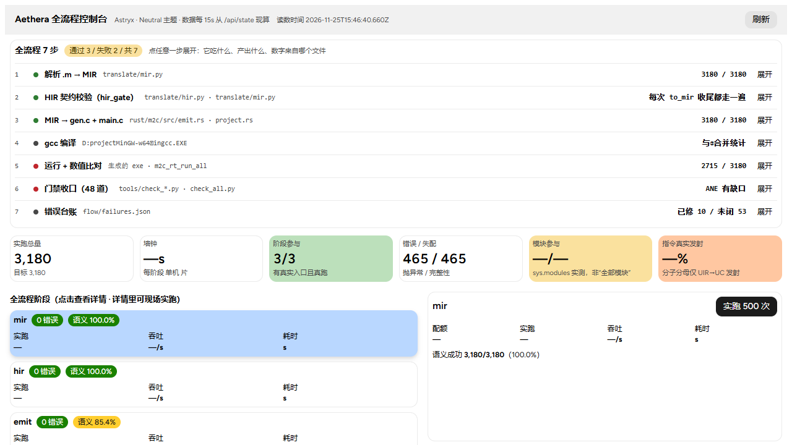

# 前端展示：两个入口

本项目有**两个**前端入口，展示的都是同一份真实数据（`flow/*.json`）。



> 上图是 React 版的实际截图：页头 `Matlabc 全流程控制台`，
> 顶部 7 步流程（`通过 3 / 失败 2 / 共 7`），KPI `实跑总量 3,180` / `错误失配 465/465`，
> 下方阶段卡片 `mir 100.0%` / `hir 100.0%` / `emit 85.4%`，右侧 `实跑 500 次` 按钮。

## 一、静态版：`flow/pipeline.html`

**单文件、零依赖、双击即看。**

- 五段流水线（每段：名称 / 源文件 / 职责 / 真实计数 / 状态色 / 数据来源）
- 三段漏斗（条形图 + 真值）
- 多轮语料对照（600 / 1200 / 3000 / 180 / 3180）
- 小脑自决 CB1–CB4
- 错误台账（按 `fixed` / `open` 分色）

**设计 token 来自 Astryx**（`flow/astryx/theme.css`，199 个语义变量），
页脚写明用法约束：`theme.css` 整份包在
`@scope ([data-astryx-theme="neutral"])` 内，所以 `<body>` 必须带该属性。

**只用 token 与排版层，不用 React 组件** —— 那是 150+ 个
`@astryxdesign/core` 组件，需要 React 19 运行时。

## 二、React 版：`web/`

**Astryx 组件 + 真实数据 API**，端口 5178。

```bash
cd web
npm install          # 首次
npm run dev          # → http://127.0.0.1:5178/
```

### 数据通路（`web/vite.config.js` 的中间件，无独立后端）

| 端点 | 作用 |
|---|---|
| `GET /api/state` | 现读 `../flow/*.json`，聚合成前端形状（`pipeline.steps` 七步、`run.*`、`modules`、`failures`…） |
| `POST /api/run?stage=&n=` | **真的跑一次三段**（`three_links_report.py`），120s 超时、只留末尾 40 行 |

### `/api/run` 的两道闸（**默认关闭**）

1. **必须 `M2C_ALLOW_RUN=1`**（否则返回 501 并说明原因）
2. **必须 `1 <= n <= 50`**（一次误点不该跑 3000 个；50 个约 20 秒）

```powershell
# 带闸启动
$env:M2C_ALLOW_RUN="1"
$env:M2C_PYTHON="C:\Program Files\Python310\python.exe"
$env:M2C_CORPUS="E:\temp\gen_mixed"
npm run dev
```

### 交互

- **7 步可点开**：看「输入 / 产出 / 中间约束 / 数据来源」
- **阶段卡片联动**：点选后右侧显示详情，可现场「实跑 N 次」
- **15 秒自动刷新**
- 「刷新」按钮

## 三、一份约定

**两个入口的所有数字都读 `flow/*.json`，没有一个是写死的。**
所以更新测试数据后，**刷新页面即可**，不需要改前端代码。

若某个 KPI 显示 `—`，它的含义是**“这项本轮没有采集”**，而不是“采集失败” ——
例如 `wall_s`（墙钟）与 `instruction_coverage_pct`（逐指令覆盖）
目前就刻意留 `null`，因为本轮确实没有那两项数据，**不编造**。
