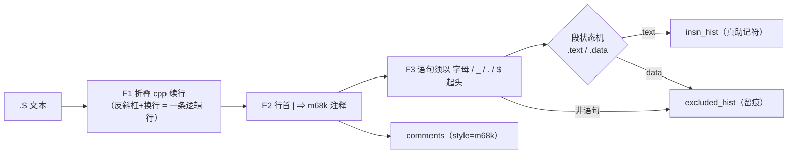

# R79 复盘 —— C28-1（JSON 明细开关）+ C28-2（`.S` 直方图分段）

> 上一轮（R78）落地了 R77 方案的 C-1「解析层下沉」，并在 §9 给出两条**最高**
> 优先级建议。本轮（R79）把这两条**做掉**，并且**量出**它们真实的效果 ——
> 包括一条与预期相反的读数。
>
> 提交：与本文档**同一次提交**（`matlabc.py` 32493 行 / 1617724 字节；
> `tests/test_matlabc.py` 20756 行 / 1077438 字节）。门禁 `tools/check_all.py`
> **rc=0（17 道）**。

---

## 1 六顶思考帽（本轮开工前的判断）

| 帽子 | 结论 |
| --- | --- |
| ⚪ 白帽 | C28-1 的事实：R78 实测 JSON 增长 `security` +30.5% / `lib` +95.7%，**整树未评估**，且**没有开关**。C28-2 的事实：`_asm_file_model` 按「行首 token」统计，实测污染 `1:` 1964、`|` 5709；无任何段状态。 |
| 🔴 红帽 | 直觉上「加个开关」是小活；但 C28-1 真正的题目是**整树 JSON 到底多大** —— 不做这个测量，开关只是猜。C28-2 的红：一个天真的 `.section` 追踪器可能分错段，把数据当代码或反之。 |
| ⚫ 黑帽 | ① 改 `_asm_file_model` 输出形状会碰 R78 的测试（`labels` 元组、`insn_total`）；② 加 flag ⇒ `--help` 变长 ⇒ `check_help_contract` 必红；③ 最深的风险：**整树 JSON 可能仍然很大** ⇒ 「开关」这个前提本身可能是错的。 |
| 🟡 黄帽 | 若真修好，`.S` 直方图从「被污染」变成「可用于分析」，而它正是 C28-3（源码视图）与 C28-4（译文层）要消费的数据。开关则给 CI / 大语料一个可用的载荷档位。 |
| 🟢 绿帽 | C28-1 备选：环境变量 / `--json-detail=full\|lite` / 布尔开关 —— 选布尔（可发现、可写进 `--help`）。C28-2 备选：黑名单过滤（脆） / 已知助记符白名单（表太大） / **段状态机 + 续行折叠**（有原则）—— 选后者。 |
| 🔵 蓝帽 | 两条一起做，因为它们**互相成对**：C28-2 让数据可信，C28-1 让数据付得起。**并且先量再下结论** —— 结果证明「量」这一步救了黄帽的乐观（见 §6）。 |

---

## 2 白帽取证：先搞清楚「污染」到底是什么（不猜）

第一轮 C28-2 落地后重测整树，`insn_top` 头名仍是 `\`（8,240）与 `|`（5,660）。
**先问量具错还是对象错**：写了 `_r79/probe_hist_r79.py`，给每个可疑 token 抓
3 个证人（文件:行:原文）。

| token | 观测次数 | 证人 | 判决 |
| --- | --- | --- | --- |
| `\` | 8,240 | `arch/powerpc/kernel/kvm_emul.S:31`（整行只有一个续行反斜杠）、`arch/arm64/crypto/sm4-neon-core.S:102` | **cpp 续行残片**在 `#define` 宏体里 |
| `|` | 5,660 | ①`arch/hexagon/kernel/head.S:51-53`（`#define PTE_BITS (` 三行续行，第 52 行以 `|` 开头）②`arch/m68k/fpsp040/bindec.S:1-12` | ① 宏体续行；② **m68k 方言里 `|` 就是行注释** |
| `}` | 517 | `arch/*/kernel/vmlinux.lds.S` | 那是**链接脚本**，语句不可能以 `}` 开头 |

三条结论都不是猜的，是**证人**给的。而第一条与 R78 的发现**闭环**：
R78 用整树探针量出「13,632 处内联汇编里 1,964 处（14.4%）在宏体」——
`\` 与部分 `|` 恰恰也是**宏体**里的东西。

---

## 3 实现（四条判据，全部有对手方）



| 判据 | 内容 | 为什么这样定 | 对手方（不这样就错在哪） |
| --- | --- | --- | --- |
| **F1** | 先按 cpp 语义**折叠续行**再分类 | `.S` 是**预处理**过的汇编，续行反斜杠 + 换行 = 一条逻辑行 | 不折叠 ⇒ 整条宏被拆成物理行，宏体残片冒充助记符（`\` 8,240） |
| **F2** | 行首 `|` ⇒ m68k 行注释，记进 `comments` | GAS 的语句必须以助记符 / 指令 / 标签开头，**不可能**以 `|` 开头 | 不处理 ⇒ `|` 当指令（5,660）；或**直接丢弃** ⇒ 丢掉那份文档（译文层还要用） |
| **F3** | 语句头必须匹配 `^[A-Za-z_.$]` | `}`、`{` 这类首字符不是标识符的不是语句 | 不判 ⇒ `}`（517）进直方图 |
| **段状态机** | 起点 `text`（GAS 规矩）；`.section` 只看段名子串（含 `text` ⇒ 文本，其余 ⇒ 数据） | 汇编没有权威的「代码段名单」 | 用白名单 ⇒ 陌生段当代码；用黑名单 ⇒ 脆 |
| **数字标签** | `1:` ⇒ `labels` 且 `kind="numeric"` | 它是**真标签**（`jmp 1b` 指向它） | 不识别 ⇒ 进直方图（`1: 1964`） |
| **语句分隔** | `;` 切语句 ⇒ `lock; addl` 变 `lock` + `addl` | GAS 的 `;` 是语句分隔符 | 不切 ⇒ 伪助记符 `lock;` |
| **不静默** | 被排除的一切进 `excluded_hist` / `segment_lines` | 「排除」必须可核对 | 直接丢弃 ⇒ 无法验证分段是否正确 |

### JSON 明细开关（C28-1）

| 设计点 | 取值 | 理由 |
| --- | --- | --- |
| 开关名 | `--no-annotations`（`dest="annotations"`, `store_false`, 默认 `True`） | 布尔可发现、可写进 `--help` |
| 丢什么 | **逐文件行级数组**：C 的 `comments`/`asm`；汇编的 `symbols`/`labels`/`insn_hist`/`excluded_hist`/`directives`/`comments`/`segment_lines` | 它们才与文件数成正比 |
| 留什么 | **顶层全部汇总**（`asm` / `comment_stats` / `asm_file_stats`）+ 标量（`macros` / `insn_total`） | 汇总的信息密度是「每语料一行」，丢掉不会变小，只会看不懂 |
| 丢法 | **不写键**，不是写空数组 | 空数组每文件白付约 32 B ⇒ 内核量级约 2 MB 纯噪声 |
| 自证 | 顶层 `annotations` 布尔 | 消费方不用猜自己拿的是哪一档 |

---

## 4 实测读数（全部真跑）

### 4.1 `.S` 整树（`--lang asm`，1,369 文件 / 3.9 s）

| 指标 | R78 | R79 | 说明 |
| --- | --- | --- | --- |
| `insn_top` 头名 | `\` 8,240 / `|` 5,660 | **`mov.l` 4,794 / `mov` 4,231 / `add` 3,559 / `nop` 2,250** | 污染消失，头部换成真助记符 |
| instructions | 201,677 | **171,812** | 差 −29,865 = 被正确排除的量 |
| labels | 11,249 | **16,089**（其中数字 **4,880**） | 数字局部标签不再冒充指令 |
| comments | 30,921 | **37,398**（其中 m68k `|` **6,477**） | 30,921 + 6,477 = 37,398（精确） |
| symbols | 1,375 | 1,365 | 宏体里的 `.globl` 不再算真符号（−10，也是修正） |
| `segment_lines` | —（无此概念） | text 242,057 / data 16,353 | 新增，可核对 |
| `excluded_hist` 头部 | — | `@` 907 / `}` 772 / `!` 623 / `mov` 577 / `{` 334 | 新增，**留痕**（见 §8 边界） |

### 4.2 JSON 体积（默认 vs `--no-annotations`）

| 语料 | full | lite | 变化 |
| --- | --- | --- | --- |
| 内核 `.S`（整树） | 18,214,824 B | **220,717 B** | **−98.8%** |
| `lib`（651 文件 / 272 KLOC） | 22,163,836 B | 11,323,966 B | −48.9% |
| `security`（258 / 122 KLOC） | 8,134,546 B | 6,234,536 B | −23.4% |
| `drivers/net`（6,086 / 5,209 KLOC） | 320,715,604 B | 258,488,485 B | −19.4% |
| `fs`（2,085 / 1,568 KLOC） | 114,865,273 B | 85,431,733 B | −25.6% |

**整树 C 外推**（4 子树 7.2 MLOC 合并口径 64,936.7 B/KLOC → 36.16 MLOC）：
**≈2.2 GB（full）/ ≈1.7 GB（lite）**。这是**外推**，不是实测 ——
整树 C 是 661 s / 10.8 GB 峰值，不在本轮预算内，所以如实标成外推。

### 4.3 旧键兼容（硬判据）

`security` 上重跑：`files` / `asm` / `comment_stats` / `edges` **逐位相同**，
唯一新增的顶层键是 `annotations`。C 前端的**模型层**一行未动。

---

## 5 缺陷与修正（本轮自己抓到的）

| 编号 | 现象 | 根因 | 处置 |
| --- | --- | --- | --- |
| **D1** | 第一轮 C28-2 之后 `insn_top` 头名仍是 `\` 8,240 / `|` 5,660 | 缺 F1（续行折叠）与 F2（m68k 注释） | 加 F1/F2/F3，重测头部换成真助记符 |
| **D2** | 手算 `segment_lines` 得 5，产品给 6 | **我漏了 `.text` 那一行**（它也是逻辑行） | 期望改 6（产品对） |
| **D3** | docstring 里「反斜杠紧跟反引号」触发 `DeprecationWarning` | 字符串转义 | 改中文表述，不加转义 |
| **D4** | 变异脚本 M6 的**还原**失败 | 还原串 `return True` 在文件里**不唯一**，`replace(...,1)` 改错了地方 | 给还原串加唯一标记 —— **「锚点唯一」是双向要求** |
| **D5** | 变异脚本所有锚点 0 次命中 | 副本按 CRLF 读、锚点以 `\n` 结尾 | 读时归一 LF（R78 记忆里那条纪律的又一次复现） |
| **D6** | README 锚点 0 次 | 我多写了一个 `(` | 按真实行尾取锚点 |

---

## 6 与预期**相反**的读数（本轮最值钱的一条）

C28-1 的前提是 R78 的读数「JSON +30.5% / +95.7% ⇒ 整树会到 GB 级」。
实测下来：

* **`.S` 上前提完全成立**：明细占载荷 **98.8%** —— 关掉它，17 MB 变 0.22 MB。
* **C 上前提只对了一半**：lite 只省 **19%–49%**，整树仍有 **≈1.7 GB**。
  原因很清楚：C 的每文件载荷里，**真正的大头是 `functions`（含 calls / complexity）
  与 `edges`**，注释与内联汇编只是其中一小块。

⇒ 结论：**这个开关不足以让整树 C 的 JSON 变小**。要做「CI 能用的 C JSON」，
下一步必须再开一档（`summary`：去掉 `functions` 明细与 `edges`，只留计数）。
这条是**量出来**的，不是猜的 —— 也正是黄帽乐观被白帽纠正的地方。

---

## 7 验证矩阵

| 装置 | 结果 |
| --- | --- |
| 单测（R78 + R79 共 8 条） | 全绿（另 2 条失败为**已登记永久红**，见 §7.1） |
| 两向变异 `_r79/mutate_r79.py` | **6/6**：M1 续行折叠 / M2 数字标签 / M3 数据段表 / M4 m68k 注释 / M5 语句首字符 / M6 明细开关 —— 每个「注入即红 + 还原即绿」 |
| NEGCTRL | 真实但无害的改动（加行尾注释）⇒ 保持绿；还原 ⇒ 绿 |
| 门禁 `tools/check_all.py` | **rc=0**，17 道全部通过且各自自证；`check_py36_clean` = **59** 个 `.py` |
| README 对等 `check_readme_parity` | OK（15 小节逐节对等） |
| 全量 FAILED 集合对照 | 见 §7.2 |

### 7.1 两条失败是「已登记的永久红」，不是本轮弄红的

* `test_r78_shell_contract`：页面骨架已改成 `lang="zh-CN"` + 主题脚本，测试仍期望 `lang="zh"`。R78 已确认（在无 `.git` 的副本上同样红）。
* `test_r77_r79_r80_site_e2e`：需要 `fe_audit.py` —— 它是 C16-6 那批「**从未提交**的产物」之一。已在 **HEAD 的 clone** 上复现同样失败。

⚠ 注意这个坑：`-k r79` 会**顺带**选中 `test_r77_r79_r80_site_e2e`（名字里含 `r79_`）。
选择器必须写成 `r79 and not site_e2e`。

### 7.2 全量 FAILED 集合对照

| 基线 | 基线 FAILED | 当前 FAILED | **新增失败** |
| --- | --- | --- | --- |
| `git clone HEAD`（`7221cfb`，带 `.git`） | 123 | 123 | **0** |

基线**必须带 `.git`**：R78 用 `git archive` 副本当基线时多出 3 个伪红，
基线错**会掩盖**真实新增。**门禁绿 ≠ 没弄红** —— 改门面常量后必须跑全量对照。

---

## 8 诚实边界（本轮**没有**解决的）

| 项 | 实测规模 | 为什么留着 |
| --- | --- | --- |
| m68k 点号省略的数据指令（`short` / `long` / `string`） | `short` 1,870、`long` 1,658、`string` 27（约 6 个 `fpsp*.S`） | 它们是**方言**（Motorola 汇编）里的指令名，加白名单等于押注；不如先把规模量清楚 |
| `.lds.S` 链接脚本 | `}` 772、`{` 334 等落在 `excluded_hist` | 那是**另一种语言**（链接脚本），需要独立分类而不是硬塞进汇编 |
| ARM 32 位 `@` 行注释 | `@` 907 | 与 F2 同源的方言问题，但本轮没取证完（只知次数，未抓证人） |
| `!` 623 / `*` 332 | 落在 `excluded_hist` | 同上，未取证 |
| 段状态机不跨 `.pushsection` / `.popsection` | — | 嵌套段栈未实现（`.S` 里少见，但存在） |
| 语义验证 | 不做 | 不判 clobber 充分性 —— 编译器对「漏 clobber」全程沉默，且本仓零依赖 + Py3.6.5 用不了 libclang ≥21（R77/R78 已登记） |

**关键点**：以上每一项都**没有静默消失** —— 它们全在 `excluded_hist` 里看得见。
「诚实」不是「全都做到了」，是「做了多少、没做什么，都数得出来」。

---

## 9 下一轮建议（C29）

| 编号 | 优先级 | 内容 | 依据（本轮实测） |
| --- | --- | --- | --- |
| **C29-1** | 最高 | 再加一档 `--json-level=summary`：C 侧去掉 `functions` 明细与 `edges`，只留计数与每文件签名 | 实测 lite 在 C 上只省 19%–49%，整树仍 ≈1.7 GB；大头是 `functions`/`edges` |
| **C29-2** | 高 | 把方言/异语言分类显式化：`.lds.S` → `kind="lds"`；m68k 点号省略指令 → 归数据；ARM `@` → 注释 | `excluded_hist` 头部全是这三类（`@` 907 / `}` 772 / `{` 334 / `short`+`long` 3,528） |
| **C29-3** | 高 | C-2 源码视图 `renderers/sview.py`（数据层已就绪：注释 + 内联汇编都进了模型） | R77 §9 的 C-2，R78/R79 已把数据备齐 |
| **C29-4** | 高 | C-3 译文层（术语词典 + 内容寻址缓存 + 可插拔后端）—— m68k 那 6,477 条 `|` 注释也是文档 | `comment_stats` 已给出「要不要翻译」的量化依据 |
| **C29-5** | 中 | 段栈：支持 `.pushsection` / `.popsection` / `.previous` | 段状态机的已知缺口 |
| **C29-6** | 中 | 汇编具名操作数 `%[name]` → `%N` 回填；`_asm_file_model` 的 `rel` 仍是 basename | R78 遗留 C28-5 / C28-6 |

另有两件**需要拍板**的旧账（R78 就提了，仍未决）：
**C16-6**（`fe_audit.py` 等 6 件「从未提交的产物」——补齐还是永久登记为「不做」；
其中 `setup.py` / `analyzer_config.example.json` 属于「补文件就能拿回」的一类）；
以及 `flow/` 图册（archify）上次更新停在 10-10。

---

## 10 复现命令

```bash
PY="C:/Program Files/Python310/python.exe"

# 门禁（17 道，含各自自证）
$PY tools/check_all.py

# R78+R79 单测（注意选择器要排除 site_e2e 那个同名前缀的永久红）
$PY -m pytest tests/test_matlabc.py -q --no-header -p no:cacheprovider -k "r78 or (r79 and not site_e2e)"

# 两向变异（只动副本）
$PY E:/matlabc/_r79/mutate_r79.py

# 取证：可疑 token 的证人（3 个/个）
$PY E:/matlabc/_r79/probe_hist_r79.py

# 实测：JSON 体积两档 + 子树外推
$PY E:/matlabc/_r79/measure_r79.py

# 整树 .S 两档 JSON 体积
$PY matlabc.py E:/matlabc/_kernel/corpus/linux-6.19.14 --lang asm --json out.json
$PY matlabc.py E:/matlabc/_kernel/corpus/linux-6.19.14 --lang asm --json out_lite.json --no-annotations

# 全量 FAILED 集合对照（基线 = 当前 HEAD 的 clone）
$PY E:/matlabc/_r79/testdiff_r79.py
```

---

## 附录 A：本轮改动的文件

| 文件 | 改动 |
| --- | --- |
| `matlabc.py` | `--no-annotations` 开关；`_annotations_on` / `_c_file_payload`；`_ext_file_payload(detail=)`；`_ASM_HEAD_RE` / `_asm_segment_of` / `_asm_statement_heads`；`_asm_file_model` 加 F1/F2/F3 + 段状态机 + 数字标签 + `excluded_hist` / `segment_lines`；`_asm_file_stats` 加 `numeric_labels` / `segment_lines` / `excluded_top` |
| `tests/test_matlabc.py` | 4 条 R79 测试（明细开关 / 段分段 / 续行折叠 / `--help` 可发现性） |
| `README.md` / `README_CN.md` | 同行内追加 R79 段（双语对等） |
| `tools/check_help_contract.py` | 两处快照：`--help` 因新增开关**合法增长** 50,792 → 51,371 / 42,284 → 42,736（门自身要求「同一提交里更新快照，不放宽 `HELP_DRIFT_BYTES`」） |
| `docs/SUPERPOWER_REVIEW_R79.md` | 本文件 |
