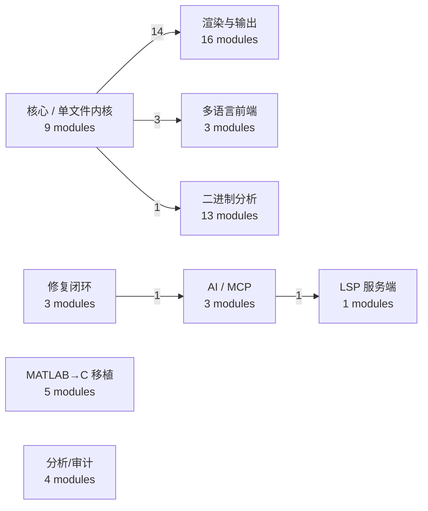

# malabc 模块边界图（自动生成）

> 由 `python tools/build_module_graph.py` 从 `check_import_graph` 的
> **模块级 import** 边现算；不要手改。

- 运行时模块：57 个；跨组边：20 条；模块级环：0
- 排除：tests / tools / harness / ci-examples / setup（开发设施）
- 口径：只画 import 期边；函数内惰性 import 不计入

## 图



## 分组明细

| 组 | 模块数 | 出边 | 入边 | 代表模块 |
| --- | ---: | ---: | ---: | --- |
| **核心 / 单文件内核** (`core`) | 9 | 18 | 0 | `concurrency, entity_model, gui, matlabc, matlabc_boot …` |
| **多语言前端** (`frontends`) | 3 | 0 | 3 | `frontends, frontends.ir, frontends.matlab` |
| **渲染与输出** (`renderers`) | 16 | 0 | 14 | `renderers, renderers._late, renderers._shared, renderers.assets, renderers.callgraph …` |
| **LSP 服务端** (`lsp`) | 1 | 0 | 1 | `matlabc_lsp` |
| **AI / MCP** (`ai`) | 3 | 1 | 1 | `ai_cli, matlabc_ask, matlabc_mcp` |
| **修复闭环** (`flow`) | 3 | 1 | 0 | `agent_loop, analyzer_memory, matlabc_flow` |
| **二进制分析** (`binary`) | 13 | 0 | 1 | `binfmt, binfmt.attribute, binfmt.buildsys, binfmt.container, binfmt.elf …` |
| **MATLAB→C 移植** (`translate`) | 5 | 0 | 0 | `translate, translate.adapters, translate.fidelity, translate.operators, translate.rules` |
| **分析/审计** (`analyzer`) | 4 | 0 | 0 | `analyzer, analyzer.api, analyzer.index, fe_audit` |

## 怎么读

- `core -->|14| renderers`：内核在 import 期直接依赖 14 条渲染边；
  渲染器只消费模型，不应反向 import 内核（`check_import_graph` G1 守环）。
- `flow -->|1| ai`、`ai -->|1| lsp`：闭环/AI/LSP 之间只有少量窄边；
  新增跨组依赖时，先问“能不能走惰性通道”，再决定是否登记。
- 没有箭头的组 = 当前没有 import 期跨组依赖，不代表永远不会有。

## 重新生成

```bash
python tools/build_module_graph.py
python tools/build_module_graph.py --check   # 产物过期即红
```
