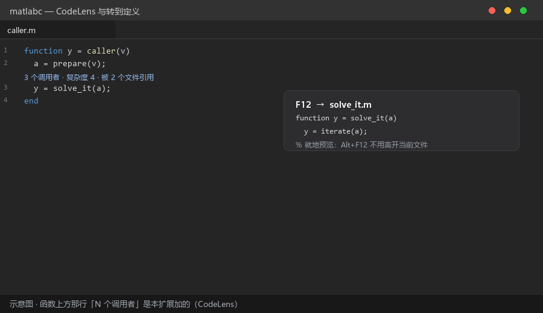
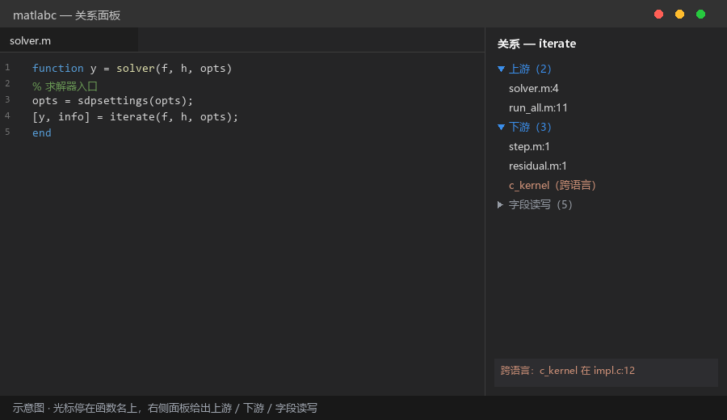
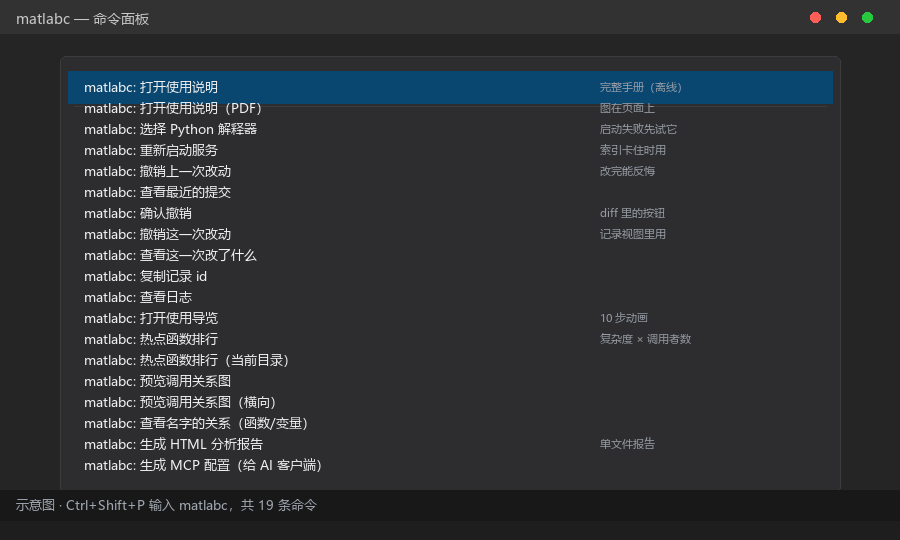
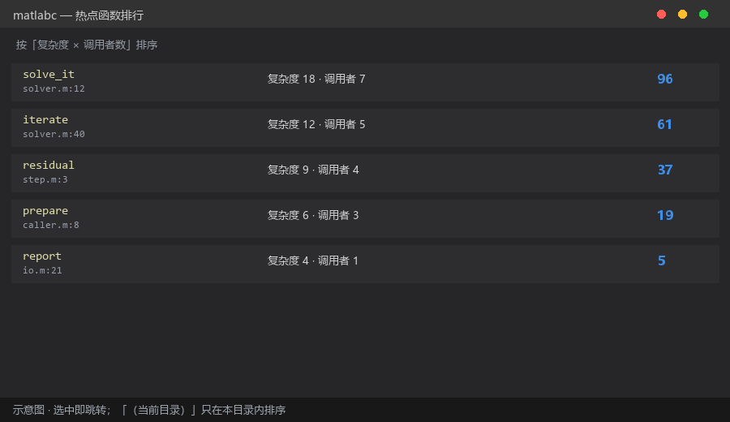
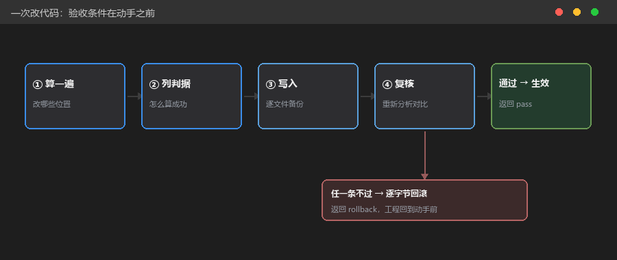
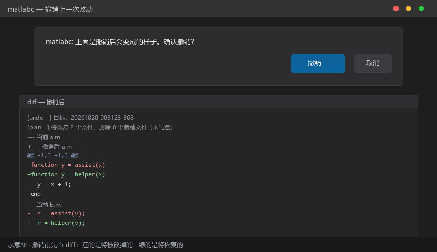
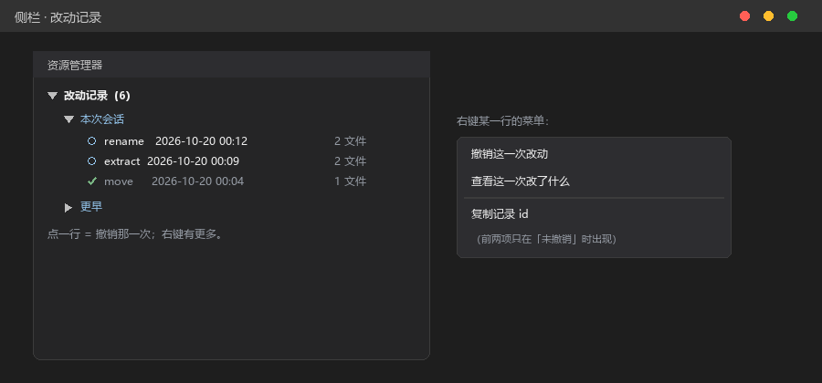

# matlabc 使用说明

## 它解决什么问题

接手一个几十上百个文件的 MATLAB 工程时，最常卡住的不是"看不懂某一行"，
而是**看不出结构**：

- 这个函数**谁在调**？我改它，会不会连累别的模块？
- 这个调用**跳不过去** —— 是我们写错了，还是它本来就是 `mex` / 库函数？
- 改完这一处，**还有哪里要跟着改**？
- 这一堆文件里，**先看哪个**？

平时只能靠 `grep` 和记忆回答这些问题。matlabc 把答案放进编辑器：
光标停在名字上，谁调用它、它调用谁、跨语言落在哪个 C 函数，直接列出来。

**不运行 MATLAB、不需要许可证、全程离线**（只用 Python 标准库，不发网络请求）。

## 支持什么

| 能力 | 你能做什么 |
| --- | --- |
| **结构化诊断** | 未初始化变量、未使用参数、可疑的类型转换、缺文档 —— 波浪线标在代码上 |
| **跳转与预览** | `F12` 跳定义、`Alt+F12` 就地看；函数、类方法、`global`、结构体字段都能跳 |
| **关系面板** | 光标停在任意名字上：上游（谁调它）、下游（它调谁）、变量声明与使用、字段读写 |
| **影响面** | 改代码前先看：谁会受影响、从入口到它的完整来路 |
| **跨语言** | `mex` / `calllib` 让调用链在边界断掉时，给出 C 函数与行号；`calllib('lib','fn')` 会去核对库的导出表（PE / ELF 都认） |
| **热点排行** | 按「复杂度 × 调用者数」排序，告诉你先看哪个函数 |
| **HTML 报告** | 一条命令生成单文件报告：概览、热点、耦合、诊断，转发或打印 |
| **AI 接入（MCP）** | 23 个工具供 AI 助手查询；改代码走**任务**（改名 / 提函数 / 搬函数），自带验收条件与自动回滚，**改完还能撤** |
| **上手导览** | 10 步动画，一屏讲清每个功能在哪 |

支持 **MATLAB `.m`**（脚本、函数、`classdef`、嵌套函数、结构体字段）、
**C/C++**（跨语言落点）、**PE / ELF 二进制**（`.dll` / `.mex*` / `.so` 的导出表）。

## 运行环境

| 需要 | 说明 |
| --- | --- |
| VS Code 1.60 以上 | 扩展本体 |
| 一个 Python **3.6 及以上**（推荐 3.10+） | 扩展靠它干活；**不需要装 MATLAB**，也不需要许可证。2.x 与 3.5 用不了，选中时会直接提示版本过低 |
| Windows / Linux / macOS | 同一个安装包，两边通用 |

---

## 1. 安装

### 1.1 装扩展

**方式一：图形界面（推荐）**

1. 打开 VS Code，左侧点「扩展」图标（或按 `Ctrl+Shift+X`）
2. 点扩展面板右上角的 `…` → **从 VSIX 安装…**
3. 选 `matlabc-<版本>.vsix`，装完点「重新加载」

**方式二：命令行**

```bash
code --install-extension matlabc-<版本>.vsix
```

装完请**重载窗口**：`Ctrl+Shift+P` → `Developer: Reload Window`。

### 1.2 装好之后会看到什么

重载窗口并打开任意 `.m` 文件后：

1. **右下角弹出一次**「matlabc 已就绪：跳转、关系面板、诊断已启用」——
   点「打开使用说明」或「看导览」都能直接进去（每个版本只弹一次）
2. **状态栏出现 `✓ matlabc`**（右下角）：把鼠标放上去能看到用的是哪个 Python、
   版本多少；点它可以直接换解释器。显示 `⚠ matlabc` 表示没起来 ——
   悬停看原因，点一下就能改
3. 左侧「扩展」里多出 matlabc 这一项，设置页能看到它的 5 个选项
4. 打开 `.m` 文件：函数名上方出现「N 个调用者」的小字，诊断问题打上波浪线
5. 光标停在函数名上，右侧出现「关系」面板

**没看到第 1 条**，说明扩展没有在这份工作区里启动：确认打开的是**文件夹**，
并且当前文件是 `.m`。

### 1.3 设置 Python 路径

扩展需要一个 Python 解释器来干活。**路径就在插件设置里配**，两种方式：

**方式一（推荐）：让扩展帮你选**

1. `Ctrl+Shift+P` 打开命令面板
2. 输入并执行 **`matlabc: 选择 Python 解释器`**
3. 它会**先扫一遍**本机常见安装位置（官方安装器、conda、微软商店等），
   把找到的列出来并标上版本 —— 选中一个即可；列表里没有你那份，
   点「手动选择 python.exe…」自己挑
4. 列出来的每个都会**当场验一遍**：版本够不够 3.6、能不能真的解析本扩展的
   服务端源码（跑不了会标「无法运行本扩展」，选了会被拒绝）
5. 通过之后才写进设置，然后提示你重载窗口

**方式二：自己填**

1. `Ctrl+,` 打开设置
2. 搜索框输入 `matlabc`
3. 找到 **`matlabc.pythonPath`**，填 Python 的绝对路径
   （例如 `C:\Python310\python.exe`）
4. 按 `Ctrl+Shift+P` → `Developer: Reload Window` 重载窗口

> 设置页里那一项默认显示 `python` —— 那是"从系统 PATH 里找 python"的意思，
> **不是错误**，被拼写检查画了波浪线也一样。只有在你装了多个 Python、
> 或 PATH 里没有 python 时，才需要改它。

**版本要求是 3.6 及以上**（推荐 3.10+）。选了更老的版本（2.7、3.5）时，
扩展会直接提示「版本过低」而不是让它在后台崩掉 —— 那种崩法只会显示一串
看不懂的语法错误。

下面几项都在同一处：

### 1.4 其它设置项

| 设置 | 默认值 | 什么时候要改 |
| --- | --- | --- |
| `matlabc.pythonPath` | `python` | 提示「找不到 Python」、或装了多个版本 |
| `matlabc.lspPath` | 空 | 一般不用动。只有把扩展文件放在别处时，才需要填扩展自带 `matlabc_lsp.py` 的绝对路径 |
| `matlabc.enabled` | 勾选 | 想临时关掉全部诊断与跳转 |
| `matlabc.docLang` | `both` | 内置函数说明只想看中文 / 只看英文 |
| `matlabc.crossLanguage` | 勾选 | 不想扫 C 源与 mex/DLL 时关掉（见第 5 节） |
| `matlabc.undoDiffLimit` | `8` | 撤销前最多打开几个并排 diff —— 文件很多时按这个数截断（1–40） |
| `matlabc.slowTaskFactor` | `2` | 「偏慢」的倍率：超过同类任务中位耗时的这个倍数才标 |
| `matlabc.slowTaskMinMs` | `200` | 「偏慢」的绝对下限（毫秒），太短的不标 |

### 1.5 打开工程

用 VS Code **打开整个工程文件夹**（不是单个文件）。打开 `.m` 文件后扩展才会激活。

**第一次打开会花几秒到几十秒建索引**，取决于工程大小。期间跳转和关系面板可能不完整，
稍等即可，不需要重开。

---

## 2. 五个最常用的动作

### 2.1 看一个文件里有什么

按 `Ctrl+Shift+O`，列出当前文件所有函数，选中回车跳过去。

适合拿到一个陌生文件时先看骨架。

### 2.2 跳到定义

光标停在名字上：

| 按键 | 效果 |
| --- | --- |
| `F12` | 跳到定义 |
| `Alt+F12` | 就地预览定义（不离开当前文件） |

**能跳的**：函数、局部函数、类方法、结构体字段（`s.field`）、结构体变量（`s`）、`global` 声明。
字段会落到**首次赋值**那一行 —— 因为字段没有"定义语句"。



*示意图：函数上方那行「3 个调用者 · 复杂度 4」是本扩展加的（CodeLens）；
`F12` 跳过去，`Alt+F12` 就地预览。*

### 2.3 看它和谁有关系

光标停在任意名字上，右侧「关系」面板会显示：

- 它被谁调用（上游）
- 它调用了谁（下游）
- 如果是变量：在哪里声明、在哪里出现
- 如果是结构体字段：哪些位置写入、哪些位置读取

面板里点开的分组会**被记住**：光标移到别处再移回来，仍然是你上次展开的样子。



*示意图：左边是代码，右边是上下游。落不到 MATLAB 里的调用会标成跨语言，
并给出 C 文件与行号。*

### 2.3.1 C / MATLAB 双栏对照

在 MATLAB 函数里右键 → **`matlabc: 打开 C/MATLAB 对照（侧边）`**：
左栏 MATLAB、右栏 C，光标在同一个函数内移动时，另一栏按行位置跟随：优先读 C 里的 `/* @m2c src:N */`，没有映射时按函数体比例。
从 C 侧也能反向发起：光标放在 `m2c_foo` / `foo` 上，会找调用它的 MATLAB 函数。
同步可用 **`matlabc: 开关 C/MATLAB 对照同步`** 临时关闭。  
如果 `.m` 比 C 新，状态栏会提示 **C 可能过期**，避免 source map 精确地跳到旧行。

### 2.4 改代码前先看影响面

关系面板里的「上游」就是影响面；想看完整调用链，把光标放在目标函数上，
面板会列出**从入口到它的每一条来路**（带文件名与行号）。

→ 改一个函数之前，先看这里：谁在调它，就有谁会因为你的改动而出问题。

### 2.5 生成一份可转发的报告

命令面板（`Ctrl+Shift+P`）→ `matlabc: 生成 HTML 分析报告`。

浏览器会打开一份单文件报告：工程概览、热点函数、耦合关系、诊断清单。
可以直接发给同事，或打印成 PDF。

---

## 3. 命令清单

按 `Ctrl+Shift+P`，输入 `matlabc`：



*示意图：命令面板里输入 `matlabc`。*

**想先看哪里最值得改**，用「热点函数排行」：



*示意图：按「复杂度 × 调用者数」排序，选中即跳转。*

| 命令 | 作用 |
| --- | --- |
| `matlabc: 打开使用说明` | 就是本文（随扩展一起分发，离线可看） |
| `matlabc: 打开使用说明（PDF）` | 本文的 PDF 版：四张示意图直接印在页面上，也适合转发 |
| `matlabc: 打开 C/MATLAB 对照（侧边）` | 左 MATLAB、右 C，函数内行级跟随；C 侧也可反向发起 |
| `matlabc: 开关 C/MATLAB 对照同步` | 临时开/关另一栏的自动跟随 |
| `matlabc: 恢复上一次 C/MATLAB 对照` | 重开窗口后恢复上次打开的左右文件与位置 |
| `matlabc: 选择 Python 解释器` | 挑一个 Python 并验证能启动，写进设置 —— **启动失败时最先试它** |
| `matlabc: 重新启动服务` | 索引卡住、刚改过设置时用 —— 只重启分析服务，不重开窗口 |
| `matlabc: 生成工程 HTML 报告` | 一条命令出整份报告（调用图内嵌），存到 `.matlabc/report.html`，完成后可直接在浏览器打开 |
| `matlabc: 重新扫描大纲` | 大纲看着不对时用：清缓存并重新扫一次，会告诉你几个符号、用了多久 |
| `matlabc: 撤销上一次改动` | 改完想反悔时用：先开并排 diff，确认后才动手 |
| `matlabc: 确认撤销` | 在 diff 里点 CodeLens 时用的就是这个（一般不用手动执行） |
| `matlabc: 撤销这一次改动` | 记录视图里对某一行用（右键菜单） |
| `matlabc: 查看这一次改了什么` | 同上，只看 diff 不动文件 |
| `matlabc: 复制记录 id` | 排查问题时把 id 发给别人 |
| `matlabc: 导出日志` | 把日志存到你选的位置（报障时直接发这个文件） |
| `matlabc: 跳到定义处` | 关系面板某一行右键用：左键去调用处，右键去定义处 |
| `matlabc: 按 id 撤销改动` | 手上有 id 时直接撤（会读剪贴板并校验格式） |
| `matlabc: 改动记录按耗时排序` | 切成按耗时降序，再点一次恢复时间线 |
| `matlabc: 按文件过滤改动记录` | 只看动过某个文件的记录（留空 = 不过滤） |
| `matlabc: 清除改动记录过滤` | 恢复显示全部 |
| `matlabc: 查看最近的提交` | 列出仓库最近的提交，选中即查看它改了什么 |
| `matlabc: 查看日志` | 打开扩展日志 |
| `matlabc: 打开使用导览` | 10 步动画，一屏讲清每个功能在哪 —— **第一次用建议先看它** |
| `matlabc: 热点函数排行` | 全工程按「复杂度 × 调用者数」排序，选中即跳转 |
| `matlabc: 热点函数排行（当前目录）` | 只看当前目录 —— 跨模块的分数没有可比性 |
| `matlabc: 预览调用关系图` | 当前函数的关系图（纵向） |
| `matlabc: 预览调用关系图（横向）` | 同上，横向布局，宽屏更好读 |
| `matlabc: 查看名字的关系（函数/变量）` | 用命令的方式打开右侧「关系」面板 |
| `matlabc: 生成 HTML 分析报告` | 生成整份报告并在浏览器打开 |
| `matlabc: 生成 MCP 配置（给 AI 客户端）` | 见第 6 节 |

---

## 4. 编辑器里会看到什么

打开一个 `.m` 文件后，除了上面那些主动操作，还有些东西是**自动出现**的：

| 你会看到 | 在哪 | 意思 |
| --- | --- | --- |
| 函数名上方一行小字 | 每个函数的第一行上方 | 这个函数有多少调用者、被调用多少次、圈复杂度 |
| 波浪线 | 代码里 | 诊断：未初始化的变量、未使用的参数、可疑的隐式转换、缺文档等 |
| 不同颜色 | 光标所在处 | 参数、局部变量、函数、字段、全局变量、内置函数 分别着色 |
| 顶部弹出的函数说明 | 光标停在函数名上 | 内置函数给中文说明；你自己的函数给签名与位置 |

这些不需要任何操作，保存文件后会自动更新。

---

## 5. 跨语言：MATLAB 调不到的东西

当一个调用在 MATLAB 里**解析不到**时（`mex`、`calllib`、预编译库），
关系面板会多出几组：

| 分组 | 意思 |
| --- | --- |
| `→ 跨语言（C 源）` | 工程里有这个函数的 `.c/.cpp` 定义，直接给文件名与行号 |
| `→ 二进制（mex / 库）` | 同名 `.mexw64` / `.dll` / `.so` 就在工程里，入口名写在文件名上 |
| `→ calllib 调用` | `calllib('lib','fn')` 里的 `fn` 是否真在该库的导出表里（✓ / ✗ / ?） |
| `→ 仍连不上` | C 源与工程内二进制都没有 —— 多半来自工具箱或动态调用 |

**没有看到这些分组？** 说明工程里确实没找到 `.c` / `.mexw64` / `.dll` / `.so`；
如果你确认有，检查设置 `matlabc.crossLanguage` 是否被关掉了 ——
关掉时那里会**明确写「已关闭」**，而不是安静地不显示。

---

## 6. 让 AI 助手读你的工程（可选）

接上之后，你说的每一句"谁在调这个函数""这个工程多大"，AI 都会去问本扩展，
而不是瞎猜。

### 6.1 三步接上

**第一步：生成配置**

命令面板 → **`matlabc: 生成 MCP 配置（给 AI 客户端）`**，弹窗里三选一：

| 选项 | 用在哪 |
| --- | --- |
| 写入 `.vscode/mcp.json` | VS Code 1.102 及以上的内置 AI（写完就能用） |
| 复制通用配置 | Claude Desktop / Cursor / CodeBuddy 等支持 `mcpServers` 的客户端 |
| 只复制 VS Code 格式 | 想自己贴到别处 |

**第二步：贴进客户端**

生成的 JSON 长这样（`command` 会自动用你配好的 Python，`--root` 是当前工程）：

```json
{
  "mcpServers": {
    "matlabc": {
      "command": "C:/Python310/python.exe",
      "args": ["D:/ext/matlabc_mcp.py", "--root", "D:/work/myproj"]
    }
  }
}
```

各客户端放哪：

| 客户端 | 配置文件 |
| --- | --- |
| VS Code（内置 AI） | 工程里的 `.vscode/mcp.json` —— 上面那个命令会直接写 |
| Claude Desktop | Windows `%APPDATA%\Claude\claude_desktop_config.json`；macOS `~/Library/Application Support/Claude/claude_desktop_config.json` |
| Cursor | `~/.cursor/mcp.json` |
| CodeBuddy / 其它 | 各自 MCP 设置页，认 `mcpServers` 格式 |

**第三步：重启客户端**

重启后问一句"这个 MATLAB 工程多大" —— 如果它在回答里引用了文件数与函数数，
说明接上了。也可以在客户端的工具列表里找以 `matlabc_` 开头的工具（共 21 个）。

> 接不上时先看两处：`command` 指向的 Python 能不能启动（用
> `matlabc: 选择 Python 解释器` 验证一次）、`args` 里的 `matlabc_mcp.py`
> 路径是否就是扩展目录里那份。

### 6.2 常见用法

**① 先摸清工程**

> "这个 MATLAB 工程有多大？最复杂的几个函数是什么？"

AI 调 `matlabc_stats`，你拿到文件数、函数数、调用边、复杂度前几名。

**② 改之前先看影响面**

> "`solver.m` 里的 `iterate` 是谁在调？我改它会不会连累别人？"

AI 调 `matlabc_impact`，你拿到上游列表（含文件名与行号）以及从入口到它的来路。

**③ 问"为什么跳不过去"**

> "这里的 `c_entry` 跳不过去，是我们写错了还是它本来是 C 函数？"

AI 调 `matlabc_cbridge`：工程内有 `.c` 的给出文件名与行号；`mex` 给出入口名；
`calllib('lib','fn')` 会去核对库的导出表，明确说 ✓ 还是 ✗。

**④ 改代码前先要一份"计划"**

> "把 `helper` 改名成 `assist`，先别动，告诉我你会改哪些地方。"

AI 调 `matlabc_task_plan`（**不写盘**），你拿到：将改的位置数、涉及文件、
以及这次改动的**验收条件**。看完觉得可以，再让它执行。

**⑤ 改完要一份"回归清单"**

> "我改了 `model.m` 和 `sim.m`，哪些入口应该先跑一遍？"

AI 调 `matlabc_changed`，按受影响程度列出入口。

**⑥ 让它真的去改（带验收）**

> "执行吧。"

AI 调 `matlabc_task_apply`：写入 → 重新分析 → 逐条核对 → 不过就**自己回滚**，
返回里带 `verdict`（`pass` / `rollback`）。

**⑦ 一次做完一整套重构**

> "把 `helper` 改名成 `assist`，再把 `assist` 里那段循环提成 `step_once`，两步一起做。"

AI 用 `steps` 传一串任务，**按顺序执行**：

```
matlabc_task_plan  {steps: [...]}   在副本上推演整条链，工程不动
matlabc_task_apply {steps: [...]}   真做；任一步失败 → 回滚全部（工程恢复原状）
```

链上后一步可以直接引用前一步：
`{"task": "rename", "old": "${prev.new}", "new": "solve"}` —— 不用手抄上一步改出来的名字。

为什么强调"整批"：分两次做时，第二步失败而第一步已经落盘，你手上就是
"改了一半"的工程 —— 那比完全没改更难收拾。

### 6.3 AI 改代码：**带验收、可回滚**

普通的"让 AI 改代码"是：它改完，你自己看对不对。
这里改代码走的是**任务**，每次都自带验收条件：

| 任务 | 做什么 | 验收条件 |
| --- | --- | --- |
| `rename` | 把一个函数名改掉 | 旧名字归零 · 函数数不变 · 调用边不变 · 诊断不增加 |
| `rename-field` | 改结构体字段（`s.old` → `s.new`） | 同上；同名变量与字符串里的名字**不动** |
| `extract` | 把一段代码提成函数 | 函数数 +1 · 诊断不增加 · 结构配平 |
| `move` | 把整个函数搬到独立文件 | 函数总数不变 · 诊断不增加 · 定义真的迁移了 |

固定两步：

```
1. matlabc_task_plan   只算不写：改哪些位置、验收条件是什么
2. matlabc_task_apply  写入 → 重新分析 → 逐条核对 → 不过就逐字节回滚
```

**所以它能做到：改坏了会自己退回去，而不是留一个半成品给你发现。**

> 两个边界要说清楚：
> - 验收条件管的是**结构**（函数数、调用边、诊断、名字残留），
>   不是"业务逻辑正确"——语义对不对仍然要你判断；
> - `extract` 的接口如果让工具自己推断，那是启发式，**先看推断结果再执行**。

### 6.4 它不会做什么

- 不在你不知情时改文件：所有写操作都是「先算 → 你确认 → 再落盘」
- 不覆盖已有文件：`extract` / `move` 遇到同名目标会直接拒绝
- 不改工程外的东西：所有路径都必须在工程目录内

### 6.5 工具速查（21 个里的常用几类）

| 想问什么 | AI 会调用 | 你会拿到 |
| --- | --- | --- |
| 这工程多大 | `matlabc_stats` | 文件数、函数数、调用边、最复杂的几个 |
| 这个文件里有什么 | `matlabc_outline` | 函数清单与行号 |
| 谁调用了它／它调用了谁 | `matlabc_impact` | 完整来路、上游下游、解析不到的调用 |
| 改这几个文件谁要回归 | `matlabc_changed` | 需要先验证的入口 |
| 这个名字在哪 | `matlabc_search` / `matlabc_definition` / `matlabc_references` | 位置与引用 |
| 字段在哪读、在哪写 | `matlabc_fields` | 按变量名分组的读写位置 |
| 工程有什么毛病 | `matlabc_diagnostics` | 未初始化、未使用等 |
| 这个 MATLAB 函数调的 C 在哪 | `matlabc_cbridge` | C 文件与行号；反向也能查 |

---

## 7. 改代码有验收、也可以撤销

让 AI 改代码时，最担心的两件事：**改坏了没人知道**、**改完想反悔来不及**。
这一节讲的就是这两件事。

### 7.1 改代码走「任务」：动手前先说清怎么算成功

AI 不是直接改文件，而是先把这次改动算成一件**任务**，并且**在动手之前**
把验收条件列出来（例如：旧名字归零 / 函数数不变 / 调用边不变 / 诊断不增加）。

改完它会重新分析，逐条核对：

- 全部通过 → 改动生效，返回 `pass`
- 任何一条不过 → **逐字节回滚**，返回 `rollback`，工程回到动手前



*示意图：判据先写出来，再动手；过不了就自己退回去。*

**所以最坏的情况是「没改成」，而不是「改成一半」。**

### 7.2 想反悔：撤销上一次改动

两个入口，效果一样：命令面板的 **`matlabc: 撤销上一次改动`**，
或点右下角状态栏的 `✓ matlabc` → 菜单里的「撤销上一次改动」。

**它会先把 diff 摆出来**（红的是将被改掉的，绿的是将恢复的），你确认后才动手：



*示意图：撤销前先看 diff，确认后再执行。*

diff 用的是编辑器**自带的并排视图**（左边是你现在的文件，右边是撤销后会变成的样子），
可以直接逐行看差异、也可以折叠上下文。确认框里还有第二个按钮
「查看这段提交」—— 点它会列出仓库在任务之后新增的提交，方便你对照。

撤销前还会检查两件事：

- 这些文件在改动之后**有没有被你再编辑过** —— 有就直接拒绝，并指出是哪个文件，
  **不会悄悄覆盖你的修改**
- 记录里存了当时的 git 提交；如果仓库已经往前走了，会提醒你一句（不阻止）

撤销完成后还会再验一次：函数数、调用边数、诊断数必须回到改动前的样子；
对不上就把「撤销」本身也退回去，工程保持原样，并说明差在哪。

### 7.3 侧栏「改动记录」

资源管理器里有一个 **改动记录** 视图，分两组：

- **本次会话** —— 这次打开窗口之后做的改动（最常看的就是这组）
- **更早** —— 之前留下来的记录，默认收起

每一行写着类型、耗时、时间、动了哪些文件；已撤销的带勾。

**没改成的那次也在**：验收不过时任务会自动回滚，但仍会留一条「回滚」记录 ——
否则「我刚才那次到底成没成」没有任何地方能查。**点这一行能看到原因**
（例如「调用边数变了」）。回滚记录不能撤销 —— 它没有改前状态。

视图标题会写成本次会话的汇总，例如「本次会话 3 成功 / 1 回滚」；
会话里只要出现过回滚，最上面还会多一行「回滚原因：调用边数变了（1 次）」，
把本会话最常踩的那个坑直接摆出来。

**明显偏慢的那次会被标出来**（`watch` 图标 + 「偏慢」）：判据是**超过同类任务
耗时中位数的 2 倍**，而不是跟一个全局阈值比 —— 改名和批量任务本来就不该一样快。
`matlabc: 改动记录按耗时排序` 可以切成降序看一下分布。

**同一个文件的多次改动会折成一个可展开节点**（`solver.m  3 次`）——
一次重构常常连着改同一个文件，平铺时看到的是一串很像的行。



*示意图：点一行 = 撤销那一次；右键还有「查看这一次改了什么」「复制记录 id」。*

记录多了以后，用 **`matlabc: 按文件过滤改动记录`** 只留动过某个文件的那些
（例如输入 `solver`）。视图标题会写成「改动记录（3/12）· 只看 solver」，
一眼能看出是过滤后的结果；`matlabc: 清除改动记录过滤` 恢复全部。

**右键某一行的菜单：**

| 菜单项 | 作用 |
|---|---|
| 撤销这一次改动 | 与命令面板那条一样，先给 diff 再确认（只在「未撤销」时出现） |
| 查看这一次改了什么 | 只打开 diff 预览，**不动任何文件** |
| 复制记录 id | 排查问题时把 id 贴给别人，能直接定位到那次改动 |

### 7.4 撤销没通过时是什么样

如果恢复出来的代码和任务前的结构对不上，撤销会被**整体退回**，并说明差在哪：

```
[validate] 撤销后验收不通过：
[validate]   · 函数数 2（应为 3）
[validate]   · 调用关系变少（可能有调用点没恢复）
[validate] 可能的原因：文件恢复不完整（像是少了函数定义）
[validate] 已退回撤销前的状态（工程未变）
```

**工程不会停在“撤了一半”的状态** —— 它会回到你点撤销之前的样子，
你可以先 `git status` 看清楚再决定下一步。

### 7.5 撤销记录存在哪

工程目录下的 `.matlabc/tasks/`（一个任务一个 JSON，保存改动前的文件内容，压缩存储）。

- 最多保留 **50 条**，超出时**先删已撤销的**
- 不希望它进版本库？把 `.matlabc/` 加进 `.gitignore` 即可（删掉它就失去撤销能力）

---

## 8. 常见问题

**Q：打开工程后什么反应都没有？**
确认你打开的是**文件夹**、并且当前文件是 `.m`。扩展只在 MATLAB 文件上激活。

**Q：提示找不到 Python / 启动失败？**
扩展会**自己弹提示**，右上角有两个按钮：「选择 Python 解释器」「打开使用说明」——
点第一个，选中你的 `python.exe` 即可（它会先试启动一次，再写进设置并提示重载）。

如果没有弹出（或已经关掉了），手动执行命令 **`matlabc: 选择 Python 解释器`**，
步骤同上。

也可以手动改：`Ctrl+,` → 搜索 `matlabc` → 把 `matlabc.pythonPath` 填成绝对路径
（例如 `C:\Python310\python.exe`）→ 重载窗口。

装了多个 Python 时填你想要的那个；装了 MATLAB 也不必用它的 Python。

**Q：大工程很慢、编辑卡顿？**
第一次分析最慢，之后增量更新。实在太大可以关掉 `matlabc.crossLanguage`（省掉扫 C 源与二进制）。

**Q：诊断太多，满屏波浪线？**
`Ctrl+Shift+P` → `matlabc.enabled` 临时关掉，或只在你关心的目录里工作。
诊断按严重度排序，先处理「错误」级别。

**Q：让 AI 改代码，改坏了怎么办？**
它改代码走的是任务：执行前会先把验收条件列出来，改完重新分析逐条核对，
**任何一条不过就自动回滚**，文件恢复到改前逐字节相同。所以最坏情况是"没改成"，
而不是"改成半截"。

**Q：AI 改完我想自己再确认一遍？**
看它返回的 `verdict`：`pass` 才是全部验收通过；`rollback` 表示它自己退回去了
（返回里会写哪条判据没过）。另外每个任务在动手前都能先"算一遍"不写盘，
那份计划里就是将要改的全部位置。

**Q：我装的是 Python 3.5 / 2.7，能用吗？**
不能。本扩展需要 **3.6 及以上**。装一个 3.10+ 的解释器，再用
`matlabc: 选择 Python 解释器` 指过去即可 —— 机器上可以同时有多个 Python，
只需要指定用哪个。

**Q：扩展好像没在工作，怎么查？**
按顺序看三处：

1. **右下角状态栏**：`✓ matlabc` 是就绪；`⚠ matlabc` 是没起来，鼠标放上去有原因
2. 点它 → **重新启动服务**（只重启分析服务，不重开窗口、不丢未保存的编辑）
3. 还不行 → 点它 → **查看日志**，最后几行通常会写清楚卡在哪

**Q：误报了怎么办？**
把那个函数名和文件发给我 —— 误报比漏报更值得修。

**Q：想回退到旧版本？**
重新装旧版 VSIX 即可（`code --install-extension matlabc-<旧版本>.vsix`），
设置与缓存都在工程目录的 `.matlabc/` 下，回退后仍然可用。

---

## 9. 一分钟上手

1. 装扩展 → 重载
2. 打开工程文件夹 → 等索引进度过去
3. `Ctrl+Shift+P` → `matlabc: 打开使用导览`，看一遍 10 步
4. 随便点进一个 `.m`，光标停在一个函数名上，看右侧「关系」面板
5. 按 `F12` 试试能不能跳过去
