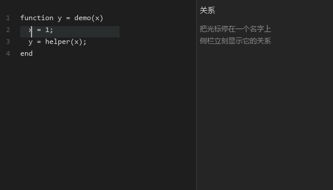

面向 MATLAB 工程的代码理解工具。
用于阅读、维护与评审既有代码，**不修改被分析的代码，也不依赖 MATLAB 运行时**。

安装后即可使用，无需配置，全程离线。

*光标停在 `x` 上 → 侧栏显示上游/下游 → 点击任一跳转到调用发生的那一行。*

---

## 核心能力

| 能力 | 说明 |
| --- | --- |
| **结构感知诊断** | 缺文档、未初始化读取、死代码、维度与污点类检查，打开文件即在编辑器中标记 |
| **跨文件导航** | 函数、局部函数、类方法、结构体成员 `s.field`、结构体变量 `s` 本身，均可定位到定义 |
| **结构体成员定位** | MATLAB 工程中大量数据以结构体承载，本扩展将成员与变量纳入导航范围，而非仅覆盖函数 |
| **调用规模概览** | 每个函数定义行上方直接标注调用者数量、被调用数量与圈复杂度 |
| **调用链分析** | 自目标函数向上追溯至入口，逐层展开；每一处调用点均可点击直达；另提供链式视图，一条完整来路一行 |
| **影响面评估** | 在修改前确定上游调用方，避免遗漏受影响的调用点 |
| **语义高亮** | 参数、局部变量、函数、结构体字段、全局变量、内置函数分别着色 |
| **符号大纲** | 按文件列出全部函数，支持快速跳转 |
| **热点排行** | 按「复杂度 × 调用者数」排序，回答「先看哪几个函数」；支持按目录过滤，可导出 Markdown |
| **保存即刷新** | 保存后仅重新分析发生变化的文件，结果与全量分析一致 |

---

## 与常见方案的区别

MATLAB 生态中的代码浏览工具，通常止于函数级：能跳函数、能列调用，但遇到结构体、字段与变量就退回全文检索。本扩展的差异集中在三处：

| 常见做法 | 本扩展 |
| --- | --- |
| 只覆盖函数，字段与变量需手动搜索 | **结构体成员与结构体变量同样可定位**，覆盖 MATLAB 的主要数据形态 |
| 调用关系只给出数量或一层 | **调用链向上追溯到入口**，每一跳都标注所在的文件与行号 |
| 查不到定义时没有反馈 | **明确说明它是什么**：字段、参数、局部变量、库外函数，或确实不存在 |
| 无法解析的调用被静默丢弃 | **计数与归因同时给出**，并说明其中多少处无法定位 |
| 大工程上逐次全量分析 | **增量刷新**，仅重算变更文件，且与全量结果逐项一致 |

最后一条尤为关键：**增量分析的价值不在于快，而在于快而不改变结论**。本扩展对每一次增量结果都与全量结果做逐项比对，一致后才对外提供。

---

## 典型场景

**接手既有工程**
自上而下确认入口、主干与支路，按调用规模判断哪些模块是核心，哪些是边缘工具。

**评估一次改动的影响**
在修改函数行为之前，先列出全部上游调用点，并区分直接调用与间接调用。

**代码评审**
以调用规模与复杂度为线索，优先评审高风险函数；结构体成员的读写位置可直接定位。

**排查“找不到定义”**
面对 `s.lb(1)` 这类写法，明确区分「字段取值」与「函数调用」，避免把字段当成缺失的函数。

---

## 使用方式

| 操作 | 快捷键 / 入口 |
| --- | --- |
| 转到定义 | `F12` |
| 查找引用 | `Shift+F12` |
| 查看说明 | 鼠标悬停于标识符 |
| 函数大纲 | `Ctrl+Shift+O` |
| 调用关系图 | 点击函数上方的调用计数，选择「预览调用关系图」 |
| 刷新诊断 | `Ctrl+S` |
| 热点函数排行 | 命令面板 → `matlabc: 热点函数排行` |
| 当前目录的热点 | 命令面板 → `matlabc: 热点函数排行（当前目录）` |
| 生成 HTML 分析报告 | 命令面板 → `matlabc: 生成 HTML 分析报告`（输出到 `.matlabc/report.html`） |
| 生成 MCP 配置 | 命令面板 → `matlabc: 生成 MCP 配置（给 AI 客户端）` |

调用关系图在编辑器旁侧打开，分三段：**链**（入口 → 目标，一条路径一行，如 `main_entry → fmincon → callpop`）、
上游（追溯至入口）、下游（展开三层）。每个节点标注所在文件与行号，可直接跳转。

---

## 交给 AI 客户端（MCP）

同一套分析结果也以 **MCP 服务**的形式暴露，任何支持 MCP 的客户端
（Claude Code、Cursor、Continue、CodeBuddy 等）都能直接调用。

配置方式：命令面板 → `matlabc: 生成 MCP 配置`，可直接写入 `.vscode/mcp.json`，
或复制成 `mcpServers` 片段贴到客户端的配置文件里。

**只读工具（11 个）**

| 工具 | 回答什么问题 |
| --- | --- |
| `matlabc_stats` | 工程规模：文件、函数、调用边、最复杂的几个 |
| `matlabc_outline` | 一个文件里有哪些函数、各在第几行 |
| `matlabc_search` | 名字记不全时按子串找函数 |
| `matlabc_explain` | 一个函数的速览：角色、改动风险、从哪看起 |
| `matlabc_impact` | 谁调用它（含完整来路）、它调用谁、多少处解析不到 |
| `matlabc_heat` | 按「复杂度 × 调用者数」排在前面的是谁 |
| `matlabc_changed` | 改了这几个文件，谁需要先回归 |
| `matlabc_definition` | 某个位置指向哪里（函数/首次赋值/global 声明） |
| `matlabc_references` | 被谁引用；全局变量分定义/声明/使用三类 |
| `matlabc_fields` | 结构体字段的跨文件读写位置，按基名分组 |
| `matlabc_diagnostics` | 工程体检：未初始化、未使用等（首次较慢） |

**写工具（3 个，分三步，不会一步改坏）**

| 工具 | 作用 |
| --- | --- |
| `matlabc_propose_edit` | 只算 diff 与影响面，**不落盘**，返回 `editId` |
| `matlabc_apply_edit` | 显式带 `editId` 才写入，写前再校验并自动备份 |
| `matlabc_undo_edit` | 从备份恢复 |

**上下文紧张的本地模型**可以加 `--tools core` 启动，只暴露 6 个核心工具，
省下约 2/3 的工具描述 token。

---

## 内网环境没有模型 API 时

模型 API 只影响「AI 调用工具」这一层，**扩展本身不依赖任何模型**：

| 能力 | 需要模型吗 |
| --- | --- |
| 大纲、转到定义、悬停、引用、关系侧栏、CodeLens | 不需要 |
| HTML 分析报告、热点排行、变更影响面 | 不需要 |
| MCP 工具被 AI 调用 | 需要 |

也就是说：公司内网不给 API 时，前面那些照常可用；要用 MCP，
需要一个能连的模型端点（自建 OpenAI 兼容服务即可，7B 以上、支持工具调用）。

---

## 运行环境

- 需要 Python 3.8 或更高版本
- 无需安装 MATLAB，无需联网，无需额外依赖
- 分析器随扩展一同分发，安装后即可使用

| 设置项 | 默认 | 说明 |
| --- | --- | --- |
| `matlabc.docLang` | `both` | 内置函数说明语言：`both` / `zh` / `en` |
| `matlabc.pythonPath` | `python` | 指定 Python 解释器 |
| `matlabc.lspPath` | 空 | 通常无需设置；留空即使用随扩展分发的分析器 |

---

## 已知边界

以下为设计取舍，非缺陷：

- **引用为函数级**：给出「哪个函数调用了它」，而非每一处调用行
- **未保存的编辑不触发诊断**：保存前的内容按草稿处理，避免输入过程中持续报错
- **新增或删除文件后**，建议重新打开工作区，或等待下一次保存触发刷新

---

## 技术附录

供集成与核对使用，日常使用无需阅读。

覆盖的协议请求

| 请求 | 对应能力 |
| --- | --- |
| `publishDiagnostics`（服务器推送） | 结构感知诊断 |
| `textDocument/definition` | 转到定义 |
| `textDocument/references` | 查找引用 |
| `textDocument/hover` | 悬停说明 |
| `textDocument/documentSymbol` | 符号大纲 |
| `textDocument/codeLens` | 调用计数与调用关系图入口 |
| `textDocument/semanticTokens/full` | 语义高亮 |
| `textDocument/didOpen` | 打开文件即开始分析 |
| `textDocument/didSave` | 保存即增量刷新 |
| `textDocument/didClose` | 关闭文件 |

---

## 版权与许可

**© 2026 冯磊（Feng Lei）。保留所有权利。**

代码以 MIT 许可发布，名称与品牌不在授权范围内。
